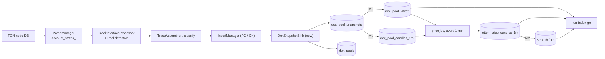

# Цены jetton'ов по DEX-пулам: план MVP

Статус: предварительное исследование, код не писался. Термины — в [`CONTEXT.md`](../../CONTEXT.md), решения — в [`docs/adr/`](../adr/).

## 1. Цель и границы

Отдавать через API текущую цену и историю цен (свечи) любого jetton'а, торгуемого на DEX, сразу в двух котировках: TON и USDT.

**В MVP входит:**

- DEX: STON.fi v1, STON.fi v2, DeDust v1, DeDust v2.
- Curves:
  - volatile — все четыре DEX;
  - stable — STON.fi v2 `stableswap` и DeDust v1 stable;
  - weighted — STON.fi v2 `weighted_const_product`.
- Live-индексация Pool snapshots в ClickHouse.
- Агрегация в Price и Candles 1m / 5m / 1h / 1d.
- Два эндпоинта в `ton-index-go`.
- Бэкфилл за 30 дней и сверка с ton-etl.

**Не входит (фаза 2):**

- Полная история с 2022-11.
- Объём торгов. Задел под него закладывается сразу (§4.2).
- STON.fi v2 `weighted_stableswap` и `constant_sum`.
- Tonco, Coffee и остальные DEX.
- Фильтр выбросов.
- Стриминг цен.

## 2. Решения (сводка)

| # | Решение | ADR |
|---|---|---|
| 1 | Price — Spot price из Reserves, среднее по Eligible pools с весом по ликвидности | [0001](../adr/0001-spot-price-from-reserves.md) |
| 2 | Цена в USDT = цена в TON × цена TON в USDT. Цену TON в USDT задают 3 Anchor pools | [0001](../adr/0001-spot-price-from-reserves.md), [0002](../adr/0002-anchor-pools-for-ton-usdt.md) |
| 3 | Свой пайплайн; ton-etl используем как справочник и эталон | [0003](../adr/0003-own-pipeline-not-ton-etl.md) |
| 4 | Pool snapshot — состояние на конец мастерчейн-блока; источник резервов заменяемый | [0004](../adr/0004-pool-snapshot-per-block.md) |
| 5 | Spot price пула считает worker, агрегацию делает ClickHouse | [0005](../adr/0005-spot-in-worker-aggregation-in-clickhouse.md) |
| 6 | Sink в `index-engine`, общий для live и бэкфилла | [0006](../adr/0006-clickhouse-sink-in-index-engine.md) |
| 7 | Пул распознаётся по белому списку code hash и проверке роутера или фабрики | [0007](../adr/0007-pool-recognition.md) |
| 8 | `ton-index-go` читает ClickHouse напрямую | [0008](../adr/0008-api-reads-clickhouse.md) |

## 3. Поток данных



Один и тот же пайплайн работает в двух режимах:

- **Live:** `ton-index-postgres` (leader) → sink → ClickHouse.
- **Бэкфилл:** `ton-index-clickhouse --from/--to` на архивной ноде → тот же sink.

Оба бинарника используют общий `IndexScheduler`. Поэтому детекция интерфейсов (`IndexScheduler::seqno_parsed` → `BlockInterfaceProcessor`) работает в обоих.

## 4. Изменения в worker'е (C++)

### 4.1 Детекторы пулов

Точка расширения — `tondb-scanner/src/smc-interfaces/`, по образцу `DedustPoolDetector` (`Tokens.h:162`, `Tokens.cpp:573-768`). Детекторы вызываются в `BlockInterfaceProcessor` (`index-engine/src/BlockInterfacesDetector.cpp`) для последнего за мастерчейн-блок состояния каждого изменившегося аккаунта.

| Детектор | Code hash gate | Как читать состояние | Как проверять подлинность |
|---|---|---|---|
| `StonfiV1PoolDetector` (новый) | хэши кода STON.fi v1 pool | `get_pool_data`: [0] reserve0, [1] reserve1, [2] token0_wallet, [3] token1_wallet, [4] lp_fee, [5] protocol_fee, [6] ref_fee | router из данных пула = официальный v1 router, и `router.get_pool_address(w0, w1) == pool` |
| `StonfiV2PoolDetector` (новый) | хэши кода STON.fi v2 pool (по типам) | `get_pool_type` плюс `get_pool_data`: [3] reserve0, [4] reserve1, [5] и [6] кошельки токенов, [7] lp_fee, [8] protocol_fee; [12] amp для stableswap или w0 для weighted | code hash роутера в белом списке v2 routers, и `get_pool_address` сходится |
| `DedustPoolDetector` (есть) | V1: `Tokens.cpp:573-577`, V2: `Tokens.cpp:579-582` | V1: `get_reserves`, `get_assets`, `is_stable`, `get_trade_fee`. V2: `get_pool_data` [9] reserveX, [10] reserveY | V1 — проверка по фабрике уже есть (`Tokens.cpp:584`). V2 — доделать аналогичную |

Доработки существующего кода:

- `InsertManagerPostgres.cpp:2483` всегда пишет `dex = "dedust"` — нужно различать `dedust_v1` и `dedust_v2`.
- Enum `dex_type` в Postgres содержит только `dedust` (`migrate.cpp:84-85`). Для MVP Postgres не нужен, но enum стоит расширить, чтобы не было рассинхрона.

Результат детектора — новая структура `schema::DexPoolState`. Она добавляется в variant `BlockchainInterfaceV2` (`IndexData.h:816-828`) и в `process_address_interfaces`. `DedustPoolData` приводится к той же структуре.

```text
DexPoolState {
  pool, dex (stonfi_v1 | stonfi_v2 | dedust_v1 | dedust_v2),
  curve (volatile | stable | weighted), curve_variant (cp | curve_stableswap | solidly | weighted_cp),
  asset0, asset1          // адреса мастеров; TON = пустое значение
  reserve0, reserve1      // raw, coins (≤ 2^120)
  amp, weight0            // параметры кривой, если есть
  lp_fee, protocol_fee    // в долях
  last_transaction_lt, code_hash, data_hash
}
```

**Сопоставление кошелёк → мастер для STON.fi.** Пулы STON.fi хранят адреса jetton-кошельков роутера, а не мастеров. Поэтому:

1. Вызвать `get_wallet_data` у аккаунта кошелька. Состояние берётся через `lookup_account(shard_states, addr)` (`FetchAccountFromShard.h:14`).
2. Закешировать пару кошелёк → мастер в памяти. Эта пара неизменна.
3. Если мастер — одна из обёрток pTON (`DexPton.cpp:10-13`), актив считается TON.

**Нагрузка.** Детекторы уже гоняют get-методы для каждого изменившегося аккаунта с кодом. Пулов, которые меняются за день, около 1–1,4 тыс., это ~35 тыс. снапшотов в день, то есть единицы вызовов TVM на блок. Добавка ничтожна.

### 4.2 Сборка Pool snapshot

Отдельный шаг после детекции, `DexSnapshotBuilder` в `index-engine`. Для каждого `DexPoolState` в `ParsedBlock` он:

1. Считает `spot_price` по формулам §5 в `long double`.
2. Считает по транзакциям этого аккаунта в блоке `tx_count` и `op_flags` — битовую маску по опкодам входящих сообщений: 1 = swap, 2 = deposit, 4 = withdraw, 8 = прочее. Это задел под объём торгов.
3. Проставляет `mc_seqno` и `block_utime` мастерчейн-блока.

### 4.3 DexSnapshotSink

- Новый актор в `index-engine`, использует клиент `clickhouse-cpp` (уже подключён, `ton-index-worker/CMakeLists.txt:61`).
- `IndexScheduler` получает необязательный `ActorId<DexSnapshotSink>`. Отправка идёт после успешной вставки мастерчейн-блока (`IndexScheduler.cpp:831` → `seqno_inserted`). Прогресс индексации от CH-sink'а не зависит.
- Вставка идёт батчами по времени или по числу строк. Повтор безопасен: таблицы `ReplacingMergeTree`, ключ `(pool, mc_seqno)`.
- В live пишет только leader. Standby отбрасывает строки; даже при двойной записи дубликатов не будет.
- Флаги запуска: `--dex-prices-clickhouse-{host,port,db,user,password}` и `--dex-prices-enabled`. Их получают оба бинарника.
- Отставание sink'а (`mc_seqno` последней вставки и глубина очереди) экспортируется в существующие OTel-метрики.

### 4.4 Где менять код (сводно)

- `tondb-scanner/src/smc-interfaces/`:
  - новые детекторы STON.fi;
  - `DexPoolState`;
  - `CMakeLists.txt:16-26`.
- `tondb-scanner/src/IndexData.h`: схема и variant.
- `index-engine/src/BlockInterfacesDetector.{h,cpp}`: регистрация детекторов и конвертация.
- `index-engine/src/`: новые `PoolMath.{h,cpp}`, `DexSnapshotBuilder`, `DexSnapshotSink`.
- `index-engine/src/IndexScheduler.{h,cpp}`: вызов sink'а.
- `ton-index-postgres/src/main.cpp`, `ton-index-clickhouse/src/main.cpp`: флаги и создание sink'а.
- По желанию: `ton-smc-scanner` (снимок текущего состояния пулов при старте с нуля) и `ton-trace-emulator` — не для MVP.

## 5. Формулы Spot price

Обозначения: x = reserve0, y = reserve1 в raw-единицах; p — цена одной raw-единицы asset0 в raw-единицах asset1 (dy/dx). Во всех четырёх DEX комиссии, уходящие из пула, в резервы не входят, поэтому p — средняя цена без комиссии.

| Curve | Где | p |
|---|---|---|
| Constant product | STON.fi v1/v2 CP, DeDust v1 volatile, DeDust v2 | `y / x` |
| Solidly `x³y + xy³ = k` | DeDust v1 stable | `y(3x² + y²) / (x(x² + 3y²))` |
| Curve StableSwap (n=2) | STON.fi v2 `stableswap` | `y(4·amp·x²y + D³) / (x(4·amp·xy² + D³))`; D — итерации Ньютона по `amp(x+y) + D = amp·D + D³/(4xy)` |
| Weighted CP | STON.fi v2 `weighted_const_product` | `w0·y / ((1−w0)·x)` |

- Точности `long double` достаточно: D³ ~ 1e60 умещается в диапазон, итерации Ньютона сходятся за 5–10 шагов.
- Хранится `Float64`.
- В тестах результат сверяется с `estimate_swap_out` / `get_expected_outputs` при малой сумме.
- **Риск:** для DeDust v1 stable не подтверждено, нормализует ли контракт резервы по decimals. У основных stable-пар decimals совпадают, но это нужно откалибровать по `estimate_swap_out` (§11).

## 6. ClickHouse

### 6.1 Таблицы

```sql
-- Справочник пулов: один раз при распознавании, обновляется при смене параметров
CREATE TABLE dex_pools (
    pool            String,
    dex             Enum8('stonfi_v1'=1,'stonfi_v2'=2,'dedust_v1'=3,'dedust_v2'=4),
    curve           Enum8('volatile'=1,'stable'=2,'weighted'=3),
    curve_variant   LowCardinality(String),
    asset0          String,          -- '' = TON
    asset1          String,
    code_hash       String,
    first_mc_seqno  UInt32,
    updated_mc_seqno UInt32
) ENGINE = ReplacingMergeTree(updated_mc_seqno)
ORDER BY pool;

-- Сырые снапшоты: одна строка на (пул, мастерчейн-блок), где пул менялся
CREATE TABLE dex_pool_snapshots (
    pool          String CODEC(ZSTD(3)),
    mc_seqno      UInt32 CODEC(Delta, ZSTD(3)),
    block_utime   DateTime CODEC(Delta, ZSTD(3)),
    last_tx_lt    UInt64 CODEC(Delta, ZSTD(3)),
    reserve0      UInt128,
    reserve1      UInt128,
    spot_price    Float64,           -- raw asset0 в raw asset1
    amp           UInt64 DEFAULT 0,
    weight0       Float64 DEFAULT 0,
    lp_fee        Float32,
    protocol_fee  Float32,
    tx_count      UInt16,
    op_flags      UInt8              -- 1 swap, 2 deposit, 4 withdraw, 8 other
) ENGINE = ReplacingMergeTree
PARTITION BY toYYYYMM(block_utime)
ORDER BY (pool, mc_seqno);

-- Последнее состояние каждого пула (из MV); читается с FINAL, объём ~80k строк
CREATE TABLE dex_pool_latest (... те же колонки ...)
ENGINE = ReplacingMergeTree(mc_seqno) ORDER BY pool;

-- Свечи пула за минуту (из MV)
CREATE TABLE dex_pool_candles_1m (
    pool      String,
    minute    DateTime,
    open      AggregateFunction(argMin, Float64, UInt32),
    high      AggregateFunction(max, Float64),
    low       AggregateFunction(min, Float64),
    close     AggregateFunction(argMax, Float64, UInt32),
    reserve0  AggregateFunction(argMax, UInt128, UInt32),
    reserve1  AggregateFunction(argMax, UInt128, UInt32),
    snapshots AggregateFunction(count),
    op_flags  AggregateFunction(groupBitOr, UInt8)
) ENGINE = AggregatingMergeTree
PARTITION BY toYYYYMM(minute)
ORDER BY (pool, minute);

-- Candles по jetton'у: пишет периодическая задача (§6.2); старшие интервалы — через MV
CREATE TABLE jetton_price_candles_1m (
    jetton         String,           -- '' = TON (цена в USDT)
    minute         DateTime,
    open_ton  Float64, high_ton  Float64, low_ton  Float64, close_ton  Float64,
    open_usdt Float64, high_usdt Float64, low_usdt Float64, close_usdt Float64,
    liquidity_ton  Float64,
    pools          UInt16,
    hops           UInt8             -- 1 = прямой пул с TON/USDT, 2 = через промежуточный актив
) ENGINE = ReplacingMergeTree
PARTITION BY toYYYYMM(minute)
ORDER BY (jetton, minute);
-- jetton_price_candles_{5m,1h,1d}: AggregatingMergeTree, MV из 1m
-- (argMin(open), max(high), min(low), argMax(close))
```

### 6.2 Алгоритм агрегации

Считается для момента T по последнему состоянию каждого пула на T:

1. **TON/USDT.** Eligible Anchor pools: снапшот не старше 7 дней, ликвидность выше порога. Цена TON в USDT — их p, взвешенные по `2 × reserve_TON`.
2. **Проход 1.** Пулы, где второй актив — TON или USDT. Цена стороны USDT переводится в TON через шаг 1. Вес — `2 × стоимость известной стороны в TON`. Отбор: Eligible pool, порог ликвидности ≈ $1k в пересчёте на TON. Цена jetton'а в TON — средневзвешенная.
3. **Проход 2.** Пулы J–K, где K получил цену в проходе 1, а J — нет. `p_J = spot(J в K) × p_K`, вес `2 × reserve_K × p_K`. Помечается `hops = 2`.
4. **USDT.** `price_usdt = price_ton × цена TON в USDT`.

Порог, окно 7 дней, веса, список якорей и правило конвертации живут в одном SQL-запросе и в таблице конфига `dex_price_config`. Их можно поменять и пересчитать историю без переиндексации (ADR-0005).

**Задача раз в минуту.** Она применяет алгоритм к закрытой минуте:

- **close:** по состоянию пулов на конец минуты;
- **open:** close предыдущей минуты;
- **high / low:** средневзвешенные high/low пулов за минуту — приближение. Для jetton'а с одним доминирующим пулом оно точное.

Реализация зависит от версии ClickHouse (§11):

- если ClickHouse ≥ 24.10 — refreshable materialized view `REFRESH EVERY 1 MINUTE APPEND`;
- иначе — cron-задача (`clickhouse-client` или небольшой Go-джоб), выполняющая тот же `INSERT … SELECT`.

**Текущая цена.** Считается при запросе тем же алгоритмом по `dex_pool_latest FINAL` (≤ ~4,4 тыс. активных пулов). Свежесть — секунды, в ритме индексации.

### 6.3 Объём данных

Оценка по датасету ton-etl (всё до 2026-09-24): ~100 Б на строку снапшота и ~50 Б на строку свечи после сжатия.

| Таблица | Сейчас, строк в день | Пиковый день | Вся история (с 2022-11) | Размер истории |
|---|---|---|---|---|
| `dex_pool_snapshots` | ~35 тыс. | ~350 тыс. | ~55–60 млн | ~6 ГБ |
| `dex_pool_candles_1m` | ~17 тыс. | — | ~37 млн | ~2 ГБ |
| Candles 5m / 1h / 1d (пулы) | ~17 тыс. суммарно | — | ~36 млн | ~1,8 ГБ |
| `jetton_price_candles_*` | ~ того же порядка, что свечи пулов | — | — | ~2–3 ГБ |
| **Итого** | **~7–10 МБ в день** | | | **~12–13 ГБ** |

- Прирост около 4 ГБ в год. Даже при нагрузке в 10 раз выше пика 2024 года это меньше 100 ГБ в год — хватает одного узла ClickHouse, TTL не нужен.
- Свечи храним только для непустых интервалов. Заполнение пропусков «на весь интервал» раздуло бы объём в 100–400 раз, поэтому пропуски заполняются при чтении.
- **Нагрузка на worker:** около 1–1,4 тыс. изменившихся пулов в день и единицы вызовов TVM на блок.

## 7. API (`ton-index-go`)

Новые маршруты рядом с `/api/v3/jetton/*` (`main.go:2916`) и клиент `clickhouse-go` с отдельным конфигом.

**`GET /api/v3/jetton/prices?address=A&address=B`**

```json
{
  "ton_usdt": "3.412",
  "prices": [{
    "jetton": "0:…", "price_ton": "0.0123", "price_usdt": "0.0419",
    "liquidity_ton": "152000", "pools": 3, "hops": 1, "updated_utime": 1790000000
  }]
}
```

**`GET /api/v3/jetton/candles?address=A&interval=1m|5m|1h|1d&quote=ton|usdt&start_utime=&end_utime=&limit=`**

- Отдаёт `[{t, open, high, low, close}]`. Пропуски заполняются предыдущим close.
- Decimals применяются здесь: `price = raw × 10^(dec_jetton − dec_quote)`. Для TON и USDT decimals известны (9 и 6); для jetton'а берутся из метаданных, а если их нет — 9 (TEP-64).
- Для `address = TON` отдаётся цена TON в USDT.

## 8. Бэкфилл

- **MVP:** 30 дней. `ton-index-clickhouse --from <seqno> --to <seqno>` с включённым sink'ом на машине с архивной нодой. Можно параллелить непересекающимися диапазонами.
- **Порядок:**
  1. Снапшоты.
  2. Materialized views построят свечи пулов.
  3. Задача агрегации пересчитает `jetton_price_candles_1m` за диапазон (режим «пересчитать с…до»).
- **Фаза 2 — полная история с 2022-11:** ~57 млн сделок, ~60 млн снапшотов. Якоря включаются по мере появления (STON.fi v2 — с 2024-09).

## 9. Тестирование без ноды

1. **Разбор состояния пулов (юнит-тесты C++).** Нужны реальные `code` / `data` пулов каждого типа и результаты `get_pool_data`. Для этого новая версия `indexer/tests/utils/api_fixture.py`, условно `pool_fixture.py`, будет выгружать через toncenter состояние пула на момент транзакции. Запускает её пользователь: из облачной сессии toncenter.com заблокирован сетевой политикой. В репо уже есть ~96 DEX-трейсов (`indexer/tests/traces/*.lz4`), для части аккаунтов в них сохранён `data_boc`.
2. **PoolMath.**
   - Эталонные значения из `estimate_swap_out` / `get_expected_outputs` на тех же состояниях.
   - Для DeDust v1 и v2 — сверка с резервами из событий swap (0x9c610de3, `nextState`) в существующих фикстурах: их семантику агент проверил на всех фикстурных свопах.
3. **Агрегация (SQL).** Синтетический набор снапшотов, golden-результаты по ценам и свечам, запуск на локальном ClickHouse в CI (docker).
4. **Сверка бэкфилла с ton-etl.**
   - Резервы на конец дня по каждому пулу должны совпасть точно.
   - Цены — в пределах допуска.
   - Сырые выгрузки ton-etl уже скачаны в scratchpad сессии; при необходимости их можно выгрузить заново с `s3://aws-public-blockchain/v1.1/ton/`.

## 10. Этапы и оценка

Оценка в человеко-днях для одного разработчика, знакомого с кодом worker'а.

| Этап | Содержание | Дни |
|---|---|---|
| M0 | Скрипт фикстур пулов, сбор состояний по всем типам | 2 |
| M1 | Детекторы STON.fi v1/v2, доработка DeDust, проверка подлинности, кошелёк → мастер | 6 |
| M2 | PoolMath и юнит-тесты, калибровка DeDust stable | 3 |
| M3 | DDL, DexSnapshotBuilder и Sink, флаги в обоих бинарниках | 4 |
| M4 | MV, задача агрегации, свечи, конфиг якорей | 4 |
| M5 | API: два эндпоинта, клиент ClickHouse, decimals, тесты | 3 |
| M6 | Бэкфилл 30 дней, сверка с ton-etl, исправления | 3 |
| M7 | Деплой (ansible), метрики и алерты отставания | 2 |
| | **Итого** | **~27 (≈ 5–6 недель)** |

## 11. Риски и открытые вопросы

| Риск | Как снимаем |
|---|---|
| Версия ClickHouse в проде неизвестна; refreshable MV требуют ≥ 24.10 | Проверить на этапе M3; запасной вариант — cron-задача |
| DeDust v1 stable: не подтверждена нормализация по decimals | Калибровка по `estimate_swap_out` в M2 |
| Расположение данных STON.fi v2 stableswap/weighted проверено только по исходникам | Читаем через `get_pool_data` (не data cell); фикстуры в M0 |
| Мастер pTON `EQBwGRAM…` из `DexPton.cpp:13` не идентифицирован | Проверить в M1; если это pTON — тоже TON |
| Манипуляция ценой тонкого пула | Порог ликвидности плюс вес по TVL; фильтр выбросов — фаза 2 |
| High/low свечи jetton'а — приближение при нескольких пулах | Задокументировано; точный вариант — пересчёт цены на каждый снапшот (фаза 2) |
| USDT отвязался от доллара | Котировка по определению в USDT, не в USD (ADR-0002) |
| Ликвидность уходит из якорей | Список якорей в конфиге; метрика «доля якорей, прошедших отбор» с алертом |
