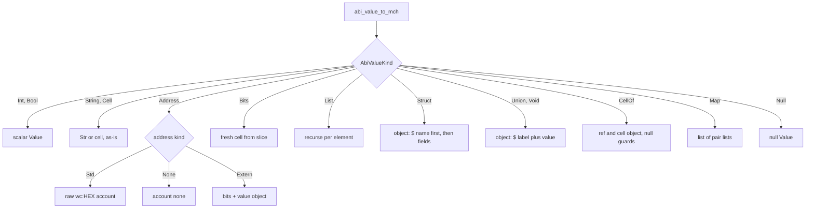

# AbiBridge

AbiBridge is the seam between the ton-abi generated code and the engine's Value universe: it adapts decoded ABI values into classifier-consumable form and registers the production ABI parser rows that merge into message_parsers. abi_value_to_mch is total — every AbiValueKind maps onto an existing Value type following the generated dump conventions, never erroring — while the LayerZero adapters additionally re-decode nested cells so the unconsumed remainder surfaces as the classifier's s field. Rows are compile-time static pairs of bare declaration names to template instantiations; no ABI model is loaded at runtime, and the row list is a function-local static built once and immutable afterwards. Parsing entry points return clean errors for null or exotic body cells rather than aborting, and a few parsers reshape generated values into the public field shapes: flattened vesting whitelists, dual-prefix jetton internal transfers, the legacy minter mint layout.

## residual_after_decode

`td::Result<Value> residual_after_decode()`

- decl: `ton-index-worker/ton-mch-engine/src/AbiBridge.cpp:105`
- callers: none found in parsed TU set
- calls: `mch::remaining_slice_cell`

Declaration surface of the template; the callable form takes the nested cell to re-decode.

## residual_after_decode

`td::Result<Value> residual_after_decode(const td::Ref<vm::Cell> & cell)`

- decl: `ton-index-worker/ton-mch-engine/src/AbiBridge.cpp:105`
- callers: mch::adapt_lz_path (ton-index-worker/ton-mch-engine/src/AbiBridge.cpp:131)

Re-decodes a nested cell and captures what the decoder left unconsumed as a residual cell Value.

Loads a fresh plain slice, runs from_slice for T discarding the decoded value, then materializes the remaining bits through remaining_slice_cell — that remainder becomes the classifier's s field. A null cell is an immediate error, and a decode failure propagates unchanged from from_slice. The LayerZero adapters call it after require_cell_of has validated the wrapper.

## abi_int_value

`Value abi_int_value()`

- decl: `ton-index-worker/ton-mch-engine/src/AbiBridge.cpp:116`
- callers: none found in parsed TU set

Declaration surface of the template; the callable forms take the integer to wrap.

## abi_int_value

`Value abi_int_value(const td::Ref<Cnt<BigInt256>> & value)`

- decl: `ton-index-worker/ton-mch-engine/src/AbiBridge.cpp:116`
- callers: mch::adapt_lz_path (ton-index-worker/ton-mch-engine/src/AbiBridge.cpp:135); mch::adapt_lz_path (ton-index-worker/ton-mch-engine/src/AbiBridge.cpp:136); mch::adapt_lz_packet (ton-index-worker/ton-mch-engine/src/AbiBridge.cpp:157); mch::adapt_lz_packet (ton-index-worker/ton-mch-engine/src/AbiBridge.cpp:158); mch::adapt_lz_send (ton-index-worker/ton-mch-engine/src/AbiBridge.cpp:176); mch::adapt_lz_send (ton-index-worker/ton-mch-engine/src/AbiBridge.cpp:177); mch::adapt_lz_send (ton-index-worker/ton-mch-engine/src/AbiBridge.cpp:178); mch::adapt_lz_send (ton-index-worker/ton-mch-engine/src/AbiBridge.cpp:185); mch::adapt_lz_send (ton-index-worker/ton-mch-engine/src/AbiBridge.cpp:186); mch::adapt_lz_send (ton-index-worker/ton-mch-engine/src/AbiBridge.cpp:187); mch::abi_parse_uln_connection_verify_callback (ton-index-worker/ton-mch-engine/src/AbiBridge.cpp:369)

Wraps a decoded big integer into the Value shape of an ABI int field.

Boxes the value through the generated abi_v_int constructor and projects it with abi_value_to_mch, so the result is indistinguishable from a decoded int field. Total and allocation-only; the LayerZero adapters use it for every numeric field.

## abi_int_value

`Value abi_int_value(const unsigned long & value)`

- decl: `ton-index-worker/ton-mch-engine/src/AbiBridge.cpp:116`
- callers: mch::adapt_lz_path (ton-index-worker/ton-mch-engine/src/AbiBridge.cpp:137); mch::adapt_lz_path (ton-index-worker/ton-mch-engine/src/AbiBridge.cpp:139); mch::adapt_lz_packet (ton-index-worker/ton-mch-engine/src/AbiBridge.cpp:161); mch::adapt_lz_send (ton-index-worker/ton-mch-engine/src/AbiBridge.cpp:179); mch::abi_parse_layerzero_channel_send_callback (ton-index-worker/ton-mch-engine/src/AbiBridge.cpp:334); mch::abi_parse_uln_connection_verify_callback (ton-index-worker/ton-mch-engine/src/AbiBridge.cpp:368)

Wraps a small integer into the Value shape of an ABI int field.

Same projection as the big-integer form, with the value boxed into a refint first. Used for fixed opcode constants and small decoded integers.

## require_cell_of

`td::Status require_cell_of()`

- decl: `ton-index-worker/ton-mch-engine/src/AbiBridge.cpp:121`
- callers: none found in parsed TU set

Declaration surface of the template; the callable overloads take a CellOf wrapper and a field name.

## require_cell_of

`td::Status require_cell_of(const ton_abi::gen::CellOf<LzPath> & value, const char * field)`

- decl: `ton-index-worker/ton-mch-engine/src/AbiBridge.cpp:121`
- callers: mch::adapt_lz_path (ton-index-worker/ton-mch-engine/src/AbiBridge.cpp:129)

Checks that a decoded CellOf wrapper carries both its cell and its decoded reference.

Returns an error naming the field when the stored cell is null or the decoded ref is absent, OK otherwise. Pure validation over the wrapper; the adapters run it before dereferencing the ref so a malformed decode cannot crash the projection.

## require_cell_of

`td::Status require_cell_of(const ton_abi::gen::CellOf<LzPacket> & value, const char * field)`

- decl: `ton-index-worker/ton-mch-engine/src/AbiBridge.cpp:121`
- callers: mch::adapt_lz_packet (ton-index-worker/ton-mch-engine/src/AbiBridge.cpp:145)

Checks that a decoded CellOf wrapper carries both its cell and its decoded reference.

Returns an error naming the field when the stored cell is null or the decoded ref is absent, OK otherwise. Pure validation over the wrapper; the adapters run it before dereferencing the ref so a malformed decode cannot crash the projection.

## require_cell_of

`td::Status require_cell_of(const ton_abi::gen::CellOf<LzMdLzSend> & value, const char * field)`

- decl: `ton-index-worker/ton-mch-engine/src/AbiBridge.cpp:121`
- callers: mch::adapt_lz_send (ton-index-worker/ton-mch-engine/src/AbiBridge.cpp:167)

Checks that a decoded CellOf wrapper carries both its cell and its decoded reference.

Returns an error naming the field when the stored cell is null or the decoded ref is absent, OK otherwise. Pure validation over the wrapper; the adapters run it before dereferencing the ref so a malformed decode cannot crash the projection.

## require_cell_of

`td::Status require_cell_of(const ton_abi::gen::CellOf<LzMdLzSendRef> & value, const char * field)`

- decl: `ton-index-worker/ton-mch-engine/src/AbiBridge.cpp:121`
- callers: mch::adapt_lz_send (ton-index-worker/ton-mch-engine/src/AbiBridge.cpp:170)

Checks that a decoded CellOf wrapper carries both its cell and its decoded reference.

Returns an error naming the field when the stored cell is null or the decoded ref is absent, OK otherwise. Pure validation over the wrapper; the adapters run it before dereferencing the ref so a malformed decode cannot crash the projection.

## require_cell_of

`td::Status require_cell_of(const ton_abi::gen::CellOf<LzOappExecutePacketRef> & value, const char * field)`

- decl: `ton-index-worker/ton-mch-engine/src/AbiBridge.cpp:121`
- callers: mch::abi_parse_layerzero_oapp_execute_callback (ton-index-worker/ton-mch-engine/src/AbiBridge.cpp:311)

Checks that a decoded CellOf wrapper carries both its cell and its decoded reference.

Returns an error naming the field when the stored cell is null or the decoded ref is absent, OK otherwise. Pure validation over the wrapper; the adapters run it before dereferencing the ref so a malformed decode cannot crash the projection.

## require_cell_of

`td::Status require_cell_of(const ton_abi::gen::CellOf<LzChannelSendCallbackRef1> & value, const char * field)`

- decl: `ton-index-worker/ton-mch-engine/src/AbiBridge.cpp:121`
- callers: mch::abi_parse_layerzero_channel_send_callback (ton-index-worker/ton-mch-engine/src/AbiBridge.cpp:322)

Checks that a decoded CellOf wrapper carries both its cell and its decoded reference.

Returns an error naming the field when the stored cell is null or the decoded ref is absent, OK otherwise. Pure validation over the wrapper; the adapters run it before dereferencing the ref so a malformed decode cannot crash the projection.

## require_cell_of

`td::Status require_cell_of(const ton_abi::gen::CellOf<LzChannelSendCallbackRef2> & value, const char * field)`

- decl: `ton-index-worker/ton-mch-engine/src/AbiBridge.cpp:121`
- callers: mch::abi_parse_layerzero_channel_send_callback (ton-index-worker/ton-mch-engine/src/AbiBridge.cpp:323)

Checks that a decoded CellOf wrapper carries both its cell and its decoded reference.

Returns an error naming the field when the stored cell is null or the decoded ref is absent, OK otherwise. Pure validation over the wrapper; the adapters run it before dereferencing the ref so a malformed decode cannot crash the projection.

## require_cell_of

`td::Status require_cell_of(const ton_abi::gen::CellOf<LzExtendedMd> & value, const char * field)`

- decl: `ton-index-worker/ton-mch-engine/src/AbiBridge.cpp:121`
- callers: mch::abi_parse_layerzero_channel_commit_packet (ton-index-worker/ton-mch-engine/src/AbiBridge.cpp:342)

Checks that a decoded CellOf wrapper carries both its cell and its decoded reference.

Returns an error naming the field when the stored cell is null or the decoded ref is absent, OK otherwise. Pure validation over the wrapper; the adapters run it before dereferencing the ref so a malformed decode cannot crash the projection.

## require_cell_of

`td::Status require_cell_of(const ton_abi::gen::CellOf<UlnMdObj> & value, const char * field)`

- decl: `ton-index-worker/ton-mch-engine/src/AbiBridge.cpp:121`
- callers: mch::abi_parse_uln_connection_verify_callback (ton-index-worker/ton-mch-engine/src/AbiBridge.cpp:355)

Checks that a decoded CellOf wrapper carries both its cell and its decoded reference.

Returns an error naming the field when the stored cell is null or the decoded ref is absent, OK otherwise. Pure validation over the wrapper; the adapters run it before dereferencing the ref so a malformed decode cannot crash the projection.

## require_cell_of

`td::Status require_cell_of(const ton_abi::gen::CellOf<UlnVerificationStatus> & value, const char * field)`

- decl: `ton-index-worker/ton-mch-engine/src/AbiBridge.cpp:121`
- callers: mch::abi_parse_uln_connection_verify_callback (ton-index-worker/ton-mch-engine/src/AbiBridge.cpp:357)

Checks that a decoded CellOf wrapper carries both its cell and its decoded reference.

Returns an error naming the field when the stored cell is null or the decoded ref is absent, OK otherwise. Pure validation over the wrapper; the adapters run it before dereferencing the ref so a malformed decode cannot crash the projection.

## adapt_lz_path

`td::Result<Value> adapt_lz_path(const ton_abi::gen::CellOf<layerzero::LzPath> & wrapped)`

- decl: `ton-index-worker/ton-mch-engine/src/AbiBridge.cpp:128`
- callers: mch::adapt_lz_packet (ton-index-worker/ton-mch-engine/src/AbiBridge.cpp:147)
- calls: `mch::Value::make_cell`, `mch::Value::make_obj`, `mch::abi_int_value`, `mch::minimal_hex`, `mch::require_cell_of`, `mch::residual_after_decode`

Projects a decoded LayerZero path into the classifier's object shape.

Requires the wrapper's cell and ref, then re-decodes the cell to capture the unconsumed residual as s while exposing the original cell under b. Header info, filler and both endpoint ids go through abi_int_value; the source and destination oapp addresses render as minimal hex. Every error comes from the require or residual steps — the projection itself cannot fail.

## adapt_lz_packet

`td::Result<Value> adapt_lz_packet(const ton_abi::gen::CellOf<layerzero::LzPacket> & wrapped)`

- decl: `ton-index-worker/ton-mch-engine/src/AbiBridge.cpp:144`
- callers: mch::adapt_lz_send (ton-index-worker/ton-mch-engine/src/AbiBridge.cpp:169); mch::abi_parse_layerzero_oapp_execute_callback (ton-index-worker/ton-mch-engine/src/AbiBridge.cpp:312); mch::abi_parse_layerzero_channel_commit_packet (ton-index-worker/ton-mch-engine/src/AbiBridge.cpp:344)
- calls: `mch::Value::make_cell`, `mch::Value::make_obj`, `mch::abi_int_value`, `mch::adapt_lz_path`, `mch::minimal_hex`, `mch::require_cell_of`, `mch::residual_after_decode`, `mch::root_bits_hex`

Projects a decoded LayerZero packet, nesting its adapted path and hex-encoding the message.

Adapts the nested path via adapt_lz_path and rejects a null message cell outright; the message is exposed as the hex of the root cell's data bits rather than as a cell. Adds the packet's own residual after re-decode plus header fields, nonce and guid, the guid in minimal hex. Errors short-circuit from the nested require, the path adaptation or the residual capture.

## adapt_lz_send

`td::Result<Value> adapt_lz_send(const ton_abi::gen::CellOf<layerzero::LzMdLzSend> & wrapped)`

- decl: `ton-index-worker/ton-mch-engine/src/AbiBridge.cpp:166`
- callers: mch::abi_parse_layerzero_channel_send_callback (ton-index-worker/ton-mch-engine/src/AbiBridge.cpp:324)
- calls: `mch::Value::make_cell`, `mch::Value::make_obj`, `mch::abi_int_value`, `mch::adapt_lz_packet`, `mch::minimal_hex`, `mch::require_cell_of`, `mch::residual_after_decode`

Projects a decoded LayerZero send request with its nested packet and fee extension.

Adapts the nested packet first, then requires the ref arm before reading the fee fields it carries, so a missing fee cell fails before any field access. Emits the original cell, the residual s, name and header fields, request id, msglib manager and library in minimal hex, the packet, extra options, the fee cell itself, and the connection, native and zro fees plus enforced options and callback data. Any nested error aborts the whole projection.

## abi_value_to_mch

`Value abi_value_to_mch(const AbiValue & v)`

- decl: `ton-index-worker/ton-mch-engine/src/AbiBridge.cpp:195`
- callers: mch::test_adapter_direct (ton-index-worker/ton-mch-engine/harness/AbiBridgeTest.cpp:375); mch::test_adapter_direct (ton-index-worker/ton-mch-engine/harness/AbiBridgeTest.cpp:378); mch::test_adapter_direct (ton-index-worker/ton-mch-engine/harness/AbiBridgeTest.cpp:381); mch::test_adapter_direct (ton-index-worker/ton-mch-engine/harness/AbiBridgeTest.cpp:386); mch::test_adapter_direct (ton-index-worker/ton-mch-engine/harness/AbiBridgeTest.cpp:394); mch::test_adapter_direct (ton-index-worker/ton-mch-engine/harness/AbiBridgeTest.cpp:399); mch::test_adapter_direct (ton-index-worker/ton-mch-engine/harness/AbiBridgeTest.cpp:403); mch::test_adapter_direct (ton-index-worker/ton-mch-engine/harness/AbiBridgeTest.cpp:408); mch::test_adapter_direct (ton-index-worker/ton-mch-engine/harness/AbiBridgeTest.cpp:418); mch::test_adapter_direct (ton-index-worker/ton-mch-engine/harness/AbiBridgeTest.cpp:425); mch::test_adapter_direct (ton-index-worker/ton-mch-engine/harness/AbiBridgeTest.cpp:432); mch::abi_value_to_mch (ton-index-worker/ton-mch-engine/src/AbiBridge.cpp:209); mch::abi_value_to_mch (ton-index-worker/ton-mch-engine/src/AbiBridge.cpp:223); mch::abi_value_to_mch (ton-index-worker/ton-mch-engine/src/AbiBridge.cpp:233); mch::abi_value_to_mch (ton-index-worker/ton-mch-engine/src/AbiBridge.cpp:243); mch::abi_value_to_mch (ton-index-worker/ton-mch-engine/src/AbiBridge.cpp:260); mch::abi_value_to_mch (ton-index-worker/ton-mch-engine/src/AbiBridge.cpp:261)
- calls: `mch::Value::make_bool`, `mch::Value::make_cell`, `mch::Value::make_int`, `mch::Value::make_list`, `mch::Value::make_obj`, `mch::Value::make_str`, `mch::Value::null`, `mch::abi_value_to_mch`, `mch::adapt_address`, `mch::cell_from_slice`

Adapts any decoded ABI value into the engine's Value universe; total, never errors.

Follows the generated dump conventions rather than the PSlice extern-string universe. Scalars, strings (raw bytes preserved — lossy utf-8 decoding is a dump-side concern) and cells map directly, addresses route through adapt_address, and bits are copied into fresh standalone cells. Structs become objects with the struct name under the dollar key first and fields in declaration order, value-carrying unions become label-plus-value objects, CellOf becomes a ref/cell pair with defensive null guards, and maps become a list of two-element lists so non-string keys survive. Lists and struct fields recurse through the same conversion.

## abi_parse_evaa_withdraw_fail_excess

`td::Result<Value> abi_parse_evaa_withdraw_fail_excess(const td::Ref<vm::Cell> & body)`

- decl: `ton-index-worker/ton-mch-engine/src/AbiBridge.cpp:272`
- callers: none found in parsed TU set
- calls: `mch::Value::make_int64`, `mch::Value::make_obj`, `mch::Value::make_str`, `mch::try_parse_first`

Parses the four Evaa withdraw fail-excess bodies into opcode-plus-reason objects.

Guards null and exotic cells, then tries the four generated excess variants in declaration order through try_parse_first, which reopens the payload for each candidate. Each accepted variant maps to a fixed opcode and reason string — locked, not collateralized, missing prices, or execution crashed. When no candidate accepts the body the result is an unknown-opcode error.

## abi_parse_layerzero_oapp_execute_callback

`td::Result<Value> abi_parse_layerzero_oapp_execute_callback(const td::Ref<vm::Cell> & body)`

- decl: `ton-index-worker/ton-mch-engine/src/AbiBridge.cpp:308`
- callers: none found in parsed TU set
- calls: `mch::Value::make_cell`, `mch::Value::make_obj`, `mch::adapt_lz_packet`, `mch::decode_abi_body`, `mch::require_cell_of`

Decodes a LayerZero Oapp execute callback into its body cell and nested adapted packet.

Runs the generated decode, requires the packet ref to be present, and reuses adapt_lz_packet for the projection. The result is an object with the original body cell and the adapted packet; a null or exotic body, a decode mismatch, a missing ref and any packet-adaptation failure all propagate as errors.

## abi_parse_layerzero_channel_send_callback

`td::Result<Value> abi_parse_layerzero_channel_send_callback(const td::Ref<vm::Cell> & body)`

- decl: `ton-index-worker/ton-mch-engine/src/AbiBridge.cpp:319`
- callers: none found in parsed TU set
- calls: `mch::Value::make_cell`, `mch::Value::make_obj`, `mch::abi_int_value`, `mch::adapt_lz_send`, `mch::decode_abi_body`, `mch::remaining_slice_cell`, `mch::require_cell_of`

Decodes a LayerZero channel send callback into opcode, residual slice and nested send request.

Decodes the generated struct and requires two chained next cells before adapting the innermost lz send value. It then re-opens the raw body, skips the 32-bit opcode — an underflow there is an error — and materializes the remaining bits as the s residual. The emitted object carries the original cell, the residual, the fixed send-callback opcode constant and the adapted lz send.

## abi_parse_layerzero_channel_commit_packet

`td::Result<Value> abi_parse_layerzero_channel_commit_packet(const td::Ref<vm::Cell> & body)`

- decl: `ton-index-worker/ton-mch-engine/src/AbiBridge.cpp:339`
- callers: none found in parsed TU set
- calls: `mch::Value::make_cell`, `mch::Value::make_obj`, `mch::adapt_lz_packet`, `mch::decode_abi_body`, `mch::require_cell_of`

Decodes a LayerZero channel commit packet into its extended-md and packet cells plus the adapted packet.

Decodes the generated struct, requires the extended-md wrapper, and adapts the packet hanging off it via adapt_lz_packet. The object exposes the extended-md cell, the packet cell and the adapted packet. Errors propagate from the decode, the require, or the nested packet adaptation.

## abi_parse_uln_connection_verify_callback

`td::Result<Value> abi_parse_uln_connection_verify_callback(const td::Ref<vm::Cell> & body)`

- decl: `ton-index-worker/ton-mch-engine/src/AbiBridge.cpp:352`
- callers: none found in parsed TU set
- calls: `mch::Value::is_null`, `mch::Value::make_cell`, `mch::Value::make_obj`, `mch::Value::make_str`, `mch::abi_int_value`, `mch::decode_abi_body`, `mch::enum_name`, `mch::require_cell_of`, `ton_abi::gen::layerzero::UlnVerificationStatusCode_name_table`

Decodes a ULN connection verify callback into its cells, nonce and a named verification status.

Requires both the md-object wrapper and the nested verification-status wrapper before reading the verification payload. The status code is looked up in the generated name table, falling back to an unknown-prefixed decimal string when the table has no entry. Returns the two cells, the nonce, the numeric code and the resolved status name.

## abi_parse_jetton_internal_transfer

`td::Result<Value> abi_parse_jetton_internal_transfer(const td::Ref<vm::Cell> & body)`

- decl: `ton-index-worker/ton-mch-engine/src/AbiBridge.cpp:377`
- callers: none found in parsed TU set
- calls: `mch::abi_parse_body`

Parses jetton internal transfers, accepting both wire prefixes.

One public parser over two honest prefixes: the standard generated form runs first and, only when it rejects specifically at its prefix check, the Ethena variant is retried on the same body. Any other standard-arm error is returned unchanged, so genuine body corruption is never masked by the fallback. Both arms use the plain abi_parse_body projection.

## abi_parse_minter_mint_legacy_shape

`td::Result<Value> abi_parse_minter_mint_legacy_shape(const td::Ref<vm::Cell> & body)`

- decl: `ton-index-worker/ton-mch-engine/src/AbiBridge.cpp:391`
- callers: none found in parsed TU set
- calls: `mch::Value::field`, `mch::Value::make_obj`, `mch::abi_parse_body`

Parses a minter mint and flattens the nested master message into the legacy public field shape.

Decodes through the plain bridge, then walks the generated object to pull query id, destination, ton amount and the master message's cell together with its inner query id and jetton amount. A missing field anywhere yields an unexpected-value-shape error rather than a null dereference. The output object matches the classifier's flat mint fields.

## flatten_vesting_whitelist_node

`td::Status flatten_vesting_whitelist_node(const Value & node, std::vector<Value> & addresses)`

- decl: `ton-index-worker/ton-mch-engine/src/AbiBridge.cpp:419`
- callers: mch::flatten_vesting_whitelist_node (ton-index-worker/ton-mch-engine/src/AbiBridge.cpp:439); mch::abi_parse_vesting_add_whitelist (ton-index-worker/ton-mch-engine/src/AbiBridge.cpp:451)
- calls: `mch::Value::field`, `mch::flatten_vesting_whitelist_node`

Recursively flattens one vesting whitelist linked-list node into the address vector.

Reads addr and next off the node object and requires next's dollar tag to be a string; a void tag terminates the walk, a Cell tag descends into the nested ref, and anything else is an unexpected-shape or unexpected-tag error. Each visited addr is appended in order, so the vector comes out head to tail. Recursion depth equals the list length — there is no cycle guard.

## abi_parse_vesting_add_whitelist

`td::Result<Value> abi_parse_vesting_add_whitelist(const td::Ref<vm::Cell> & body)`

- decl: `ton-index-worker/ton-mch-engine/src/AbiBridge.cpp:442`
- callers: none found in parsed TU set
- calls: `mch::Value::field`, `mch::Value::make_list`, `mch::Value::make_obj`, `mch::abi_parse_body`, `mch::flatten_vesting_whitelist_node`

Parses a vesting whitelist addition into a query id and a flat address list.

Decodes the generated struct, requires the query_id and head fields, then flattens the head through flatten_vesting_whitelist_node. Returns an object with the query id and the addresses list; shape problems surface as the flattener's errors.

## abi_parse_conditional_query_id

`td::Result<Value> abi_parse_conditional_query_id()`

- decl: `ton-index-worker/ton-mch-engine/src/AbiBridge.cpp:461`
- callers: none found in parsed TU set
- calls: `mch::Value::make_obj`, `mch::Value::null`

Parses opcodes that ship with and without a query id, normalizing the field to null in the latter shape.

Guards null and exotic bodies, then tries the with-query generated form on a special-loaded slice; on success the query id int is returned. Otherwise the no-query form is tried on a fresh plain slice, and only when that also rejects is an error returned, carrying the no-query arm's message. The result object always carries a query_id field, null when the body omitted it.

## cell_from_slice

`Value cell_from_slice(const td::Ref<vm::CellSlice> & slice)`

- decl: `ton-index-worker/ton-mch-engine/src/AbiBridge.cpp:50`
- callers: mch::abi_value_to_mch (ton-index-worker/ton-mch-engine/src/AbiBridge.cpp:214); mch::adapt_address (ton-index-worker/ton-mch-engine/src/AbiBridge.cpp:74)
- calls: `mch::Value::make_cell`

Copies a bit slice into a fresh, root-hash-comparable cell Value.

Uses the non-throwing append so the conversion stays total: a slice that cannot be appended, or a null slice, yields an empty cell rather than an exception. The fresh cell exists so hashes and equality behave like ordinary cells, which a bare slice cannot offer.

## adapt_address

`Value adapt_address(const ton_abi::AbiAddress & a)`

- decl: `ton-index-worker/ton-mch-engine/src/AbiBridge.cpp:58`
- callers: mch::abi_value_to_mch (ton-index-worker/ton-mch-engine/src/AbiBridge.cpp:202)
- calls: `mch::Value::make_account_none`, `mch::Value::make_account_raw`, `mch::Value::make_int`, `mch::Value::make_obj`, `mch::Value::null`, `mch::cell_from_slice`

Adapts an ABI address into the engine's account value forms.

Standard addresses become raw workchain-colon-uppercase-hex strings matching the canonical AccountId rendering; a present-but-empty addr_none becomes an account-none value rather than null; extern addresses, having no native form, become an object of the bit count plus a cell value. The trailing null return is unreachable for well-formed kinds.

## decode_abi_body

`td::Result<T> decode_abi_body()`

- decl: `ton-index-worker/ton-mch-engine/src/AbiBridge.cpp:82`
- callers: none found in parsed TU set

Declaration surface of the template; the callable overloads take the body cell to decode.

## decode_abi_body

`td::Result<LayerZeroOappExecuteCallbackAbi> decode_abi_body(const td::Ref<vm::Cell> & body)`

- decl: `ton-index-worker/ton-mch-engine/src/AbiBridge.cpp:82`
- callers: mch::abi_parse_layerzero_oapp_execute_callback (ton-index-worker/ton-mch-engine/src/AbiBridge.cpp:310)

Decodes a body cell as the Oapp execute callback struct.

Rejects a null body and exotic cells with clean errors, then hands a special-loaded slice to the generated from_slice and returns its result. Used only by the matching LayerZero callback parser.

## decode_abi_body

`td::Result<LayerzeroChannelSendCallbackAbi> decode_abi_body(const td::Ref<vm::Cell> & body)`

- decl: `ton-index-worker/ton-mch-engine/src/AbiBridge.cpp:82`
- callers: mch::abi_parse_layerzero_channel_send_callback (ton-index-worker/ton-mch-engine/src/AbiBridge.cpp:321)

Decodes a body cell as the channel send callback struct.

Rejects a null body and exotic cells with clean errors, then hands a special-loaded slice to the generated from_slice and returns its result. Used only by the matching LayerZero callback parser.

## decode_abi_body

`td::Result<ChannelCommitPacketAbi> decode_abi_body(const td::Ref<vm::Cell> & body)`

- decl: `ton-index-worker/ton-mch-engine/src/AbiBridge.cpp:82`
- callers: mch::abi_parse_layerzero_channel_commit_packet (ton-index-worker/ton-mch-engine/src/AbiBridge.cpp:341)

Decodes a body cell as the channel commit packet struct.

Rejects a null body and exotic cells with clean errors, then hands a special-loaded slice to the generated from_slice and returns its result. Used only by the matching LayerZero callback parser.

## decode_abi_body

`td::Result<UlnConnectionVerifyCallbackAbi> decode_abi_body(const td::Ref<vm::Cell> & body)`

- decl: `ton-index-worker/ton-mch-engine/src/AbiBridge.cpp:82`
- callers: mch::abi_parse_uln_connection_verify_callback (ton-index-worker/ton-mch-engine/src/AbiBridge.cpp:354)

Decodes a body cell as the ULN connection verify callback struct.

Rejects a null body and exotic cells with clean errors, then hands a special-loaded slice to the generated from_slice and returns its result. Used only by the matching LayerZero callback parser.

## remaining_slice_cell

`td::Result<Value> remaining_slice_cell(const vm::CellSlice & slice)`

- decl: `ton-index-worker/ton-mch-engine/src/AbiBridge.cpp:94`
- callers: mch::residual_after_decode (ton-index-worker/ton-mch-engine/src/AbiBridge.cpp:112); mch::abi_parse_layerzero_channel_send_callback (ton-index-worker/ton-mch-engine/src/AbiBridge.cpp:330)
- calls: `mch::Value::make_cell`

Materializes a slice's bits into a fresh cell Value.

Appends the slice into a CellBuilder and finalizes it; a failed append becomes a cannot-materialize error rather than an exception. Both the residual capture and the send callback's post-opcode remainder go through it.

## abi_parse_body

`td::Result<Value> abi_parse_body()`

- decl: `ton-index-worker/ton-mch-engine/src/AbiBridge.h:37`
- callers: none found in parsed TU set

Declaration surface of the template; the callable form takes the body cell to parse.

## abi_parse_body

`td::Result<Value> abi_parse_body(const td::Ref<vm::Cell> & body)`

- decl: `ton-index-worker/ton-mch-engine/src/AbiBridge.h:37`
- callers: mch::abi_parse_jetton_internal_transfer (ton-index-worker/ton-mch-engine/src/AbiBridge.cpp:378)

Parses a body as a generated ABI struct and projects the result into a Value.

Rejects null and exotic cells up front, decodes via from_slice, converts with to_abi_value, then projects through abi_value_to_mch. The instantiation's address matches the parser-fn signature exactly, so each generated type registers as an ordinary parser row with dispatch baked into from_slice. No ABI model is loaded or consulted at runtime.

## abi_message_parsers

`const std::vector<std::pair<std::string, MsgParserFn>> & abi_message_parsers()`

- decl: `ton-index-worker/ton-mch-engine/src/AbiBridge.h:55`
- callers: mch::test_abi_rows_dispatch (ton-index-worker/ton-mch-engine/harness/AbiBridgeTest.cpp:483); [mch::built_registry (ton-index-worker/ton-mch-engine/src/MsgParse.cpp:67)](MsgParse.md#built_registry)

Returns the static row list of ABI parser names and functions that merges into message_parsers.

Close to ninety rows keyed by bare declaration names — the identifier form the mch grammar's parse clause reads — spanning dedust, jetton, multisig, pton, dns, stonfi, coffee, evaa, layerzero, jvault, subscriptions, tonco, teleitem, nft-sale, tonstakers, vesting and cocoon declarations. Most rows are direct abi_parse_body instantiations; the rest wrap the adapters for dual-prefix or reshaped values. The rows live in a function-local static built once and immutable afterwards, and MsgParse merges them behind the handwritten parsers.

