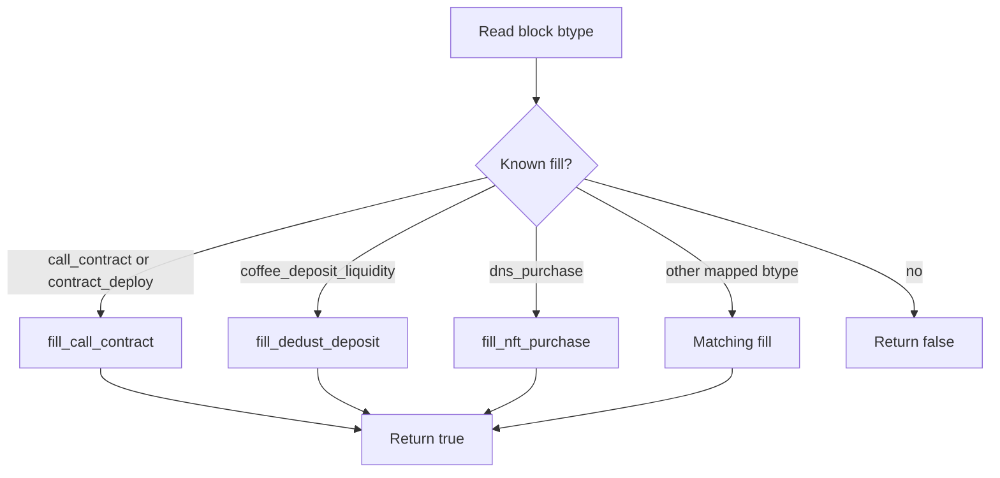
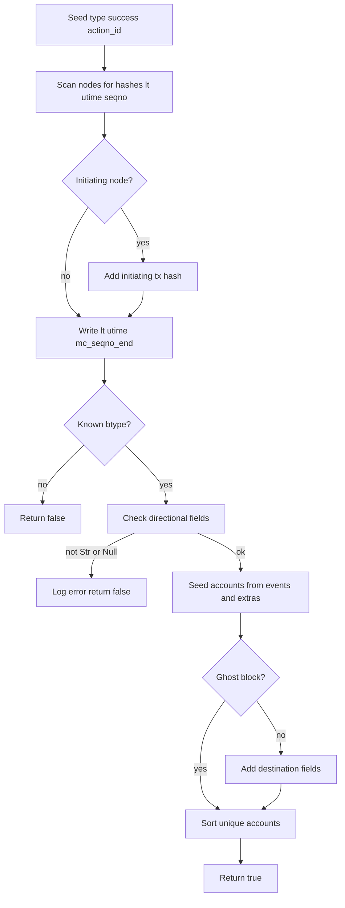
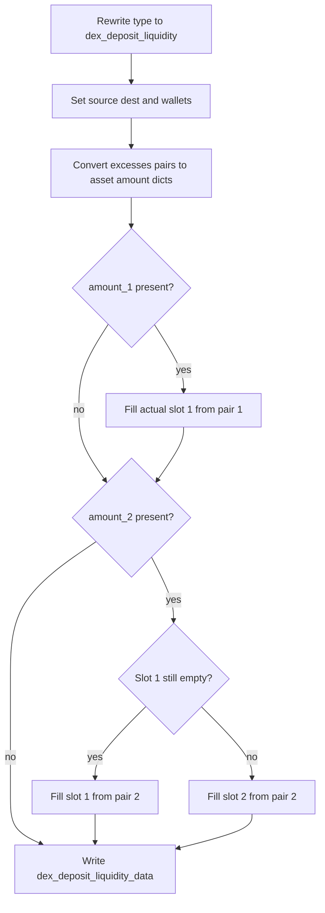

# ActionBuild

Turns classified blocks into serializable Action rows shared by the production classifier and the dump harness. classify_schema_trace walks ActionRow values from serialize_rows, calls build_action, and counts a false return as an unported btype; create_unknown_action is appended when the trace classified as unknown. Fills rewrite directional fields to Str or Null, pack type-specific composites, and sometimes overwrite type to a generic name such as stake_deposit. calc_action_id is a pure function of the lowest-lt event node hash plus btype, so a child can name its parent before either Action exists. Callers own the Action; Block pointers are borrowed; nothing here takes a lock.

## class mch::Action

- decl: `ton-index-worker/ton-mch-engine/src/ActionBuild.h:68`

Serializable action row with identity, time range, accounts, directional fields, and type-specific composites.

Value type written by build_action and create_unknown_action, then scrubbed and serialized. After a successful build the eight directional slots are Str or Null. parent_action_id and ancestor_type stay empty on a top-level row; on a child they name the consuming block's action_id and the btypes of every ancestor. accounts is a role-less set that fills may seed and build_action then completes and dedups.

## class mch::ActionRow

- decl: `ton-index-worker/ton-mch-engine/src/ActionBuild.h:86`

Block pointer plus the two consumption-tree fields that are not properties of the block alone.

serialize_rows produces these so a child can carry parent_action_id, the calc_action_id of the consumer, and ancestor_type before either Action is built. block is non-owning and must outlive the row. The ActionRow overload of build_action copies those two fields onto the Action after the Block fill succeeds.

## fill_change_dns

`void fill_change_dns(const Value & d, Action & a)`

- decl: `ton-index-worker/ton-mch-engine/src/ActionBuild.cpp:1007`
- callers: mch::fill_action (ton-index-worker/ton-mch-engine/src/ActionBuild.cpp:1587)
- calls: `mch::Value::null`, `mch::av_addr`, `mch::bytes_hex`, `mch::dg`, `mch::mkdict`

Maps a change_dns block onto directional fields and change_dns_record_data.

Copies source, destination, and collection_address. DNSNextResolver and DNSSmcAddress become addresses, the latter also copying flags, while DNSAdnlAddress and DNSStorageAddress become lowercase unseparated hex and DNSText copies dns_text. Any other schema leaves value and flags null. The four composite keys are always present. Missing keys become Null.

## fill_delete_dns

`void fill_delete_dns(const Value & d, Action & a)`

- decl: `ton-index-worker/ton-mch-engine/src/ActionBuild.cpp:1044`
- callers: mch::fill_action (ton-index-worker/ton-mch-engine/src/ActionBuild.cpp:1588)
- calls: `mch::Value::null`, `mch::av_addr`, `mch::bytes_hex`, `mch::dg`, `mch::mkdict`

Maps a delete_dns block onto directional fields and a key-only change_dns_record_data.

Same directional mapping as fill_change_dns. The composite keeps value_schema and flags null and omits a value key, naming only the hex record key that was removed.

## fill_nominator_pool_deposit

`void fill_nominator_pool_deposit(const Value & d, Action & a)`

- decl: `ton-index-worker/ton-mch-engine/src/ActionBuild.cpp:1055`
- callers: mch::fill_action (ton-index-worker/ton-mch-engine/src/ActionBuild.cpp:1574)
- calls: `mch::Value::make_str`, `mch::av_addr`, `mch::av_amount`, `mch::dg`, `mch::mkdict`

Rewrites a nominator pool deposit as stake_deposit with nominator staking_data.

Sets type to stake_deposit, copies source, pool, and value, and writes a one-key staking_data whose provider is nominator. No asset field.

## fill_nominator_pool_withdraw_request

`void fill_nominator_pool_withdraw_request(const Value & d, Action & a)`

- decl: `ton-index-worker/ton-mch-engine/src/ActionBuild.cpp:1065`
- callers: mch::fill_action (ton-index-worker/ton-mch-engine/src/ActionBuild.cpp:1575)
- calls: `mch::Value::is_null`, `mch::Value::make_str`, `mch::av_addr`, `mch::av_amount`, `mch::dg`, `mch::mkdict`

Chooses stake_withdrawal or stake_withdrawal_request from whether payout_amount is present.

A null payout_amount keeps the row a request. A present payout becomes stake_withdrawal and fills amount. Provider is nominator in both cases. source and pool are always copied. The block btype does not decide the action type.

## fill_election

`void fill_election(const Value & d, Action & a)`

- decl: `ton-index-worker/ton-mch-engine/src/ActionBuild.cpp:1084`
- callers: mch::fill_action (ton-index-worker/ton-mch-engine/src/ActionBuild.cpp:1576)
- calls: `mch::av_addr`, `mch::av_amount`, `mch::dg`

Copies stake_holder and amount for election_deposit and election_recover.

No composite. Recover omits amount when the elector never confirmed, and a missing key becomes Null.

## fill_subscribe

`void fill_subscribe(const Value & d, Action & a)`

- decl: `ton-index-worker/ton-mch-engine/src/ActionBuild.cpp:1089`
- callers: mch::fill_action (ton-index-worker/ton-mch-engine/src/ActionBuild.cpp:1577)
- calls: `mch::av_addr`, `mch::av_amount`, `mch::dg`

Maps a subscribe block onto subscriber, beneficiary, subscription, and amount.

Copies the four fields and writes no composite.

## fill_unsubscribe

`void fill_unsubscribe(const Value & d, Action & a)`

- decl: `ton-index-worker/ton-mch-engine/src/ActionBuild.cpp:1096`
- callers: mch::fill_action (ton-index-worker/ton-mch-engine/src/ActionBuild.cpp:1578)
- calls: `mch::av_addr`, `mch::dg`

Maps an unsubscribe block onto subscriber, beneficiary, and subscription.

Same directional mapping as fill_subscribe without an amount.

## fill_tonstakers_deposit

`void fill_tonstakers_deposit(const Value & d, Action & a)`

- decl: `ton-index-worker/ton-mch-engine/src/ActionBuild.cpp:1102`
- callers: mch::fill_action (ton-index-worker/ton-mch-engine/src/ActionBuild.cpp:1579)
- calls: `mch::Value::make_str`, `mch::av_addr`, `mch::av_amount`, `mch::dg`, `mch::mkdict`

Rewrites a tonstakers deposit as stake_deposit with liquid_staking staking_data.

Sets type to stake_deposit, copies source, pool, value, and asset, and records tokens_minted under provider liquid_staking.

## fill_jetton_burn

`void fill_jetton_burn(const Value & d, Action & a)`

- decl: `ton-index-worker/ton-mch-engine/src/ActionBuild.cpp:111`
- callers: mch::fill_action (ton-index-worker/ton-mch-engine/src/ActionBuild.cpp:1515)
- calls: `mch::av_addr`, `mch::av_amount`, `mch::dg`

Maps a jetton burn onto owner, wallet, asset, and amount.

No composite. owner is source, jetton_wallet is source_secondary.

## fill_tonstakers_withdraw

`void fill_tonstakers_withdraw(const Value & d, Action & a)`

- decl: `ton-index-worker/ton-mch-engine/src/ActionBuild.cpp:1114`
- callers: mch::fill_action (ton-index-worker/ton-mch-engine/src/ActionBuild.cpp:1580)
- calls: `mch::Value::make_str`, `mch::av_addr`, `mch::av_amount`, `mch::dg`, `mch::mkdict`

Rewrites a tonstakers withdraw as stake_withdrawal with liquid_staking staking_data.

Sets type to stake_withdrawal, copies stake_holder, pool, amount, and asset. staking_data carries the burnt NFT address as ts_nft and tokens_burnt.

## fill_tonstakers_withdraw_request

`void fill_tonstakers_withdraw_request(const Value & d, Action & a)`

- decl: `ton-index-worker/ton-mch-engine/src/ActionBuild.cpp:1127`
- callers: mch::fill_action (ton-index-worker/ton-mch-engine/src/ActionBuild.cpp:1581)
- calls: `mch::Value::make_str`, `mch::av_addr`, `mch::av_amount`, `mch::dg`, `mch::mkdict`

Rewrites a tonstakers withdraw request as stake_withdrawal_request with liquid_staking staking_data.

Sets type to stake_withdrawal_request. amount is tokens_burnt, source_secondary is the tsTON wallet, and staking_data carries the minted NFT as ts_nft. Unlike the completed withdraw, tokens_burnt is the row amount rather than a composite field.

## fill_dex_deposit_liquidity

`void fill_dex_deposit_liquidity(const Value & d, Action & a)`

- decl: `ton-index-worker/ton-mch-engine/src/ActionBuild.cpp:1142`
- callers: mch::fill_dedust_v2_deposit_partial (ton-index-worker/ton-mch-engine/src/ActionBuild.cpp:1207); mch::fill_action (ton-index-worker/ton-mch-engine/src/ActionBuild.cpp:1582)
- calls: `mch::av_addr`, `mch::av_amount`, `mch::dg`, `mch::mkdict`

Maps a generic dex deposit onto source, pool, and dex_deposit_liquidity_data.

Does not rewrite type. Data keys use amount_1 and sender_wallet_N, unlike the DeDust V1 fill. Also used by fill_dedust_v2_deposit_partial, which then adds a deposit contract. No target amounts or vault excesses, so the composite is eight keys.

## fill_dedust_v2_deposit

`void fill_dedust_v2_deposit(const Value & d, Action & a)`

- decl: `ton-index-worker/ton-mch-engine/src/ActionBuild.cpp:1162`
- callers: mch::fill_action (ton-index-worker/ton-mch-engine/src/ActionBuild.cpp:1524)
- calls: `mch::Value::is_null`, `mch::Value::make_list`, `mch::Value::null`, `mch::av_addr`, `mch::av_amount`, `mch::dg`, `mch::mkdict`

Rewrites a DeDust V2 deposit as dex_deposit_liquidity with vault excesses and target amounts.

Sets type to dex_deposit_liquidity. destination_secondary is written only when deposit_contract is present. Pool lives under pool rather than pool_address, user wallets under sender_wallet_N, and target_asset_1/2 alias asset_1/2 because V2 has no separate target asset. vault_excesses pairs shorter than two become Null asset and amount.

## fill_jetton_mint

`void fill_jetton_mint(const Value & d, Action & a)`

- decl: `ton-index-worker/ton-mch-engine/src/ActionBuild.cpp:118`
- callers: mch::fill_action (ton-index-worker/ton-mch-engine/src/ActionBuild.cpp:1516)
- calls: `mch::av_addr`, `mch::av_amount`, `mch::dg`

Maps a jetton mint onto recipient wallets, asset, amount, and TON value.

to is destination, to_jetton_wallet is destination_secondary, ton_amount is value. No composite.

## fill_dedust_v2_deposit_partial

`void fill_dedust_v2_deposit_partial(const Value & d, Action & a)`

- decl: `ton-index-worker/ton-mch-engine/src/ActionBuild.cpp:1205`
- callers: mch::fill_action (ton-index-worker/ton-mch-engine/src/ActionBuild.cpp:1525)
- calls: `mch::Value::is_null`, `mch::av_addr`, `mch::dg`, `mch::fill_dex_deposit_liquidity`

Rewrites a DeDust V2 partial deposit as dex_deposit_liquidity via the generic eight-key fill.

Sets type, then calls fill_dex_deposit_liquidity and optionally destination_secondary from deposit_contract. A partial carries no target amounts and no vault excesses, so the composite stays eight keys rather than the twelve-key V2 complete shape.

## fill_dex_withdraw_liquidity

`void fill_dex_withdraw_liquidity(const Value & d, Action & a)`

- decl: `ton-index-worker/ton-mch-engine/src/ActionBuild.cpp:1214`
- callers: mch::fill_action (ton-index-worker/ton-mch-engine/src/ActionBuild.cpp:1583)
- calls: `mch::av_addr`, `mch::av_amount`, `mch::dg`, `mch::mkdict`

Maps a dex withdraw onto sender wallets, pool, LP asset, and dex_withdraw_liquidity_data.

Does not rewrite type. Out amounts and assets, user and dex wallets, is_refund, and lp_tokens_burnt go in the composite. Missing keys become Null.

## fill_nft_purchase

`void fill_nft_purchase(const Value & d, Action & a)`

- decl: `ton-index-worker/ton-mch-engine/src/ActionBuild.cpp:1238`
- callers: mch::fill_action (ton-index-worker/ton-mch-engine/src/ActionBuild.cpp:1584); mch::fill_action (ton-index-worker/ton-mch-engine/src/ActionBuild.cpp:1585)
- calls: `mch::Value::make_bool`, `mch::Value::null`, `mch::av_addr`, `mch::av_amount`, `mch::dg`, `mch::mkdict`

Maps getgems or telegram NFT and DNS purchases onto nft_transfer_data only.

Used for both nft_purchase and dns_purchase. is_purchase is hardcoded true and royalty_amount is Null. Unlike fill_nft_transfer, nft_listing_data is not written.

## convert_transfer

`Value convert_transfer(const Value & t)`

- decl: `ton-index-worker/ton-mch-engine/src/ActionBuild.cpp:126`
- callers: mch::fill_jetton_swap (ton-index-worker/ton-mch-engine/src/ActionBuild.cpp:150); mch::fill_jetton_swap (ton-index-worker/ton-mch-engine/src/ActionBuild.cpp:151)
- calls: `mch::av_addr`, `mch::av_amount`, `mch::dg`, `mch::mkdict`

Rebuilds a dex swap leg as a six-key dict of amounts, addresses, and asset.

Used for both incoming and outgoing legs of fill_jetton_swap. Amounts go through av_amount, addresses and asset through av_addr.

## fill_dns_release

`void fill_dns_release(const Value & d, Action & a)`

- decl: `ton-index-worker/ton-mch-engine/src/ActionBuild.cpp:1263`
- callers: mch::fill_action (ton-index-worker/ton-mch-engine/src/ActionBuild.cpp:1586)
- calls: `mch::Value::null`, `mch::av_addr`, `mch::av_amount`, `mch::dg`, `mch::mkdict`

Maps a DNS release onto nft_transfer_data with purchase fields nulled.

source is the releaser, destination the NFT, asset the collection. nft_transfer_data keeps query_id and nft_item_index and nulls every purchase, payload, and payout field. value is the TON amount on the block.

## fill_nft_put_on_auction

`void fill_nft_put_on_auction(const Value & d, Action & a)`

- decl: `ton-index-worker/ton-mch-engine/src/ActionBuild.cpp:1288`
- callers: mch::fill_action (ton-index-worker/ton-mch-engine/src/ActionBuild.cpp:1590)
- calls: `mch::Value::null`, `mch::av_addr`, `mch::av_amount`, `mch::dg`, `mch::mkdict`

Maps an auction listing onto nft_transfer_data and nft_listing_data with sale keys nulled.

Shared by teleitem_start_auction and nft_put_on_auction. nft_transfer_data holds only marketplace_address. Listing carries auction fee and bid fields and explicitly nulls full_price, marketplace_fee, and royalty_amount.

## fill_cancel_nft_trade

`void fill_cancel_nft_trade(const Value & d, Action & a)`

- decl: `ton-index-worker/ton-mch-engine/src/ActionBuild.cpp:1319`
- callers: mch::fill_action (ton-index-worker/ton-mch-engine/src/ActionBuild.cpp:1593)
- calls: `mch::Value::null`, `mch::av_addr`, `mch::dg`, `mch::mkdict`, `mch::push_account`

Maps a cancelled or finished NFT trade onto a mostly-null nft_transfer_data and pushes the NFT into accounts.

Shared by teleitem_cancel_auction, nft_cancel_sale, nft_cancel_auction, and nft_finish_auction. destination is the sale or auction contract and asset_secondary is the NFT, which generic account assembly cannot reach because those matchers do not consume the nft_transfer. push_account plus later dedup covers both cases. marketplace_address is the only populated transfer composite field besides the nulls.

## fill_nft_put_on_sale

`void fill_nft_put_on_sale(const Value & d, Action & a)`

- decl: `ton-index-worker/ton-mch-engine/src/ActionBuild.cpp:1348`
- callers: mch::fill_action (ton-index-worker/ton-mch-engine/src/ActionBuild.cpp:1594)
- calls: `mch::Value::null`, `mch::av_addr`, `mch::av_amount`, `mch::dg`, `mch::mkdict`

Maps a sale listing onto nft_transfer_data and nft_listing_data with auction keys nulled.

Same two composites as fill_nft_put_on_auction with the sale and auction key groups swapped. Listing carries full_price, marketplace_fee, and royalty_amount and nulls the five auction-only keys.

## convert_peer_swap

`Value convert_peer_swap(const Value & ps)`

- decl: `ton-index-worker/ton-mch-engine/src/ActionBuild.cpp:137`
- callers: mch::fill_jetton_swap (ton-index-worker/ton-mch-engine/src/ActionBuild.cpp:181)
- calls: `mch::av_addr`, `mch::av_amount`, `mch::dg`, `mch::mkdict`

Rebuilds one peer-swap hop as amount_in, asset_in, amount_out, and asset_out.

Reads nested in and out dicts. Used only when fill_jetton_swap walks a peer_swaps list.

## fill_sale_update

`void fill_sale_update(const Value & d, Action & a)`

- decl: `ton-index-worker/ton-mch-engine/src/ActionBuild.cpp:1376`
- callers: mch::fill_action (ton-index-worker/ton-mch-engine/src/ActionBuild.cpp:1595)
- calls: `mch::Value::null`, `mch::av_addr`, `mch::av_amount`, `mch::dg`, `mch::mkdict`, `mch::push_account`

Maps an nft_update_sale onto listing and transfer composites and pushes the NFT into accounts.

asset_secondary is the NFT, neither source nor destination, so it needs the extra push. New price fields go in nft_listing_data. nft_transfer_data is mostly null except marketplace_address.

## fill_auction_bid

`void fill_auction_bid(const Value & d, Action & a)`

- decl: `ton-index-worker/ton-mch-engine/src/ActionBuild.cpp:1415`
- callers: mch::fill_action (ton-index-worker/ton-mch-engine/src/ActionBuild.cpp:1596)
- calls: `mch::av_addr`, `mch::dg`, `mch::mkdict`, `mch::push_account`

Maps an auction bid onto bidder, auction, NFT fields, and a raw bid value.

nft_transfer_data holds nft_item_index and marketplace from auction_type. value is the raw amount Int, not av_amount. The NFT is pushed into accounts.

## fill_auction_outbid

`void fill_auction_outbid(const Value & d, Action & a)`

- decl: `ton-index-worker/ton-mch-engine/src/ActionBuild.cpp:1428`
- callers: mch::fill_action (ton-index-worker/ton-mch-engine/src/ActionBuild.cpp:1597)
- calls: `mch::av_addr`, `mch::av_amount`, `mch::dg`, `mch::mkdict`, `mch::push_account`

Maps an outbid refund onto auction, bidders, NFT fields, amount, and a comment.

source is the auction, destination the outbid bidder, source_secondary the new bidder. amount goes through av_amount. ton_transfer_data holds comment. The NFT is pushed into accounts.

## fill_nft_discovery

`void fill_nft_discovery(const Value & d, Action & a)`

- decl: `ton-index-worker/ton-mch-engine/src/ActionBuild.cpp:1445`
- callers: mch::fill_action (ton-index-worker/ton-mch-engine/src/ActionBuild.cpp:1598)
- calls: `mch::Value::null`, `mch::av_addr`, `mch::dg`, `mch::mkdict`

Maps an NFT discovery onto collection, item, and nft_transfer_data without a destination.

destination is deliberately never set. nft_item_index is result_index. Every other transfer composite field is Null.

## fill_jetton_swap

`void fill_jetton_swap(const Value & d, Action & a)`

- decl: `ton-index-worker/ton-mch-engine/src/ActionBuild.cpp:147`
- callers: mch::fill_action (ton-index-worker/ton-mch-engine/src/ActionBuild.cpp:1517)
- calls: `mch::Value::is_null`, `mch::Value::make_list`, `mch::Value::null`, `mch::av_addr`, `mch::av_amount`, `mch::convert_peer_swap`, `mch::convert_transfer`, `mch::dg`, `mch::has`, `mch::mkdict`

Maps a jetton swap onto directional assets, wallets, and jetton_swap_data.

Incoming and outgoing legs go through convert_transfer. For stonfi_v2, dedust, or tonco, asset and asset2 come from source_asset and destination_asset rather than the leg assets. destination_wallet and destination_asset, when present, override destination_secondary and asset2. min_out_amount is included only when the key exists. peer_swaps, when present, are converted hop by hop.

## fill_nft_mint

`void fill_nft_mint(const Value & d, Action & a)`

- decl: `ton-index-worker/ton-mch-engine/src/ActionBuild.cpp:1471`
- callers: mch::fill_action (ton-index-worker/ton-mch-engine/src/ActionBuild.cpp:1599)
- calls: `mch::av_addr`, `mch::dg`, `mch::mkdict`

Maps an NFT mint onto source, item address, collection, opcode, and nft_mint_data.

asset_secondary copies destination, the minted item. opcode and nft_item_index are raw passthroughs. The only producer of the nft_mint_data composite.

## fill_call_contract

`void fill_call_contract(const Value & d, Action & a)`

- decl: `ton-index-worker/ton-mch-engine/src/ActionBuild.cpp:1484`
- callers: mch::fill_action (ton-index-worker/ton-mch-engine/src/ActionBuild.cpp:1511)
- calls: `mch::av_addr`, `mch::av_amount`, `mch::dg`

Maps a fallback call_contract or contract_deploy onto opcode, value, and endpoints.

Fallback-path fills only. The main dump never emits these leaf btypes. extra_currencies is absent from the leaf data. No composite.

## fill_ton_transfer

`void fill_ton_transfer(const Value & d, Action & a)`

- decl: `ton-index-worker/ton-mch-engine/src/ActionBuild.cpp:1493`
- callers: mch::fill_action (ton-index-worker/ton-mch-engine/src/ActionBuild.cpp:1512)
- calls: `mch::av_addr`, `mch::av_amount`, `mch::dg`, `mch::mkdict`

Maps a fallback ton_transfer onto value, endpoints, and ton_transfer_data.

content is the already-stripped comment from leaf_comment_info. encrypted is copied as-is. Fallback path only.

## fill_tick_tock

`void fill_tick_tock(const Value & d, Action & a)`

- decl: `ton-index-worker/ton-mch-engine/src/ActionBuild.cpp:1503`
- callers: mch::fill_action (ton-index-worker/ton-mch-engine/src/ActionBuild.cpp:1513)
- calls: `mch::av_addr`, `mch::dg`

Maps a fallback tick_tock onto the transaction account as source.

No destination, amount, or composite. Fallback path only.

## fill_action

`bool fill_action(Block * b, Action & a)`

- decl: `ton-index-worker/ton-mch-engine/src/ActionBuild.cpp:1508`
- callers: mch::build_action (ton-index-worker/ton-mch-engine/src/ActionBuild.cpp:1644)
- calls: `mch::fill_auction_bid`, `mch::fill_auction_outbid`, `mch::fill_call_contract`, `mch::fill_cancel_nft_trade`, `mch::fill_change_dns`, `mch::fill_cocoon_client_change_secret_hash`, `mch::fill_cocoon_client_increase_stake`, `mch::fill_cocoon_client_register`, `mch::fill_cocoon_client_request_refund`, `mch::fill_cocoon_client_top_up`, `mch::fill_cocoon_client_withdraw`, `mch::fill_cocoon_grant_refund`, `mch::fill_cocoon_proxy_charge`, `mch::fill_cocoon_proxy_payout`, `mch::fill_cocoon_register_proxy`, `mch::fill_cocoon_unregister_proxy`, `mch::fill_cocoon_worker_payout`, `mch::fill_coffee_create_pool`, `mch::fill_coffee_create_pool_creator`, `mch::fill_coffee_create_vault`, `mch::fill_coffee_mev_protect_hold_funds`, `mch::fill_coffee_staking_claim_rewards`, `mch::fill_coffee_staking_deposit`, `mch::fill_coffee_staking_withdraw`, `mch::fill_dedust_deposit`, `mch::fill_dedust_deposit_partial`, `mch::fill_dedust_v2_claim_fees`, `mch::fill_dedust_v2_claim_reward`, `mch::fill_dedust_v2_deposit`, `mch::fill_dedust_v2_deposit_partial`, `mch::fill_delete_dns`, `mch::fill_dex_deposit_liquidity`, `mch::fill_dex_withdraw_liquidity`, `mch::fill_dns_release`, `mch::fill_dns_renew`, `mch::fill_election`, `mch::fill_ethena_deposit`, `mch::fill_ethena_withdrawal_request`, `mch::fill_evaa_liquidate`, `mch::fill_evaa_supply`, `mch::fill_evaa_withdraw`, `mch::fill_jetton_burn`, `mch::fill_jetton_mint`, `mch::fill_jetton_swap`, `mch::fill_jetton_transfer`, `mch::fill_jvault_claim`, `mch::fill_jvault_stake`, `mch::fill_jvault_unstake`, `mch::fill_jvault_unstake_request`, `mch::fill_layerzero_commit_packet`, `mch::fill_layerzero_dvn_verify`, `mch::fill_layerzero_receive`, `mch::fill_layerzero_send`, `mch::fill_layerzero_send_tokens`, `mch::fill_multisig_approve`, `mch::fill_multisig_create_order`, `mch::fill_multisig_execute`, `mch::fill_nft_discovery`, `mch::fill_nft_mint`, `mch::fill_nft_purchase`, `mch::fill_nft_put_on_auction`, `mch::fill_nft_put_on_sale`, `mch::fill_nft_transfer`, `mch::fill_nominator_pool_deposit`, `mch::fill_nominator_pool_withdraw_request`, `mch::fill_sale_update`, `mch::fill_subscribe`, `mch::fill_tgbtc_burn`, `mch::fill_tgbtc_dkg_log`, `mch::fill_tgbtc_mint`, `mch::fill_tgbtc_new_key`, `mch::fill_tick_tock`, `mch::fill_ton_transfer`, `mch::fill_tonco_deploy_pool`, `mch::fill_tonco_deposit`, `mch::fill_tonco_withdraw`, `mch::fill_tonstakers_deposit`, `mch::fill_tonstakers_withdraw`, `mch::fill_tonstakers_withdraw_request`, `mch::fill_unsubscribe`, `mch::fill_vesting_add_whitelist`, `mch::fill_vesting_send_message`

Dispatches a block btype to its fill and returns false for an unported skip-table entry.

Dispatches on the block btype. call_contract and contract_deploy share fill_call_contract, coffee_deposit_liquidity reuses fill_dedust_deposit, dns_purchase reuses fill_nft_purchase, and teleitem_start_auction shares the auction listing fill. Four cancel and finish btypes share fill_cancel_nft_trade, and both election btypes share fill_election. An unknown btype returns false without writing a composite.

## calc_action_id

`std::string calc_action_id(const Block * b)`

- decl: `ton-index-worker/ton-mch-engine/src/ActionBuild.cpp:1605`
- callers: mch::build_action (ton-index-worker/ton-mch-engine/src/ActionBuild.cpp:1621); [mch::serialize_rows (ton-index-worker/ton-mch-engine/src/ClassifyCore.cpp:557)](ClassifyCore.md#serialize_rows); [mch::serialize_rows (ton-index-worker/ton-mch-engine/src/ClassifyCore.cpp:570)](ClassifyCore.md#serialize_rows)
- calls: `mch::EventNode::lt`, `mch::EventNode::tx_hash`

Hashes the lowest-lt event node identity plus btype into a base64 action_id.

Picks the event node with the smallest lt. The key is that node's msg_hash when a message exists, otherwise its tx_hash, then the block btype. SHA-256 of that key is base64-encoded. Pure function of the block, so serialize_rows can link a child to its parent before either Action is built. An empty event_nodes list hashes just the btype.

## build_action

`bool build_action(Block * b, Action & a)`

- decl: `ton-index-worker/ton-mch-engine/src/ActionBuild.cpp:1618`
- callers: mch::test_bucket_b_fills (ton-index-worker/ton-mch-engine/harness/EmuActionSerializeTest.cpp:973); mch::build_action (ton-index-worker/ton-mch-engine/src/ActionBuild.cpp:1695)
- calls: `mch::(lambda at /home/verdigos/dev/ton-indexer-private/ton-index-worker/ton-mch-engine/src/ActionBuild.cpp:1675:19)::operator()`, `mch::EventNode::tx_hash`, `mch::calc_action_id`, `mch::fill_action`, `mch::node_utime`

Fills identity, time range, type-specific fields, and the role-less account set for one block.

Seeds type from btype, success as not failed, and action_id. Scans event_nodes for unique tx hashes, max tx lt, min node_utime, max tx now, and max mc_block_seqno, then adds the initiating node's hash if present. Empty event_nodes leave start_lt as min_lt and zero the other range fields. fill_action false returns false immediately. Each directional field must then be Str or Null or the build logs an error and fails. Accounts start from whatever the fill pushed, plus each event tx account, source fields, destination fields unless the block is ghost, and the initiating tx account unless it is tick_tock, then sort-unique.

## operator()

`void operator()(const Value & v) const`

- decl: `ton-index-worker/ton-mch-engine/src/ActionBuild.cpp:1675`
- callers: mch::build_action (ton-index-worker/ton-mch-engine/src/ActionBuild.cpp:1678); mch::build_action (ton-index-worker/ton-mch-engine/src/ActionBuild.cpp:1679); mch::build_action (ton-index-worker/ton-mch-engine/src/ActionBuild.cpp:1681); mch::build_action (ton-index-worker/ton-mch-engine/src/ActionBuild.cpp:1682)

Appends a Str value to the account accumulator during build_action.

Local lambda. Non-Str values are ignored, including Null.

## build_action

`bool build_action(const ActionRow & row, Action & a)`

- decl: `ton-index-worker/ton-mch-engine/src/ActionBuild.cpp:1694`
- callers: mch::run_dump (ton-index-worker/ton-mch-engine/harness/Classify.cpp:203); mch::run_dump (ton-index-worker/ton-mch-engine/harness/Classify.cpp:221); [mch::classify_schema_trace (ton-index-worker/ton-mch-engine/src/ClassifyCore.cpp:854)](ClassifyCore.md#classify_schema_trace)
- calls: `mch::build_action`

Builds from the row's block, then copies parent_action_id and ancestor_type.

Returns false if the Block overload fails, leaving parent fields uncopied. Production classify and the dump harness both go through this overload.

## create_unknown_action

`Action create_unknown_action(const Trace & trace)`

- decl: `ton-index-worker/ton-mch-engine/src/ActionBuild.cpp:1701`
- callers: mch::run_dump (ton-index-worker/ton-mch-engine/harness/Classify.cpp:240); mch::test_unknown_action (ton-index-worker/ton-mch-engine/harness/EmuActionSerializeTest.cpp:871); [mch::classify_schema_trace (ton-index-worker/ton-mch-engine/src/ClassifyCore.cpp:869)](ClassifyCore.md#classify_schema_trace)
- calls: `mch::Action::Action`

Builds the synthetic unknown row whose action_id is the trace id.

Emitted when ClassifyResult.unknown_trace is set. The only action_id not derived from a hash, and on the emulated path it is also the Redis trace key. lt, utime, and mc_seqno_end come from the Trace, so every loader must populate those fields. success is false if any transaction is aborted. tx_hashes are sorted. accounts are the unique transaction accounts.

## fill_nft_transfer

`void fill_nft_transfer(const Value & d, Action & a)`

- decl: `ton-index-worker/ton-mch-engine/src/ActionBuild.cpp:188`
- callers: mch::fill_action (ton-index-worker/ton-mch-engine/src/ActionBuild.cpp:1518)
- calls: `mch::Value::is_null`, `mch::Value::null`, `mch::av_addr`, `mch::av_amount`, `mch::dg`, `mch::mkdict`

Maps an nft_transfer onto owners, collection, item, nft_transfer_data, and nft_listing_data.

source is set only when prev_owner is present. price is filled only when is_purchase is a true bool, otherwise Null. Listing holds marketplace_fee_address from payout_address and royalty_address. Unlike fill_nft_purchase, both composites are written.

## fill_dedust_deposit

`void fill_dedust_deposit(const Value & d, Action & a)`

- decl: `ton-index-worker/ton-mch-engine/src/ActionBuild.cpp:224`
- callers: mch::fill_action (ton-index-worker/ton-mch-engine/src/ActionBuild.cpp:1519); mch::fill_action (ton-index-worker/ton-mch-engine/src/ActionBuild.cpp:1522)
- calls: `mch::Value::make_list`, `mch::Value::null`, `mch::av_addr`, `mch::av_amount`, `mch::dg`, `mch::mkdict`

Rewrites a DeDust or Coffee deposit as dex_deposit_liquidity with vault excesses.

Used for both dedust_deposit_liquidity and coffee_deposit_liquidity. destination is pool_address, destination_secondary the deposit contract. vault_excesses pairs shorter than two become Null asset and amount. Target assets and amounts are copied under the V1 field names.

## av_addr

`Value av_addr(const Value & v)`

- decl: `ton-index-worker/ton-mch-engine/src/ActionBuild.cpp:26`
- callers: mch::fill_change_dns (ton-index-worker/ton-mch-engine/src/ActionBuild.cpp:1008); mch::fill_change_dns (ton-index-worker/ton-mch-engine/src/ActionBuild.cpp:1009); mch::fill_change_dns (ton-index-worker/ton-mch-engine/src/ActionBuild.cpp:1010); mch::fill_change_dns (ton-index-worker/ton-mch-engine/src/ActionBuild.cpp:1019); mch::fill_jetton_transfer (ton-index-worker/ton-mch-engine/src/ActionBuild.cpp:102); mch::fill_delete_dns (ton-index-worker/ton-mch-engine/src/ActionBuild.cpp:1045); mch::fill_delete_dns (ton-index-worker/ton-mch-engine/src/ActionBuild.cpp:1046); mch::fill_delete_dns (ton-index-worker/ton-mch-engine/src/ActionBuild.cpp:1047); mch::fill_nominator_pool_deposit (ton-index-worker/ton-mch-engine/src/ActionBuild.cpp:1057); mch::fill_nominator_pool_deposit (ton-index-worker/ton-mch-engine/src/ActionBuild.cpp:1058); mch::fill_nominator_pool_withdraw_request (ton-index-worker/ton-mch-engine/src/ActionBuild.cpp:1078); mch::fill_nominator_pool_withdraw_request (ton-index-worker/ton-mch-engine/src/ActionBuild.cpp:1079); mch::fill_election (ton-index-worker/ton-mch-engine/src/ActionBuild.cpp:1085); mch::fill_subscribe (ton-index-worker/ton-mch-engine/src/ActionBuild.cpp:1090); mch::fill_subscribe (ton-index-worker/ton-mch-engine/src/ActionBuild.cpp:1091); mch::fill_subscribe (ton-index-worker/ton-mch-engine/src/ActionBuild.cpp:1092); mch::fill_unsubscribe (ton-index-worker/ton-mch-engine/src/ActionBuild.cpp:1097); mch::fill_unsubscribe (ton-index-worker/ton-mch-engine/src/ActionBuild.cpp:1098); mch::fill_unsubscribe (ton-index-worker/ton-mch-engine/src/ActionBuild.cpp:1099); mch::fill_tonstakers_deposit (ton-index-worker/ton-mch-engine/src/ActionBuild.cpp:1104); mch::fill_tonstakers_deposit (ton-index-worker/ton-mch-engine/src/ActionBuild.cpp:1105); mch::fill_tonstakers_deposit (ton-index-worker/ton-mch-engine/src/ActionBuild.cpp:1107); mch::fill_tonstakers_withdraw (ton-index-worker/ton-mch-engine/src/ActionBuild.cpp:1116); mch::fill_tonstakers_withdraw (ton-index-worker/ton-mch-engine/src/ActionBuild.cpp:1117); mch::fill_tonstakers_withdraw (ton-index-worker/ton-mch-engine/src/ActionBuild.cpp:1119); mch::fill_jetton_burn (ton-index-worker/ton-mch-engine/src/ActionBuild.cpp:112); mch::fill_tonstakers_withdraw (ton-index-worker/ton-mch-engine/src/ActionBuild.cpp:1122); mch::fill_tonstakers_withdraw_request (ton-index-worker/ton-mch-engine/src/ActionBuild.cpp:1129); mch::fill_jetton_burn (ton-index-worker/ton-mch-engine/src/ActionBuild.cpp:113); mch::fill_tonstakers_withdraw_request (ton-index-worker/ton-mch-engine/src/ActionBuild.cpp:1130); mch::fill_tonstakers_withdraw_request (ton-index-worker/ton-mch-engine/src/ActionBuild.cpp:1131); mch::fill_tonstakers_withdraw_request (ton-index-worker/ton-mch-engine/src/ActionBuild.cpp:1133); mch::fill_tonstakers_withdraw_request (ton-index-worker/ton-mch-engine/src/ActionBuild.cpp:1136); mch::fill_jetton_burn (ton-index-worker/ton-mch-engine/src/ActionBuild.cpp:114); mch::fill_dex_deposit_liquidity (ton-index-worker/ton-mch-engine/src/ActionBuild.cpp:1143); mch::fill_dex_deposit_liquidity (ton-index-worker/ton-mch-engine/src/ActionBuild.cpp:1144); mch::fill_dex_deposit_liquidity (ton-index-worker/ton-mch-engine/src/ActionBuild.cpp:1149); mch::fill_dex_deposit_liquidity (ton-index-worker/ton-mch-engine/src/ActionBuild.cpp:1150); mch::fill_dex_deposit_liquidity (ton-index-worker/ton-mch-engine/src/ActionBuild.cpp:1151); mch::fill_dex_deposit_liquidity (ton-index-worker/ton-mch-engine/src/ActionBuild.cpp:1152); mch::fill_dedust_v2_deposit (ton-index-worker/ton-mch-engine/src/ActionBuild.cpp:1164); mch::fill_dedust_v2_deposit (ton-index-worker/ton-mch-engine/src/ActionBuild.cpp:1165); mch::fill_dedust_v2_deposit (ton-index-worker/ton-mch-engine/src/ActionBuild.cpp:1168); mch::fill_dedust_v2_deposit (ton-index-worker/ton-mch-engine/src/ActionBuild.cpp:1180); mch::fill_dedust_v2_deposit (ton-index-worker/ton-mch-engine/src/ActionBuild.cpp:1187); mch::fill_dedust_v2_deposit (ton-index-worker/ton-mch-engine/src/ActionBuild.cpp:1189); mch::fill_jetton_mint (ton-index-worker/ton-mch-engine/src/ActionBuild.cpp:119); mch::fill_dedust_v2_deposit (ton-index-worker/ton-mch-engine/src/ActionBuild.cpp:1191); mch::fill_dedust_v2_deposit (ton-index-worker/ton-mch-engine/src/ActionBuild.cpp:1192); mch::fill_dedust_v2_deposit (ton-index-worker/ton-mch-engine/src/ActionBuild.cpp:1194); mch::fill_dedust_v2_deposit (ton-index-worker/ton-mch-engine/src/ActionBuild.cpp:1196); mch::fill_jetton_mint (ton-index-worker/ton-mch-engine/src/ActionBuild.cpp:120); mch::fill_jetton_mint (ton-index-worker/ton-mch-engine/src/ActionBuild.cpp:121); mch::fill_dedust_v2_deposit_partial (ton-index-worker/ton-mch-engine/src/ActionBuild.cpp:1210); mch::fill_dex_withdraw_liquidity (ton-index-worker/ton-mch-engine/src/ActionBuild.cpp:1215); mch::fill_dex_withdraw_liquidity (ton-index-worker/ton-mch-engine/src/ActionBuild.cpp:1216); mch::fill_dex_withdraw_liquidity (ton-index-worker/ton-mch-engine/src/ActionBuild.cpp:1217); mch::fill_dex_withdraw_liquidity (ton-index-worker/ton-mch-engine/src/ActionBuild.cpp:1218); mch::fill_dex_withdraw_liquidity (ton-index-worker/ton-mch-engine/src/ActionBuild.cpp:1223); mch::fill_dex_withdraw_liquidity (ton-index-worker/ton-mch-engine/src/ActionBuild.cpp:1224); mch::fill_dex_withdraw_liquidity (ton-index-worker/ton-mch-engine/src/ActionBuild.cpp:1225); mch::fill_dex_withdraw_liquidity (ton-index-worker/ton-mch-engine/src/ActionBuild.cpp:1226); mch::fill_dex_withdraw_liquidity (ton-index-worker/ton-mch-engine/src/ActionBuild.cpp:1227); mch::fill_dex_withdraw_liquidity (ton-index-worker/ton-mch-engine/src/ActionBuild.cpp:1228); mch::fill_dex_withdraw_liquidity (ton-index-worker/ton-mch-engine/src/ActionBuild.cpp:1229); mch::fill_dex_withdraw_liquidity (ton-index-worker/ton-mch-engine/src/ActionBuild.cpp:1230); mch::fill_nft_purchase (ton-index-worker/ton-mch-engine/src/ActionBuild.cpp:1239); mch::fill_nft_purchase (ton-index-worker/ton-mch-engine/src/ActionBuild.cpp:1240); mch::fill_nft_purchase (ton-index-worker/ton-mch-engine/src/ActionBuild.cpp:1241); mch::fill_nft_purchase (ton-index-worker/ton-mch-engine/src/ActionBuild.cpp:1242); mch::fill_nft_purchase (ton-index-worker/ton-mch-engine/src/ActionBuild.cpp:1251); mch::fill_nft_purchase (ton-index-worker/ton-mch-engine/src/ActionBuild.cpp:1253); mch::fill_nft_purchase (ton-index-worker/ton-mch-engine/src/ActionBuild.cpp:1254); mch::fill_dns_release (ton-index-worker/ton-mch-engine/src/ActionBuild.cpp:1264); mch::fill_dns_release (ton-index-worker/ton-mch-engine/src/ActionBuild.cpp:1265); mch::fill_dns_release (ton-index-worker/ton-mch-engine/src/ActionBuild.cpp:1266); mch::fill_nft_put_on_auction (ton-index-worker/ton-mch-engine/src/ActionBuild.cpp:1289); mch::convert_transfer (ton-index-worker/ton-mch-engine/src/ActionBuild.cpp:129); mch::fill_nft_put_on_auction (ton-index-worker/ton-mch-engine/src/ActionBuild.cpp:1290); mch::fill_nft_put_on_auction (ton-index-worker/ton-mch-engine/src/ActionBuild.cpp:1291); mch::fill_nft_put_on_auction (ton-index-worker/ton-mch-engine/src/ActionBuild.cpp:1292); mch::fill_nft_put_on_auction (ton-index-worker/ton-mch-engine/src/ActionBuild.cpp:1293); mch::fill_nft_put_on_auction (ton-index-worker/ton-mch-engine/src/ActionBuild.cpp:1295); mch::convert_transfer (ton-index-worker/ton-mch-engine/src/ActionBuild.cpp:130); mch::fill_nft_put_on_auction (ton-index-worker/ton-mch-engine/src/ActionBuild.cpp:1304); mch::fill_nft_put_on_auction (ton-index-worker/ton-mch-engine/src/ActionBuild.cpp:1306); mch::convert_transfer (ton-index-worker/ton-mch-engine/src/ActionBuild.cpp:131); mch::convert_transfer (ton-index-worker/ton-mch-engine/src/ActionBuild.cpp:132); mch::fill_cancel_nft_trade (ton-index-worker/ton-mch-engine/src/ActionBuild.cpp:1320); mch::fill_cancel_nft_trade (ton-index-worker/ton-mch-engine/src/ActionBuild.cpp:1321); mch::fill_cancel_nft_trade (ton-index-worker/ton-mch-engine/src/ActionBuild.cpp:1322); mch::fill_cancel_nft_trade (ton-index-worker/ton-mch-engine/src/ActionBuild.cpp:1323); mch::convert_transfer (ton-index-worker/ton-mch-engine/src/ActionBuild.cpp:133); mch::fill_cancel_nft_trade (ton-index-worker/ton-mch-engine/src/ActionBuild.cpp:1334); mch::fill_nft_put_on_sale (ton-index-worker/ton-mch-engine/src/ActionBuild.cpp:1349); mch::fill_nft_put_on_sale (ton-index-worker/ton-mch-engine/src/ActionBuild.cpp:1350); mch::fill_nft_put_on_sale (ton-index-worker/ton-mch-engine/src/ActionBuild.cpp:1351); mch::fill_nft_put_on_sale (ton-index-worker/ton-mch-engine/src/ActionBuild.cpp:1352); mch::fill_nft_put_on_sale (ton-index-worker/ton-mch-engine/src/ActionBuild.cpp:1353); mch::fill_nft_put_on_sale (ton-index-worker/ton-mch-engine/src/ActionBuild.cpp:1355); mch::fill_nft_put_on_sale (ton-index-worker/ton-mch-engine/src/ActionBuild.cpp:1362); mch::fill_nft_put_on_sale (ton-index-worker/ton-mch-engine/src/ActionBuild.cpp:1364); mch::fill_sale_update (ton-index-worker/ton-mch-engine/src/ActionBuild.cpp:1377); mch::fill_sale_update (ton-index-worker/ton-mch-engine/src/ActionBuild.cpp:1378); mch::fill_sale_update (ton-index-worker/ton-mch-engine/src/ActionBuild.cpp:1379); mch::fill_sale_update (ton-index-worker/ton-mch-engine/src/ActionBuild.cpp:1404); mch::convert_peer_swap (ton-index-worker/ton-mch-engine/src/ActionBuild.cpp:141); mch::fill_auction_bid (ton-index-worker/ton-mch-engine/src/ActionBuild.cpp:1416); mch::fill_auction_bid (ton-index-worker/ton-mch-engine/src/ActionBuild.cpp:1417); mch::fill_auction_bid (ton-index-worker/ton-mch-engine/src/ActionBuild.cpp:1418); mch::fill_auction_bid (ton-index-worker/ton-mch-engine/src/ActionBuild.cpp:1419); mch::fill_auction_outbid (ton-index-worker/ton-mch-engine/src/ActionBuild.cpp:1429); mch::convert_peer_swap (ton-index-worker/ton-mch-engine/src/ActionBuild.cpp:143); mch::fill_auction_outbid (ton-index-worker/ton-mch-engine/src/ActionBuild.cpp:1430); mch::fill_auction_outbid (ton-index-worker/ton-mch-engine/src/ActionBuild.cpp:1431); mch::fill_auction_outbid (ton-index-worker/ton-mch-engine/src/ActionBuild.cpp:1432); mch::fill_auction_outbid (ton-index-worker/ton-mch-engine/src/ActionBuild.cpp:1433); mch::fill_nft_discovery (ton-index-worker/ton-mch-engine/src/ActionBuild.cpp:1446); mch::fill_nft_discovery (ton-index-worker/ton-mch-engine/src/ActionBuild.cpp:1447); mch::fill_nft_discovery (ton-index-worker/ton-mch-engine/src/ActionBuild.cpp:1448); mch::fill_nft_mint (ton-index-worker/ton-mch-engine/src/ActionBuild.cpp:1472); mch::fill_nft_mint (ton-index-worker/ton-mch-engine/src/ActionBuild.cpp:1473); mch::fill_nft_mint (ton-index-worker/ton-mch-engine/src/ActionBuild.cpp:1476); mch::fill_call_contract (ton-index-worker/ton-mch-engine/src/ActionBuild.cpp:1487); mch::fill_call_contract (ton-index-worker/ton-mch-engine/src/ActionBuild.cpp:1488); mch::fill_ton_transfer (ton-index-worker/ton-mch-engine/src/ActionBuild.cpp:1495); mch::fill_ton_transfer (ton-index-worker/ton-mch-engine/src/ActionBuild.cpp:1496); mch::fill_tick_tock (ton-index-worker/ton-mch-engine/src/ActionBuild.cpp:1504); mch::fill_jetton_swap (ton-index-worker/ton-mch-engine/src/ActionBuild.cpp:152); mch::fill_jetton_swap (ton-index-worker/ton-mch-engine/src/ActionBuild.cpp:153); mch::fill_jetton_swap (ton-index-worker/ton-mch-engine/src/ActionBuild.cpp:156); mch::fill_jetton_swap (ton-index-worker/ton-mch-engine/src/ActionBuild.cpp:157); mch::fill_jetton_swap (ton-index-worker/ton-mch-engine/src/ActionBuild.cpp:164); mch::fill_jetton_swap (ton-index-worker/ton-mch-engine/src/ActionBuild.cpp:167); mch::fill_jetton_swap (ton-index-worker/ton-mch-engine/src/ActionBuild.cpp:173); mch::fill_nft_transfer (ton-index-worker/ton-mch-engine/src/ActionBuild.cpp:190); mch::fill_nft_transfer (ton-index-worker/ton-mch-engine/src/ActionBuild.cpp:192); mch::fill_nft_transfer (ton-index-worker/ton-mch-engine/src/ActionBuild.cpp:194); mch::fill_nft_transfer (ton-index-worker/ton-mch-engine/src/ActionBuild.cpp:196); mch::fill_nft_transfer (ton-index-worker/ton-mch-engine/src/ActionBuild.cpp:208); mch::fill_nft_transfer (ton-index-worker/ton-mch-engine/src/ActionBuild.cpp:210); mch::fill_nft_transfer (ton-index-worker/ton-mch-engine/src/ActionBuild.cpp:211); mch::fill_nft_transfer (ton-index-worker/ton-mch-engine/src/ActionBuild.cpp:219); mch::fill_nft_transfer (ton-index-worker/ton-mch-engine/src/ActionBuild.cpp:220); mch::fill_dedust_deposit (ton-index-worker/ton-mch-engine/src/ActionBuild.cpp:226); mch::fill_dedust_deposit (ton-index-worker/ton-mch-engine/src/ActionBuild.cpp:227); mch::fill_dedust_deposit (ton-index-worker/ton-mch-engine/src/ActionBuild.cpp:228); mch::fill_dedust_deposit (ton-index-worker/ton-mch-engine/src/ActionBuild.cpp:239); mch::fill_dedust_deposit (ton-index-worker/ton-mch-engine/src/ActionBuild.cpp:246); mch::fill_dedust_deposit (ton-index-worker/ton-mch-engine/src/ActionBuild.cpp:248); mch::fill_dedust_deposit (ton-index-worker/ton-mch-engine/src/ActionBuild.cpp:250); mch::fill_dedust_deposit (ton-index-worker/ton-mch-engine/src/ActionBuild.cpp:251); mch::fill_dedust_deposit (ton-index-worker/ton-mch-engine/src/ActionBuild.cpp:253); mch::fill_dedust_deposit (ton-index-worker/ton-mch-engine/src/ActionBuild.cpp:255); mch::fill_dedust_deposit_partial (ton-index-worker/ton-mch-engine/src/ActionBuild.cpp:263); mch::fill_dedust_deposit_partial (ton-index-worker/ton-mch-engine/src/ActionBuild.cpp:264); mch::fill_dedust_deposit_partial (ton-index-worker/ton-mch-engine/src/ActionBuild.cpp:267); mch::fill_dedust_deposit_partial (ton-index-worker/ton-mch-engine/src/ActionBuild.cpp:269); mch::fill_dedust_deposit_partial (ton-index-worker/ton-mch-engine/src/ActionBuild.cpp:271); mch::fill_dedust_deposit_partial (ton-index-worker/ton-mch-engine/src/ActionBuild.cpp:272); mch::fill_dedust_deposit_partial (ton-index-worker/ton-mch-engine/src/ActionBuild.cpp:274); mch::fill_dedust_deposit_partial (ton-index-worker/ton-mch-engine/src/ActionBuild.cpp:276); mch::fill_dedust_v2_claim_fees (ton-index-worker/ton-mch-engine/src/ActionBuild.cpp:284); mch::fill_dedust_v2_claim_fees (ton-index-worker/ton-mch-engine/src/ActionBuild.cpp:285); mch::fill_dedust_v2_claim_fees (ton-index-worker/ton-mch-engine/src/ActionBuild.cpp:286); mch::fill_dedust_v2_claim_fees (ton-index-worker/ton-mch-engine/src/ActionBuild.cpp:291); mch::fill_dedust_v2_claim_fees (ton-index-worker/ton-mch-engine/src/ActionBuild.cpp:292); mch::fill_dedust_v2_claim_fees (ton-index-worker/ton-mch-engine/src/ActionBuild.cpp:293); mch::fill_dedust_v2_claim_fees (ton-index-worker/ton-mch-engine/src/ActionBuild.cpp:294); mch::fill_dedust_v2_claim_fees (ton-index-worker/ton-mch-engine/src/ActionBuild.cpp:295); mch::fill_dedust_v2_claim_fees (ton-index-worker/ton-mch-engine/src/ActionBuild.cpp:296); mch::fill_dedust_v2_claim_fees (ton-index-worker/ton-mch-engine/src/ActionBuild.cpp:297); mch::fill_dedust_v2_claim_fees (ton-index-worker/ton-mch-engine/src/ActionBuild.cpp:298); mch::fill_dedust_v2_claim_reward (ton-index-worker/ton-mch-engine/src/ActionBuild.cpp:307); mch::fill_dedust_v2_claim_reward (ton-index-worker/ton-mch-engine/src/ActionBuild.cpp:308); mch::fill_dedust_v2_claim_reward (ton-index-worker/ton-mch-engine/src/ActionBuild.cpp:309); mch::fill_dedust_v2_claim_reward (ton-index-worker/ton-mch-engine/src/ActionBuild.cpp:314); mch::fill_dedust_v2_claim_reward (ton-index-worker/ton-mch-engine/src/ActionBuild.cpp:316); mch::fill_dedust_v2_claim_reward (ton-index-worker/ton-mch-engine/src/ActionBuild.cpp:318); mch::fill_dedust_v2_claim_reward (ton-index-worker/ton-mch-engine/src/ActionBuild.cpp:320); mch::fill_tonco_withdraw (ton-index-worker/ton-mch-engine/src/ActionBuild.cpp:331); mch::fill_tonco_withdraw (ton-index-worker/ton-mch-engine/src/ActionBuild.cpp:333); mch::fill_tonco_withdraw (ton-index-worker/ton-mch-engine/src/ActionBuild.cpp:339); mch::fill_tonco_withdraw (ton-index-worker/ton-mch-engine/src/ActionBuild.cpp:340); mch::fill_tonco_withdraw (ton-index-worker/ton-mch-engine/src/ActionBuild.cpp:341); mch::fill_tonco_withdraw (ton-index-worker/ton-mch-engine/src/ActionBuild.cpp:342); mch::fill_tonco_withdraw (ton-index-worker/ton-mch-engine/src/ActionBuild.cpp:343); mch::fill_tonco_withdraw (ton-index-worker/ton-mch-engine/src/ActionBuild.cpp:344); mch::fill_tonco_withdraw (ton-index-worker/ton-mch-engine/src/ActionBuild.cpp:345); mch::fill_tonco_withdraw (ton-index-worker/ton-mch-engine/src/ActionBuild.cpp:346); mch::fill_tonco_withdraw (ton-index-worker/ton-mch-engine/src/ActionBuild.cpp:350); mch::fill_tonco_deposit (ton-index-worker/ton-mch-engine/src/ActionBuild.cpp:358); mch::fill_tonco_deposit (ton-index-worker/ton-mch-engine/src/ActionBuild.cpp:360); mch::fill_tonco_deposit (ton-index-worker/ton-mch-engine/src/ActionBuild.cpp:361); mch::fill_tonco_deposit (ton-index-worker/ton-mch-engine/src/ActionBuild.cpp:362); mch::fill_tonco_deposit (ton-index-worker/ton-mch-engine/src/ActionBuild.cpp:373); mch::fill_tonco_deposit (ton-index-worker/ton-mch-engine/src/ActionBuild.cpp:398); mch::fill_tonco_deposit (ton-index-worker/ton-mch-engine/src/ActionBuild.cpp:399); mch::fill_tonco_deposit (ton-index-worker/ton-mch-engine/src/ActionBuild.cpp:400); mch::fill_tonco_deposit (ton-index-worker/ton-mch-engine/src/ActionBuild.cpp:401); mch::fill_tonco_deposit (ton-index-worker/ton-mch-engine/src/ActionBuild.cpp:406); mch::fill_tonco_deposit (ton-index-worker/ton-mch-engine/src/ActionBuild.cpp:409); mch::fill_tonco_deposit (ton-index-worker/ton-mch-engine/src/ActionBuild.cpp:410); mch::fill_evaa_supply (ton-index-worker/ton-mch-engine/src/ActionBuild.cpp:417); mch::fill_evaa_supply (ton-index-worker/ton-mch-engine/src/ActionBuild.cpp:418); mch::fill_evaa_supply (ton-index-worker/ton-mch-engine/src/ActionBuild.cpp:419); mch::fill_evaa_supply (ton-index-worker/ton-mch-engine/src/ActionBuild.cpp:420); mch::fill_evaa_supply (ton-index-worker/ton-mch-engine/src/ActionBuild.cpp:422); mch::fill_evaa_supply (ton-index-worker/ton-mch-engine/src/ActionBuild.cpp:429); mch::fill_evaa_supply (ton-index-worker/ton-mch-engine/src/ActionBuild.cpp:431); mch::fill_evaa_supply (ton-index-worker/ton-mch-engine/src/ActionBuild.cpp:433); mch::fill_evaa_withdraw (ton-index-worker/ton-mch-engine/src/ActionBuild.cpp:438); mch::fill_evaa_withdraw (ton-index-worker/ton-mch-engine/src/ActionBuild.cpp:439); mch::fill_evaa_withdraw (ton-index-worker/ton-mch-engine/src/ActionBuild.cpp:440); mch::fill_evaa_withdraw (ton-index-worker/ton-mch-engine/src/ActionBuild.cpp:442); mch::fill_evaa_withdraw (ton-index-worker/ton-mch-engine/src/ActionBuild.cpp:449); mch::fill_evaa_withdraw (ton-index-worker/ton-mch-engine/src/ActionBuild.cpp:451); mch::fill_evaa_withdraw (ton-index-worker/ton-mch-engine/src/ActionBuild.cpp:453); mch::fill_evaa_liquidate (ton-index-worker/ton-mch-engine/src/ActionBuild.cpp:461); mch::fill_evaa_liquidate (ton-index-worker/ton-mch-engine/src/ActionBuild.cpp:462); mch::fill_evaa_liquidate (ton-index-worker/ton-mch-engine/src/ActionBuild.cpp:463); mch::fill_jvault_stake (ton-index-worker/ton-mch-engine/src/ActionBuild.cpp:477); mch::fill_jvault_stake (ton-index-worker/ton-mch-engine/src/ActionBuild.cpp:478); mch::fill_jvault_stake (ton-index-worker/ton-mch-engine/src/ActionBuild.cpp:479); mch::fill_jvault_stake (ton-index-worker/ton-mch-engine/src/ActionBuild.cpp:480); mch::fill_jvault_stake (ton-index-worker/ton-mch-engine/src/ActionBuild.cpp:484); mch::fill_jvault_unstake (ton-index-worker/ton-mch-engine/src/ActionBuild.cpp:489); mch::fill_jvault_unstake (ton-index-worker/ton-mch-engine/src/ActionBuild.cpp:490); mch::fill_jvault_unstake (ton-index-worker/ton-mch-engine/src/ActionBuild.cpp:491); mch::fill_jvault_unstake (ton-index-worker/ton-mch-engine/src/ActionBuild.cpp:494); mch::fill_jvault_unstake (ton-index-worker/ton-mch-engine/src/ActionBuild.cpp:495); mch::fill_jvault_unstake_request (ton-index-worker/ton-mch-engine/src/ActionBuild.cpp:499); mch::fill_jvault_unstake_request (ton-index-worker/ton-mch-engine/src/ActionBuild.cpp:500); mch::fill_jvault_unstake_request (ton-index-worker/ton-mch-engine/src/ActionBuild.cpp:501); mch::fill_jvault_unstake_request (ton-index-worker/ton-mch-engine/src/ActionBuild.cpp:503); mch::fill_jvault_unstake_request (ton-index-worker/ton-mch-engine/src/ActionBuild.cpp:504); mch::fill_jvault_claim (ton-index-worker/ton-mch-engine/src/ActionBuild.cpp:509); mch::fill_jvault_claim (ton-index-worker/ton-mch-engine/src/ActionBuild.cpp:510); mch::fill_jvault_claim (ton-index-worker/ton-mch-engine/src/ActionBuild.cpp:511); mch::fill_jvault_claim (ton-index-worker/ton-mch-engine/src/ActionBuild.cpp:515); mch::fill_ethena_deposit (ton-index-worker/ton-mch-engine/src/ActionBuild.cpp:525); mch::fill_ethena_deposit (ton-index-worker/ton-mch-engine/src/ActionBuild.cpp:526); mch::fill_ethena_deposit (ton-index-worker/ton-mch-engine/src/ActionBuild.cpp:527); mch::fill_ethena_deposit (ton-index-worker/ton-mch-engine/src/ActionBuild.cpp:529); mch::fill_ethena_deposit (ton-index-worker/ton-mch-engine/src/ActionBuild.cpp:530); mch::fill_layerzero_receive (ton-index-worker/ton-mch-engine/src/ActionBuild.cpp:538); mch::fill_layerzero_receive (ton-index-worker/ton-mch-engine/src/ActionBuild.cpp:539); mch::fill_layerzero_receive (ton-index-worker/ton-mch-engine/src/ActionBuild.cpp:540); mch::fill_layerzero_send_fields (ton-index-worker/ton-mch-engine/src/ActionBuild.cpp:551); mch::fill_layerzero_send_fields (ton-index-worker/ton-mch-engine/src/ActionBuild.cpp:554); mch::fill_layerzero_send_fields (ton-index-worker/ton-mch-engine/src/ActionBuild.cpp:555); mch::fill_layerzero_send (ton-index-worker/ton-mch-engine/src/ActionBuild.cpp:561); mch::fill_layerzero_send_tokens (ton-index-worker/ton-mch-engine/src/ActionBuild.cpp:566); mch::fill_layerzero_send_tokens (ton-index-worker/ton-mch-engine/src/ActionBuild.cpp:567); mch::fill_layerzero_send_tokens (ton-index-worker/ton-mch-engine/src/ActionBuild.cpp:568); mch::fill_layerzero_send_tokens (ton-index-worker/ton-mch-engine/src/ActionBuild.cpp:570); mch::fill_layerzero_send_tokens (ton-index-worker/ton-mch-engine/src/ActionBuild.cpp:572); mch::fill_layerzero_commit_packet (ton-index-worker/ton-mch-engine/src/ActionBuild.cpp:578); mch::fill_layerzero_commit_packet (ton-index-worker/ton-mch-engine/src/ActionBuild.cpp:579); mch::fill_layerzero_commit_packet (ton-index-worker/ton-mch-engine/src/ActionBuild.cpp:580); mch::fill_layerzero_commit_packet (ton-index-worker/ton-mch-engine/src/ActionBuild.cpp:581); mch::fill_layerzero_commit_packet (ton-index-worker/ton-mch-engine/src/ActionBuild.cpp:582); mch::fill_layerzero_commit_packet (ton-index-worker/ton-mch-engine/src/ActionBuild.cpp:583); mch::fill_layerzero_dvn_verify (ton-index-worker/ton-mch-engine/src/ActionBuild.cpp:588); mch::fill_layerzero_dvn_verify (ton-index-worker/ton-mch-engine/src/ActionBuild.cpp:592); mch::fill_layerzero_dvn_verify (ton-index-worker/ton-mch-engine/src/ActionBuild.cpp:593); mch::fill_layerzero_dvn_verify (ton-index-worker/ton-mch-engine/src/ActionBuild.cpp:594); mch::fill_layerzero_dvn_verify (ton-index-worker/ton-mch-engine/src/ActionBuild.cpp:595); mch::fill_coffee_create_vault (ton-index-worker/ton-mch-engine/src/ActionBuild.cpp:600); mch::fill_coffee_create_vault (ton-index-worker/ton-mch-engine/src/ActionBuild.cpp:601); mch::fill_coffee_create_vault (ton-index-worker/ton-mch-engine/src/ActionBuild.cpp:602); mch::fill_coffee_create_pool_creator (ton-index-worker/ton-mch-engine/src/ActionBuild.cpp:610); mch::fill_coffee_create_pool_creator (ton-index-worker/ton-mch-engine/src/ActionBuild.cpp:611); mch::fill_coffee_create_pool_creator (ton-index-worker/ton-mch-engine/src/ActionBuild.cpp:612); mch::fill_coffee_create_pool_creator (ton-index-worker/ton-mch-engine/src/ActionBuild.cpp:613); mch::fill_coffee_create_pool_creator (ton-index-worker/ton-mch-engine/src/ActionBuild.cpp:614); mch::fill_coffee_create_pool_creator (ton-index-worker/ton-mch-engine/src/ActionBuild.cpp:615); mch::fill_coffee_create_pool_creator (ton-index-worker/ton-mch-engine/src/ActionBuild.cpp:616); mch::fill_coffee_create_pool (ton-index-worker/ton-mch-engine/src/ActionBuild.cpp:621); mch::fill_coffee_create_pool (ton-index-worker/ton-mch-engine/src/ActionBuild.cpp:622); mch::fill_coffee_create_pool (ton-index-worker/ton-mch-engine/src/ActionBuild.cpp:624); mch::fill_coffee_create_pool (ton-index-worker/ton-mch-engine/src/ActionBuild.cpp:625); mch::fill_coffee_create_pool (ton-index-worker/ton-mch-engine/src/ActionBuild.cpp:626); mch::fill_coffee_create_pool (ton-index-worker/ton-mch-engine/src/ActionBuild.cpp:627); mch::fill_coffee_create_pool (ton-index-worker/ton-mch-engine/src/ActionBuild.cpp:631); mch::fill_coffee_create_pool (ton-index-worker/ton-mch-engine/src/ActionBuild.cpp:632); mch::fill_coffee_create_pool (ton-index-worker/ton-mch-engine/src/ActionBuild.cpp:633); mch::fill_coffee_mev_protect_hold_funds (ton-index-worker/ton-mch-engine/src/ActionBuild.cpp:639); mch::fill_coffee_mev_protect_hold_funds (ton-index-worker/ton-mch-engine/src/ActionBuild.cpp:640); mch::fill_coffee_mev_protect_hold_funds (ton-index-worker/ton-mch-engine/src/ActionBuild.cpp:641); mch::fill_coffee_mev_protect_hold_funds (ton-index-worker/ton-mch-engine/src/ActionBuild.cpp:642); mch::fill_coffee_mev_protect_hold_funds (ton-index-worker/ton-mch-engine/src/ActionBuild.cpp:643); mch::fill_coffee_staking_deposit (ton-index-worker/ton-mch-engine/src/ActionBuild.cpp:648); mch::fill_coffee_staking_deposit (ton-index-worker/ton-mch-engine/src/ActionBuild.cpp:649); mch::fill_coffee_staking_deposit (ton-index-worker/ton-mch-engine/src/ActionBuild.cpp:650); mch::fill_coffee_staking_deposit (ton-index-worker/ton-mch-engine/src/ActionBuild.cpp:651); mch::fill_coffee_staking_deposit (ton-index-worker/ton-mch-engine/src/ActionBuild.cpp:652); mch::fill_coffee_staking_deposit (ton-index-worker/ton-mch-engine/src/ActionBuild.cpp:655); mch::fill_coffee_staking_withdraw (ton-index-worker/ton-mch-engine/src/ActionBuild.cpp:663); mch::fill_coffee_staking_withdraw (ton-index-worker/ton-mch-engine/src/ActionBuild.cpp:664); mch::fill_coffee_staking_withdraw (ton-index-worker/ton-mch-engine/src/ActionBuild.cpp:665); mch::fill_coffee_staking_withdraw (ton-index-worker/ton-mch-engine/src/ActionBuild.cpp:666); mch::fill_coffee_staking_withdraw (ton-index-worker/ton-mch-engine/src/ActionBuild.cpp:667); mch::fill_coffee_staking_withdraw (ton-index-worker/ton-mch-engine/src/ActionBuild.cpp:670); mch::fill_coffee_staking_claim_rewards (ton-index-worker/ton-mch-engine/src/ActionBuild.cpp:679); mch::fill_coffee_staking_claim_rewards (ton-index-worker/ton-mch-engine/src/ActionBuild.cpp:680); mch::fill_coffee_staking_claim_rewards (ton-index-worker/ton-mch-engine/src/ActionBuild.cpp:681); mch::fill_coffee_staking_claim_rewards (ton-index-worker/ton-mch-engine/src/ActionBuild.cpp:682); mch::fill_coffee_staking_claim_rewards (ton-index-worker/ton-mch-engine/src/ActionBuild.cpp:683); mch::fill_vesting_send_message (ton-index-worker/ton-mch-engine/src/ActionBuild.cpp:688); mch::fill_vesting_send_message (ton-index-worker/ton-mch-engine/src/ActionBuild.cpp:689); mch::fill_vesting_send_message (ton-index-worker/ton-mch-engine/src/ActionBuild.cpp:690); mch::fill_vesting_add_whitelist (ton-index-worker/ton-mch-engine/src/ActionBuild.cpp:703); mch::fill_vesting_add_whitelist (ton-index-worker/ton-mch-engine/src/ActionBuild.cpp:704); mch::fill_vesting_add_whitelist (ton-index-worker/ton-mch-engine/src/ActionBuild.cpp:708); mch::fill_multisig_create_order (ton-index-worker/ton-mch-engine/src/ActionBuild.cpp:717); mch::fill_multisig_create_order (ton-index-worker/ton-mch-engine/src/ActionBuild.cpp:718); mch::fill_multisig_create_order (ton-index-worker/ton-mch-engine/src/ActionBuild.cpp:719); mch::fill_multisig_approve (ton-index-worker/ton-mch-engine/src/ActionBuild.cpp:734); mch::fill_multisig_approve (ton-index-worker/ton-mch-engine/src/ActionBuild.cpp:735); mch::fill_multisig_execute (ton-index-worker/ton-mch-engine/src/ActionBuild.cpp:747); mch::fill_multisig_execute (ton-index-worker/ton-mch-engine/src/ActionBuild.cpp:748); mch::fill_tonco_deploy_pool (ton-index-worker/ton-mch-engine/src/ActionBuild.cpp:768); mch::fill_tonco_deploy_pool (ton-index-worker/ton-mch-engine/src/ActionBuild.cpp:769); mch::fill_tonco_deploy_pool (ton-index-worker/ton-mch-engine/src/ActionBuild.cpp:770); mch::fill_tonco_deploy_pool (ton-index-worker/ton-mch-engine/src/ActionBuild.cpp:772); mch::fill_tonco_deploy_pool (ton-index-worker/ton-mch-engine/src/ActionBuild.cpp:773); mch::fill_tonco_deploy_pool (ton-index-worker/ton-mch-engine/src/ActionBuild.cpp:774); mch::fill_tonco_deploy_pool (ton-index-worker/ton-mch-engine/src/ActionBuild.cpp:775); mch::fill_ethena_withdrawal_request (ton-index-worker/ton-mch-engine/src/ActionBuild.cpp:790); mch::fill_ethena_withdrawal_request (ton-index-worker/ton-mch-engine/src/ActionBuild.cpp:791); mch::fill_ethena_withdrawal_request (ton-index-worker/ton-mch-engine/src/ActionBuild.cpp:792); mch::fill_ethena_withdrawal_request (ton-index-worker/ton-mch-engine/src/ActionBuild.cpp:793); mch::fill_cocoon_worker_payout (ton-index-worker/ton-mch-engine/src/ActionBuild.cpp:802); mch::fill_cocoon_worker_payout (ton-index-worker/ton-mch-engine/src/ActionBuild.cpp:803); mch::fill_cocoon_worker_payout (ton-index-worker/ton-mch-engine/src/ActionBuild.cpp:804); mch::fill_cocoon_proxy_payout (ton-index-worker/ton-mch-engine/src/ActionBuild.cpp:816); mch::fill_cocoon_proxy_payout (ton-index-worker/ton-mch-engine/src/ActionBuild.cpp:817); mch::fill_cocoon_proxy_payout (ton-index-worker/ton-mch-engine/src/ActionBuild.cpp:818); mch::fill_cocoon_proxy_charge (ton-index-worker/ton-mch-engine/src/ActionBuild.cpp:827); mch::fill_cocoon_proxy_charge (ton-index-worker/ton-mch-engine/src/ActionBuild.cpp:828); mch::fill_cocoon_client_top_up (ton-index-worker/ton-mch-engine/src/ActionBuild.cpp:838); mch::fill_cocoon_client_top_up (ton-index-worker/ton-mch-engine/src/ActionBuild.cpp:839); mch::fill_cocoon_client_top_up (ton-index-worker/ton-mch-engine/src/ActionBuild.cpp:840); mch::fill_cocoon_register_proxy (ton-index-worker/ton-mch-engine/src/ActionBuild.cpp:848); mch::fill_cocoon_unregister_proxy (ton-index-worker/ton-mch-engine/src/ActionBuild.cpp:855); mch::fill_cocoon_client_register (ton-index-worker/ton-mch-engine/src/ActionBuild.cpp:863); mch::fill_cocoon_client_register (ton-index-worker/ton-mch-engine/src/ActionBuild.cpp:864); mch::fill_cocoon_client_change_secret_hash (ton-index-worker/ton-mch-engine/src/ActionBuild.cpp:874); mch::fill_cocoon_client_change_secret_hash (ton-index-worker/ton-mch-engine/src/ActionBuild.cpp:875); mch::fill_cocoon_client_request_refund (ton-index-worker/ton-mch-engine/src/ActionBuild.cpp:883); mch::fill_cocoon_client_request_refund (ton-index-worker/ton-mch-engine/src/ActionBuild.cpp:884); mch::fill_cocoon_grant_refund (ton-index-worker/ton-mch-engine/src/ActionBuild.cpp:892); mch::fill_cocoon_grant_refund (ton-index-worker/ton-mch-engine/src/ActionBuild.cpp:893); mch::fill_cocoon_grant_refund (ton-index-worker/ton-mch-engine/src/ActionBuild.cpp:894); mch::fill_cocoon_client_increase_stake (ton-index-worker/ton-mch-engine/src/ActionBuild.cpp:906); mch::fill_cocoon_client_increase_stake (ton-index-worker/ton-mch-engine/src/ActionBuild.cpp:907); mch::fill_cocoon_client_withdraw (ton-index-worker/ton-mch-engine/src/ActionBuild.cpp:916); mch::fill_cocoon_client_withdraw (ton-index-worker/ton-mch-engine/src/ActionBuild.cpp:917); mch::fill_tgbtc_mint (ton-index-worker/ton-mch-engine/src/ActionBuild.cpp:929); mch::fill_jetton_transfer (ton-index-worker/ton-mch-engine/src/ActionBuild.cpp:93); mch::fill_tgbtc_mint (ton-index-worker/ton-mch-engine/src/ActionBuild.cpp:930); mch::fill_tgbtc_mint (ton-index-worker/ton-mch-engine/src/ActionBuild.cpp:932); mch::fill_tgbtc_mint (ton-index-worker/ton-mch-engine/src/ActionBuild.cpp:938); mch::fill_tgbtc_mint (ton-index-worker/ton-mch-engine/src/ActionBuild.cpp:939); mch::fill_jetton_transfer (ton-index-worker/ton-mch-engine/src/ActionBuild.cpp:94); mch::fill_tgbtc_burn (ton-index-worker/ton-mch-engine/src/ActionBuild.cpp:948); mch::fill_tgbtc_burn (ton-index-worker/ton-mch-engine/src/ActionBuild.cpp:949); mch::fill_jetton_transfer (ton-index-worker/ton-mch-engine/src/ActionBuild.cpp:95); mch::fill_tgbtc_burn (ton-index-worker/ton-mch-engine/src/ActionBuild.cpp:950); mch::fill_tgbtc_burn (ton-index-worker/ton-mch-engine/src/ActionBuild.cpp:952); mch::fill_jetton_transfer (ton-index-worker/ton-mch-engine/src/ActionBuild.cpp:96); mch::fill_tgbtc_new_key (ton-index-worker/ton-mch-engine/src/ActionBuild.cpp:961); mch::fill_tgbtc_new_key (ton-index-worker/ton-mch-engine/src/ActionBuild.cpp:965); mch::fill_tgbtc_new_key (ton-index-worker/ton-mch-engine/src/ActionBuild.cpp:966); mch::fill_tgbtc_dkg_log (ton-index-worker/ton-mch-engine/src/ActionBuild.cpp:975); mch::fill_dns_renew (ton-index-worker/ton-mch-engine/src/ActionBuild.cpp:983); mch::fill_dns_renew (ton-index-worker/ton-mch-engine/src/ActionBuild.cpp:984); mch::fill_dns_renew (ton-index-worker/ton-mch-engine/src/ActionBuild.cpp:985); mch::fill_jetton_transfer (ton-index-worker/ton-mch-engine/src/ActionBuild.cpp:99)
- calls: `mch::Value::is_null`, `mch::Value::make_str`, `mch::Value::null`

Turns an Account or jetton Asset into a canonical address string, otherwise Null.

addr_none accounts and TON assets, Asset with has_jetton false, become Null. Any other type, including an already-Str address, also becomes Null. Composites store addresses as plain strings so they render with the str prefix on both sides.

## fill_dedust_deposit_partial

`void fill_dedust_deposit_partial(const Value & d, Action & a)`

- decl: `ton-index-worker/ton-mch-engine/src/ActionBuild.cpp:261`
- callers: mch::fill_action (ton-index-worker/ton-mch-engine/src/ActionBuild.cpp:1523)
- calls: `mch::Value::null`, `mch::av_addr`, `mch::av_amount`, `mch::dg`, `mch::mkdict`

Rewrites a DeDust partial deposit as dex_deposit_liquidity without minted LP or excesses.

destination_secondary is the deposit contract. lp_tokens_minted is Null. No vault_excesses key. Target assets and amounts are still copied.

## fill_dedust_v2_claim_fees

`void fill_dedust_v2_claim_fees(const Value & d, Action & a)`

- decl: `ton-index-worker/ton-mch-engine/src/ActionBuild.cpp:283`
- callers: mch::fill_action (ton-index-worker/ton-mch-engine/src/ActionBuild.cpp:1528)
- calls: `mch::Value::make_bool`, `mch::Value::null`, `mch::av_addr`, `mch::av_amount`, `mch::dg`, `mch::mkdict`

Maps a DeDust V2 fee claim onto dex_withdraw_liquidity_data with both asset slots filled.

Leaves type at the block btype. is_refund is false and lp_tokens_burnt is Null. amount_x/y and asset_x/y become amount1/2 and asset1_out/2_out.

## fill_dedust_v2_claim_reward

`void fill_dedust_v2_claim_reward(const Value & d, Action & a)`

- decl: `ton-index-worker/ton-mch-engine/src/ActionBuild.cpp:306`
- callers: mch::fill_action (ton-index-worker/ton-mch-engine/src/ActionBuild.cpp:1529)
- calls: `mch::Value::make_bool`, `mch::Value::null`, `mch::av_addr`, `mch::av_amount`, `mch::dg`, `mch::mkdict`

Maps a DeDust V2 reward claim onto dex_withdraw_liquidity_data with only the first asset slot filled.

Leaves type at the block btype. Slot 2 fields are Null. reward_index is on the block data but is not serialized. is_refund is false and lp_tokens_burnt is Null.

## fill_tonco_withdraw

`void fill_tonco_withdraw(const Value & d, Action & a)`

- decl: `ton-index-worker/ton-mch-engine/src/ActionBuild.cpp:329`
- callers: mch::fill_action (ton-index-worker/ton-mch-engine/src/ActionBuild.cpp:1527)
- calls: `mch::Value::make_bool`, `mch::Value::make_str`, `mch::Value::null`, `mch::av_addr`, `mch::av_amount`, `mch::dg`, `mch::mkdict`

Rewrites a Tonco withdraw as dex_withdraw_liquidity with NFT burn fields and is_refund false.

Tonco LP shares live in position NFTs rather than LP jettons, so source_secondary and asset are hard-nulled. dex is the string tonco. liquidity_burnt becomes lp_tokens_burnt. burned_nft_index, burned_nft_address, tick_lower, and tick_upper are included.

## av_amount

`Value av_amount(const Value & v)`

- decl: `ton-index-worker/ton-mch-engine/src/ActionBuild.cpp:35`
- callers: mch::fill_jetton_transfer (ton-index-worker/ton-mch-engine/src/ActionBuild.cpp:103); mch::fill_nominator_pool_deposit (ton-index-worker/ton-mch-engine/src/ActionBuild.cpp:1059); mch::fill_nominator_pool_withdraw_request (ton-index-worker/ton-mch-engine/src/ActionBuild.cpp:1073); mch::fill_election (ton-index-worker/ton-mch-engine/src/ActionBuild.cpp:1086); mch::fill_subscribe (ton-index-worker/ton-mch-engine/src/ActionBuild.cpp:1093); mch::fill_tonstakers_deposit (ton-index-worker/ton-mch-engine/src/ActionBuild.cpp:1106); mch::fill_tonstakers_deposit (ton-index-worker/ton-mch-engine/src/ActionBuild.cpp:1110); mch::fill_tonstakers_withdraw (ton-index-worker/ton-mch-engine/src/ActionBuild.cpp:1118); mch::fill_tonstakers_withdraw (ton-index-worker/ton-mch-engine/src/ActionBuild.cpp:1123); mch::fill_tonstakers_withdraw_request (ton-index-worker/ton-mch-engine/src/ActionBuild.cpp:1132); mch::fill_dex_deposit_liquidity (ton-index-worker/ton-mch-engine/src/ActionBuild.cpp:1147); mch::fill_dex_deposit_liquidity (ton-index-worker/ton-mch-engine/src/ActionBuild.cpp:1148); mch::fill_jetton_burn (ton-index-worker/ton-mch-engine/src/ActionBuild.cpp:115); mch::fill_dex_deposit_liquidity (ton-index-worker/ton-mch-engine/src/ActionBuild.cpp:1153); mch::fill_dedust_v2_deposit (ton-index-worker/ton-mch-engine/src/ActionBuild.cpp:1181); mch::fill_dedust_v2_deposit (ton-index-worker/ton-mch-engine/src/ActionBuild.cpp:1188); mch::fill_dedust_v2_deposit (ton-index-worker/ton-mch-engine/src/ActionBuild.cpp:1190); mch::fill_dedust_v2_deposit (ton-index-worker/ton-mch-engine/src/ActionBuild.cpp:1193); mch::fill_dedust_v2_deposit (ton-index-worker/ton-mch-engine/src/ActionBuild.cpp:1195); mch::fill_dedust_v2_deposit (ton-index-worker/ton-mch-engine/src/ActionBuild.cpp:1197); mch::fill_jetton_mint (ton-index-worker/ton-mch-engine/src/ActionBuild.cpp:122); mch::fill_dex_withdraw_liquidity (ton-index-worker/ton-mch-engine/src/ActionBuild.cpp:1221); mch::fill_dex_withdraw_liquidity (ton-index-worker/ton-mch-engine/src/ActionBuild.cpp:1222); mch::fill_jetton_mint (ton-index-worker/ton-mch-engine/src/ActionBuild.cpp:123); mch::fill_dex_withdraw_liquidity (ton-index-worker/ton-mch-engine/src/ActionBuild.cpp:1232); mch::fill_nft_purchase (ton-index-worker/ton-mch-engine/src/ActionBuild.cpp:1246); mch::fill_nft_purchase (ton-index-worker/ton-mch-engine/src/ActionBuild.cpp:1248); mch::fill_nft_purchase (ton-index-worker/ton-mch-engine/src/ActionBuild.cpp:1255); mch::convert_transfer (ton-index-worker/ton-mch-engine/src/ActionBuild.cpp:128); mch::fill_dns_release (ton-index-worker/ton-mch-engine/src/ActionBuild.cpp:1285); mch::fill_nft_put_on_auction (ton-index-worker/ton-mch-engine/src/ActionBuild.cpp:1299); mch::fill_nft_put_on_auction (ton-index-worker/ton-mch-engine/src/ActionBuild.cpp:1300); mch::fill_nft_put_on_auction (ton-index-worker/ton-mch-engine/src/ActionBuild.cpp:1301); mch::fill_nft_put_on_auction (ton-index-worker/ton-mch-engine/src/ActionBuild.cpp:1302); mch::fill_nft_put_on_auction (ton-index-worker/ton-mch-engine/src/ActionBuild.cpp:1303); mch::fill_nft_put_on_sale (ton-index-worker/ton-mch-engine/src/ActionBuild.cpp:1359); mch::fill_nft_put_on_sale (ton-index-worker/ton-mch-engine/src/ActionBuild.cpp:1360); mch::fill_nft_put_on_sale (ton-index-worker/ton-mch-engine/src/ActionBuild.cpp:1361); mch::fill_sale_update (ton-index-worker/ton-mch-engine/src/ActionBuild.cpp:1382); mch::fill_sale_update (ton-index-worker/ton-mch-engine/src/ActionBuild.cpp:1383); mch::fill_sale_update (ton-index-worker/ton-mch-engine/src/ActionBuild.cpp:1384); mch::convert_peer_swap (ton-index-worker/ton-mch-engine/src/ActionBuild.cpp:140); mch::convert_peer_swap (ton-index-worker/ton-mch-engine/src/ActionBuild.cpp:142); mch::fill_auction_outbid (ton-index-worker/ton-mch-engine/src/ActionBuild.cpp:1437); mch::fill_call_contract (ton-index-worker/ton-mch-engine/src/ActionBuild.cpp:1486); mch::fill_ton_transfer (ton-index-worker/ton-mch-engine/src/ActionBuild.cpp:1494); mch::fill_jetton_swap (ton-index-worker/ton-mch-engine/src/ActionBuild.cpp:170); mch::fill_nft_transfer (ton-index-worker/ton-mch-engine/src/ActionBuild.cpp:201); mch::fill_nft_transfer (ton-index-worker/ton-mch-engine/src/ActionBuild.cpp:204); mch::fill_nft_transfer (ton-index-worker/ton-mch-engine/src/ActionBuild.cpp:212); mch::fill_nft_transfer (ton-index-worker/ton-mch-engine/src/ActionBuild.cpp:216); mch::fill_dedust_deposit (ton-index-worker/ton-mch-engine/src/ActionBuild.cpp:240); mch::fill_dedust_deposit (ton-index-worker/ton-mch-engine/src/ActionBuild.cpp:247); mch::fill_dedust_deposit (ton-index-worker/ton-mch-engine/src/ActionBuild.cpp:249); mch::fill_dedust_deposit (ton-index-worker/ton-mch-engine/src/ActionBuild.cpp:252); mch::fill_dedust_deposit (ton-index-worker/ton-mch-engine/src/ActionBuild.cpp:254); mch::fill_dedust_deposit (ton-index-worker/ton-mch-engine/src/ActionBuild.cpp:256); mch::fill_dedust_deposit_partial (ton-index-worker/ton-mch-engine/src/ActionBuild.cpp:268); mch::fill_dedust_deposit_partial (ton-index-worker/ton-mch-engine/src/ActionBuild.cpp:270); mch::fill_dedust_deposit_partial (ton-index-worker/ton-mch-engine/src/ActionBuild.cpp:275); mch::fill_dedust_deposit_partial (ton-index-worker/ton-mch-engine/src/ActionBuild.cpp:277); mch::fill_dedust_v2_claim_fees (ton-index-worker/ton-mch-engine/src/ActionBuild.cpp:289); mch::fill_dedust_v2_claim_fees (ton-index-worker/ton-mch-engine/src/ActionBuild.cpp:290); mch::fill_dedust_v2_claim_reward (ton-index-worker/ton-mch-engine/src/ActionBuild.cpp:312); mch::fill_tonco_withdraw (ton-index-worker/ton-mch-engine/src/ActionBuild.cpp:337); mch::fill_tonco_withdraw (ton-index-worker/ton-mch-engine/src/ActionBuild.cpp:338); mch::fill_tonco_withdraw (ton-index-worker/ton-mch-engine/src/ActionBuild.cpp:348); mch::fill_tonco_deposit (ton-index-worker/ton-mch-engine/src/ActionBuild.cpp:374); mch::fill_tonco_deposit (ton-index-worker/ton-mch-engine/src/ActionBuild.cpp:396); mch::fill_tonco_deposit (ton-index-worker/ton-mch-engine/src/ActionBuild.cpp:397); mch::fill_tonco_deposit (ton-index-worker/ton-mch-engine/src/ActionBuild.cpp:402); mch::fill_tonco_deposit (ton-index-worker/ton-mch-engine/src/ActionBuild.cpp:407); mch::fill_tonco_deposit (ton-index-worker/ton-mch-engine/src/ActionBuild.cpp:408); mch::fill_evaa_supply (ton-index-worker/ton-mch-engine/src/ActionBuild.cpp:421); mch::fill_evaa_withdraw (ton-index-worker/ton-mch-engine/src/ActionBuild.cpp:441); mch::fill_jvault_stake (ton-index-worker/ton-mch-engine/src/ActionBuild.cpp:481); mch::fill_jvault_unstake (ton-index-worker/ton-mch-engine/src/ActionBuild.cpp:492); mch::fill_jvault_unstake_request (ton-index-worker/ton-mch-engine/src/ActionBuild.cpp:502); mch::fill_ethena_deposit (ton-index-worker/ton-mch-engine/src/ActionBuild.cpp:528); mch::fill_ethena_deposit (ton-index-worker/ton-mch-engine/src/ActionBuild.cpp:533); mch::fill_layerzero_send_tokens (ton-index-worker/ton-mch-engine/src/ActionBuild.cpp:569); mch::fill_coffee_create_vault (ton-index-worker/ton-mch-engine/src/ActionBuild.cpp:603); mch::fill_coffee_create_pool_creator (ton-index-worker/ton-mch-engine/src/ActionBuild.cpp:617); mch::fill_coffee_create_pool (ton-index-worker/ton-mch-engine/src/ActionBuild.cpp:623); mch::fill_coffee_create_pool (ton-index-worker/ton-mch-engine/src/ActionBuild.cpp:629); mch::fill_coffee_create_pool (ton-index-worker/ton-mch-engine/src/ActionBuild.cpp:630); mch::fill_coffee_create_pool (ton-index-worker/ton-mch-engine/src/ActionBuild.cpp:634); mch::fill_coffee_mev_protect_hold_funds (ton-index-worker/ton-mch-engine/src/ActionBuild.cpp:644); mch::fill_coffee_staking_deposit (ton-index-worker/ton-mch-engine/src/ActionBuild.cpp:653); mch::fill_coffee_staking_withdraw (ton-index-worker/ton-mch-engine/src/ActionBuild.cpp:668); mch::fill_coffee_staking_claim_rewards (ton-index-worker/ton-mch-engine/src/ActionBuild.cpp:684); mch::fill_vesting_send_message (ton-index-worker/ton-mch-engine/src/ActionBuild.cpp:691); mch::fill_ethena_withdrawal_request (ton-index-worker/ton-mch-engine/src/ActionBuild.cpp:794); mch::fill_ethena_withdrawal_request (ton-index-worker/ton-mch-engine/src/ActionBuild.cpp:797); mch::fill_cocoon_worker_payout (ton-index-worker/ton-mch-engine/src/ActionBuild.cpp:805); mch::fill_cocoon_client_top_up (ton-index-worker/ton-mch-engine/src/ActionBuild.cpp:841); mch::fill_cocoon_grant_refund (ton-index-worker/ton-mch-engine/src/ActionBuild.cpp:895); mch::fill_cocoon_client_increase_stake (ton-index-worker/ton-mch-engine/src/ActionBuild.cpp:908); mch::fill_cocoon_client_increase_stake (ton-index-worker/ton-mch-engine/src/ActionBuild.cpp:911); mch::fill_cocoon_client_withdraw (ton-index-worker/ton-mch-engine/src/ActionBuild.cpp:918); mch::fill_cocoon_client_withdraw (ton-index-worker/ton-mch-engine/src/ActionBuild.cpp:921); mch::fill_tgbtc_mint (ton-index-worker/ton-mch-engine/src/ActionBuild.cpp:931); mch::fill_tgbtc_burn (ton-index-worker/ton-mch-engine/src/ActionBuild.cpp:951); mch::fill_tgbtc_new_key (ton-index-worker/ton-mch-engine/src/ActionBuild.cpp:967); mch::fill_jetton_transfer (ton-index-worker/ton-mch-engine/src/ActionBuild.cpp:97)
- calls: `mch::Value::Value`, `mch::Value::is_null`, `mch::Value::make_int`, `mch::Value::null`

Turns an Amount into its underlying Int, or Null, and passes a raw Int through.

A null Amount.num becomes Null. Used for jvault, EVAA, and tgbtc raw amounts that are already Int rather than Amount. Null stays Null.

## fill_tonco_deposit

`void fill_tonco_deposit(const Value & d, Action & a)`

- decl: `ton-index-worker/ton-mch-engine/src/ActionBuild.cpp:356`
- callers: mch::fill_action (ton-index-worker/ton-mch-engine/src/ActionBuild.cpp:1526)
- calls: `mch::Value::is_null`, `mch::Value::make_list`, `mch::Value::make_str`, `mch::Value::null`, `mch::av_addr`, `mch::av_amount`, `mch::dg`, `mch::mkdict`

Rewrites a Tonco deposit as dex_deposit_liquidity, packing the first two non-null amount/asset pairs.

source_secondary is sender_wallet_1 if present, else sender_wallet_2. destination_secondary is the account contract. dex is the string tonco. Target amounts come from position_amount_1/2 while target assets alias asset_1/2. excesses pairs shorter than two become Null. A missing amount_1 still lets amount_2 occupy slot 1.

## fill_evaa_supply

`void fill_evaa_supply(const Value & d, Action & a, bool block_failed)`

- decl: `ton-index-worker/ton-mch-engine/src/ActionBuild.cpp:416`
- callers: mch::fill_action (ton-index-worker/ton-mch-engine/src/ActionBuild.cpp:1530)
- calls: `mch::av_addr`, `mch::av_amount`, `mch::av_hex`, `mch::dg`, `mch::mkdict`

Maps an EVAA supply onto directional wallets, amount, asset, success, and evaa_supply_data.

amount is a raw Int, passed through av_amount. success is the is_success bool, forced false when block_failed. asset_id is 0x-prefixed lowercase hex. recipient and master jetton wallets go in the composite.

## dg

`Value dg(const Value & d, const char * k)`

- decl: `ton-index-worker/ton-mch-engine/src/ActionBuild.cpp:43`
- callers: mch::fill_change_dns (ton-index-worker/ton-mch-engine/src/ActionBuild.cpp:1008); mch::fill_change_dns (ton-index-worker/ton-mch-engine/src/ActionBuild.cpp:1009); mch::fill_jetton_transfer (ton-index-worker/ton-mch-engine/src/ActionBuild.cpp:101); mch::fill_change_dns (ton-index-worker/ton-mch-engine/src/ActionBuild.cpp:1010); mch::fill_change_dns (ton-index-worker/ton-mch-engine/src/ActionBuild.cpp:1012); mch::fill_change_dns (ton-index-worker/ton-mch-engine/src/ActionBuild.cpp:1013); mch::fill_change_dns (ton-index-worker/ton-mch-engine/src/ActionBuild.cpp:1019); mch::fill_jetton_transfer (ton-index-worker/ton-mch-engine/src/ActionBuild.cpp:102); mch::fill_change_dns (ton-index-worker/ton-mch-engine/src/ActionBuild.cpp:1021); mch::fill_change_dns (ton-index-worker/ton-mch-engine/src/ActionBuild.cpp:1024); mch::fill_change_dns (ton-index-worker/ton-mch-engine/src/ActionBuild.cpp:1025); mch::fill_change_dns (ton-index-worker/ton-mch-engine/src/ActionBuild.cpp:1027); mch::fill_change_dns (ton-index-worker/ton-mch-engine/src/ActionBuild.cpp:1029); mch::fill_jetton_transfer (ton-index-worker/ton-mch-engine/src/ActionBuild.cpp:103); mch::fill_change_dns (ton-index-worker/ton-mch-engine/src/ActionBuild.cpp:1037); mch::fill_jetton_transfer (ton-index-worker/ton-mch-engine/src/ActionBuild.cpp:104); mch::fill_delete_dns (ton-index-worker/ton-mch-engine/src/ActionBuild.cpp:1045); mch::fill_delete_dns (ton-index-worker/ton-mch-engine/src/ActionBuild.cpp:1046); mch::fill_delete_dns (ton-index-worker/ton-mch-engine/src/ActionBuild.cpp:1047); mch::fill_jetton_transfer (ton-index-worker/ton-mch-engine/src/ActionBuild.cpp:105); mch::fill_delete_dns (ton-index-worker/ton-mch-engine/src/ActionBuild.cpp:1051); mch::fill_nominator_pool_deposit (ton-index-worker/ton-mch-engine/src/ActionBuild.cpp:1057); mch::fill_nominator_pool_deposit (ton-index-worker/ton-mch-engine/src/ActionBuild.cpp:1058); mch::fill_nominator_pool_deposit (ton-index-worker/ton-mch-engine/src/ActionBuild.cpp:1059); mch::fill_nominator_pool_withdraw_request (ton-index-worker/ton-mch-engine/src/ActionBuild.cpp:1068); mch::fill_jetton_transfer (ton-index-worker/ton-mch-engine/src/ActionBuild.cpp:107); mch::fill_nominator_pool_withdraw_request (ton-index-worker/ton-mch-engine/src/ActionBuild.cpp:1078); mch::fill_nominator_pool_withdraw_request (ton-index-worker/ton-mch-engine/src/ActionBuild.cpp:1079); mch::fill_election (ton-index-worker/ton-mch-engine/src/ActionBuild.cpp:1085); mch::fill_election (ton-index-worker/ton-mch-engine/src/ActionBuild.cpp:1086); mch::fill_subscribe (ton-index-worker/ton-mch-engine/src/ActionBuild.cpp:1090); mch::fill_subscribe (ton-index-worker/ton-mch-engine/src/ActionBuild.cpp:1091); mch::fill_subscribe (ton-index-worker/ton-mch-engine/src/ActionBuild.cpp:1092); mch::fill_subscribe (ton-index-worker/ton-mch-engine/src/ActionBuild.cpp:1093); mch::fill_unsubscribe (ton-index-worker/ton-mch-engine/src/ActionBuild.cpp:1097); mch::fill_unsubscribe (ton-index-worker/ton-mch-engine/src/ActionBuild.cpp:1098); mch::fill_unsubscribe (ton-index-worker/ton-mch-engine/src/ActionBuild.cpp:1099); mch::fill_tonstakers_deposit (ton-index-worker/ton-mch-engine/src/ActionBuild.cpp:1104); mch::fill_tonstakers_deposit (ton-index-worker/ton-mch-engine/src/ActionBuild.cpp:1105); mch::fill_tonstakers_deposit (ton-index-worker/ton-mch-engine/src/ActionBuild.cpp:1106); mch::fill_tonstakers_deposit (ton-index-worker/ton-mch-engine/src/ActionBuild.cpp:1107); mch::fill_tonstakers_deposit (ton-index-worker/ton-mch-engine/src/ActionBuild.cpp:1110); mch::fill_tonstakers_withdraw (ton-index-worker/ton-mch-engine/src/ActionBuild.cpp:1116); mch::fill_tonstakers_withdraw (ton-index-worker/ton-mch-engine/src/ActionBuild.cpp:1117); mch::fill_tonstakers_withdraw (ton-index-worker/ton-mch-engine/src/ActionBuild.cpp:1118); mch::fill_tonstakers_withdraw (ton-index-worker/ton-mch-engine/src/ActionBuild.cpp:1119); mch::fill_jetton_burn (ton-index-worker/ton-mch-engine/src/ActionBuild.cpp:112); mch::fill_tonstakers_withdraw (ton-index-worker/ton-mch-engine/src/ActionBuild.cpp:1122); mch::fill_tonstakers_withdraw (ton-index-worker/ton-mch-engine/src/ActionBuild.cpp:1123); mch::fill_tonstakers_withdraw_request (ton-index-worker/ton-mch-engine/src/ActionBuild.cpp:1129); mch::fill_jetton_burn (ton-index-worker/ton-mch-engine/src/ActionBuild.cpp:113); mch::fill_tonstakers_withdraw_request (ton-index-worker/ton-mch-engine/src/ActionBuild.cpp:1130); mch::fill_tonstakers_withdraw_request (ton-index-worker/ton-mch-engine/src/ActionBuild.cpp:1131); mch::fill_tonstakers_withdraw_request (ton-index-worker/ton-mch-engine/src/ActionBuild.cpp:1132); mch::fill_tonstakers_withdraw_request (ton-index-worker/ton-mch-engine/src/ActionBuild.cpp:1133); mch::fill_tonstakers_withdraw_request (ton-index-worker/ton-mch-engine/src/ActionBuild.cpp:1136); mch::fill_jetton_burn (ton-index-worker/ton-mch-engine/src/ActionBuild.cpp:114); mch::fill_dex_deposit_liquidity (ton-index-worker/ton-mch-engine/src/ActionBuild.cpp:1143); mch::fill_dex_deposit_liquidity (ton-index-worker/ton-mch-engine/src/ActionBuild.cpp:1144); mch::fill_dex_deposit_liquidity (ton-index-worker/ton-mch-engine/src/ActionBuild.cpp:1146); mch::fill_dex_deposit_liquidity (ton-index-worker/ton-mch-engine/src/ActionBuild.cpp:1147); mch::fill_dex_deposit_liquidity (ton-index-worker/ton-mch-engine/src/ActionBuild.cpp:1148); mch::fill_dex_deposit_liquidity (ton-index-worker/ton-mch-engine/src/ActionBuild.cpp:1149); mch::fill_jetton_burn (ton-index-worker/ton-mch-engine/src/ActionBuild.cpp:115); mch::fill_dex_deposit_liquidity (ton-index-worker/ton-mch-engine/src/ActionBuild.cpp:1150); mch::fill_dex_deposit_liquidity (ton-index-worker/ton-mch-engine/src/ActionBuild.cpp:1151); mch::fill_dex_deposit_liquidity (ton-index-worker/ton-mch-engine/src/ActionBuild.cpp:1152); mch::fill_dex_deposit_liquidity (ton-index-worker/ton-mch-engine/src/ActionBuild.cpp:1153); mch::fill_dedust_v2_deposit (ton-index-worker/ton-mch-engine/src/ActionBuild.cpp:1164); mch::fill_dedust_v2_deposit (ton-index-worker/ton-mch-engine/src/ActionBuild.cpp:1165); mch::fill_dedust_v2_deposit (ton-index-worker/ton-mch-engine/src/ActionBuild.cpp:1166); mch::fill_dedust_v2_deposit (ton-index-worker/ton-mch-engine/src/ActionBuild.cpp:1171); mch::fill_dedust_v2_deposit (ton-index-worker/ton-mch-engine/src/ActionBuild.cpp:1186); mch::fill_dedust_v2_deposit (ton-index-worker/ton-mch-engine/src/ActionBuild.cpp:1187); mch::fill_dedust_v2_deposit (ton-index-worker/ton-mch-engine/src/ActionBuild.cpp:1188); mch::fill_dedust_v2_deposit (ton-index-worker/ton-mch-engine/src/ActionBuild.cpp:1189); mch::fill_jetton_mint (ton-index-worker/ton-mch-engine/src/ActionBuild.cpp:119); mch::fill_dedust_v2_deposit (ton-index-worker/ton-mch-engine/src/ActionBuild.cpp:1190); mch::fill_dedust_v2_deposit (ton-index-worker/ton-mch-engine/src/ActionBuild.cpp:1191); mch::fill_dedust_v2_deposit (ton-index-worker/ton-mch-engine/src/ActionBuild.cpp:1192); mch::fill_dedust_v2_deposit (ton-index-worker/ton-mch-engine/src/ActionBuild.cpp:1193); mch::fill_dedust_v2_deposit (ton-index-worker/ton-mch-engine/src/ActionBuild.cpp:1194); mch::fill_dedust_v2_deposit (ton-index-worker/ton-mch-engine/src/ActionBuild.cpp:1195); mch::fill_dedust_v2_deposit (ton-index-worker/ton-mch-engine/src/ActionBuild.cpp:1196); mch::fill_dedust_v2_deposit (ton-index-worker/ton-mch-engine/src/ActionBuild.cpp:1197); mch::fill_jetton_mint (ton-index-worker/ton-mch-engine/src/ActionBuild.cpp:120); mch::fill_dedust_v2_deposit_partial (ton-index-worker/ton-mch-engine/src/ActionBuild.cpp:1208); mch::fill_jetton_mint (ton-index-worker/ton-mch-engine/src/ActionBuild.cpp:121); mch::fill_dex_withdraw_liquidity (ton-index-worker/ton-mch-engine/src/ActionBuild.cpp:1215); mch::fill_dex_withdraw_liquidity (ton-index-worker/ton-mch-engine/src/ActionBuild.cpp:1216); mch::fill_dex_withdraw_liquidity (ton-index-worker/ton-mch-engine/src/ActionBuild.cpp:1217); mch::fill_dex_withdraw_liquidity (ton-index-worker/ton-mch-engine/src/ActionBuild.cpp:1218); mch::fill_jetton_mint (ton-index-worker/ton-mch-engine/src/ActionBuild.cpp:122); mch::fill_dex_withdraw_liquidity (ton-index-worker/ton-mch-engine/src/ActionBuild.cpp:1220); mch::fill_dex_withdraw_liquidity (ton-index-worker/ton-mch-engine/src/ActionBuild.cpp:1221); mch::fill_dex_withdraw_liquidity (ton-index-worker/ton-mch-engine/src/ActionBuild.cpp:1222); mch::fill_dex_withdraw_liquidity (ton-index-worker/ton-mch-engine/src/ActionBuild.cpp:1223); mch::fill_dex_withdraw_liquidity (ton-index-worker/ton-mch-engine/src/ActionBuild.cpp:1224); mch::fill_dex_withdraw_liquidity (ton-index-worker/ton-mch-engine/src/ActionBuild.cpp:1225); mch::fill_dex_withdraw_liquidity (ton-index-worker/ton-mch-engine/src/ActionBuild.cpp:1226); mch::fill_dex_withdraw_liquidity (ton-index-worker/ton-mch-engine/src/ActionBuild.cpp:1227); mch::fill_dex_withdraw_liquidity (ton-index-worker/ton-mch-engine/src/ActionBuild.cpp:1228); mch::fill_dex_withdraw_liquidity (ton-index-worker/ton-mch-engine/src/ActionBuild.cpp:1229); mch::fill_jetton_mint (ton-index-worker/ton-mch-engine/src/ActionBuild.cpp:123); mch::fill_dex_withdraw_liquidity (ton-index-worker/ton-mch-engine/src/ActionBuild.cpp:1230); mch::fill_dex_withdraw_liquidity (ton-index-worker/ton-mch-engine/src/ActionBuild.cpp:1231); mch::fill_dex_withdraw_liquidity (ton-index-worker/ton-mch-engine/src/ActionBuild.cpp:1232); mch::fill_nft_purchase (ton-index-worker/ton-mch-engine/src/ActionBuild.cpp:1239); mch::fill_nft_purchase (ton-index-worker/ton-mch-engine/src/ActionBuild.cpp:1240); mch::fill_nft_purchase (ton-index-worker/ton-mch-engine/src/ActionBuild.cpp:1241); mch::fill_nft_purchase (ton-index-worker/ton-mch-engine/src/ActionBuild.cpp:1242); mch::fill_nft_purchase (ton-index-worker/ton-mch-engine/src/ActionBuild.cpp:1244); mch::fill_nft_purchase (ton-index-worker/ton-mch-engine/src/ActionBuild.cpp:1246); mch::fill_nft_purchase (ton-index-worker/ton-mch-engine/src/ActionBuild.cpp:1247); mch::fill_nft_purchase (ton-index-worker/ton-mch-engine/src/ActionBuild.cpp:1248); mch::fill_nft_purchase (ton-index-worker/ton-mch-engine/src/ActionBuild.cpp:1249); mch::fill_nft_purchase (ton-index-worker/ton-mch-engine/src/ActionBuild.cpp:1250); mch::fill_nft_purchase (ton-index-worker/ton-mch-engine/src/ActionBuild.cpp:1251); mch::fill_nft_purchase (ton-index-worker/ton-mch-engine/src/ActionBuild.cpp:1252); mch::fill_nft_purchase (ton-index-worker/ton-mch-engine/src/ActionBuild.cpp:1253); mch::fill_nft_purchase (ton-index-worker/ton-mch-engine/src/ActionBuild.cpp:1254); mch::fill_nft_purchase (ton-index-worker/ton-mch-engine/src/ActionBuild.cpp:1255); mch::fill_nft_purchase (ton-index-worker/ton-mch-engine/src/ActionBuild.cpp:1256); mch::fill_nft_purchase (ton-index-worker/ton-mch-engine/src/ActionBuild.cpp:1257); mch::fill_nft_purchase (ton-index-worker/ton-mch-engine/src/ActionBuild.cpp:1258); mch::fill_dns_release (ton-index-worker/ton-mch-engine/src/ActionBuild.cpp:1264); mch::fill_dns_release (ton-index-worker/ton-mch-engine/src/ActionBuild.cpp:1265); mch::fill_dns_release (ton-index-worker/ton-mch-engine/src/ActionBuild.cpp:1266); mch::fill_dns_release (ton-index-worker/ton-mch-engine/src/ActionBuild.cpp:1268); mch::fill_dns_release (ton-index-worker/ton-mch-engine/src/ActionBuild.cpp:1271); mch::convert_transfer (ton-index-worker/ton-mch-engine/src/ActionBuild.cpp:128); mch::fill_dns_release (ton-index-worker/ton-mch-engine/src/ActionBuild.cpp:1285); mch::fill_nft_put_on_auction (ton-index-worker/ton-mch-engine/src/ActionBuild.cpp:1289); mch::convert_transfer (ton-index-worker/ton-mch-engine/src/ActionBuild.cpp:129); mch::fill_nft_put_on_auction (ton-index-worker/ton-mch-engine/src/ActionBuild.cpp:1290); mch::fill_nft_put_on_auction (ton-index-worker/ton-mch-engine/src/ActionBuild.cpp:1291); mch::fill_nft_put_on_auction (ton-index-worker/ton-mch-engine/src/ActionBuild.cpp:1292); mch::fill_nft_put_on_auction (ton-index-worker/ton-mch-engine/src/ActionBuild.cpp:1293); mch::fill_nft_put_on_auction (ton-index-worker/ton-mch-engine/src/ActionBuild.cpp:1295); mch::fill_nft_put_on_auction (ton-index-worker/ton-mch-engine/src/ActionBuild.cpp:1298); mch::fill_nft_put_on_auction (ton-index-worker/ton-mch-engine/src/ActionBuild.cpp:1299); mch::convert_transfer (ton-index-worker/ton-mch-engine/src/ActionBuild.cpp:130); mch::fill_nft_put_on_auction (ton-index-worker/ton-mch-engine/src/ActionBuild.cpp:1300); mch::fill_nft_put_on_auction (ton-index-worker/ton-mch-engine/src/ActionBuild.cpp:1301); mch::fill_nft_put_on_auction (ton-index-worker/ton-mch-engine/src/ActionBuild.cpp:1302); mch::fill_nft_put_on_auction (ton-index-worker/ton-mch-engine/src/ActionBuild.cpp:1303); mch::fill_nft_put_on_auction (ton-index-worker/ton-mch-engine/src/ActionBuild.cpp:1304); mch::fill_nft_put_on_auction (ton-index-worker/ton-mch-engine/src/ActionBuild.cpp:1305); mch::fill_nft_put_on_auction (ton-index-worker/ton-mch-engine/src/ActionBuild.cpp:1306); mch::convert_transfer (ton-index-worker/ton-mch-engine/src/ActionBuild.cpp:131); mch::convert_transfer (ton-index-worker/ton-mch-engine/src/ActionBuild.cpp:132); mch::fill_cancel_nft_trade (ton-index-worker/ton-mch-engine/src/ActionBuild.cpp:1320); mch::fill_cancel_nft_trade (ton-index-worker/ton-mch-engine/src/ActionBuild.cpp:1321); mch::fill_cancel_nft_trade (ton-index-worker/ton-mch-engine/src/ActionBuild.cpp:1322); mch::fill_cancel_nft_trade (ton-index-worker/ton-mch-engine/src/ActionBuild.cpp:1323); mch::convert_transfer (ton-index-worker/ton-mch-engine/src/ActionBuild.cpp:133); mch::fill_cancel_nft_trade (ton-index-worker/ton-mch-engine/src/ActionBuild.cpp:1334); mch::fill_nft_put_on_sale (ton-index-worker/ton-mch-engine/src/ActionBuild.cpp:1349); mch::fill_nft_put_on_sale (ton-index-worker/ton-mch-engine/src/ActionBuild.cpp:1350); mch::fill_nft_put_on_sale (ton-index-worker/ton-mch-engine/src/ActionBuild.cpp:1351); mch::fill_nft_put_on_sale (ton-index-worker/ton-mch-engine/src/ActionBuild.cpp:1352); mch::fill_nft_put_on_sale (ton-index-worker/ton-mch-engine/src/ActionBuild.cpp:1353); mch::fill_nft_put_on_sale (ton-index-worker/ton-mch-engine/src/ActionBuild.cpp:1355); mch::fill_nft_put_on_sale (ton-index-worker/ton-mch-engine/src/ActionBuild.cpp:1358); mch::fill_nft_put_on_sale (ton-index-worker/ton-mch-engine/src/ActionBuild.cpp:1359); mch::fill_nft_put_on_sale (ton-index-worker/ton-mch-engine/src/ActionBuild.cpp:1360); mch::fill_nft_put_on_sale (ton-index-worker/ton-mch-engine/src/ActionBuild.cpp:1361); mch::fill_nft_put_on_sale (ton-index-worker/ton-mch-engine/src/ActionBuild.cpp:1362); mch::fill_nft_put_on_sale (ton-index-worker/ton-mch-engine/src/ActionBuild.cpp:1363); mch::fill_nft_put_on_sale (ton-index-worker/ton-mch-engine/src/ActionBuild.cpp:1364); mch::fill_sale_update (ton-index-worker/ton-mch-engine/src/ActionBuild.cpp:1377); mch::fill_sale_update (ton-index-worker/ton-mch-engine/src/ActionBuild.cpp:1378); mch::fill_sale_update (ton-index-worker/ton-mch-engine/src/ActionBuild.cpp:1379); mch::convert_peer_swap (ton-index-worker/ton-mch-engine/src/ActionBuild.cpp:138); mch::fill_sale_update (ton-index-worker/ton-mch-engine/src/ActionBuild.cpp:1382); mch::fill_sale_update (ton-index-worker/ton-mch-engine/src/ActionBuild.cpp:1383); mch::fill_sale_update (ton-index-worker/ton-mch-engine/src/ActionBuild.cpp:1384); mch::convert_peer_swap (ton-index-worker/ton-mch-engine/src/ActionBuild.cpp:140); mch::fill_sale_update (ton-index-worker/ton-mch-engine/src/ActionBuild.cpp:1404); mch::convert_peer_swap (ton-index-worker/ton-mch-engine/src/ActionBuild.cpp:141); mch::fill_auction_bid (ton-index-worker/ton-mch-engine/src/ActionBuild.cpp:1416); mch::fill_auction_bid (ton-index-worker/ton-mch-engine/src/ActionBuild.cpp:1417); mch::fill_auction_bid (ton-index-worker/ton-mch-engine/src/ActionBuild.cpp:1418); mch::fill_auction_bid (ton-index-worker/ton-mch-engine/src/ActionBuild.cpp:1419); mch::convert_peer_swap (ton-index-worker/ton-mch-engine/src/ActionBuild.cpp:142); mch::fill_auction_bid (ton-index-worker/ton-mch-engine/src/ActionBuild.cpp:1421); mch::fill_auction_bid (ton-index-worker/ton-mch-engine/src/ActionBuild.cpp:1422); mch::fill_auction_bid (ton-index-worker/ton-mch-engine/src/ActionBuild.cpp:1425); mch::fill_auction_outbid (ton-index-worker/ton-mch-engine/src/ActionBuild.cpp:1429); mch::convert_peer_swap (ton-index-worker/ton-mch-engine/src/ActionBuild.cpp:143); mch::fill_auction_outbid (ton-index-worker/ton-mch-engine/src/ActionBuild.cpp:1430); mch::fill_auction_outbid (ton-index-worker/ton-mch-engine/src/ActionBuild.cpp:1431); mch::fill_auction_outbid (ton-index-worker/ton-mch-engine/src/ActionBuild.cpp:1432); mch::fill_auction_outbid (ton-index-worker/ton-mch-engine/src/ActionBuild.cpp:1433); mch::fill_auction_outbid (ton-index-worker/ton-mch-engine/src/ActionBuild.cpp:1435); mch::fill_auction_outbid (ton-index-worker/ton-mch-engine/src/ActionBuild.cpp:1437); mch::fill_auction_outbid (ton-index-worker/ton-mch-engine/src/ActionBuild.cpp:1439); mch::fill_nft_discovery (ton-index-worker/ton-mch-engine/src/ActionBuild.cpp:1446); mch::fill_nft_discovery (ton-index-worker/ton-mch-engine/src/ActionBuild.cpp:1447); mch::fill_nft_discovery (ton-index-worker/ton-mch-engine/src/ActionBuild.cpp:1448); mch::fill_nft_discovery (ton-index-worker/ton-mch-engine/src/ActionBuild.cpp:1453); mch::fill_nft_mint (ton-index-worker/ton-mch-engine/src/ActionBuild.cpp:1472); mch::fill_nft_mint (ton-index-worker/ton-mch-engine/src/ActionBuild.cpp:1473); mch::fill_nft_mint (ton-index-worker/ton-mch-engine/src/ActionBuild.cpp:1475); mch::fill_nft_mint (ton-index-worker/ton-mch-engine/src/ActionBuild.cpp:1476); mch::fill_nft_mint (ton-index-worker/ton-mch-engine/src/ActionBuild.cpp:1478); mch::fill_jetton_swap (ton-index-worker/ton-mch-engine/src/ActionBuild.cpp:148); mch::fill_call_contract (ton-index-worker/ton-mch-engine/src/ActionBuild.cpp:1485); mch::fill_call_contract (ton-index-worker/ton-mch-engine/src/ActionBuild.cpp:1486); mch::fill_call_contract (ton-index-worker/ton-mch-engine/src/ActionBuild.cpp:1487); mch::fill_call_contract (ton-index-worker/ton-mch-engine/src/ActionBuild.cpp:1488); mch::fill_jetton_swap (ton-index-worker/ton-mch-engine/src/ActionBuild.cpp:149); mch::fill_ton_transfer (ton-index-worker/ton-mch-engine/src/ActionBuild.cpp:1494); mch::fill_ton_transfer (ton-index-worker/ton-mch-engine/src/ActionBuild.cpp:1495); mch::fill_ton_transfer (ton-index-worker/ton-mch-engine/src/ActionBuild.cpp:1496); mch::fill_ton_transfer (ton-index-worker/ton-mch-engine/src/ActionBuild.cpp:1498); mch::fill_ton_transfer (ton-index-worker/ton-mch-engine/src/ActionBuild.cpp:1499); mch::fill_tick_tock (ton-index-worker/ton-mch-engine/src/ActionBuild.cpp:1504); mch::fill_jetton_swap (ton-index-worker/ton-mch-engine/src/ActionBuild.cpp:152); mch::fill_jetton_swap (ton-index-worker/ton-mch-engine/src/ActionBuild.cpp:153); mch::fill_jetton_swap (ton-index-worker/ton-mch-engine/src/ActionBuild.cpp:154); mch::fill_jetton_swap (ton-index-worker/ton-mch-engine/src/ActionBuild.cpp:156); mch::fill_jetton_swap (ton-index-worker/ton-mch-engine/src/ActionBuild.cpp:157); mch::fill_jetton_swap (ton-index-worker/ton-mch-engine/src/ActionBuild.cpp:159); mch::fill_jetton_swap (ton-index-worker/ton-mch-engine/src/ActionBuild.cpp:160); mch::fill_jetton_swap (ton-index-worker/ton-mch-engine/src/ActionBuild.cpp:161); mch::fill_jetton_swap (ton-index-worker/ton-mch-engine/src/ActionBuild.cpp:162); mch::fill_jetton_swap (ton-index-worker/ton-mch-engine/src/ActionBuild.cpp:163); mch::fill_jetton_swap (ton-index-worker/ton-mch-engine/src/ActionBuild.cpp:164); mch::fill_jetton_swap (ton-index-worker/ton-mch-engine/src/ActionBuild.cpp:166); mch::fill_jetton_swap (ton-index-worker/ton-mch-engine/src/ActionBuild.cpp:167); mch::fill_jetton_swap (ton-index-worker/ton-mch-engine/src/ActionBuild.cpp:170); mch::fill_jetton_swap (ton-index-worker/ton-mch-engine/src/ActionBuild.cpp:173); mch::fill_jetton_swap (ton-index-worker/ton-mch-engine/src/ActionBuild.cpp:177); mch::fill_jetton_swap (ton-index-worker/ton-mch-engine/src/ActionBuild.cpp:178); mch::fill_nft_transfer (ton-index-worker/ton-mch-engine/src/ActionBuild.cpp:189); mch::fill_nft_transfer (ton-index-worker/ton-mch-engine/src/ActionBuild.cpp:190); mch::fill_nft_transfer (ton-index-worker/ton-mch-engine/src/ActionBuild.cpp:192); mch::fill_nft_transfer (ton-index-worker/ton-mch-engine/src/ActionBuild.cpp:193); mch::fill_nft_transfer (ton-index-worker/ton-mch-engine/src/ActionBuild.cpp:194); mch::fill_nft_transfer (ton-index-worker/ton-mch-engine/src/ActionBuild.cpp:195); mch::fill_nft_transfer (ton-index-worker/ton-mch-engine/src/ActionBuild.cpp:196); mch::fill_nft_transfer (ton-index-worker/ton-mch-engine/src/ActionBuild.cpp:197); mch::fill_nft_transfer (ton-index-worker/ton-mch-engine/src/ActionBuild.cpp:199); mch::fill_nft_transfer (ton-index-worker/ton-mch-engine/src/ActionBuild.cpp:200); mch::fill_nft_transfer (ton-index-worker/ton-mch-engine/src/ActionBuild.cpp:201); mch::fill_nft_transfer (ton-index-worker/ton-mch-engine/src/ActionBuild.cpp:202); mch::fill_nft_transfer (ton-index-worker/ton-mch-engine/src/ActionBuild.cpp:203); mch::fill_nft_transfer (ton-index-worker/ton-mch-engine/src/ActionBuild.cpp:205); mch::fill_nft_transfer (ton-index-worker/ton-mch-engine/src/ActionBuild.cpp:206); mch::fill_nft_transfer (ton-index-worker/ton-mch-engine/src/ActionBuild.cpp:207); mch::fill_nft_transfer (ton-index-worker/ton-mch-engine/src/ActionBuild.cpp:209); mch::fill_nft_transfer (ton-index-worker/ton-mch-engine/src/ActionBuild.cpp:210); mch::fill_nft_transfer (ton-index-worker/ton-mch-engine/src/ActionBuild.cpp:211); mch::fill_nft_transfer (ton-index-worker/ton-mch-engine/src/ActionBuild.cpp:212); mch::fill_nft_transfer (ton-index-worker/ton-mch-engine/src/ActionBuild.cpp:213); mch::fill_nft_transfer (ton-index-worker/ton-mch-engine/src/ActionBuild.cpp:214); mch::fill_nft_transfer (ton-index-worker/ton-mch-engine/src/ActionBuild.cpp:215); mch::fill_nft_transfer (ton-index-worker/ton-mch-engine/src/ActionBuild.cpp:216); mch::fill_nft_transfer (ton-index-worker/ton-mch-engine/src/ActionBuild.cpp:219); mch::fill_nft_transfer (ton-index-worker/ton-mch-engine/src/ActionBuild.cpp:220); mch::fill_dedust_deposit (ton-index-worker/ton-mch-engine/src/ActionBuild.cpp:226); mch::fill_dedust_deposit (ton-index-worker/ton-mch-engine/src/ActionBuild.cpp:227); mch::fill_dedust_deposit (ton-index-worker/ton-mch-engine/src/ActionBuild.cpp:228); mch::fill_dedust_deposit (ton-index-worker/ton-mch-engine/src/ActionBuild.cpp:230); mch::fill_dedust_deposit (ton-index-worker/ton-mch-engine/src/ActionBuild.cpp:245); mch::fill_dedust_deposit (ton-index-worker/ton-mch-engine/src/ActionBuild.cpp:246); mch::fill_dedust_deposit (ton-index-worker/ton-mch-engine/src/ActionBuild.cpp:247); mch::fill_dedust_deposit (ton-index-worker/ton-mch-engine/src/ActionBuild.cpp:248); mch::fill_dedust_deposit (ton-index-worker/ton-mch-engine/src/ActionBuild.cpp:249); mch::fill_dedust_deposit (ton-index-worker/ton-mch-engine/src/ActionBuild.cpp:250); mch::fill_dedust_deposit (ton-index-worker/ton-mch-engine/src/ActionBuild.cpp:251); mch::fill_dedust_deposit (ton-index-worker/ton-mch-engine/src/ActionBuild.cpp:252); mch::fill_dedust_deposit (ton-index-worker/ton-mch-engine/src/ActionBuild.cpp:253); mch::fill_dedust_deposit (ton-index-worker/ton-mch-engine/src/ActionBuild.cpp:254); mch::fill_dedust_deposit (ton-index-worker/ton-mch-engine/src/ActionBuild.cpp:255); mch::fill_dedust_deposit (ton-index-worker/ton-mch-engine/src/ActionBuild.cpp:256); mch::fill_dedust_deposit_partial (ton-index-worker/ton-mch-engine/src/ActionBuild.cpp:263); mch::fill_dedust_deposit_partial (ton-index-worker/ton-mch-engine/src/ActionBuild.cpp:264); mch::fill_dedust_deposit_partial (ton-index-worker/ton-mch-engine/src/ActionBuild.cpp:266); mch::fill_dedust_deposit_partial (ton-index-worker/ton-mch-engine/src/ActionBuild.cpp:267); mch::fill_dedust_deposit_partial (ton-index-worker/ton-mch-engine/src/ActionBuild.cpp:268); mch::fill_dedust_deposit_partial (ton-index-worker/ton-mch-engine/src/ActionBuild.cpp:269); mch::fill_dedust_deposit_partial (ton-index-worker/ton-mch-engine/src/ActionBuild.cpp:270); mch::fill_dedust_deposit_partial (ton-index-worker/ton-mch-engine/src/ActionBuild.cpp:271); mch::fill_dedust_deposit_partial (ton-index-worker/ton-mch-engine/src/ActionBuild.cpp:272); mch::fill_dedust_deposit_partial (ton-index-worker/ton-mch-engine/src/ActionBuild.cpp:274); mch::fill_dedust_deposit_partial (ton-index-worker/ton-mch-engine/src/ActionBuild.cpp:275); mch::fill_dedust_deposit_partial (ton-index-worker/ton-mch-engine/src/ActionBuild.cpp:276); mch::fill_dedust_deposit_partial (ton-index-worker/ton-mch-engine/src/ActionBuild.cpp:277); mch::fill_dedust_v2_claim_fees (ton-index-worker/ton-mch-engine/src/ActionBuild.cpp:284); mch::fill_dedust_v2_claim_fees (ton-index-worker/ton-mch-engine/src/ActionBuild.cpp:285); mch::fill_dedust_v2_claim_fees (ton-index-worker/ton-mch-engine/src/ActionBuild.cpp:286); mch::fill_dedust_v2_claim_fees (ton-index-worker/ton-mch-engine/src/ActionBuild.cpp:288); mch::fill_dedust_v2_claim_fees (ton-index-worker/ton-mch-engine/src/ActionBuild.cpp:289); mch::fill_dedust_v2_claim_fees (ton-index-worker/ton-mch-engine/src/ActionBuild.cpp:290); mch::fill_dedust_v2_claim_fees (ton-index-worker/ton-mch-engine/src/ActionBuild.cpp:291); mch::fill_dedust_v2_claim_fees (ton-index-worker/ton-mch-engine/src/ActionBuild.cpp:292); mch::fill_dedust_v2_claim_fees (ton-index-worker/ton-mch-engine/src/ActionBuild.cpp:293); mch::fill_dedust_v2_claim_fees (ton-index-worker/ton-mch-engine/src/ActionBuild.cpp:294); mch::fill_dedust_v2_claim_fees (ton-index-worker/ton-mch-engine/src/ActionBuild.cpp:295); mch::fill_dedust_v2_claim_fees (ton-index-worker/ton-mch-engine/src/ActionBuild.cpp:296); mch::fill_dedust_v2_claim_fees (ton-index-worker/ton-mch-engine/src/ActionBuild.cpp:297); mch::fill_dedust_v2_claim_fees (ton-index-worker/ton-mch-engine/src/ActionBuild.cpp:298); mch::fill_dedust_v2_claim_reward (ton-index-worker/ton-mch-engine/src/ActionBuild.cpp:307); mch::fill_dedust_v2_claim_reward (ton-index-worker/ton-mch-engine/src/ActionBuild.cpp:308); mch::fill_dedust_v2_claim_reward (ton-index-worker/ton-mch-engine/src/ActionBuild.cpp:309); mch::fill_dedust_v2_claim_reward (ton-index-worker/ton-mch-engine/src/ActionBuild.cpp:311); mch::fill_dedust_v2_claim_reward (ton-index-worker/ton-mch-engine/src/ActionBuild.cpp:312); mch::fill_dedust_v2_claim_reward (ton-index-worker/ton-mch-engine/src/ActionBuild.cpp:314); mch::fill_dedust_v2_claim_reward (ton-index-worker/ton-mch-engine/src/ActionBuild.cpp:316); mch::fill_dedust_v2_claim_reward (ton-index-worker/ton-mch-engine/src/ActionBuild.cpp:318); mch::fill_dedust_v2_claim_reward (ton-index-worker/ton-mch-engine/src/ActionBuild.cpp:320); mch::fill_tonco_withdraw (ton-index-worker/ton-mch-engine/src/ActionBuild.cpp:331); mch::fill_tonco_withdraw (ton-index-worker/ton-mch-engine/src/ActionBuild.cpp:333); mch::fill_tonco_withdraw (ton-index-worker/ton-mch-engine/src/ActionBuild.cpp:337); mch::fill_tonco_withdraw (ton-index-worker/ton-mch-engine/src/ActionBuild.cpp:338); mch::fill_tonco_withdraw (ton-index-worker/ton-mch-engine/src/ActionBuild.cpp:339); mch::fill_tonco_withdraw (ton-index-worker/ton-mch-engine/src/ActionBuild.cpp:340); mch::fill_tonco_withdraw (ton-index-worker/ton-mch-engine/src/ActionBuild.cpp:341); mch::fill_tonco_withdraw (ton-index-worker/ton-mch-engine/src/ActionBuild.cpp:342); mch::fill_tonco_withdraw (ton-index-worker/ton-mch-engine/src/ActionBuild.cpp:343); mch::fill_tonco_withdraw (ton-index-worker/ton-mch-engine/src/ActionBuild.cpp:344); mch::fill_tonco_withdraw (ton-index-worker/ton-mch-engine/src/ActionBuild.cpp:345); mch::fill_tonco_withdraw (ton-index-worker/ton-mch-engine/src/ActionBuild.cpp:346); mch::fill_tonco_withdraw (ton-index-worker/ton-mch-engine/src/ActionBuild.cpp:348); mch::fill_tonco_withdraw (ton-index-worker/ton-mch-engine/src/ActionBuild.cpp:349); mch::fill_tonco_withdraw (ton-index-worker/ton-mch-engine/src/ActionBuild.cpp:350); mch::fill_tonco_withdraw (ton-index-worker/ton-mch-engine/src/ActionBuild.cpp:351); mch::fill_tonco_withdraw (ton-index-worker/ton-mch-engine/src/ActionBuild.cpp:352); mch::fill_tonco_deposit (ton-index-worker/ton-mch-engine/src/ActionBuild.cpp:358); mch::fill_tonco_deposit (ton-index-worker/ton-mch-engine/src/ActionBuild.cpp:359); mch::fill_tonco_deposit (ton-index-worker/ton-mch-engine/src/ActionBuild.cpp:361); mch::fill_tonco_deposit (ton-index-worker/ton-mch-engine/src/ActionBuild.cpp:362); mch::fill_tonco_deposit (ton-index-worker/ton-mch-engine/src/ActionBuild.cpp:364); mch::fill_tonco_deposit (ton-index-worker/ton-mch-engine/src/ActionBuild.cpp:378); mch::fill_tonco_deposit (ton-index-worker/ton-mch-engine/src/ActionBuild.cpp:379); mch::fill_tonco_deposit (ton-index-worker/ton-mch-engine/src/ActionBuild.cpp:402); mch::fill_tonco_deposit (ton-index-worker/ton-mch-engine/src/ActionBuild.cpp:403); mch::fill_tonco_deposit (ton-index-worker/ton-mch-engine/src/ActionBuild.cpp:404); mch::fill_tonco_deposit (ton-index-worker/ton-mch-engine/src/ActionBuild.cpp:405); mch::fill_tonco_deposit (ton-index-worker/ton-mch-engine/src/ActionBuild.cpp:406); mch::fill_tonco_deposit (ton-index-worker/ton-mch-engine/src/ActionBuild.cpp:407); mch::fill_tonco_deposit (ton-index-worker/ton-mch-engine/src/ActionBuild.cpp:408); mch::fill_tonco_deposit (ton-index-worker/ton-mch-engine/src/ActionBuild.cpp:409); mch::fill_tonco_deposit (ton-index-worker/ton-mch-engine/src/ActionBuild.cpp:410); mch::fill_evaa_supply (ton-index-worker/ton-mch-engine/src/ActionBuild.cpp:417); mch::fill_evaa_supply (ton-index-worker/ton-mch-engine/src/ActionBuild.cpp:418); mch::fill_evaa_supply (ton-index-worker/ton-mch-engine/src/ActionBuild.cpp:419); mch::fill_evaa_supply (ton-index-worker/ton-mch-engine/src/ActionBuild.cpp:420); mch::fill_evaa_supply (ton-index-worker/ton-mch-engine/src/ActionBuild.cpp:421); mch::fill_evaa_supply (ton-index-worker/ton-mch-engine/src/ActionBuild.cpp:422); mch::fill_evaa_supply (ton-index-worker/ton-mch-engine/src/ActionBuild.cpp:423); mch::fill_evaa_supply (ton-index-worker/ton-mch-engine/src/ActionBuild.cpp:427); mch::fill_evaa_supply (ton-index-worker/ton-mch-engine/src/ActionBuild.cpp:428); mch::fill_evaa_supply (ton-index-worker/ton-mch-engine/src/ActionBuild.cpp:429); mch::fill_evaa_supply (ton-index-worker/ton-mch-engine/src/ActionBuild.cpp:430); mch::fill_evaa_supply (ton-index-worker/ton-mch-engine/src/ActionBuild.cpp:432); mch::fill_evaa_withdraw (ton-index-worker/ton-mch-engine/src/ActionBuild.cpp:438); mch::fill_evaa_withdraw (ton-index-worker/ton-mch-engine/src/ActionBuild.cpp:439); mch::fill_evaa_withdraw (ton-index-worker/ton-mch-engine/src/ActionBuild.cpp:440); mch::fill_evaa_withdraw (ton-index-worker/ton-mch-engine/src/ActionBuild.cpp:441); mch::fill_evaa_withdraw (ton-index-worker/ton-mch-engine/src/ActionBuild.cpp:442); mch::fill_evaa_withdraw (ton-index-worker/ton-mch-engine/src/ActionBuild.cpp:443); mch::fill_evaa_withdraw (ton-index-worker/ton-mch-engine/src/ActionBuild.cpp:447); mch::fill_evaa_withdraw (ton-index-worker/ton-mch-engine/src/ActionBuild.cpp:448); mch::fill_evaa_withdraw (ton-index-worker/ton-mch-engine/src/ActionBuild.cpp:450); mch::fill_evaa_withdraw (ton-index-worker/ton-mch-engine/src/ActionBuild.cpp:452); mch::fill_evaa_withdraw (ton-index-worker/ton-mch-engine/src/ActionBuild.cpp:453); mch::fill_evaa_withdraw (ton-index-worker/ton-mch-engine/src/ActionBuild.cpp:454); mch::fill_evaa_liquidate (ton-index-worker/ton-mch-engine/src/ActionBuild.cpp:461); mch::fill_evaa_liquidate (ton-index-worker/ton-mch-engine/src/ActionBuild.cpp:462); mch::fill_evaa_liquidate (ton-index-worker/ton-mch-engine/src/ActionBuild.cpp:463); mch::fill_evaa_liquidate (ton-index-worker/ton-mch-engine/src/ActionBuild.cpp:464); mch::fill_evaa_liquidate (ton-index-worker/ton-mch-engine/src/ActionBuild.cpp:465); mch::fill_evaa_liquidate (ton-index-worker/ton-mch-engine/src/ActionBuild.cpp:468); mch::fill_evaa_liquidate (ton-index-worker/ton-mch-engine/src/ActionBuild.cpp:469); mch::fill_evaa_liquidate (ton-index-worker/ton-mch-engine/src/ActionBuild.cpp:470); mch::fill_jvault_stake (ton-index-worker/ton-mch-engine/src/ActionBuild.cpp:477); mch::fill_jvault_stake (ton-index-worker/ton-mch-engine/src/ActionBuild.cpp:478); mch::fill_jvault_stake (ton-index-worker/ton-mch-engine/src/ActionBuild.cpp:479); mch::fill_jvault_stake (ton-index-worker/ton-mch-engine/src/ActionBuild.cpp:480); mch::fill_jvault_stake (ton-index-worker/ton-mch-engine/src/ActionBuild.cpp:481); mch::fill_jvault_stake (ton-index-worker/ton-mch-engine/src/ActionBuild.cpp:483); mch::fill_jvault_stake (ton-index-worker/ton-mch-engine/src/ActionBuild.cpp:484); mch::fill_jvault_unstake (ton-index-worker/ton-mch-engine/src/ActionBuild.cpp:489); mch::fill_jvault_unstake (ton-index-worker/ton-mch-engine/src/ActionBuild.cpp:490); mch::fill_jvault_unstake (ton-index-worker/ton-mch-engine/src/ActionBuild.cpp:491); mch::fill_jvault_unstake (ton-index-worker/ton-mch-engine/src/ActionBuild.cpp:492); mch::fill_jvault_unstake (ton-index-worker/ton-mch-engine/src/ActionBuild.cpp:493); mch::fill_jvault_unstake (ton-index-worker/ton-mch-engine/src/ActionBuild.cpp:494); mch::fill_jvault_unstake (ton-index-worker/ton-mch-engine/src/ActionBuild.cpp:495); mch::fill_jvault_unstake_request (ton-index-worker/ton-mch-engine/src/ActionBuild.cpp:499); mch::fill_jvault_unstake_request (ton-index-worker/ton-mch-engine/src/ActionBuild.cpp:500); mch::fill_jvault_unstake_request (ton-index-worker/ton-mch-engine/src/ActionBuild.cpp:501); mch::fill_jvault_unstake_request (ton-index-worker/ton-mch-engine/src/ActionBuild.cpp:502); mch::fill_jvault_unstake_request (ton-index-worker/ton-mch-engine/src/ActionBuild.cpp:503); mch::fill_jvault_unstake_request (ton-index-worker/ton-mch-engine/src/ActionBuild.cpp:504); mch::fill_jvault_unstake_request (ton-index-worker/ton-mch-engine/src/ActionBuild.cpp:505); mch::fill_jvault_claim (ton-index-worker/ton-mch-engine/src/ActionBuild.cpp:509); mch::fill_jvault_claim (ton-index-worker/ton-mch-engine/src/ActionBuild.cpp:510); mch::fill_jvault_claim (ton-index-worker/ton-mch-engine/src/ActionBuild.cpp:511); mch::fill_jvault_claim (ton-index-worker/ton-mch-engine/src/ActionBuild.cpp:513); mch::fill_jvault_claim (ton-index-worker/ton-mch-engine/src/ActionBuild.cpp:519); mch::fill_ethena_deposit (ton-index-worker/ton-mch-engine/src/ActionBuild.cpp:525); mch::fill_ethena_deposit (ton-index-worker/ton-mch-engine/src/ActionBuild.cpp:526); mch::fill_ethena_deposit (ton-index-worker/ton-mch-engine/src/ActionBuild.cpp:527); mch::fill_ethena_deposit (ton-index-worker/ton-mch-engine/src/ActionBuild.cpp:528); mch::fill_ethena_deposit (ton-index-worker/ton-mch-engine/src/ActionBuild.cpp:529); mch::fill_ethena_deposit (ton-index-worker/ton-mch-engine/src/ActionBuild.cpp:530); mch::fill_ethena_deposit (ton-index-worker/ton-mch-engine/src/ActionBuild.cpp:533); mch::fill_layerzero_receive (ton-index-worker/ton-mch-engine/src/ActionBuild.cpp:538); mch::fill_layerzero_receive (ton-index-worker/ton-mch-engine/src/ActionBuild.cpp:539); mch::fill_layerzero_receive (ton-index-worker/ton-mch-engine/src/ActionBuild.cpp:540); mch::fill_layerzero_receive (ton-index-worker/ton-mch-engine/src/ActionBuild.cpp:541); mch::fill_layerzero_send_fields (ton-index-worker/ton-mch-engine/src/ActionBuild.cpp:548); mch::fill_layerzero_send_fields (ton-index-worker/ton-mch-engine/src/ActionBuild.cpp:549); mch::fill_layerzero_send_fields (ton-index-worker/ton-mch-engine/src/ActionBuild.cpp:550); mch::fill_layerzero_send_fields (ton-index-worker/ton-mch-engine/src/ActionBuild.cpp:551); mch::fill_layerzero_send_fields (ton-index-worker/ton-mch-engine/src/ActionBuild.cpp:552); mch::fill_layerzero_send_fields (ton-index-worker/ton-mch-engine/src/ActionBuild.cpp:553); mch::fill_layerzero_send_fields (ton-index-worker/ton-mch-engine/src/ActionBuild.cpp:554); mch::fill_layerzero_send_fields (ton-index-worker/ton-mch-engine/src/ActionBuild.cpp:555); mch::fill_layerzero_send_fields (ton-index-worker/ton-mch-engine/src/ActionBuild.cpp:557); mch::fill_layerzero_send (ton-index-worker/ton-mch-engine/src/ActionBuild.cpp:561); mch::fill_layerzero_send_tokens (ton-index-worker/ton-mch-engine/src/ActionBuild.cpp:566); mch::fill_layerzero_send_tokens (ton-index-worker/ton-mch-engine/src/ActionBuild.cpp:567); mch::fill_layerzero_send_tokens (ton-index-worker/ton-mch-engine/src/ActionBuild.cpp:568); mch::fill_layerzero_send_tokens (ton-index-worker/ton-mch-engine/src/ActionBuild.cpp:569); mch::fill_layerzero_send_tokens (ton-index-worker/ton-mch-engine/src/ActionBuild.cpp:570); mch::fill_layerzero_send_tokens (ton-index-worker/ton-mch-engine/src/ActionBuild.cpp:571); mch::fill_layerzero_send_tokens (ton-index-worker/ton-mch-engine/src/ActionBuild.cpp:572); mch::fill_layerzero_commit_packet (ton-index-worker/ton-mch-engine/src/ActionBuild.cpp:578); mch::fill_layerzero_commit_packet (ton-index-worker/ton-mch-engine/src/ActionBuild.cpp:579); mch::fill_layerzero_commit_packet (ton-index-worker/ton-mch-engine/src/ActionBuild.cpp:580); mch::fill_layerzero_commit_packet (ton-index-worker/ton-mch-engine/src/ActionBuild.cpp:581); mch::fill_layerzero_commit_packet (ton-index-worker/ton-mch-engine/src/ActionBuild.cpp:582); mch::fill_layerzero_commit_packet (ton-index-worker/ton-mch-engine/src/ActionBuild.cpp:583); mch::fill_layerzero_commit_packet (ton-index-worker/ton-mch-engine/src/ActionBuild.cpp:584); mch::fill_layerzero_dvn_verify (ton-index-worker/ton-mch-engine/src/ActionBuild.cpp:588); mch::fill_layerzero_dvn_verify (ton-index-worker/ton-mch-engine/src/ActionBuild.cpp:590); mch::fill_layerzero_dvn_verify (ton-index-worker/ton-mch-engine/src/ActionBuild.cpp:591); mch::fill_layerzero_dvn_verify (ton-index-worker/ton-mch-engine/src/ActionBuild.cpp:592); mch::fill_layerzero_dvn_verify (ton-index-worker/ton-mch-engine/src/ActionBuild.cpp:593); mch::fill_layerzero_dvn_verify (ton-index-worker/ton-mch-engine/src/ActionBuild.cpp:594); mch::fill_layerzero_dvn_verify (ton-index-worker/ton-mch-engine/src/ActionBuild.cpp:595); mch::fill_coffee_create_vault (ton-index-worker/ton-mch-engine/src/ActionBuild.cpp:600); mch::fill_coffee_create_vault (ton-index-worker/ton-mch-engine/src/ActionBuild.cpp:601); mch::fill_coffee_create_vault (ton-index-worker/ton-mch-engine/src/ActionBuild.cpp:602); mch::fill_coffee_create_vault (ton-index-worker/ton-mch-engine/src/ActionBuild.cpp:603); mch::fill_coffee_create_pool_creator (ton-index-worker/ton-mch-engine/src/ActionBuild.cpp:610); mch::fill_coffee_create_pool_creator (ton-index-worker/ton-mch-engine/src/ActionBuild.cpp:611); mch::fill_coffee_create_pool_creator (ton-index-worker/ton-mch-engine/src/ActionBuild.cpp:612); mch::fill_coffee_create_pool_creator (ton-index-worker/ton-mch-engine/src/ActionBuild.cpp:613); mch::fill_coffee_create_pool_creator (ton-index-worker/ton-mch-engine/src/ActionBuild.cpp:614); mch::fill_coffee_create_pool_creator (ton-index-worker/ton-mch-engine/src/ActionBuild.cpp:615); mch::fill_coffee_create_pool_creator (ton-index-worker/ton-mch-engine/src/ActionBuild.cpp:616); mch::fill_coffee_create_pool_creator (ton-index-worker/ton-mch-engine/src/ActionBuild.cpp:617); mch::fill_coffee_create_pool (ton-index-worker/ton-mch-engine/src/ActionBuild.cpp:621); mch::fill_coffee_create_pool (ton-index-worker/ton-mch-engine/src/ActionBuild.cpp:622); mch::fill_coffee_create_pool (ton-index-worker/ton-mch-engine/src/ActionBuild.cpp:623); mch::fill_coffee_create_pool (ton-index-worker/ton-mch-engine/src/ActionBuild.cpp:624); mch::fill_coffee_create_pool (ton-index-worker/ton-mch-engine/src/ActionBuild.cpp:625); mch::fill_coffee_create_pool (ton-index-worker/ton-mch-engine/src/ActionBuild.cpp:626); mch::fill_coffee_create_pool (ton-index-worker/ton-mch-engine/src/ActionBuild.cpp:627); mch::fill_coffee_create_pool (ton-index-worker/ton-mch-engine/src/ActionBuild.cpp:629); mch::fill_coffee_create_pool (ton-index-worker/ton-mch-engine/src/ActionBuild.cpp:630); mch::fill_coffee_create_pool (ton-index-worker/ton-mch-engine/src/ActionBuild.cpp:631); mch::fill_coffee_create_pool (ton-index-worker/ton-mch-engine/src/ActionBuild.cpp:632); mch::fill_coffee_create_pool (ton-index-worker/ton-mch-engine/src/ActionBuild.cpp:633); mch::fill_coffee_create_pool (ton-index-worker/ton-mch-engine/src/ActionBuild.cpp:634); mch::fill_coffee_mev_protect_hold_funds (ton-index-worker/ton-mch-engine/src/ActionBuild.cpp:639); mch::fill_coffee_mev_protect_hold_funds (ton-index-worker/ton-mch-engine/src/ActionBuild.cpp:640); mch::fill_coffee_mev_protect_hold_funds (ton-index-worker/ton-mch-engine/src/ActionBuild.cpp:641); mch::fill_coffee_mev_protect_hold_funds (ton-index-worker/ton-mch-engine/src/ActionBuild.cpp:642); mch::fill_coffee_mev_protect_hold_funds (ton-index-worker/ton-mch-engine/src/ActionBuild.cpp:643); mch::fill_coffee_mev_protect_hold_funds (ton-index-worker/ton-mch-engine/src/ActionBuild.cpp:644); mch::fill_coffee_staking_deposit (ton-index-worker/ton-mch-engine/src/ActionBuild.cpp:648); mch::fill_coffee_staking_deposit (ton-index-worker/ton-mch-engine/src/ActionBuild.cpp:649); mch::fill_coffee_staking_deposit (ton-index-worker/ton-mch-engine/src/ActionBuild.cpp:650); mch::fill_coffee_staking_deposit (ton-index-worker/ton-mch-engine/src/ActionBuild.cpp:651); mch::fill_coffee_staking_deposit (ton-index-worker/ton-mch-engine/src/ActionBuild.cpp:652); mch::fill_coffee_staking_deposit (ton-index-worker/ton-mch-engine/src/ActionBuild.cpp:653); mch::fill_coffee_staking_deposit (ton-index-worker/ton-mch-engine/src/ActionBuild.cpp:655); mch::fill_coffee_staking_deposit (ton-index-worker/ton-mch-engine/src/ActionBuild.cpp:658); mch::fill_coffee_staking_withdraw (ton-index-worker/ton-mch-engine/src/ActionBuild.cpp:663); mch::fill_coffee_staking_withdraw (ton-index-worker/ton-mch-engine/src/ActionBuild.cpp:664); mch::fill_coffee_staking_withdraw (ton-index-worker/ton-mch-engine/src/ActionBuild.cpp:665); mch::fill_coffee_staking_withdraw (ton-index-worker/ton-mch-engine/src/ActionBuild.cpp:666); mch::fill_coffee_staking_withdraw (ton-index-worker/ton-mch-engine/src/ActionBuild.cpp:667); mch::fill_coffee_staking_withdraw (ton-index-worker/ton-mch-engine/src/ActionBuild.cpp:668); mch::fill_coffee_staking_withdraw (ton-index-worker/ton-mch-engine/src/ActionBuild.cpp:670); mch::fill_coffee_staking_withdraw (ton-index-worker/ton-mch-engine/src/ActionBuild.cpp:671); mch::fill_coffee_staking_withdraw (ton-index-worker/ton-mch-engine/src/ActionBuild.cpp:672); mch::fill_coffee_staking_claim_rewards (ton-index-worker/ton-mch-engine/src/ActionBuild.cpp:679); mch::fill_coffee_staking_claim_rewards (ton-index-worker/ton-mch-engine/src/ActionBuild.cpp:680); mch::fill_coffee_staking_claim_rewards (ton-index-worker/ton-mch-engine/src/ActionBuild.cpp:681); mch::fill_coffee_staking_claim_rewards (ton-index-worker/ton-mch-engine/src/ActionBuild.cpp:682); mch::fill_coffee_staking_claim_rewards (ton-index-worker/ton-mch-engine/src/ActionBuild.cpp:683); mch::fill_coffee_staking_claim_rewards (ton-index-worker/ton-mch-engine/src/ActionBuild.cpp:684); mch::fill_vesting_send_message (ton-index-worker/ton-mch-engine/src/ActionBuild.cpp:688); mch::fill_vesting_send_message (ton-index-worker/ton-mch-engine/src/ActionBuild.cpp:689); mch::fill_vesting_send_message (ton-index-worker/ton-mch-engine/src/ActionBuild.cpp:690); mch::fill_vesting_send_message (ton-index-worker/ton-mch-engine/src/ActionBuild.cpp:691); mch::fill_vesting_send_message (ton-index-worker/ton-mch-engine/src/ActionBuild.cpp:692); mch::fill_vesting_send_message (ton-index-worker/ton-mch-engine/src/ActionBuild.cpp:695); mch::fill_vesting_send_message (ton-index-worker/ton-mch-engine/src/ActionBuild.cpp:696); mch::fill_vesting_add_whitelist (ton-index-worker/ton-mch-engine/src/ActionBuild.cpp:703); mch::fill_vesting_add_whitelist (ton-index-worker/ton-mch-engine/src/ActionBuild.cpp:704); mch::fill_vesting_add_whitelist (ton-index-worker/ton-mch-engine/src/ActionBuild.cpp:706); mch::fill_vesting_add_whitelist (ton-index-worker/ton-mch-engine/src/ActionBuild.cpp:711); mch::fill_multisig_create_order (ton-index-worker/ton-mch-engine/src/ActionBuild.cpp:717); mch::fill_multisig_create_order (ton-index-worker/ton-mch-engine/src/ActionBuild.cpp:718); mch::fill_multisig_create_order (ton-index-worker/ton-mch-engine/src/ActionBuild.cpp:719); mch::fill_multisig_create_order (ton-index-worker/ton-mch-engine/src/ActionBuild.cpp:721); mch::fill_multisig_create_order (ton-index-worker/ton-mch-engine/src/ActionBuild.cpp:722); mch::fill_multisig_create_order (ton-index-worker/ton-mch-engine/src/ActionBuild.cpp:723); mch::fill_multisig_create_order (ton-index-worker/ton-mch-engine/src/ActionBuild.cpp:724); mch::fill_multisig_create_order (ton-index-worker/ton-mch-engine/src/ActionBuild.cpp:725); mch::fill_multisig_create_order (ton-index-worker/ton-mch-engine/src/ActionBuild.cpp:726); mch::fill_multisig_create_order (ton-index-worker/ton-mch-engine/src/ActionBuild.cpp:727); mch::fill_multisig_create_order (ton-index-worker/ton-mch-engine/src/ActionBuild.cpp:729); mch::fill_multisig_approve (ton-index-worker/ton-mch-engine/src/ActionBuild.cpp:734); mch::fill_multisig_approve (ton-index-worker/ton-mch-engine/src/ActionBuild.cpp:735); mch::fill_multisig_approve (ton-index-worker/ton-mch-engine/src/ActionBuild.cpp:736); mch::fill_multisig_approve (ton-index-worker/ton-mch-engine/src/ActionBuild.cpp:739); mch::fill_multisig_approve (ton-index-worker/ton-mch-engine/src/ActionBuild.cpp:740); mch::fill_multisig_approve (ton-index-worker/ton-mch-engine/src/ActionBuild.cpp:742); mch::fill_multisig_execute (ton-index-worker/ton-mch-engine/src/ActionBuild.cpp:747); mch::fill_multisig_execute (ton-index-worker/ton-mch-engine/src/ActionBuild.cpp:748); mch::fill_multisig_execute (ton-index-worker/ton-mch-engine/src/ActionBuild.cpp:749); mch::fill_multisig_execute (ton-index-worker/ton-mch-engine/src/ActionBuild.cpp:752); mch::fill_multisig_execute (ton-index-worker/ton-mch-engine/src/ActionBuild.cpp:753); mch::fill_multisig_execute (ton-index-worker/ton-mch-engine/src/ActionBuild.cpp:754); mch::fill_multisig_execute (ton-index-worker/ton-mch-engine/src/ActionBuild.cpp:755); mch::fill_multisig_execute (ton-index-worker/ton-mch-engine/src/ActionBuild.cpp:756); mch::fill_multisig_execute (ton-index-worker/ton-mch-engine/src/ActionBuild.cpp:757); mch::fill_multisig_execute (ton-index-worker/ton-mch-engine/src/ActionBuild.cpp:759); mch::fill_tonco_deploy_pool (ton-index-worker/ton-mch-engine/src/ActionBuild.cpp:766); mch::fill_tonco_deploy_pool (ton-index-worker/ton-mch-engine/src/ActionBuild.cpp:768); mch::fill_tonco_deploy_pool (ton-index-worker/ton-mch-engine/src/ActionBuild.cpp:769); mch::fill_tonco_deploy_pool (ton-index-worker/ton-mch-engine/src/ActionBuild.cpp:770); mch::fill_tonco_deploy_pool (ton-index-worker/ton-mch-engine/src/ActionBuild.cpp:772); mch::fill_tonco_deploy_pool (ton-index-worker/ton-mch-engine/src/ActionBuild.cpp:773); mch::fill_tonco_deploy_pool (ton-index-worker/ton-mch-engine/src/ActionBuild.cpp:774); mch::fill_tonco_deploy_pool (ton-index-worker/ton-mch-engine/src/ActionBuild.cpp:775); mch::fill_tonco_deploy_pool (ton-index-worker/ton-mch-engine/src/ActionBuild.cpp:776); mch::fill_tonco_deploy_pool (ton-index-worker/ton-mch-engine/src/ActionBuild.cpp:777); mch::fill_tonco_deploy_pool (ton-index-worker/ton-mch-engine/src/ActionBuild.cpp:778); mch::fill_tonco_deploy_pool (ton-index-worker/ton-mch-engine/src/ActionBuild.cpp:779); mch::fill_tonco_deploy_pool (ton-index-worker/ton-mch-engine/src/ActionBuild.cpp:780); mch::fill_tonco_deploy_pool (ton-index-worker/ton-mch-engine/src/ActionBuild.cpp:781); mch::fill_ethena_withdrawal_request (ton-index-worker/ton-mch-engine/src/ActionBuild.cpp:790); mch::fill_ethena_withdrawal_request (ton-index-worker/ton-mch-engine/src/ActionBuild.cpp:791); mch::fill_ethena_withdrawal_request (ton-index-worker/ton-mch-engine/src/ActionBuild.cpp:792); mch::fill_ethena_withdrawal_request (ton-index-worker/ton-mch-engine/src/ActionBuild.cpp:793); mch::fill_ethena_withdrawal_request (ton-index-worker/ton-mch-engine/src/ActionBuild.cpp:794); mch::fill_ethena_withdrawal_request (ton-index-worker/ton-mch-engine/src/ActionBuild.cpp:797); mch::fill_cocoon_worker_payout (ton-index-worker/ton-mch-engine/src/ActionBuild.cpp:802); mch::fill_cocoon_worker_payout (ton-index-worker/ton-mch-engine/src/ActionBuild.cpp:803); mch::fill_cocoon_worker_payout (ton-index-worker/ton-mch-engine/src/ActionBuild.cpp:804); mch::fill_cocoon_worker_payout (ton-index-worker/ton-mch-engine/src/ActionBuild.cpp:805); mch::fill_cocoon_worker_payout (ton-index-worker/ton-mch-engine/src/ActionBuild.cpp:807); mch::fill_cocoon_worker_payout (ton-index-worker/ton-mch-engine/src/ActionBuild.cpp:808); mch::fill_cocoon_worker_payout (ton-index-worker/ton-mch-engine/src/ActionBuild.cpp:809); mch::fill_cocoon_worker_payout (ton-index-worker/ton-mch-engine/src/ActionBuild.cpp:810); mch::fill_cocoon_worker_payout (ton-index-worker/ton-mch-engine/src/ActionBuild.cpp:811); mch::fill_cocoon_proxy_payout (ton-index-worker/ton-mch-engine/src/ActionBuild.cpp:816); mch::fill_cocoon_proxy_payout (ton-index-worker/ton-mch-engine/src/ActionBuild.cpp:817); mch::fill_cocoon_proxy_payout (ton-index-worker/ton-mch-engine/src/ActionBuild.cpp:818); mch::fill_cocoon_proxy_payout (ton-index-worker/ton-mch-engine/src/ActionBuild.cpp:820); mch::fill_cocoon_proxy_charge (ton-index-worker/ton-mch-engine/src/ActionBuild.cpp:827); mch::fill_cocoon_proxy_charge (ton-index-worker/ton-mch-engine/src/ActionBuild.cpp:828); mch::fill_cocoon_proxy_charge (ton-index-worker/ton-mch-engine/src/ActionBuild.cpp:831); mch::fill_cocoon_proxy_charge (ton-index-worker/ton-mch-engine/src/ActionBuild.cpp:832); mch::fill_cocoon_proxy_charge (ton-index-worker/ton-mch-engine/src/ActionBuild.cpp:833); mch::fill_cocoon_client_top_up (ton-index-worker/ton-mch-engine/src/ActionBuild.cpp:838); mch::fill_cocoon_client_top_up (ton-index-worker/ton-mch-engine/src/ActionBuild.cpp:839); mch::fill_cocoon_client_top_up (ton-index-worker/ton-mch-engine/src/ActionBuild.cpp:840); mch::fill_cocoon_client_top_up (ton-index-worker/ton-mch-engine/src/ActionBuild.cpp:841); mch::fill_cocoon_client_top_up (ton-index-worker/ton-mch-engine/src/ActionBuild.cpp:843); mch::fill_cocoon_register_proxy (ton-index-worker/ton-mch-engine/src/ActionBuild.cpp:848); mch::fill_cocoon_register_proxy (ton-index-worker/ton-mch-engine/src/ActionBuild.cpp:850); mch::fill_cocoon_unregister_proxy (ton-index-worker/ton-mch-engine/src/ActionBuild.cpp:855); mch::fill_cocoon_unregister_proxy (ton-index-worker/ton-mch-engine/src/ActionBuild.cpp:857); mch::fill_cocoon_unregister_proxy (ton-index-worker/ton-mch-engine/src/ActionBuild.cpp:858); mch::fill_cocoon_client_register (ton-index-worker/ton-mch-engine/src/ActionBuild.cpp:863); mch::fill_cocoon_client_register (ton-index-worker/ton-mch-engine/src/ActionBuild.cpp:864); mch::fill_cocoon_client_register (ton-index-worker/ton-mch-engine/src/ActionBuild.cpp:866); mch::fill_cocoon_client_register (ton-index-worker/ton-mch-engine/src/ActionBuild.cpp:867); mch::fill_cocoon_client_change_secret_hash (ton-index-worker/ton-mch-engine/src/ActionBuild.cpp:874); mch::fill_cocoon_client_change_secret_hash (ton-index-worker/ton-mch-engine/src/ActionBuild.cpp:875); mch::fill_cocoon_client_change_secret_hash (ton-index-worker/ton-mch-engine/src/ActionBuild.cpp:877); mch::fill_cocoon_client_change_secret_hash (ton-index-worker/ton-mch-engine/src/ActionBuild.cpp:878); mch::fill_cocoon_client_request_refund (ton-index-worker/ton-mch-engine/src/ActionBuild.cpp:883); mch::fill_cocoon_client_request_refund (ton-index-worker/ton-mch-engine/src/ActionBuild.cpp:884); mch::fill_cocoon_client_request_refund (ton-index-worker/ton-mch-engine/src/ActionBuild.cpp:886); mch::fill_cocoon_client_request_refund (ton-index-worker/ton-mch-engine/src/ActionBuild.cpp:887); mch::fill_cocoon_grant_refund (ton-index-worker/ton-mch-engine/src/ActionBuild.cpp:892); mch::fill_cocoon_grant_refund (ton-index-worker/ton-mch-engine/src/ActionBuild.cpp:893); mch::fill_cocoon_grant_refund (ton-index-worker/ton-mch-engine/src/ActionBuild.cpp:894); mch::fill_cocoon_grant_refund (ton-index-worker/ton-mch-engine/src/ActionBuild.cpp:895); mch::fill_cocoon_grant_refund (ton-index-worker/ton-mch-engine/src/ActionBuild.cpp:897); mch::fill_cocoon_grant_refund (ton-index-worker/ton-mch-engine/src/ActionBuild.cpp:898); mch::fill_cocoon_grant_refund (ton-index-worker/ton-mch-engine/src/ActionBuild.cpp:899); mch::fill_cocoon_client_increase_stake (ton-index-worker/ton-mch-engine/src/ActionBuild.cpp:906); mch::fill_cocoon_client_increase_stake (ton-index-worker/ton-mch-engine/src/ActionBuild.cpp:907); mch::fill_cocoon_client_increase_stake (ton-index-worker/ton-mch-engine/src/ActionBuild.cpp:908); mch::fill_cocoon_client_increase_stake (ton-index-worker/ton-mch-engine/src/ActionBuild.cpp:910); mch::fill_cocoon_client_increase_stake (ton-index-worker/ton-mch-engine/src/ActionBuild.cpp:911); mch::fill_cocoon_client_withdraw (ton-index-worker/ton-mch-engine/src/ActionBuild.cpp:916); mch::fill_cocoon_client_withdraw (ton-index-worker/ton-mch-engine/src/ActionBuild.cpp:917); mch::fill_cocoon_client_withdraw (ton-index-worker/ton-mch-engine/src/ActionBuild.cpp:918); mch::fill_cocoon_client_withdraw (ton-index-worker/ton-mch-engine/src/ActionBuild.cpp:920); mch::fill_cocoon_client_withdraw (ton-index-worker/ton-mch-engine/src/ActionBuild.cpp:921); mch::fill_tgbtc_mint (ton-index-worker/ton-mch-engine/src/ActionBuild.cpp:927); mch::fill_tgbtc_mint (ton-index-worker/ton-mch-engine/src/ActionBuild.cpp:929); mch::fill_jetton_transfer (ton-index-worker/ton-mch-engine/src/ActionBuild.cpp:93); mch::fill_tgbtc_mint (ton-index-worker/ton-mch-engine/src/ActionBuild.cpp:930); mch::fill_tgbtc_mint (ton-index-worker/ton-mch-engine/src/ActionBuild.cpp:931); mch::fill_tgbtc_mint (ton-index-worker/ton-mch-engine/src/ActionBuild.cpp:932); mch::fill_tgbtc_mint (ton-index-worker/ton-mch-engine/src/ActionBuild.cpp:933); mch::fill_tgbtc_mint (ton-index-worker/ton-mch-engine/src/ActionBuild.cpp:936); mch::fill_tgbtc_mint (ton-index-worker/ton-mch-engine/src/ActionBuild.cpp:938); mch::fill_tgbtc_mint (ton-index-worker/ton-mch-engine/src/ActionBuild.cpp:939); mch::fill_jetton_transfer (ton-index-worker/ton-mch-engine/src/ActionBuild.cpp:94); mch::fill_tgbtc_burn (ton-index-worker/ton-mch-engine/src/ActionBuild.cpp:946); mch::fill_tgbtc_burn (ton-index-worker/ton-mch-engine/src/ActionBuild.cpp:948); mch::fill_tgbtc_burn (ton-index-worker/ton-mch-engine/src/ActionBuild.cpp:949); mch::fill_jetton_transfer (ton-index-worker/ton-mch-engine/src/ActionBuild.cpp:95); mch::fill_tgbtc_burn (ton-index-worker/ton-mch-engine/src/ActionBuild.cpp:950); mch::fill_tgbtc_burn (ton-index-worker/ton-mch-engine/src/ActionBuild.cpp:951); mch::fill_tgbtc_burn (ton-index-worker/ton-mch-engine/src/ActionBuild.cpp:952); mch::fill_tgbtc_new_key (ton-index-worker/ton-mch-engine/src/ActionBuild.cpp:959); mch::fill_jetton_transfer (ton-index-worker/ton-mch-engine/src/ActionBuild.cpp:96); mch::fill_tgbtc_new_key (ton-index-worker/ton-mch-engine/src/ActionBuild.cpp:961); mch::fill_tgbtc_new_key (ton-index-worker/ton-mch-engine/src/ActionBuild.cpp:963); mch::fill_tgbtc_new_key (ton-index-worker/ton-mch-engine/src/ActionBuild.cpp:965); mch::fill_tgbtc_new_key (ton-index-worker/ton-mch-engine/src/ActionBuild.cpp:966); mch::fill_tgbtc_new_key (ton-index-worker/ton-mch-engine/src/ActionBuild.cpp:967); mch::fill_tgbtc_new_key (ton-index-worker/ton-mch-engine/src/ActionBuild.cpp:968); mch::fill_jetton_transfer (ton-index-worker/ton-mch-engine/src/ActionBuild.cpp:97); mch::fill_tgbtc_dkg_log (ton-index-worker/ton-mch-engine/src/ActionBuild.cpp:975); mch::fill_tgbtc_dkg_log (ton-index-worker/ton-mch-engine/src/ActionBuild.cpp:977); mch::fill_tgbtc_dkg_log (ton-index-worker/ton-mch-engine/src/ActionBuild.cpp:979); mch::fill_jetton_transfer (ton-index-worker/ton-mch-engine/src/ActionBuild.cpp:98); mch::fill_dns_renew (ton-index-worker/ton-mch-engine/src/ActionBuild.cpp:983); mch::fill_dns_renew (ton-index-worker/ton-mch-engine/src/ActionBuild.cpp:984); mch::fill_dns_renew (ton-index-worker/ton-mch-engine/src/ActionBuild.cpp:985)
- calls: `mch::Value::Value`, `mch::Value::field`, `mch::Value::null`

Looks up a dict field by name, returning Null when the key is absent.

The fill-side missing-key path. Never throws. A present Null field is returned as Null, distinct from absence only for has.

## fill_evaa_withdraw

`void fill_evaa_withdraw(const Value & d, Action & a, bool block_failed)`

- decl: `ton-index-worker/ton-mch-engine/src/ActionBuild.cpp:437`
- callers: mch::fill_action (ton-index-worker/ton-mch-engine/src/ActionBuild.cpp:1531)
- calls: `mch::av_addr`, `mch::av_amount`, `mch::av_hex`, `mch::dg`, `mch::mkdict`

Maps an EVAA withdraw onto owner, recipient, amount, asset, success, and evaa_withdraw_data.

amount is a raw Int. success is the is_success bool, forced false when block_failed. fail_reason and asset_id live in the composite. No source_secondary.

## fill_evaa_liquidate

`void fill_evaa_liquidate(const Value & d, Action & a)`

- decl: `ton-index-worker/ton-mch-engine/src/ActionBuild.cpp:460`
- callers: mch::test_evaa_liquidate_surface (ton-index-worker/ton-mch-engine/harness/EmuActionSerializeTest.cpp:1228); mch::fill_action (ton-index-worker/ton-mch-engine/src/ActionBuild.cpp:1532)
- calls: `mch::av_addr`, `mch::av_hex`, `mch::dg`, `mch::mkdict`

Maps an EVAA liquidation onto liquidator, borrower, collateral amount, success, and evaa_liquidate_data.

Public so the serialize test can drive it directly. amount is collateral_amount copied raw, not through av_amount. success follows is_success only. There is no block_failed parameter. asset_id is hex of collateral_asset_id. debt_amount is copied raw.

## has

`bool has(const Value & d, const char * k)`

- decl: `ton-index-worker/ton-mch-engine/src/ActionBuild.cpp:47`
- callers: mch::fill_jetton_swap (ton-index-worker/ton-mch-engine/src/ActionBuild.cpp:170)
- calls: `mch::Value::field`

True when the dict carries the named key, even if the value is Null.

Used only to decide whether fill_jetton_swap includes min_out_amount. Absence is distinct from a present Null.

## fill_jvault_stake

`void fill_jvault_stake(const Value & d, Action & a)`

- decl: `ton-index-worker/ton-mch-engine/src/ActionBuild.cpp:476`
- callers: mch::fill_action (ton-index-worker/ton-mch-engine/src/ActionBuild.cpp:1533)
- calls: `mch::av_addr`, `mch::av_amount`, `mch::dg`, `mch::mkdict`

Maps a jvault stake onto sender wallets, pool, asset, amount, and jvault_stake_data.

amount is staked_amount. The composite holds period and stake_wallet.

## fill_jvault_unstake

`void fill_jvault_unstake(const Value & d, Action & a)`

- decl: `ton-index-worker/ton-mch-engine/src/ActionBuild.cpp:488`
- callers: mch::fill_action (ton-index-worker/ton-mch-engine/src/ActionBuild.cpp:1534)
- calls: `mch::av_addr`, `mch::av_amount`, `mch::dg`

Maps a jvault unstake onto sender, stake wallet, pool, amount, assets, and exit_code.

amount is unstaked_amount. opcode is exit_code. asset2 is jvault_asset. No composite.

## fill_jvault_unstake_request

`void fill_jvault_unstake_request(const Value & d, Action & a)`

- decl: `ton-index-worker/ton-mch-engine/src/ActionBuild.cpp:498`
- callers: mch::fill_action (ton-index-worker/ton-mch-engine/src/ActionBuild.cpp:1535)
- calls: `mch::av_addr`, `mch::av_amount`, `mch::dg`

Maps a jvault unstake request onto sender, stake wallet, pool, requested amount, assets, and exit_code.

Same directional shape as fill_jvault_unstake with requested_amount. opcode is exit_code. No composite.

## fill_jvault_claim

`void fill_jvault_claim(const Value & d, Action & a)`

- decl: `ton-index-worker/ton-mch-engine/src/ActionBuild.cpp:508`
- callers: mch::fill_action (ton-index-worker/ton-mch-engine/src/ActionBuild.cpp:1536)
- calls: `mch::Value::make_list`, `mch::av_addr`, `mch::dg`, `mch::mkdict`

Maps a jvault claim onto sender, stake wallet, pool, and jvault_claim_data.

claimed_jettons are mapped element-wise through av_addr. claimed_amounts is copied as-is.

## av_hex

`Value av_hex(const Value & v)`

- decl: `ton-index-worker/ton-mch-engine/src/ActionBuild.cpp:51`
- callers: mch::fill_evaa_supply (ton-index-worker/ton-mch-engine/src/ActionBuild.cpp:428); mch::fill_evaa_withdraw (ton-index-worker/ton-mch-engine/src/ActionBuild.cpp:454); mch::fill_evaa_liquidate (ton-index-worker/ton-mch-engine/src/ActionBuild.cpp:470)
- calls: `mch::Value::is_null`, `mch::Value::make_str`, `mch::Value::null`

Renders a positive Int as 0x-prefixed lowercase hex with no leading zeros.

Used only for EVAA asset_id. Null, non-Int, or a null num becomes Null.

## fill_ethena_deposit

`void fill_ethena_deposit(const Value & d, Action & a)`

- decl: `ton-index-worker/ton-mch-engine/src/ActionBuild.cpp:523`
- callers: mch::fill_action (ton-index-worker/ton-mch-engine/src/ActionBuild.cpp:1537)
- calls: `mch::Value::make_str`, `mch::av_addr`, `mch::av_amount`, `mch::dg`, `mch::mkdict`

Rewrites an Ethena deposit as stake_deposit with ethena staking_data.

amount is value. asset2 is source_asset. staking_data holds provider ethena and tokens_minted.

## fill_layerzero_receive

`void fill_layerzero_receive(const Value & d, Action & a)`

- decl: `ton-index-worker/ton-mch-engine/src/ActionBuild.cpp:537`
- callers: mch::fill_action (ton-index-worker/ton-mch-engine/src/ActionBuild.cpp:1538)
- calls: `mch::av_addr`, `mch::dg`

Maps a LayerZero receive onto sender, oapp, channel, and packet_data.

layerzero_packet_data is copied from packet_data without rewriting. No send composite.

## fill_layerzero_send_fields

`void fill_layerzero_send_fields(const Value & d, Action & a)`

- decl: `ton-index-worker/ton-mch-engine/src/ActionBuild.cpp:546`
- callers: mch::fill_layerzero_send (ton-index-worker/ton-mch-engine/src/ActionBuild.cpp:562); mch::fill_layerzero_send_tokens (ton-index-worker/ton-mch-engine/src/ActionBuild.cpp:571)
- calls: `mch::av_addr`, `mch::dg`, `mch::mkdict`

Fills the LayerZero send composite and packet_data shared by native and token sends.

msglib_manager and msglib are payload hex strings, not accounts, so they are copied raw. uln, endpoint, and channel go through av_addr. native_fee and zro_fee are copied raw.

## fill_layerzero_send

`void fill_layerzero_send(const Value & d, Action & a)`

- decl: `ton-index-worker/ton-mch-engine/src/ActionBuild.cpp:560`
- callers: mch::fill_action (ton-index-worker/ton-mch-engine/src/ActionBuild.cpp:1539)
- calls: `mch::av_addr`, `mch::dg`, `mch::fill_layerzero_send_fields`

Maps a native LayerZero send onto initiator plus the shared send composite.

source is initiator. Send fields are read from the block data itself, not a nested dict.

## fill_layerzero_send_tokens

`void fill_layerzero_send_tokens(const Value & d, Action & a)`

- decl: `ton-index-worker/ton-mch-engine/src/ActionBuild.cpp:565`
- callers: mch::fill_action (ton-index-worker/ton-mch-engine/src/ActionBuild.cpp:1540)
- calls: `mch::av_addr`, `mch::av_amount`, `mch::dg`, `mch::fill_layerzero_send_fields`

Maps a LayerZero token send onto wallets, amount, asset, sender, and the nested send composite.

Send fields come from the nested layerzero_send_data dict. source is written last from sender, after the shared fill, so it is the token sender rather than an initiator.

## fill_layerzero_commit_packet

`void fill_layerzero_commit_packet(const Value & d, Action & a)`

- decl: `ton-index-worker/ton-mch-engine/src/ActionBuild.cpp:577`
- callers: mch::fill_action (ton-index-worker/ton-mch-engine/src/ActionBuild.cpp:1541)
- calls: `mch::av_addr`, `mch::dg`

Maps a LayerZero commit-packet onto endpoint, ULN, channel, and packet_data.

uln and uln_connection both carry the ULN connection address. asset is the channel and asset_secondary the msglib connection, stretching those slots past jetton assets. packet_data is copied raw.

## av_hex_bare

`Value av_hex_bare(const Value & v)`

- decl: `ton-index-worker/ton-mch-engine/src/ActionBuild.cpp:58`
- callers: mch::fill_cocoon_client_change_secret_hash (ton-index-worker/ton-mch-engine/src/ActionBuild.cpp:878)
- calls: `mch::Value::is_null`, `mch::Value::make_str`, `mch::Value::null`

Renders a positive Int as lowercase hex with no 0x prefix.

Exists solely for Cocoon new_secret_hash. Null, non-Int, or a null num becomes Null.

## fill_layerzero_dvn_verify

`void fill_layerzero_dvn_verify(const Value & d, Action & a)`

- decl: `ton-index-worker/ton-mch-engine/src/ActionBuild.cpp:587`
- callers: mch::fill_action (ton-index-worker/ton-mch-engine/src/ActionBuild.cpp:1542)
- calls: `mch::av_addr`, `mch::dg`, `mch::mkdict`

Maps a LayerZero DVN verify onto sender and layerzero_dvn_verify_data.

No destination. The composite holds nonce, status, and addresses for dvn, proxy, uln, and uln_connection.

## fill_coffee_create_vault

`void fill_coffee_create_vault(const Value & d, Action & a)`

- decl: `ton-index-worker/ton-mch-engine/src/ActionBuild.cpp:599`
- callers: mch::fill_action (ton-index-worker/ton-mch-engine/src/ActionBuild.cpp:1543)
- calls: `mch::av_addr`, `mch::av_amount`, `mch::dg`

Maps a Coffee vault create onto sender, vault, asset, and value.

value is the amount field. No composite.

## fill_coffee_create_pool_creator

`void fill_coffee_create_pool_creator(const Value & d, Action & a)`

- decl: `ton-index-worker/ton-mch-engine/src/ActionBuild.cpp:609`
- callers: mch::fill_action (ton-index-worker/ton-mch-engine/src/ActionBuild.cpp:1544)
- calls: `mch::av_addr`, `mch::av_amount`, `mch::dg`

Maps a Coffee pool-creator create onto wallets, provided asset, pool pair, and amount.

pool_first and pool_second occupy asset2 and asset2_secondary as a flat pair rather than a PoolParams object. destination is deposit_recipient. No composite.

## fill_coffee_create_pool

`void fill_coffee_create_pool(const Value & d, Action & a)`

- decl: `ton-index-worker/ton-mch-engine/src/ActionBuild.cpp:620`
- callers: mch::fill_action (ton-index-worker/ton-mch-engine/src/ActionBuild.cpp:1545)
- calls: `mch::av_addr`, `mch::av_amount`, `mch::dg`, `mch::mkdict`

Maps a Coffee pool create onto source, assets, pool, and coffee_create_pool_data.

The composite holds both deposit amounts, both initiators, provided_asset, and lp_tokens_minted.

## fill_coffee_mev_protect_hold_funds

`void fill_coffee_mev_protect_hold_funds(const Value & d, Action & a)`

- decl: `ton-index-worker/ton-mch-engine/src/ActionBuild.cpp:638`
- callers: mch::fill_action (ton-index-worker/ton-mch-engine/src/ActionBuild.cpp:1546)
- calls: `mch::av_addr`, `mch::av_amount`, `mch::dg`

Maps a Coffee MEV-protect hold onto sender wallets, MEV contract wallets, asset, and amount.

No composite.

## fill_coffee_staking_deposit

`void fill_coffee_staking_deposit(const Value & d, Action & a)`

- decl: `ton-index-worker/ton-mch-engine/src/ActionBuild.cpp:647`
- callers: mch::fill_action (ton-index-worker/ton-mch-engine/src/ActionBuild.cpp:1547)
- calls: `mch::av_addr`, `mch::av_amount`, `mch::dg`, `mch::mkdict`

Maps a Coffee staking deposit onto wallets, pool, asset, amount, and coffee_staking_deposit_data.

amount is value. minted_item_index is a raw passthrough because the NFT-item interface record can store it as a float.

## comment_value

`Value comment_value(const Value & d)`

- decl: `ton-index-worker/ton-mch-engine/src/ActionBuild.cpp:65`
- callers: mch::fill_jetton_transfer (ton-index-worker/ton-mch-engine/src/ActionBuild.cpp:106)
- calls: `mch::Value::field`, `mch::Value::is_null`, `mch::Value::make_str`, `mch::Value::null`, `mch::decode_comment_bytes`

Renders a jetton or NFT comment as a string, or Null.

Missing or null comment is Null. When encrypted_comment is a true bool, the raw bytes are base64-encoded. Otherwise decode_comment_bytes applies utf-8 backslashreplace and strips U+0000.

## fill_coffee_staking_withdraw

`void fill_coffee_staking_withdraw(const Value & d, Action & a)`

- decl: `ton-index-worker/ton-mch-engine/src/ActionBuild.cpp:662`
- callers: mch::fill_action (ton-index-worker/ton-mch-engine/src/ActionBuild.cpp:1548)
- calls: `mch::av_addr`, `mch::av_amount`, `mch::dg`, `mch::mkdict`

Maps a Coffee staking withdraw onto wallets, pool, asset, amount, and coffee_staking_withdraw_data.

The composite holds nft_address, nft_index, and points. nft_index and points are raw passthroughs.

## fill_coffee_staking_claim_rewards

`void fill_coffee_staking_claim_rewards(const Value & d, Action & a)`

- decl: `ton-index-worker/ton-mch-engine/src/ActionBuild.cpp:676`
- callers: mch::fill_action (ton-index-worker/ton-mch-engine/src/ActionBuild.cpp:1549)
- calls: `mch::av_addr`, `mch::av_amount`, `mch::dg`

Maps a Coffee staking reward claim onto pool wallets, recipient wallets, asset, and amount.

admin is dropped because it is always the same highload wallet and no directional field fits it. The block still carries it. No composite.

## fill_vesting_send_message

`void fill_vesting_send_message(const Value & d, Action & a)`

- decl: `ton-index-worker/ton-mch-engine/src/ActionBuild.cpp:687`
- callers: mch::fill_action (ton-index-worker/ton-mch-engine/src/ActionBuild.cpp:1550)
- calls: `mch::av_addr`, `mch::av_amount`, `mch::dg`, `mch::mkdict`

Maps a vesting send-message onto sender, vesting contract, inner destination, amount, success, and vesting_send_message_data.

success is whether the inner message was actually sent. amount is message_value. The composite holds query_id and message_boc from message_boc_str.

## fill_vesting_add_whitelist

`void fill_vesting_add_whitelist(const Value & d, Action & a)`

- decl: `ton-index-worker/ton-mch-engine/src/ActionBuild.cpp:702`
- callers: mch::fill_action (ton-index-worker/ton-mch-engine/src/ActionBuild.cpp:1551)
- calls: `mch::Value::make_list`, `mch::av_addr`, `mch::dg`, `mch::mkdict`

Maps a vesting whitelist add onto adder, vesting contract, and vesting_add_whitelist_data.

accounts_added is a list of addresses mapped element-wise through av_addr. query_id is copied.

## fill_multisig_create_order

`void fill_multisig_create_order(const Value & d, Action & a)`

- decl: `ton-index-worker/ton-mch-engine/src/ActionBuild.cpp:716`
- callers: mch::fill_action (ton-index-worker/ton-mch-engine/src/ActionBuild.cpp:1552)
- calls: `mch::av_addr`, `mch::dg`, `mch::mkdict`, `mch::push_account`

Maps a multisig create-order onto creator, multisig, order contract, composite, and signer accounts.

is_signed_by_creator is creator_approved. order_boc is order_boc_str. Each signer that is already a Str is pushed into accounts for later dedup.

## fill_multisig_approve

`void fill_multisig_approve(const Value & d, Action & a)`

- decl: `ton-index-worker/ton-mch-engine/src/ActionBuild.cpp:733`
- callers: mch::fill_action (ton-index-worker/ton-mch-engine/src/ActionBuild.cpp:1553)
- calls: `mch::av_addr`, `mch::dg`, `mch::mkdict`, `mch::push_account`

Maps a multisig approve onto signer, order, success, composite, and signer accounts.

success follows the success bool. The composite holds signer_index and exit_code. Str signers are pushed into accounts.

## fill_multisig_execute

`void fill_multisig_execute(const Value & d, Action & a)`

- decl: `ton-index-worker/ton-mch-engine/src/ActionBuild.cpp:746`
- callers: mch::fill_action (ton-index-worker/ton-mch-engine/src/ActionBuild.cpp:1554)
- calls: `mch::av_addr`, `mch::dg`, `mch::mkdict`, `mch::push_account`

Maps a multisig execute onto order contract, multisig, success, composite, and signer accounts.

source is the order contract. signers_hash is signers_hash_str and order_boc is order_boc_str. Str signers are pushed into accounts.

## node_utime

`std::int64_t node_utime(const EventNode * n)`

- decl: `ton-index-worker/ton-mch-engine/src/ActionBuild.cpp:76`
- callers: mch::build_action (ton-index-worker/ton-mch-engine/src/ActionBuild.cpp:1631)

Picks the event-node timestamp used for start_utime.

tick_tock uses tx.now. A node with created_lt set uses created_at, or 0 if created_at is missing. Otherwise tx.now, or 0 if there is no transaction.

## fill_tonco_deploy_pool

`void fill_tonco_deploy_pool(const Value & d, Action & a)`

- decl: `ton-index-worker/ton-mch-engine/src/ActionBuild.cpp:765`
- callers: mch::fill_action (ton-index-worker/ton-mch-engine/src/ActionBuild.cpp:1555)
- calls: `mch::av_addr`, `mch::dg`, `mch::mkdict`

Maps a Tonco pool deploy onto deployer, router, pool, success, and tonco_deploy_pool_data.

success is the literal true written by the matcher once POOLV3_INIT is found. The composite holds router wallets, minters, tick_spacing, initial_price_x96, fees, and pool_active.

## fill_ethena_withdrawal_request

`void fill_ethena_withdrawal_request(const Value & d, Action & a)`

- decl: `ton-index-worker/ton-mch-engine/src/ActionBuild.cpp:788`
- callers: mch::fill_action (ton-index-worker/ton-mch-engine/src/ActionBuild.cpp:1556)
- calls: `mch::Value::make_str`, `mch::av_addr`, `mch::av_amount`, `mch::dg`, `mch::mkdict`

Rewrites an Ethena withdrawal request as stake_withdrawal_request with ethena staking_data.

The block btype is ethena_withdrawal_request. tokens_minted in staking_data is ts_usde_amount. source_secondary is source_wallet.

## fill_cocoon_worker_payout

`void fill_cocoon_worker_payout(const Value & d, Action & a)`

- decl: `ton-index-worker/ton-mch-engine/src/ActionBuild.cpp:801`
- callers: mch::fill_action (ton-index-worker/ton-mch-engine/src/ActionBuild.cpp:1557)
- calls: `mch::av_addr`, `mch::av_amount`, `mch::dg`, `mch::mkdict`

Maps a Cocoon worker payout onto proxy, worker, owner, amount, and cocoon_worker_payout_data.

amount is payout_amount. The composite holds payout_type, query_id, new_tokens, worker_state, and worker_tokens.

## fill_cocoon_proxy_payout

`void fill_cocoon_proxy_payout(const Value & d, Action & a)`

- decl: `ton-index-worker/ton-mch-engine/src/ActionBuild.cpp:815`
- callers: mch::fill_action (ton-index-worker/ton-mch-engine/src/ActionBuild.cpp:1558)
- calls: `mch::av_addr`, `mch::dg`, `mch::mkdict`

Maps a Cocoon proxy payout onto proxy, owner, excesses recipient, and cocoon_proxy_payout_data.

The composite holds only query_id. No amount field.

## fill_cocoon_proxy_charge

`void fill_cocoon_proxy_charge(const Value & d, Action & a)`

- decl: `ton-index-worker/ton-mch-engine/src/ActionBuild.cpp:826`
- callers: mch::fill_action (ton-index-worker/ton-mch-engine/src/ActionBuild.cpp:1559)
- calls: `mch::Value::make_int64`, `mch::av_addr`, `mch::dg`, `mch::mkdict`

Maps a Cocoon proxy charge onto proxy, client, a literal zero amount, and cocoon_proxy_charge_data.

amount is the integer 0, meaning no actual transfer, not a value read off the block. The composite holds query_id, new_tokens_used, and expected_address.

## mkdict

`Value mkdict(Value::Fields f)`

- decl: `ton-index-worker/ton-mch-engine/src/ActionBuild.cpp:83`
- callers: mch::fill_change_dns (ton-index-worker/ton-mch-engine/src/ActionBuild.cpp:1039); mch::fill_delete_dns (ton-index-worker/ton-mch-engine/src/ActionBuild.cpp:1052); mch::fill_nominator_pool_deposit (ton-index-worker/ton-mch-engine/src/ActionBuild.cpp:1062); mch::fill_nominator_pool_withdraw_request (ton-index-worker/ton-mch-engine/src/ActionBuild.cpp:1077); mch::fill_jetton_transfer (ton-index-worker/ton-mch-engine/src/ActionBuild.cpp:108); mch::fill_tonstakers_deposit (ton-index-worker/ton-mch-engine/src/ActionBuild.cpp:1111); mch::fill_tonstakers_withdraw (ton-index-worker/ton-mch-engine/src/ActionBuild.cpp:1124); mch::fill_tonstakers_withdraw_request (ton-index-worker/ton-mch-engine/src/ActionBuild.cpp:1137); mch::fill_dex_deposit_liquidity (ton-index-worker/ton-mch-engine/src/ActionBuild.cpp:1154); mch::fill_dedust_v2_deposit (ton-index-worker/ton-mch-engine/src/ActionBuild.cpp:1182); mch::fill_dedust_v2_deposit (ton-index-worker/ton-mch-engine/src/ActionBuild.cpp:1199); mch::fill_dex_withdraw_liquidity (ton-index-worker/ton-mch-engine/src/ActionBuild.cpp:1233); mch::fill_nft_purchase (ton-index-worker/ton-mch-engine/src/ActionBuild.cpp:1260); mch::fill_dns_release (ton-index-worker/ton-mch-engine/src/ActionBuild.cpp:1284); mch::fill_nft_put_on_auction (ton-index-worker/ton-mch-engine/src/ActionBuild.cpp:1296); mch::fill_nft_put_on_auction (ton-index-worker/ton-mch-engine/src/ActionBuild.cpp:1311); mch::convert_transfer (ton-index-worker/ton-mch-engine/src/ActionBuild.cpp:134); mch::fill_cancel_nft_trade (ton-index-worker/ton-mch-engine/src/ActionBuild.cpp:1341); mch::fill_nft_put_on_sale (ton-index-worker/ton-mch-engine/src/ActionBuild.cpp:1356); mch::fill_nft_put_on_sale (ton-index-worker/ton-mch-engine/src/ActionBuild.cpp:1371); mch::fill_sale_update (ton-index-worker/ton-mch-engine/src/ActionBuild.cpp:1393); mch::fill_sale_update (ton-index-worker/ton-mch-engine/src/ActionBuild.cpp:1411); mch::fill_auction_bid (ton-index-worker/ton-mch-engine/src/ActionBuild.cpp:1423); mch::fill_auction_outbid (ton-index-worker/ton-mch-engine/src/ActionBuild.cpp:1436); mch::convert_peer_swap (ton-index-worker/ton-mch-engine/src/ActionBuild.cpp:144); mch::fill_auction_outbid (ton-index-worker/ton-mch-engine/src/ActionBuild.cpp:1440); mch::fill_nft_discovery (ton-index-worker/ton-mch-engine/src/ActionBuild.cpp:1466); mch::fill_nft_mint (ton-index-worker/ton-mch-engine/src/ActionBuild.cpp:1479); mch::fill_ton_transfer (ton-index-worker/ton-mch-engine/src/ActionBuild.cpp:1500); mch::fill_jetton_swap (ton-index-worker/ton-mch-engine/src/ActionBuild.cpp:185); mch::fill_nft_transfer (ton-index-worker/ton-mch-engine/src/ActionBuild.cpp:217); mch::fill_nft_transfer (ton-index-worker/ton-mch-engine/src/ActionBuild.cpp:221); mch::fill_dedust_deposit (ton-index-worker/ton-mch-engine/src/ActionBuild.cpp:241); mch::fill_dedust_deposit (ton-index-worker/ton-mch-engine/src/ActionBuild.cpp:258); mch::fill_dedust_deposit_partial (ton-index-worker/ton-mch-engine/src/ActionBuild.cpp:278); mch::fill_dedust_v2_claim_fees (ton-index-worker/ton-mch-engine/src/ActionBuild.cpp:301); mch::fill_dedust_v2_claim_reward (ton-index-worker/ton-mch-engine/src/ActionBuild.cpp:324); mch::fill_tonco_withdraw (ton-index-worker/ton-mch-engine/src/ActionBuild.cpp:353); mch::fill_tonco_deposit (ton-index-worker/ton-mch-engine/src/ActionBuild.cpp:375); mch::fill_tonco_deposit (ton-index-worker/ton-mch-engine/src/ActionBuild.cpp:412); mch::fill_evaa_supply (ton-index-worker/ton-mch-engine/src/ActionBuild.cpp:434); mch::fill_evaa_withdraw (ton-index-worker/ton-mch-engine/src/ActionBuild.cpp:455); mch::fill_evaa_liquidate (ton-index-worker/ton-mch-engine/src/ActionBuild.cpp:471); mch::fill_jvault_stake (ton-index-worker/ton-mch-engine/src/ActionBuild.cpp:485); mch::fill_jvault_claim (ton-index-worker/ton-mch-engine/src/ActionBuild.cpp:520); mch::fill_ethena_deposit (ton-index-worker/ton-mch-engine/src/ActionBuild.cpp:534); mch::fill_layerzero_send_fields (ton-index-worker/ton-mch-engine/src/ActionBuild.cpp:556); mch::fill_layerzero_dvn_verify (ton-index-worker/ton-mch-engine/src/ActionBuild.cpp:596); mch::fill_coffee_create_pool (ton-index-worker/ton-mch-engine/src/ActionBuild.cpp:635); mch::fill_coffee_staking_deposit (ton-index-worker/ton-mch-engine/src/ActionBuild.cpp:659); mch::fill_coffee_staking_withdraw (ton-index-worker/ton-mch-engine/src/ActionBuild.cpp:673); mch::fill_vesting_send_message (ton-index-worker/ton-mch-engine/src/ActionBuild.cpp:697); mch::fill_vesting_add_whitelist (ton-index-worker/ton-mch-engine/src/ActionBuild.cpp:713); mch::fill_multisig_create_order (ton-index-worker/ton-mch-engine/src/ActionBuild.cpp:728); mch::fill_multisig_approve (ton-index-worker/ton-mch-engine/src/ActionBuild.cpp:741); mch::fill_multisig_execute (ton-index-worker/ton-mch-engine/src/ActionBuild.cpp:758); mch::fill_tonco_deploy_pool (ton-index-worker/ton-mch-engine/src/ActionBuild.cpp:782); mch::fill_ethena_withdrawal_request (ton-index-worker/ton-mch-engine/src/ActionBuild.cpp:798); mch::fill_cocoon_worker_payout (ton-index-worker/ton-mch-engine/src/ActionBuild.cpp:812); mch::fill_cocoon_proxy_payout (ton-index-worker/ton-mch-engine/src/ActionBuild.cpp:821); mch::fill_cocoon_proxy_charge (ton-index-worker/ton-mch-engine/src/ActionBuild.cpp:834); mch::fill_cocoon_client_top_up (ton-index-worker/ton-mch-engine/src/ActionBuild.cpp:844); mch::fill_cocoon_register_proxy (ton-index-worker/ton-mch-engine/src/ActionBuild.cpp:851); mch::fill_cocoon_unregister_proxy (ton-index-worker/ton-mch-engine/src/ActionBuild.cpp:859); mch::fill_cocoon_client_register (ton-index-worker/ton-mch-engine/src/ActionBuild.cpp:868); mch::fill_cocoon_client_change_secret_hash (ton-index-worker/ton-mch-engine/src/ActionBuild.cpp:879); mch::fill_cocoon_client_request_refund (ton-index-worker/ton-mch-engine/src/ActionBuild.cpp:888); mch::fill_cocoon_grant_refund (ton-index-worker/ton-mch-engine/src/ActionBuild.cpp:900); mch::fill_cocoon_client_increase_stake (ton-index-worker/ton-mch-engine/src/ActionBuild.cpp:912); mch::fill_cocoon_client_withdraw (ton-index-worker/ton-mch-engine/src/ActionBuild.cpp:922); mch::fill_tgbtc_mint (ton-index-worker/ton-mch-engine/src/ActionBuild.cpp:937); mch::fill_tgbtc_new_key (ton-index-worker/ton-mch-engine/src/ActionBuild.cpp:964); mch::fill_tgbtc_dkg_log (ton-index-worker/ton-mch-engine/src/ActionBuild.cpp:978)
- calls: `mch::Value::make_dict`

Wraps a field list as a Dict value.

Thin alias for Value.make_dict used by every composite fill.

## fill_cocoon_client_top_up

`void fill_cocoon_client_top_up(const Value & d, Action & a)`

- decl: `ton-index-worker/ton-mch-engine/src/ActionBuild.cpp:837`
- callers: mch::fill_action (ton-index-worker/ton-mch-engine/src/ActionBuild.cpp:1560)
- calls: `mch::av_addr`, `mch::av_amount`, `mch::dg`, `mch::mkdict`

Maps a Cocoon client top-up onto sender, client, proxy, amount, and cocoon_client_top_up_data.

amount is top_up_amount. The composite holds only query_id.

## fill_cocoon_register_proxy

`void fill_cocoon_register_proxy(const Value & d, Action & a)`

- decl: `ton-index-worker/ton-mch-engine/src/ActionBuild.cpp:847`
- callers: mch::fill_action (ton-index-worker/ton-mch-engine/src/ActionBuild.cpp:1561)
- calls: `mch::av_addr`, `mch::dg`, `mch::mkdict`

Maps a Cocoon proxy register onto the root contract and cocoon_register_proxy_data.

No source. The composite holds only query_id.

## fill_cocoon_unregister_proxy

`void fill_cocoon_unregister_proxy(const Value & d, Action & a)`

- decl: `ton-index-worker/ton-mch-engine/src/ActionBuild.cpp:854`
- callers: mch::fill_action (ton-index-worker/ton-mch-engine/src/ActionBuild.cpp:1562)
- calls: `mch::av_addr`, `mch::dg`, `mch::mkdict`

Maps a Cocoon proxy unregister onto the root contract and cocoon_unregister_proxy_data.

No source. The composite holds query_id and seqno.

## fill_cocoon_client_register

`void fill_cocoon_client_register(const Value & d, Action & a)`

- decl: `ton-index-worker/ton-mch-engine/src/ActionBuild.cpp:862`
- callers: mch::fill_action (ton-index-worker/ton-mch-engine/src/ActionBuild.cpp:1563)
- calls: `mch::av_addr`, `mch::dg`, `mch::mkdict`

Maps a Cocoon client register onto owner, client contract, and cocoon_client_register_data.

The composite holds query_id and nonce.

## fill_cocoon_client_change_secret_hash

`void fill_cocoon_client_change_secret_hash(const Value & d, Action & a)`

- decl: `ton-index-worker/ton-mch-engine/src/ActionBuild.cpp:873`
- callers: mch::fill_action (ton-index-worker/ton-mch-engine/src/ActionBuild.cpp:1564)
- calls: `mch::av_addr`, `mch::av_hex_bare`, `mch::dg`, `mch::mkdict`

Maps a Cocoon secret-hash change onto owner, client contract, and cocoon_client_change_secret_hash_data.

new_secret_hash is rendered as lowercase hex without a 0x prefix. The block keeps the raw integer.

## push_account

`void push_account(Action & a, const Value & v)`

- decl: `ton-index-worker/ton-mch-engine/src/ActionBuild.cpp:88`
- callers: mch::fill_cancel_nft_trade (ton-index-worker/ton-mch-engine/src/ActionBuild.cpp:1342); mch::fill_sale_update (ton-index-worker/ton-mch-engine/src/ActionBuild.cpp:1412); mch::fill_auction_bid (ton-index-worker/ton-mch-engine/src/ActionBuild.cpp:1424); mch::fill_auction_outbid (ton-index-worker/ton-mch-engine/src/ActionBuild.cpp:1441); mch::fill_multisig_create_order (ton-index-worker/ton-mch-engine/src/ActionBuild.cpp:730); mch::fill_multisig_approve (ton-index-worker/ton-mch-engine/src/ActionBuild.cpp:743); mch::fill_multisig_execute (ton-index-worker/ton-mch-engine/src/ActionBuild.cpp:760)

Appends a Str address to Action.accounts as an extra participant.

Used when generic source and destination assembly cannot derive the account, such as an NFT that is neither endpoint. Non-Str values are ignored. build_action dedups afterward, so a duplicate push is harmless.

## fill_cocoon_client_request_refund

`void fill_cocoon_client_request_refund(const Value & d, Action & a)`

- decl: `ton-index-worker/ton-mch-engine/src/ActionBuild.cpp:882`
- callers: mch::fill_action (ton-index-worker/ton-mch-engine/src/ActionBuild.cpp:1565)
- calls: `mch::av_addr`, `mch::dg`, `mch::mkdict`

Maps a Cocoon refund request onto owner, client contract, and cocoon_client_request_refund_data.

The composite holds query_id and via_wallet, the latter copied raw.

## fill_cocoon_grant_refund

`void fill_cocoon_grant_refund(const Value & d, Action & a)`

- decl: `ton-index-worker/ton-mch-engine/src/ActionBuild.cpp:891`
- callers: mch::fill_action (ton-index-worker/ton-mch-engine/src/ActionBuild.cpp:1566)
- calls: `mch::av_addr`, `mch::av_amount`, `mch::dg`, `mch::mkdict`

Maps a Cocoon grant-refund onto proxy, client, recipient, amount, and cocoon_grant_refund_data.

amount is payout_amount. The composite holds query_id, new_tokens_used, and expected_address, the same extra keys as a proxy charge.

## fill_cocoon_client_increase_stake

`void fill_cocoon_client_increase_stake(const Value & d, Action & a)`

- decl: `ton-index-worker/ton-mch-engine/src/ActionBuild.cpp:905`
- callers: mch::fill_action (ton-index-worker/ton-mch-engine/src/ActionBuild.cpp:1567)
- calls: `mch::av_addr`, `mch::av_amount`, `mch::dg`, `mch::mkdict`

Maps a Cocoon stake increase onto owner, client contract, amount, and cocoon_client_increase_stake_data.

new_stake is written twice, once as the row-level amount and once inside the composite, plus query_id.

## fill_cocoon_client_withdraw

`void fill_cocoon_client_withdraw(const Value & d, Action & a)`

- decl: `ton-index-worker/ton-mch-engine/src/ActionBuild.cpp:915`
- callers: mch::fill_action (ton-index-worker/ton-mch-engine/src/ActionBuild.cpp:1568)
- calls: `mch::av_addr`, `mch::av_amount`, `mch::dg`, `mch::mkdict`

Maps a Cocoon client withdraw onto owner, client contract, amount, and cocoon_client_withdraw_data.

withdraw_amount is written twice, once as the row-level amount and once inside the composite, plus query_id.

## fill_jetton_transfer

`void fill_jetton_transfer(const Value & d, Action & a)`

- decl: `ton-index-worker/ton-mch-engine/src/ActionBuild.cpp:92`
- callers: mch::fill_action (ton-index-worker/ton-mch-engine/src/ActionBuild.cpp:1514)
- calls: `mch::av_addr`, `mch::av_amount`, `mch::comment_value`, `mch::dg`, `mch::mkdict`

Maps a jetton transfer onto sender and receiver wallets, amount, asset, and jetton_transfer_data.

The composite holds query_id, response_destination from response_address, forward_amount, both payloads, the rendered comment, and is_encrypted_comment from encrypted_comment.

## fill_tgbtc_mint

`void fill_tgbtc_mint(const Value & d, Action & a)`

- decl: `ton-index-worker/ton-mch-engine/src/ActionBuild.cpp:925`
- callers: mch::fill_action (ton-index-worker/ton-mch-engine/src/ActionBuild.cpp:1569)
- calls: `mch::av_addr`, `mch::av_amount`, `mch::dg`, `mch::mkdict`

Maps a tgbtc mint onto sender, recipient, amount, asset, success, extra, and wallets, with an optional fallback type suffix.

type starts as tgbtc_mint and appends _fallback when crippled is a true bool. extra.btc_txid is bitcoin_txid. source_secondary is the teleport contract, destination_secondary the recipient wallet.

## fill_tgbtc_burn

`void fill_tgbtc_burn(const Value & d, Action & a)`

- decl: `ton-index-worker/ton-mch-engine/src/ActionBuild.cpp:944`
- callers: mch::fill_action (ton-index-worker/ton-mch-engine/src/ActionBuild.cpp:1570)
- calls: `mch::av_addr`, `mch::av_amount`, `mch::dg`

Maps a tgbtc burn onto sender, jetton wallet, pegout, amount, and asset, with an optional fallback type suffix.

type starts as tgbtc_burn and appends _fallback when crippled is a true bool, the same pattern as the mint. No extra dict and no success override.

## fill_tgbtc_new_key

`void fill_tgbtc_new_key(const Value & d, Action & a)`

- decl: `ton-index-worker/ton-mch-engine/src/ActionBuild.cpp:957`
- callers: mch::fill_action (ton-index-worker/ton-mch-engine/src/ActionBuild.cpp:1571)
- calls: `mch::av_addr`, `mch::av_amount`, `mch::dg`, `mch::mkdict`

Maps a tgbtc new-key onto teleport, coordinator, pegout, amount, timestamp value, and extra.pubkey, with an optional fallback type suffix.

amount is a raw Int. value is the DKG timestamp, not a TON amount. extra.pubkey is raw hex, not an address. crippled appends _fallback.

## fill_tgbtc_dkg_log

`void fill_tgbtc_dkg_log(const Value & d, Action & a)`

- decl: `ton-index-worker/ton-mch-engine/src/ActionBuild.cpp:973`
- callers: mch::fill_action (ton-index-worker/ton-mch-engine/src/ActionBuild.cpp:1572)
- calls: `mch::av_addr`, `mch::dg`, `mch::mkdict`

Maps a tgbtc DKG log onto the coordinator, timestamp value, and extra.pubkey under a hardcoded fallback type.

type is always tgbtc_dkg_log_fallback. There is no non-fallback producer and no crippled field. extra key is pubkey while the data field is internal_pubkey. value is the timestamp.

## fill_dns_renew

`void fill_dns_renew(const Value & d, Action & a)`

- decl: `ton-index-worker/ton-mch-engine/src/ActionBuild.cpp:982`
- callers: mch::fill_action (ton-index-worker/ton-mch-engine/src/ActionBuild.cpp:1573)
- calls: `mch::av_addr`, `mch::dg`

Maps a DNS renew onto source, destination, and collection.

No composite. Dispatched from the renew_dns btype.

## bytes_hex

`Value bytes_hex(const Value & v)`

- decl: `ton-index-worker/ton-mch-engine/src/ActionBuild.cpp:991`
- callers: mch::fill_change_dns (ton-index-worker/ton-mch-engine/src/ActionBuild.cpp:1024); mch::fill_change_dns (ton-index-worker/ton-mch-engine/src/ActionBuild.cpp:1027); mch::fill_change_dns (ton-index-worker/ton-mch-engine/src/ActionBuild.cpp:1037); mch::fill_delete_dns (ton-index-worker/ton-mch-engine/src/ActionBuild.cpp:1051)
- calls: `mch::Value::make_str`, `mch::Value::null`

Renders Bytes as lowercase unseparated hex, or Null for any other type.

Used for DNS record keys and ADNL or storage addresses. Uppercase hex would pass a Go string-pointer decoder and silently store a different key, so this path must not be swapped for the uppercase buffer-to-hex helper.

## Action

`void Action()`

- decl: `ton-index-worker/ton-mch-engine/src/ActionBuild.h:68`
- callers: mch::run_dump (ton-index-worker/ton-mch-engine/harness/Classify.cpp:202); mch::run_dump (ton-index-worker/ton-mch-engine/harness/Classify.cpp:220); mch::base_action (ton-index-worker/ton-mch-engine/harness/EmuActionSerializeTest.cpp:141); mch::test_bucket_b_fills (ton-index-worker/ton-mch-engine/harness/EmuActionSerializeTest.cpp:971); mch::create_unknown_action (ton-index-worker/ton-mch-engine/src/ActionBuild.cpp:1702); [mch::classify_schema_trace (ton-index-worker/ton-mch-engine/src/ClassifyCore.cpp:853)](ClassifyCore.md#classify_schema_trace)

Default-constructs an Action with success true and numeric fields zero.

Implicit. Strings and vectors empty, Value members default. Callers fill via build_action or create_unknown_action.

## Action

`void Action(Action &&)`

- decl: `ton-index-worker/ton-mch-engine/src/ActionBuild.h:68`
- callers: mch::base_action (ton-index-worker/ton-mch-engine/harness/EmuActionSerializeTest.cpp:152); mch::wire_fixture_action (ton-index-worker/ton-mch-engine/harness/EmuActionSerializeTest.cpp:665); mch::test_bucket_b_fills (ton-index-worker/ton-mch-engine/harness/EmuActionSerializeTest.cpp:974); mch::create_unknown_action (ton-index-worker/ton-mch-engine/src/ActionBuild.cpp:1723)

Moves an Action.

Implicit move. Used when create_unknown_action returns and when tests relocate a filled row.
