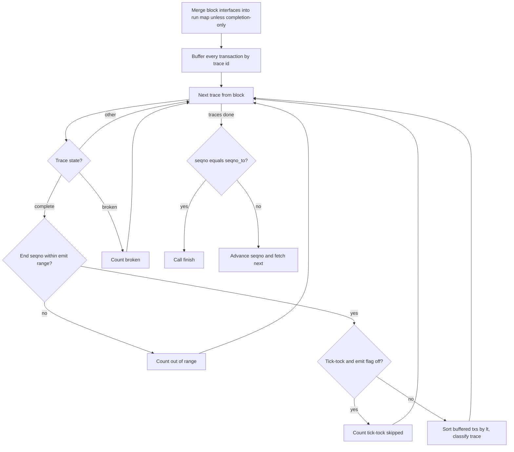
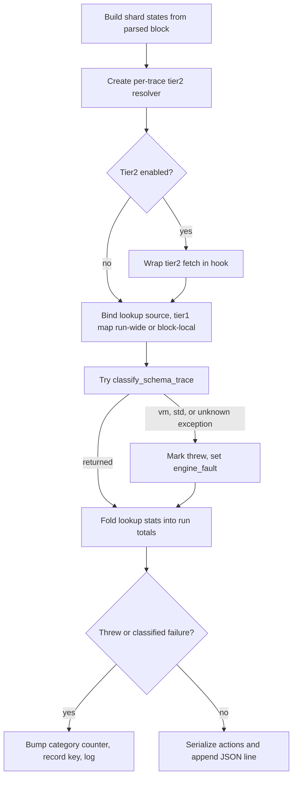

# BatchRunner

BatchRunner is the td::actor::Actor behind ton-mch-index: it drives one linear pipeline per masterchain seqno — fetch, parse, trace assembly, interface detection, classify — and appends one JSON line per classified trace to output_path. Stage transitions are asynchronous: each stage finishes by sending the next actor message (td::actor::send_closure via promises), not by calling down a synchronous chain; still, exactly one seqno is in flight at a time, so the run-wide accumulators (account_interfaces_, the pending transactions_by_trace_ buffer, stage timers, counters) need no locking. prep_ is a shared const MchEnginePrep read by every classify call, while per-trace state (EmuCelldbTier2, ParsedBlockLookupSource) is local to classify_trace. The actor terminates itself exactly once — finish() with exit code 0 after seqno_to_, or fail() with exit code 7 on any pipeline error — and the shared atomic exit_code_ is what main returns.

## class BatchRunner

- decl: `ton-index-worker/ton-mch-index/src/BatchRunner.h:23`

Actor running a complete batch: one seqno range from block fetch to JSON-lines output, one seqno at a time.

Owns the output ofstream, the cross-seqno interface map, the pending-trace buffer, per-stage timers, and all run counters; DbScanner/ParseManager/TraceAssembler are peer actors addressed by ActorId, never called directly. Invariant: the next seqno is fetched only after every complete trace of the current one was classified, so cross-block traces stay whole. exit_code_ is the atomic main returns; watcher_ is main's shared td::Destructor whose final release stops the actor scheduler, tying process exit to this actor's destruction.

## seqno_fetched

`void seqno_fetched(std::uint32_t seqno, schema::MasterchainBlockDataState block_data_state)`

- decl: `ton-index-worker/ton-mch-index/src/BatchRunner.cpp:100`
- callers: none found in parsed TU set
- calls: `now_s`

Takes the fetched block data state and chains into parse through the cell DB reader.

Books elapsed time into t_fetch_ and restarts the stage clock. Fetch, cell-DB-reader, and parse errors all route to fail(), aborting the whole run; success resumes via seqno_parsed.

## seqno_parsed

`void seqno_parsed(std::uint32_t seqno, ParsedBlockPtr parsed_block)`

- decl: `ton-index-worker/ton-mch-index/src/BatchRunner.cpp:129`
- callers: none found in parsed TU set
- calls: `now_s`

Hands the parsed block to TraceAssembler::assemble for cross-block trace assembly.

Books t_parse_. An assembly error routes to fail(); the updated parsed block re-enters via seqno_traces_assembled.

## seqno_traces_assembled

`void seqno_traces_assembled(std::uint32_t seqno, ParsedBlockPtr parsed_block)`

- decl: `ton-index-worker/ton-mch-index/src/BatchRunner.cpp:145`
- callers: none found in parsed TU set
- calls: `now_s`

Spawns a one-shot BlockInterfaceProcessor actor to detect account interfaces for the block.

Books t_assemble_ and releases the created actor — fire-and-forget ownership; the processor resolves back into seqno_interfaces_processed or fails the run.

## seqno_interfaces_processed

`void seqno_interfaces_processed(std::uint32_t seqno, ParsedBlockPtr parsed_block)`

- decl: `ton-index-worker/ton-mch-index/src/BatchRunner.cpp:162`
- callers: none found in parsed TU set
- calls: `BatchRunner::classify_trace`, `BatchRunner::fetch_seqno`, `BatchRunner::finish`, `now_s`

Absorbs the block's interfaces and pending transactions, classifies each complete in-range trace, then advances to the next seqno or finishes.

Unless tier1_completion_only_ is set, the block's account_interfaces_ merge into the run-wide map; every transaction buffers into transactions_by_trace_ keyed by trace_id across seqnos (peak size tracked). Complete traces whose mc_seqno_end falls in [seqno_from_, seqno_to_] get their buffered transactions sorted by lt and classified (timed into t_classify_); tick-tock-rooted traces — external_hash unset — are skipped and counted in tick_tock_skipped_ unless emit_tick_tock_ (--emit-tick-tock). At seqno == seqno_to_ the run calls finish() instead of fetching further; out-of-range and broken traces are only counted.

## category_name

`const char * category_name(mch::FailureCategory category)`

- decl: `ton-index-worker/ton-mch-index/src/BatchRunner.cpp:26`
- callers: BatchRunner::classify_trace (ton-index-worker/ton-mch-index/src/BatchRunner.cpp:290)

Renders a FailureCategory enumerator as its telemetry string; "?" for an out-of-range value.

## fail

`void fail(std::uint32_t seqno, const char * stage, td::Status error)`

- decl: `ton-index-worker/ton-mch-index/src/BatchRunner.cpp:325`
- callers: none found in parsed TU set

Hard-aborts the whole batch run: logs the stage error, sets exit code 7, stops the actor.

No per-seqno retry exists — one failed fetch/parse/assembly/interface stage kills the remaining run mid-seqno. The output stream is not flushed or closed here (that happens at destruction) and no summary line is emitted.

## operator()

`unsigned long operator()(mch::FailureCategory category) const`

- decl: `ton-index-worker/ton-mch-index/src/BatchRunner.cpp:355`
- callers: BatchRunner::finish (ton-index-worker/ton-mch-index/src/BatchRunner.cpp:367); BatchRunner::finish (ton-index-worker/ton-mch-index/src/BatchRunner.cpp:368); BatchRunner::finish (ton-index-worker/ton-mch-index/src/BatchRunner.cpp:369); BatchRunner::finish (ton-index-worker/ton-mch-index/src/BatchRunner.cpp:370)

finish()'s counter lambda: the run's total for a failure category, or 0 when that category never occurred.

## BatchRunner

`void BatchRunner(td::actor::ActorId<DbScanner> db_scanner, td::actor::ActorId<ParseManager> parse_manager, td::actor::ActorId<TraceAssembler> trace_assembler, std::shared_ptr<const mch::MchEnginePrep> prep, std::string output_path, std::uint32_t read_start, std::uint32_t seqno_from, std::uint32_t seqno_to, bool tier2_enabled, bool emit_tick_tock, bool tier1_completion_only, std::shared_ptr<std::atomic_int> exit_code, std::shared_ptr<td::Destructor> watcher)`

- decl: `ton-index-worker/ton-mch-index/src/BatchRunner.cpp:42`
- callers: none found in parsed TU set

Stores actor ids, shared prep, output path, seqno range, and diagnostic flags; sequencing starts at read_start.

## now_s

`double now_s()`

- decl: `ton-index-worker/ton-mch-index/src/BatchRunner.cpp:66`
- callers: BatchRunner::seqno_fetched (ton-index-worker/ton-mch-index/src/BatchRunner.cpp:101); BatchRunner::seqno_fetched (ton-index-worker/ton-mch-index/src/BatchRunner.cpp:102); BatchRunner::seqno_parsed (ton-index-worker/ton-mch-index/src/BatchRunner.cpp:130); BatchRunner::seqno_parsed (ton-index-worker/ton-mch-index/src/BatchRunner.cpp:131); BatchRunner::seqno_traces_assembled (ton-index-worker/ton-mch-index/src/BatchRunner.cpp:146); BatchRunner::seqno_traces_assembled (ton-index-worker/ton-mch-index/src/BatchRunner.cpp:147); BatchRunner::seqno_interfaces_processed (ton-index-worker/ton-mch-index/src/BatchRunner.cpp:163); BatchRunner::seqno_interfaces_processed (ton-index-worker/ton-mch-index/src/BatchRunner.cpp:164); BatchRunner::seqno_interfaces_processed (ton-index-worker/ton-mch-index/src/BatchRunner.cpp:204); BatchRunner::seqno_interfaces_processed (ton-index-worker/ton-mch-index/src/BatchRunner.cpp:206); BatchRunner::finish (ton-index-worker/ton-mch-index/src/BatchRunner.cpp:377); BatchRunner::start_up (ton-index-worker/ton-mch-index/src/BatchRunner.cpp:82); BatchRunner::fetch_seqno (ton-index-worker/ton-mch-index/src/BatchRunner.cpp:96)

Wall-clock seconds from td::Time::now, the base for all stage timers.

## start_up

`void start_up()`

- decl: `ton-index-worker/ton-mch-index/src/BatchRunner.cpp:71`
- callers: none found in parsed TU set
- calls: `BatchRunner::fetch_seqno`, `now_s`

Opens the output file (truncating), resets the trace assembler to read_start, and kicks off the first fetch.

An unopenable output path is fatal before any seqno is read: exit code 7 and immediate stop. TraceAssembler::reset_state plus set_expected_seqno(read_start_) make cross-block trace assembly begin at the prewarm point rather than the emit range.

## fetch_seqno

`void fetch_seqno()`

- decl: `ton-index-worker/ton-mch-index/src/BatchRunner.h:35`
- callers: BatchRunner::seqno_interfaces_processed (ton-index-worker/ton-mch-index/src/BatchRunner.cpp:221); BatchRunner::start_up (ton-index-worker/ton-mch-index/src/BatchRunner.cpp:83)
- calls: `now_s`

Asks DbScanner for the current seqno with a promise routing success to seqno_fetched and errors to fail.

Marks stage_started_ so the next handler attributes elapsed wall time to fetch. The promise lambda captures the actor self-id and seqno, keeping the chain alive across actor hops.

## classify_trace

`void classify_trace(const std::string & trace_key, std::vector<schema::Transaction> txs, const ParsedBlockPtr & parsed_block)`

- decl: `ton-index-worker/ton-mch-index/src/BatchRunner.h:40`
- callers: BatchRunner::seqno_interfaces_processed (ton-index-worker/ton-mch-index/src/BatchRunner.cpp:205)
- calls: `category_name`, `mch::ActionSerializeStats::ActionSerializeStats`, `mch::EmuCelldbTier2::EmuCelldbTier2`, `mch::EmuCelldbTier2::fetch`, `mch::EmuTraceView::EmuTraceView`, `mch::ParsedBlockLookupSource::ParsedBlockLookupSource`, `mch::ParsedBlockLookupSource::stats`, `mch::SchemaClassifyResult::SchemaClassifyResult`, `mch::classify_schema_trace`, `mch::serialize_actions`

Classifies one complete trace via classify_schema_trace and appends one JSON line (trace_key, actions_b64, tx_hashes) on success.

Builds AllShardStates from the parsed block's shard blocks and constructs a fresh EmuCelldbTier2 per trace — the tier-2 memo is scoped to this trace — wrapping its fetch in a Tier2Hook only when tier2_enabled_. Tier 1 is the run-wide account_interfaces_, or just this parsed block's own interfaces when tier1_completion_only_ is set (the --tier1-completion-only A/B diagnostic: lookups then see only the completion block's interfaces, not the accumulated ones). classify_schema_trace already catches internally, but the call is wrapped in a second catch for the vm exception types — VmError and friends are not std::exception, so this is belt-and-suspenders against anything escaping. A thrown or classified failure increments the category counter, records the trace key, and returns without emitting a row; success serializes rows via serialize_actions, folds the source's lookup stats into the run totals, and writes the JSON line.

## finish

`void finish()`

- decl: `ton-index-worker/ton-mch-index/src/BatchRunner.h:43`
- callers: BatchRunner::seqno_interfaces_processed (ton-index-worker/ton-mch-index/src/BatchRunner.cpp:216)
- calls: `BatchRunner::(lambda at /home/verdigos/dev/ton-indexer-private/ton-index-worker/ton-mch-index/src/BatchRunner.cpp:355:19)::operator()`, `now_s`

Flushes and closes the output, logs the stats summary and wall-clock perf lines, sets exit code 0, stops the actor.

The summary line counts seqnos read (prewarm vs range), blocks/transactions, trace selection (selected, out-of-range, tick-tock-skipped, pending-at-eof, broken), classification outcomes by failure category, actions emitted, and lookup tier attribution; the perf line breaks wall time into t_fetch_/t_parse_/t_assemble_/t_interfaces_/t_classify_ plus derived seqnos/s, traces/s, and ms/trace rates. Both go to the log and stdout, followed by every failed trace key. Then exit code 0 is stored and the actor stops — the normal end of a completed run.

