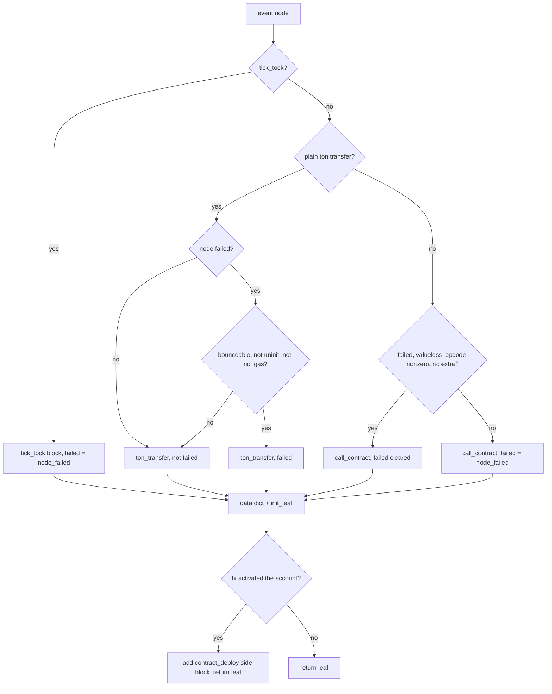

# BlockTree

BlockTree turns a flat Trace into the matching substrate: to_tree links transactions into an EventTree of event nodes keyed by message hash, init_block classifies each node into leaf blocks (tick_tock, ton_transfer, call_contract, plus contract-deploy side blocks) and connects them, and BlockArena owns every block while TraceContext bundles the chained lifetimes trace to tree to arena. The core invariant is canonical ordering: every next_blocks list stays stably sorted by min_lt so walker candidate choice is deterministic, and sort_next_blocks is the single repair operation after any mutation that appends forward edges. The graph is raw pointers throughout — nodes reference the trace, blocks reference nodes and each other — so arena, tree, and trace must die in that order, which is exactly why TraceContext exists. merge_blocks folds an accepted build's blocks into a produced block behind an earliest-common-block check and is never rolled back, while shapers reshape topology through insert_between and compact_connections. All of it runs single-threaded inside classify, one trace at a time.

## class mch::LeafCommentInfo

- decl: `ton-index-worker/ton-mch-engine/src/BlockTree.cpp:28`

Parsed comment summary of a ton-transfer leaf body: decoded comment, encrypted flag, encoded flag.

comment is nullopt when the body carries no comment or any BOC decode fails, and encrypted is never set then; comment_encoded is true only when a comment exists and is encrypted. Consumed by leaf_data for the getgems purchase predicate and the nft transfer shaper.

## class mch::BlockArena

- decl: `ton-index-worker/ton-mch-engine/src/BlockTree.h:164`

Owning arena for every Block; blocks reference each other by raw pointer.

make allocates a block, stamps its btype, and returns the raw pointer; blocks live until arena destruction, so block pointers are valid exactly as long as the arena.

## class mch::TraceContext

- decl: `ton-index-worker/ton-mch-engine/src/BlockTree.h:184`

Bundles the chained lifetimes Trace to EventTree to BlockArena plus the root block pointer.

Holding all three by value in declaration order makes destruction run arena first, then tree, then trace, matching the direction of the pointer dependencies; everything downstream of classify receives a whole TraceContext, never loose pieces.

## class mch::EventNode

- decl: `ton-index-worker/ton-mch-engine/src/BlockTree.h:22`

One node in the message tree: the incoming message and its transaction plus parent and children links.

lt prefers the message's created_lt and falls back to its tx_lt, with tick_tock using the transaction's lt directly; tx_hash prefers the transaction and falls back to the message. The ghost and forced_failed flags mark synthesized-but-unsent messages from the ghost-external fallback, where failed no longer reduces to tx aborted.

## class mch::EventTree

- decl: `ton-index-worker/ton-mch-engine/src/BlockTree.h:68`

Owns every EventNode and the synthetic ghost messages; points at the root and counts orphaned nodes.

synthetic_msgs holds Message objects no transaction in the trace ever carried, so a ghost node's msg lives exactly as long as the node itself. unlinked counts nodes unreachable from root: orphan subtrees are tolerated as legal partial input but surfaced rather than silently dropped.

## class mch::Block

- decl: `ton-index-worker/ton-mch-engine/src/BlockTree.h:83`

Matching substrate node: btype and opcode identity, data payload, graph edges, failure flags, and lt bounds.

Leaf blocks carry a constructor data dict while a produced block carries its build output; next_blocks is the canonical forward edge list, children_blocks holds merge children and deploy side blocks, and parent points at a producing block. failed and broken feed downstream serialization, and min_lt with min_lt_without_initiating_tx drive canonical ordering and the earliest-common-block merge check.

## direction

`int direction() const`

- decl: `ton-index-worker/ton-mch-engine/src/BlockTree.cpp:150`
- callers: mch::ensure_earliest_common_block (ton-index-worker/ton-mch-engine/src/BlockTree.cpp:254)

Classifies a block's event direction: 0 incoming, 1 outgoing, 2 mixed or multi-node.

Only single-node blocks are directional; a merged block with several event nodes or none reports 2, which sorts it after directed blocks in the earliest-common-block ordering.

## sort_next_blocks

`void sort_next_blocks()`

- decl: `ton-index-worker/ton-mch-engine/src/BlockTree.cpp:158`
- callers: mch::Block::compact_connections (ton-index-worker/ton-mch-engine/src/BlockTree.cpp:177); mch::Block::merge_blocks (ton-index-worker/ton-mch-engine/src/BlockTree.cpp:310); mch::init_block (ton-index-worker/ton-mch-engine/src/BlockTree.cpp:448)

Re-sorts next_blocks stably by min_lt ascending.

The single repair operation for canonical order, called after any mutation that appends forward edges — connect, merge, or compaction.

## compact_connections

`void compact_connections()`

- decl: `ton-index-worker/ton-mch-engine/src/BlockTree.cpp:163`
- callers: mch::Block::merge_blocks (ton-index-worker/ton-mch-engine/src/BlockTree.cpp:312); [mch::nft_transfer_parent_absorb (ton-index-worker/ton-mch-engine/src/host/HostNft.cpp:564)](HostNft.md#nft_transfer_parent_absorb); [mch::getgems_proxy_insert (ton-index-worker/ton-mch-engine/src/host/HostNftSale.cpp:515)](HostNftSale.md#getgems_proxy_insert); [mch::nominator_withdraw_absorb_payouts (ton-index-worker/ton-mch-engine/src/host/HostNominator.cpp:83)](HostNominator.md#nominator_withdraw_absorb_payouts)
- calls: `mch::Block::sort_next_blocks`, `mch::Block::topmost_parent`

Deduplicates next_blocks through topmost parents, dropping child and self edges.

Forward edges to a child block or to this block itself are removed, remaining successors collapse to their topmost parent with first-seen order kept, and a canonical sort restores min_lt order. Deterministic replacement of the original set-based compaction.

## insert_between

`void insert_between(const std::vector<Block *> & targets, Block * new_block)`

- decl: `ton-index-worker/ton-mch-engine/src/BlockTree.cpp:180`
- callers: mch::test_insert_between (ton-index-worker/ton-mch-engine/harness/ShapeTest.cpp:59); [mch::post_process_stonfi_v2_liquidity (ton-index-worker/ton-mch-engine/src/ClassifyCore.cpp:439)](ClassifyCore.md#post_process_stonfi_v2_liquidity); [mch::getgems_proxy_insert (ton-index-worker/ton-mch-engine/src/host/HostNftSale.cpp:513)](HostNftSale.md#getgems_proxy_insert)
- calls: `mch::Block::connect`

Splices new_block between this block and each target, redirecting grandchild and child back edges.

Children's forward edges that reached a target are redirected to new_block, and a child can end up with new_block more than once; targets leave this block's next_blocks, target children whose previous_block pointed at the target are reparented to new_block, and this block connects to new_block which connects to every target. Deliberately append-only with no sort, mirroring the original shaper exactly so topology parity holds.

## find_frontier

`std::vector<Block *> find_frontier(const std::vector<Block *> & in_set) const`

- decl: `ton-index-worker/ton-mch-engine/src/BlockTree.cpp:217`
- callers: mch::Block::merge_blocks (ton-index-worker/ton-mch-engine/src/BlockTree.cpp:295)

BFS from this block's successors outward to the first blocks outside the given merged set.

Traversal expands any block found in the set and collects the first out-of-set block per identity; those frontier blocks become the merged block's new forward edges.

## calculate_min_max_lt

`void calculate_min_max_lt()`

- decl: `ton-index-worker/ton-mch-engine/src/BlockTree.cpp:236`
- callers: mch::Block::merge_blocks (ton-index-worker/ton-mch-engine/src/BlockTree.cpp:309); [mch::post_process_dedust_liquidity (ton-index-worker/ton-mch-engine/src/ClassifyCore.cpp:307)](ClassifyCore.md#post_process_dedust_liquidity); [mch::post_process_dedust_v2_liquidity (ton-index-worker/ton-mch-engine/src/ClassifyCore.cpp:369)](ClassifyCore.md#post_process_dedust_v2_liquidity); [mch::post_process_stonfi_v2_liquidity (ton-index-worker/ton-mch-engine/src/ClassifyCore.cpp:446)](ClassifyCore.md#post_process_stonfi_v2_liquidity); [mch::post_process_stonfi_v2_liquidity (ton-index-worker/ton-mch-engine/src/ClassifyCore.cpp:454)](ClassifyCore.md#post_process_stonfi_v2_liquidity)
- calls: `mch::EventNode::lt`

Recomputes min_lt and min_lt_without_initiating_tx as the minimum event-node lt.

Both fields are set to the same minimum and an empty event list yields zero. Host post-processors call it after absorbing a paired leg's nodes.

## ensure_earliest_common_block

`Block * ensure_earliest_common_block(const std::vector<Block *> & blocks)`

- decl: `ton-index-worker/ton-mch-engine/src/BlockTree.cpp:248`
- callers: mch::Block::merge_blocks (ton-index-worker/ton-mch-engine/src/BlockTree.cpp:286)
- calls: `mch::Block::direction`

Picks the merge anchor block, or rejects the merge when the set has no earliest common block.

Blocks sort by min_lt_without_initiating_tx with direction as tiebreak; every later block must chain back to the earliest through previous_block links already inside the connected set, otherwise nullptr, which is a clean build rejection rather than an error.

## merge_blocks

`bool merge_blocks(const std::vector<Block *> & blocks)`

- decl: `ton-index-worker/ton-mch-engine/src/BlockTree.cpp:276`
- callers: [mch::try_build (ton-index-worker/ton-mch-engine/src/ClassifyCore.cpp:154)](ClassifyCore.md#try_build); [mch::fallback_jetton_transfer (ton-index-worker/ton-mch-engine/src/GhostExternal.cpp:301)](GhostExternal.md#fallback_jetton_transfer); [mch::nft_transfer_parent_absorb (ton-index-worker/ton-mch-engine/src/host/HostNft.cpp:563)](HostNft.md#nft_transfer_parent_absorb); [mch::getgems_proxy_insert (ton-index-worker/ton-mch-engine/src/host/HostNftSale.cpp:514)](HostNftSale.md#getgems_proxy_insert); [mch::nominator_withdraw_absorb_payouts (ton-index-worker/ton-mch-engine/src/host/HostNominator.cpp:77)](HostNominator.md#nominator_withdraw_absorb_payouts); [mch::tgbtc_deploy_absorb (ton-index-worker/ton-mch-engine/src/host/HostTgbtc.cpp:321)](HostTgbtc.md#tgbtc_deploy_absorb)
- calls: `mch::Block::calculate_min_max_lt`, `mch::Block::compact_connections`, `mch::Block::find_frontier`, `mch::Block::sort_next_blocks`, `mch::ensure_earliest_common_block`

Folds the given blocks under this produced block: reparenting, absorbing event nodes, relinking the frontier.

Nulls and duplicates drop out first; a missing earliest common block returns false with nothing changed. Surviving blocks reparent here, append their event nodes and children entries, and the block inherits the earliest's frontier as forward edges, its previous_block and initiating_event_node, while ORing is_ghost_block over the absorbed nodes; lt bounds are recomputed, edges sorted, and the earliest's old predecessor compacted. Must run only after a build accepted, because merges are never rolled back.

## LeafCommentInfo

`void LeafCommentInfo()`

- decl: `ton-index-worker/ton-mch-engine/src/BlockTree.cpp:28`
- callers: mch::leaf_comment_info (ton-index-worker/ton-mch-engine/src/BlockTree.cpp:35)

Implicit default constructor: no comment, not encrypted.

## LeafCommentInfo

`void LeafCommentInfo(LeafCommentInfo &&)`

- decl: `ton-index-worker/ton-mch-engine/src/BlockTree.cpp:28`
- callers: mch::leaf_comment_info (ton-index-worker/ton-mch-engine/src/BlockTree.cpp:38); mch::leaf_comment_info (ton-index-worker/ton-mch-engine/src/BlockTree.cpp:42); mch::leaf_comment_info (ton-index-worker/ton-mch-engine/src/BlockTree.cpp:46); mch::leaf_comment_info (ton-index-worker/ton-mch-engine/src/BlockTree.cpp:60)

Implicit move constructor for returning the parsed summary by value.

## node_failed

`bool node_failed(const EventNode * node)`

- decl: `ton-index-worker/ton-mch-engine/src/BlockTree.cpp:320`
- callers: mch::make_leaf_block (ton-index-worker/ton-mch-engine/src/BlockTree.cpp:388); mch::make_leaf_block (ton-index-worker/ton-mch-engine/src/BlockTree.cpp:392); mch::make_leaf_block (ton-index-worker/ton-mch-engine/src/BlockTree.cpp:407); mch::make_leaf_block (ton-index-worker/ton-mch-engine/src/BlockTree.cpp:425)

A node failed when it was force-failed or its transaction aborted.

The OR matters for ghost nodes, whose forced_failed flag is set instead of any aborted transaction.

## init_leaf

`void init_leaf(Block * b, const EventNode * node)`

- decl: `ton-index-worker/ton-mch-engine/src/BlockTree.cpp:324`
- callers: mch::make_leaf_block (ton-index-worker/ton-mch-engine/src/BlockTree.cpp:418); mch::make_leaf_block (ton-index-worker/ton-mch-engine/src/BlockTree.cpp:427)
- calls: `mch::EventNode::lt`

Initializes a fresh leaf block from its single event node.

Records the node, the ghost flag, lt bounds (min_lt from the node's own lt, the without-initiating-tx variant from the owning transaction's lt), and sets initiating_event_node to the node's tree parent, null at the root.

## account_or_null

`Value account_or_null(const std::optional<std::string> & addr)`

- decl: `ton-index-worker/ton-mch-engine/src/BlockTree.cpp:334`
- callers: mch::leaf_data (ton-index-worker/ton-mch-engine/src/BlockTree.cpp:362); mch::leaf_data (ton-index-worker/ton-mch-engine/src/BlockTree.cpp:364)
- calls: `mch::Value::make_account_raw`, `mch::Value::null`

Maps an optional address string to an Account value or Value null.

A present address goes through make_account_raw's canonicalize-or-passthrough; absence becomes Value null.

## leaf_comment_info

`LeafCommentInfo leaf_comment_info(const EventNode * node)`

- decl: `ton-index-worker/ton-mch-engine/src/BlockTree.cpp:34`
- callers: mch::leaf_data (ton-index-worker/ton-mch-engine/src/BlockTree.cpp:371)
- calls: `mch::LeafCommentInfo::LeafCommentInfo`, `mch::ton_transfer_comment`

Decodes a leaf's comment fields from its message body.

The base64 body is BOC-parsed and run through ton_transfer_comment, then the first 32 bits are peeked for the encrypted-comment opcode. Any decode failure yields no comment and not encrypted, never an error; comment_encoded is set only when a comment exists and is encrypted.

## leaf_data

`Value leaf_data(const std::string & btype, const EventNode * node, std::optional<std::uint32_t> op)`

- decl: `ton-index-worker/ton-mch-engine/src/BlockTree.cpp:344`
- callers: mch::make_leaf_block (ton-index-worker/ton-mch-engine/src/BlockTree.cpp:417); mch::make_leaf_block (ton-index-worker/ton-mch-engine/src/BlockTree.cpp:426)
- calls: `mch::Value::make_account_raw`, `mch::Value::make_amount`, `mch::Value::make_amount_none`, `mch::Value::make_bool`, `mch::Value::make_dict`, `mch::Value::make_int64`, `mch::Value::make_str`, `mch::Value::null`, `mch::account_or_null`, `mch::leaf_comment_info`

Builds the leaf block's constructor data dict so where-expression dotfield reads see the same values.

tick_tock carries only the account; other btypes carry opcode (the masked u32, absent on ton_transfer), source, destination, and value as an Amount or amount-none; ton_transfer additionally carries comment, encrypted, and comment_encoded from leaf_comment_info. extra_currencies stays omitted because its map is not decoded.

## make_leaf_block

`Block * make_leaf_block(BlockArena & arena, const EventNode * node)`

- decl: `ton-index-worker/ton-mch-engine/src/BlockTree.cpp:379`
- callers: mch::init_block (ton-index-worker/ton-mch-engine/src/BlockTree.cpp:438); mch::init_block (ton-index-worker/ton-mch-engine/src/BlockTree.cpp:444)
- calls: `mch::BlockArena::make`, `mch::EventNode::opcode`, `mch::init_leaf`, `mch::leaf_data`, `mch::node_failed`

Classifies one event node into a leaf block with failure flags and an optional contract-deploy side block.

tick_tock nodes become tick_tock blocks; a zero-or-absent opcode message with both endpoints becomes ton_transfer, whose failure logic forgives uninit destinations and no-gas sends but keeps bounceables failed; everything else is call_contract with its opcode, where a failed valueless call with a nonzero opcode and no extra currencies is un-failed as a log or event leaf. A transaction that activated a previously non-active account also spawns a contract_deploy side block in children_blocks sharing the same node.

## init_block

`Block * init_block(BlockArena & arena, const EventNode * node)`

- decl: `ton-index-worker/ton-mch-engine/src/BlockTree.cpp:436`
- callers: mch::test_schema_no_gas_ton_transfer (ton-index-worker/ton-mch-engine/harness/EmuActionSerializeTest.cpp:959); mch::schema_ctx_loader (ton-index-worker/ton-mch-engine/harness/SchemaGate.cpp:162); [mch::basic_classify_fallback (ton-index-worker/ton-mch-engine/src/ClassifyCore.cpp:584)](ClassifyCore.md#basic_classify_fallback); [mch::ghost_external_rows (ton-index-worker/ton-mch-engine/src/ClassifyCore.cpp:613)](ClassifyCore.md#ghost_external_rows); [mch::classify_schema_trace (ton-index-worker/ton-mch-engine/src/ClassifyCore.cpp:842)](ClassifyCore.md#classify_schema_trace); mch::load_trace_context (ton-index-worker/ton-mch-engine/src/fixtures/FixtureLoader.cpp:303)
- calls: `mch::Block::connect`, `mch::Block::sort_next_blocks`, `mch::make_leaf_block`

Builds the block subtree for one event node: leaf blocks connected in canonical order.

An explicit stack walks the event tree depth-first because trace depth is unbounded and recursion is not; each child gets make_leaf_block and a connect edge, and every block sorts its next_blocks before the walk continues. Returns the subtree's root block.

## to_tree

`EventTree to_tree(const Trace & trace)`

- decl: `ton-index-worker/ton-mch-engine/src/BlockTree.cpp:65`
- callers: mch::test_schema_no_gas_ton_transfer (ton-index-worker/ton-mch-engine/harness/EmuActionSerializeTest.cpp:954); mch::schema_ctx_loader (ton-index-worker/ton-mch-engine/harness/SchemaGate.cpp:158); [mch::classify_schema_trace (ton-index-worker/ton-mch-engine/src/ClassifyCore.cpp:835)](ClassifyCore.md#classify_schema_trace); mch::load_trace_context (ton-index-worker/ton-mch-engine/src/fixtures/FixtureLoader.cpp:299)
- calls: `mch::(lambda at /home/verdigos/dev/ton-indexer-private/ton-index-worker/ton-mch-engine/src/BlockTree.cpp:81:20)::operator()`, `mch::EventTree::EventTree`

Links a trace's transactions into an EventNode tree keyed by message hash.

Transactions sort stably descending by lt, each gets a node bound to its incoming message, destination-less out-messages become notification leaf children, and other out-messages link to the child transaction's node through the in-msg hash map; out-messages with a destination but no child transaction are tolerated as partial traces. The root is the topmost parent of the earliest transaction, and a BFS from it counts unreachable nodes into unlinked so silent loss stays visible. The trace must outlive the tree.

## operator()

`EventNode * operator()(const Message * msg, const Transaction * tx, bool tick_tock) const`

- decl: `ton-index-worker/ton-mch-engine/src/BlockTree.cpp:81`
- callers: mch::to_tree (ton-index-worker/ton-mch-engine/src/BlockTree.cpp:104); mch::to_tree (ton-index-worker/ton-mch-engine/src/BlockTree.cpp:113)

Allocates an EventNode in the tree and stamps its message, transaction, and tick_tock flag.

## connect

`void connect(Block * other)`

- decl: `ton-index-worker/ton-mch-engine/src/BlockTree.h:114`
- callers: mch::test_walker_peek_bind_and_aux (ton-index-worker/ton-mch-engine/harness/ShapeTest.cpp:196); mch::test_walker_peek_bind_and_aux (ton-index-worker/ton-mch-engine/harness/ShapeTest.cpp:197); mch::test_walker_peek_then_consume (ton-index-worker/ton-mch-engine/harness/ShapeTest.cpp:214); mch::test_insert_between (ton-index-worker/ton-mch-engine/harness/ShapeTest.cpp:46); mch::Block::insert_between (ton-index-worker/ton-mch-engine/src/BlockTree.cpp:211); mch::Block::insert_between (ton-index-worker/ton-mch-engine/src/BlockTree.cpp:213); mch::init_block (ton-index-worker/ton-mch-engine/src/BlockTree.cpp:445); [mch::wrap_root (ton-index-worker/ton-mch-engine/src/ClassifyCore.cpp:54)](ClassifyCore.md#wrap_root)

Appends a forward edge and sets the target's previous_block back-pointer.

Append-only by design, so shaper topology parity holds; callers re-establish canonical order separately with sort_next_blocks.

## topmost_parent

`Block * topmost_parent()`

- decl: `ton-index-worker/ton-mch-engine/src/BlockTree.h:119`
- callers: mch::Block::compact_connections (ton-index-worker/ton-mch-engine/src/BlockTree.cpp:171)

Walks parent links to the outermost producing block.

## anchor_tx_hash

`std::string anchor_tx_hash() const`

- decl: `ton-index-worker/ton-mch-engine/src/BlockTree.h:148`
- callers: [mch::sort_unique_children (ton-index-worker/ton-mch-engine/src/ClassifyCore.cpp:85)](ClassifyCore.md#sort_unique_children)
- calls: `mch::EventNode::tx_hash`

Transaction hash of the block's first event node, empty when it has none.

## BlockArena

`void BlockArena()`

- decl: `ton-index-worker/ton-mch-engine/src/BlockTree.h:164`
- callers: mch::test_decode_consumed (ton-index-worker/ton-mch-engine/harness/DexRecordsTest.cpp:164); mch::test_data_truthy (ton-index-worker/ton-mch-engine/harness/DexRecordsTest.cpp:211); mch::test_bucket_b_fills (ton-index-worker/ton-mch-engine/harness/EmuActionSerializeTest.cpp:967); mch::test_walker_peek_bind_and_aux (ton-index-worker/ton-mch-engine/harness/ShapeTest.cpp:192); mch::test_walker_peek_then_consume (ton-index-worker/ton-mch-engine/harness/ShapeTest.cpp:211); mch::test_insert_between (ton-index-worker/ton-mch-engine/harness/ShapeTest.cpp:43); mch::test_getgems_proxy_insert (ton-index-worker/ton-mch-engine/harness/ShapeTest.cpp:73)

Implicit default constructor; starts with an empty block list.

## make

`Block * make(std::string btype)`

- decl: `ton-index-worker/ton-mch-engine/src/BlockTree.h:167`
- callers: mch::decode_block (ton-index-worker/ton-mch-engine/harness/BuildVectorRunner.cpp:120); mch::test_decode_consumed (ton-index-worker/ton-mch-engine/harness/DexRecordsTest.cpp:165); mch::test_data_truthy (ton-index-worker/ton-mch-engine/harness/DexRecordsTest.cpp:212); mch::test_bucket_b_fills (ton-index-worker/ton-mch-engine/harness/EmuActionSerializeTest.cpp:969); mch::call (ton-index-worker/ton-mch-engine/harness/ShapeTest.cpp:150); mch::test_insert_between (ton-index-worker/ton-mch-engine/harness/ShapeTest.cpp:44); mch::test_insert_between (ton-index-worker/ton-mch-engine/harness/ShapeTest.cpp:45); mch::test_insert_between (ton-index-worker/ton-mch-engine/harness/ShapeTest.cpp:49); mch::test_insert_between (ton-index-worker/ton-mch-engine/harness/ShapeTest.cpp:54); mch::test_insert_between (ton-index-worker/ton-mch-engine/harness/ShapeTest.cpp:58); mch::test_getgems_proxy_insert (ton-index-worker/ton-mch-engine/harness/ShapeTest.cpp:75); mch::test_getgems_proxy_insert (ton-index-worker/ton-mch-engine/harness/ShapeTest.cpp:80); mch::test_getgems_proxy_insert (ton-index-worker/ton-mch-engine/harness/ShapeTest.cpp:84); mch::make_leaf_block (ton-index-worker/ton-mch-engine/src/BlockTree.cpp:387); mch::make_leaf_block (ton-index-worker/ton-mch-engine/src/BlockTree.cpp:390); mch::make_leaf_block (ton-index-worker/ton-mch-engine/src/BlockTree.cpp:405); mch::make_leaf_block (ton-index-worker/ton-mch-engine/src/BlockTree.cpp:423); [mch::try_build (ton-index-worker/ton-mch-engine/src/ClassifyCore.cpp:150)](ClassifyCore.md#try_build); [mch::post_process_stonfi_v2_liquidity (ton-index-worker/ton-mch-engine/src/ClassifyCore.cpp:437)](ClassifyCore.md#post_process_stonfi_v2_liquidity); [mch::wrap_root (ton-index-worker/ton-mch-engine/src/ClassifyCore.cpp:53)](ClassifyCore.md#wrap_root); [mch::fallback_jetton_transfer (ton-index-worker/ton-mch-engine/src/GhostExternal.cpp:299)](GhostExternal.md#fallback_jetton_transfer); [mch::getgems_proxy_insert (ton-index-worker/ton-mch-engine/src/host/HostNftSale.cpp:512)](HostNftSale.md#getgems_proxy_insert)

Allocates a block in the arena, stamps its btype, and returns it.

## TraceContext

`void TraceContext()`

- decl: `ton-index-worker/ton-mch-engine/src/BlockTree.h:184`
- callers: mch::test_schema_no_gas_ton_transfer (ton-index-worker/ton-mch-engine/harness/EmuActionSerializeTest.cpp:949); mch::schema_ctx_loader (ton-index-worker/ton-mch-engine/harness/SchemaGate.cpp:155); [mch::classify_schema_trace (ton-index-worker/ton-mch-engine/src/ClassifyCore.cpp:833)](ClassifyCore.md#classify_schema_trace); mch::load_trace_context (ton-index-worker/ton-mch-engine/src/fixtures/FixtureLoader.cpp:297)

Implicit default constructor; empty trace, tree, and arena, null root.

## opcode

`std::optional<std::uint32_t> opcode() const`

- decl: `ton-index-worker/ton-mch-engine/src/BlockTree.h:38`
- callers: mch::make_leaf_block (ton-index-worker/ton-mch-engine/src/BlockTree.cpp:380)
- calls: `mch::Message::opcode32`

The node's message opcode as a masked u32, or nullopt with no message.

## lt

`std::int64_t lt() const`

- decl: `ton-index-worker/ton-mch-engine/src/BlockTree.h:43`
- callers: [mch::calc_action_id (ton-index-worker/ton-mch-engine/src/ActionBuild.cpp:1608)](ActionBuild.md#calc_action_id); mch::Block::calculate_min_max_lt (ton-index-worker/ton-mch-engine/src/BlockTree.cpp:239); mch::init_leaf (ton-index-worker/ton-mch-engine/src/BlockTree.cpp:327); mch::init_leaf (ton-index-worker/ton-mch-engine/src/BlockTree.cpp:328)

Logical time: tick_tock uses the transaction's lt, else the message's created_lt, else its tx_lt, else zero.

## tx_hash

`std::string tx_hash() const`

- decl: `ton-index-worker/ton-mch-engine/src/BlockTree.h:56`
- callers: mch::Block::anchor_tx_hash (ton-index-worker/ton-mch-engine/devtools/../src/BlockTree.h:149); [mch::calc_action_id (ton-index-worker/ton-mch-engine/src/ActionBuild.cpp:1612)](ActionBuild.md#calc_action_id); [mch::build_action (ton-index-worker/ton-mch-engine/src/ActionBuild.cpp:1628)](ActionBuild.md#build_action); [mch::build_action (ton-index-worker/ton-mch-engine/src/ActionBuild.cpp:1636)](ActionBuild.md#build_action); mch::Block::anchor_tx_hash (ton-index-worker/ton-mch-engine/src/BlockTree.h:149)

Transaction hash, or the message's tx_hash with no transaction, else empty.

## EventTree

`void EventTree()`

- decl: `ton-index-worker/ton-mch-engine/src/BlockTree.h:68`
- callers: mch::to_tree (ton-index-worker/ton-mch-engine/src/BlockTree.cpp:66)

Implicit default constructor; no nodes, null root, nothing unlinked.

## EventTree

`void EventTree(EventTree &&)`

- decl: `ton-index-worker/ton-mch-engine/src/BlockTree.h:68`
- callers: mch::to_tree (ton-index-worker/ton-mch-engine/src/BlockTree.cpp:147); mch::to_tree (ton-index-worker/ton-mch-engine/src/BlockTree.cpp:68)

Implicit move constructor; transfers node ownership out of the source tree.

## operator=

`EventTree & operator=(EventTree &&)`

- decl: `ton-index-worker/ton-mch-engine/src/BlockTree.h:68`
- callers: mch::test_schema_no_gas_ton_transfer (ton-index-worker/ton-mch-engine/harness/EmuActionSerializeTest.cpp:954); mch::schema_ctx_loader (ton-index-worker/ton-mch-engine/harness/SchemaGate.cpp:158); [mch::classify_schema_trace (ton-index-worker/ton-mch-engine/src/ClassifyCore.cpp:835)](ClassifyCore.md#classify_schema_trace); mch::load_trace_context (ton-index-worker/ton-mch-engine/src/fixtures/FixtureLoader.cpp:299)

Implicit move assignment used when storing a to_tree result into a TraceContext.

