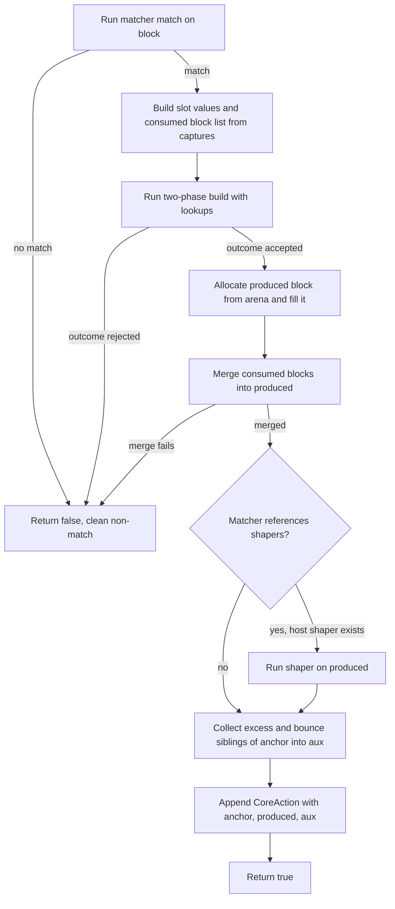
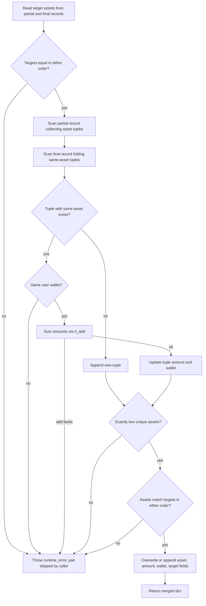
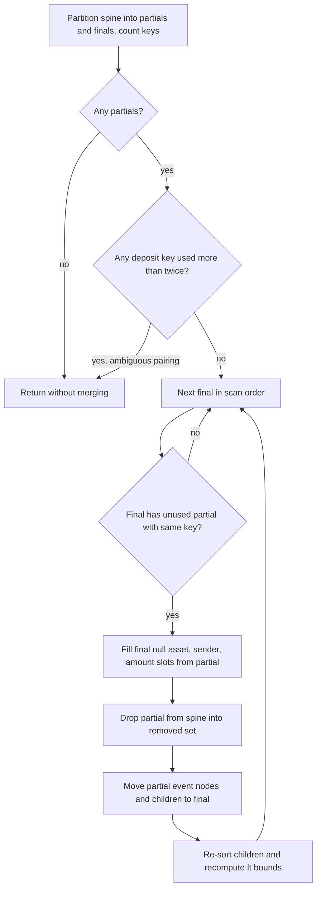
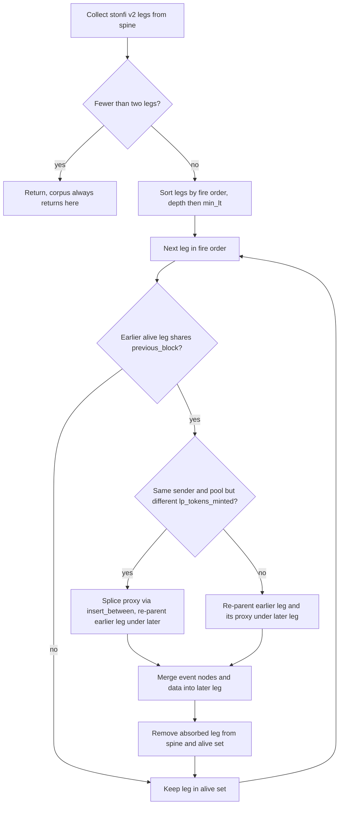
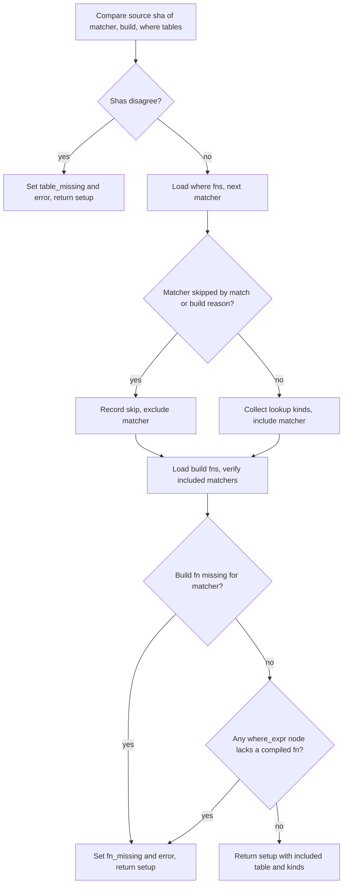
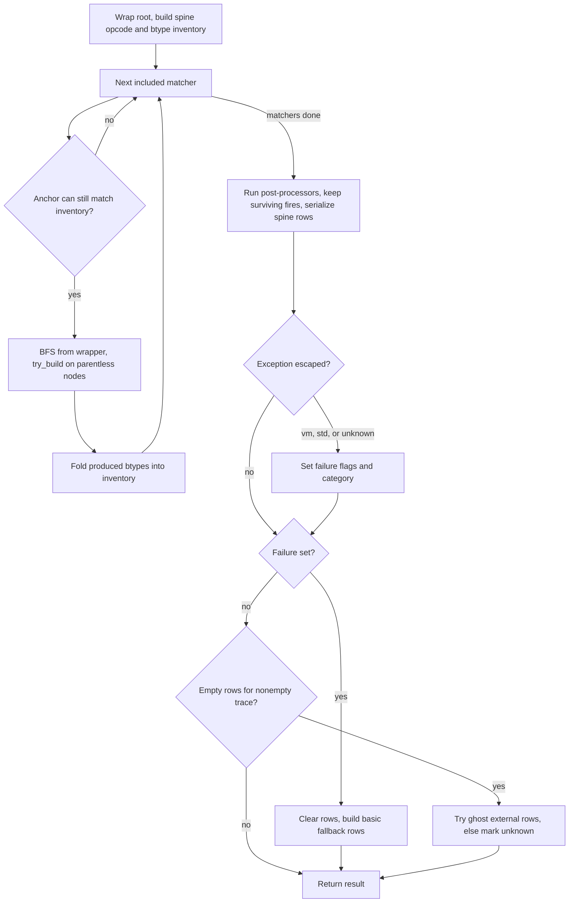
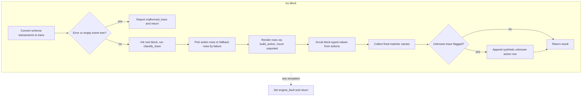

# ClassifyCore

Pure classification pipelines turning a trace (a TraceContext, or schema transactions via classify_schema_trace) into buffered per-trace action rows: an anchor-prefiltered matcher loop over an arena-allocated block tree, then post-processing passes and spine serialization. All produced and proxy blocks are allocated from the caller-owned TraceContext arena, so every Block pointer in a result is valid only while that arena lives — classify_schema_trace scrubs Block-typed Values out of the final Actions before returning. Failures are captured, never thrown past classify_trace: a mid-trace exception sets ClassifyResult failure fields (with a FailureCategory; "two-phase lookup did not converge" is detected by message text as lookup_infra_fail) and the pipeline falls back to basic_classify_fallback or ghost_external_rows rows. Trace-independent state (ClassifySetup from prepare_classify) is immutable and shareable across calls and threads; the LookupSource and its hook are per-call, single-thread.

## class mch::Tup

- decl: `ton-index-worker/ton-mch-engine/src/ClassifyCore.cpp:215`

Local struct inside combine_deposits holding one deposit leg's asset, amount, and user jetton wallet.

## class mch::CoreAction

- decl: `ton-index-worker/ton-mch-engine/src/ClassifyCore.h:44`

One matcher fire: anchor block, produced block, and fire-time aux blocks, as raw pointers into the trace arena.

All pointers reference the caller's TraceContext arena and die with it; adapters render block_key(anchor)/data/consumed/aux or build a row from produced. aux holds root-level excess/bounce blocks auto-appended at fire time from the anchor's next_blocks. A fire whose produced block a later pass merges away still appears here — removals show up in the spine view (action_rows), not in this list.

## class mch::ClassifyResult

- decl: `ton-index-worker/ton-mch-engine/src/ClassifyCore.h:53`

Buffered per-trace outcome: surviving actions in fire order, serialized action rows, failure flags, and fallback rows.

`actions` and `action_rows` are two views of one run: fires in order versus the post-processed spine used for serialization. On a mid-trace exception the pipeline sets `failure`/`failure_reason`/`failure_category`, clears actions and action_rows, and fills `fallback_rows`; production commits normal rows only on success. `unknown_trace` marks a nonempty trace that classified cleanly yet produced no row under normal or ghost serialization, keeping "classified, nothing recognized" distinct from "not classified".

## class mch::SchemaClassifyResult

- decl: `ton-index-worker/ton-mch-engine/src/ClassifyCore.h:76`

Schema-facing summary of one classify_schema_trace call: failure flags, whether fallback rows were used, and the unported-btype count.

Carries no block pointers — the payload itself travels through the caller's rows out-parameter — so the struct is freely movable. unported_btypes counts rows build_action could not render into an Action; they are skipped, not fatal.

## class mch::ClassifySetup

- decl: `ton-index-worker/ton-mch-engine/src/ClassifyCore.h:88`

Trace-independent run prep: included matcher indices, skip table, generated build-fn and where tables, and the union of referenced lookup kinds.

Built once by prepare_classify from the compiled-in matcher table, then read-only and shared by every classify call. table_missing/fn_missing plus error flag generated-table disagreement or a missing compiled fn — build bugs that are startup-fatal in production and report-and-exit in the adapter. Pass the SAME matcher table to classify_trace that was passed here; included indexes into it.

## scrub_arena_refs

`std::size_t scrub_arena_refs(Action & a)`

- decl: `ton-index-worker/ton-mch-engine/src/ClassifyCore.cpp:114`
- callers: mch::classify_schema_trace (ton-index-worker/ton-mch-engine/src/ClassifyCore.cpp:858)
- calls: `mch::scrub_value`

Nulls every Block-typed Value found in an Action's value fields, returning the replacement count.

Action fields can carry Block Values pointing into the TraceContext arena that classify_schema_trace destroys on return; this walks each action's MCH_ACTION_VALUE_FIELDS and repairs them in place via scrub_value so serialized rows hold no dangling pointers. The returned count feeds the scrubbed telemetry out-parameter only.

## try_build

`bool try_build(const CompiledMatcher & m, BuildOutcome (*)(BuildEnv &) fn, Block * block, BlockArena & arena, const std::set<std::string> & kinds, const LookupSource & src, const WhereTable & wheres, std::vector<CoreAction> & out)`

- decl: `ton-index-worker/ton-mch-engine/src/ClassifyCore.cpp:126`
- callers: mch::classify_trace (ton-index-worker/ton-mch-engine/src/ClassifyCore.cpp:757)
- calls: `mch::Block::merge_blocks`, `mch::BlockArena::make`, `mch::RejectCtx::RejectCtx`, `mch::RejectScope::RejectScope`, `mch::ShaperMatch::ShaperMatch`, `mch::Value::make_block`, `mch::Value::make_list`, `mch::host_shapers`, `mch::matcher_match`, `mch::reject_ctx`, `mch::run_two_phase`, `mch::slots_from_captures`

One matcher attempt on one block: match, two-phase build, produced-block merge, shaping, and CoreAction recording.

A matcher rejection, a rejected build outcome, or a merge_blocks failure returns false — a clean non-match, not an error. The produced block is allocated from the caller's arena (defaulting to the matcher's first produces btype when the build didn't pick one) and absorbs the matched blocks; excess/bounce siblings of the anchor become aux per the matcher's include flags. Lookup work runs inside run_two_phase against the shared LookupSource; exceptions from it (including two-phase non-convergence) propagate to classify_trace's handlers rather than being caught here.

## pp_field

`Value pp_field(const Value & d, const std::string & k)`

- decl: `ton-index-worker/ton-mch-engine/src/ClassifyCore.cpp:197`
- callers: mch::combine_deposits (ton-index-worker/ton-mch-engine/src/ClassifyCore.cpp:210); mch::combine_deposits (ton-index-worker/ton-mch-engine/src/ClassifyCore.cpp:211); mch::combine_deposits (ton-index-worker/ton-mch-engine/src/ClassifyCore.cpp:220); mch::combine_deposits (ton-index-worker/ton-mch-engine/src/ClassifyCore.cpp:222); mch::combine_deposits (ton-index-worker/ton-mch-engine/src/ClassifyCore.cpp:223); mch::deposit_contract_key (ton-index-worker/ton-mch-engine/src/ClassifyCore.cpp:271); mch::post_process_dedust_v2_liquidity (ton-index-worker/ton-mch-engine/src/ClassifyCore.cpp:350); mch::post_process_dedust_v2_liquidity (ton-index-worker/ton-mch-engine/src/ClassifyCore.cpp:351); mch::post_process_dedust_v2_liquidity (ton-index-worker/ton-mch-engine/src/ClassifyCore.cpp:354); mch::post_process_dedust_v2_liquidity (ton-index-worker/ton-mch-engine/src/ClassifyCore.cpp:355); mch::post_process_dedust_v2_liquidity (ton-index-worker/ton-mch-engine/src/ClassifyCore.cpp:356); mch::is_stonfi_v2_leg (ton-index-worker/ton-mch-engine/src/ClassifyCore.cpp:378); mch::stonfi_v2_data_merge (ton-index-worker/ton-mch-engine/src/ClassifyCore.cpp:407); mch::stonfi_v2_data_merge (ton-index-worker/ton-mch-engine/src/ClassifyCore.cpp:408); mch::stonfi_v2_data_merge (ton-index-worker/ton-mch-engine/src/ClassifyCore.cpp:409); mch::stonfi_v2_data_merge (ton-index-worker/ton-mch-engine/src/ClassifyCore.cpp:410); mch::stonfi_v2_data_merge (ton-index-worker/ton-mch-engine/src/ClassifyCore.cpp:411); mch::post_process_stonfi_v2_liquidity (ton-index-worker/ton-mch-engine/src/ClassifyCore.cpp:431); mch::post_process_stonfi_v2_liquidity (ton-index-worker/ton-mch-engine/src/ClassifyCore.cpp:432); mch::post_process_stonfi_v2_liquidity (ton-index-worker/ton-mch-engine/src/ClassifyCore.cpp:433); mch::serializes_to_row (ton-index-worker/ton-mch-engine/src/ClassifyCore.cpp:501)
- calls: `mch::Value::Value`, `mch::Value::field`, `mch::Value::null`

Null-safe dict field accessor: the Value at key k, or null when absent.

## pp_eq

`bool pp_eq(const Value & a, const Value & b)`

- decl: `ton-index-worker/ton-mch-engine/src/ClassifyCore.cpp:201`
- callers: mch::combine_deposits (ton-index-worker/ton-mch-engine/src/ClassifyCore.cpp:212); mch::combine_deposits (ton-index-worker/ton-mch-engine/src/ClassifyCore.cpp:227); mch::combine_deposits (ton-index-worker/ton-mch-engine/src/ClassifyCore.cpp:230); mch::combine_deposits (ton-index-worker/ton-mch-engine/src/ClassifyCore.cpp:247); mch::combine_deposits (ton-index-worker/ton-mch-engine/src/ClassifyCore.cpp:248); mch::post_process_stonfi_v2_liquidity (ton-index-worker/ton-mch-engine/src/ClassifyCore.cpp:435)
- calls: `mch::rt_eq`

Value equality through the runtime eq operator: true only when eval neither faults nor yields a non-Bool.

Faults and non-Bool results read as false instead of throwing, letting post-processor pairing compare matcher-produced data defensively.

## combine_deposits

`Value combine_deposits(const Value & first, const Value & final_d)`

- decl: `ton-index-worker/ton-mch-engine/src/ClassifyCore.cpp:209`
- callers: mch::post_process_dedust_liquidity (ton-index-worker/ton-mch-engine/src/ClassifyCore.cpp:297)
- calls: `mch::(lambda at /home/verdigos/dev/ton-indexer-private/ton-index-worker/ton-mch-engine/src/ClassifyCore.cpp:217:15)::operator()`, `mch::(lambda at /home/verdigos/dev/ton-indexer-private/ton-index-worker/ton-mch-engine/src/ClassifyCore.cpp:253:20)::operator()`, `mch::Value::Value`, `mch::Value::is_null`, `mch::Value::make_dict`, `mch::pp_eq`, `mch::pp_field`, `mch::rt_add`

Merges a DeDust V1 partial liquidity deposit into its completing record, summing per-asset amounts into one dict.

Collects asset_N/amount_N/user_jetton_wallet_N tuples from both records, folding duplicates by asset with rt_add and requiring exactly two unique assets that match the final's target assets in either order. Any inconsistency — target-asset mismatch, same asset with a different user wallet, a faulting add, wrong tuple count — throws std::runtime_error; the caller catches per pair and leaves only that pair unmerged.

## operator()

`void operator()(const Value & d, bool merge) const`

- decl: `ton-index-worker/ton-mch-engine/src/ClassifyCore.cpp:217`
- callers: mch::combine_deposits (ton-index-worker/ton-mch-engine/src/ClassifyCore.cpp:243); mch::combine_deposits (ton-index-worker/ton-mch-engine/src/ClassifyCore.cpp:244)

combine_deposits' scan lambda: gathers a record's asset/amount/wallet tuples, folding same-asset entries when merge is set.

## operator()

`void operator()(const std::string & k, Value v) const`

- decl: `ton-index-worker/ton-mch-engine/src/ClassifyCore.cpp:253`
- callers: mch::combine_deposits (ton-index-worker/ton-mch-engine/src/ClassifyCore.cpp:261); mch::combine_deposits (ton-index-worker/ton-mch-engine/src/ClassifyCore.cpp:262); mch::combine_deposits (ton-index-worker/ton-mch-engine/src/ClassifyCore.cpp:263); mch::combine_deposits (ton-index-worker/ton-mch-engine/src/ClassifyCore.cpp:265); mch::combine_deposits (ton-index-worker/ton-mch-engine/src/ClassifyCore.cpp:266)

combine_deposits' upsert lambda: overwrites field k in the output field list or appends it.

## deposit_contract_key

`std::string deposit_contract_key(const Block * b)`

- decl: `ton-index-worker/ton-mch-engine/src/ClassifyCore.cpp:270`
- callers: mch::post_process_dedust_liquidity (ton-index-worker/ton-mch-engine/src/ClassifyCore.cpp:282); mch::post_process_dedust_liquidity (ton-index-worker/ton-mch-engine/src/ClassifyCore.cpp:284); mch::post_process_dedust_liquidity (ton-index-worker/ton-mch-engine/src/ClassifyCore.cpp:285); mch::post_process_dedust_liquidity (ton-index-worker/ton-mch-engine/src/ClassifyCore.cpp:292); mch::post_process_dedust_v2_liquidity (ton-index-worker/ton-mch-engine/src/ClassifyCore.cpp:323); mch::post_process_dedust_v2_liquidity (ton-index-worker/ton-mch-engine/src/ClassifyCore.cpp:324); mch::post_process_dedust_v2_liquidity (ton-index-worker/ton-mch-engine/src/ClassifyCore.cpp:327); mch::post_process_dedust_v2_liquidity (ton-index-worker/ton-mch-engine/src/ClassifyCore.cpp:335)
- calls: `mch::Value::describe`, `mch::pp_field`

Grouping key for deposit pairing: the block's deposit_contract field as raw address text, addr_none, or a describe() fallback.

Account values render as their raw string (or the literal addr_none); any other value falls back to Value::describe so the key stays a total, printable string.

## post_process_dedust_liquidity

`void post_process_dedust_liquidity(std::vector<Block *> & blocks, std::set<Block *> & removed)`

- decl: `ton-index-worker/ton-mch-engine/src/ClassifyCore.cpp:275`
- callers: mch::run_post_processors (ton-index-worker/ton-mch-engine/src/ClassifyCore.cpp:489)
- calls: `mch::Block::calculate_min_max_lt`, `mch::Value::Value`, `mch::combine_deposits`, `mch::deposit_contract_key`, `mch::sort_unique_children`

DeDust V1 pass: folds each partial liquidity deposit into its completing record, grouped by deposit-contract key.

Backs off entirely — no merges at all — when any deposit-contract key appears more than twice, treating that as ambiguous pairing. Each partial with a matching final merges via combine_deposits; a throwing pair is skipped individually without affecting other actions. Merged partials leave the spine (into removed), hand their event nodes and children to the final, and the final's children are re-sorted with lt bounds recomputed.

## gather_blocks

`std::vector<Block *> gather_blocks(Block * root)`

- decl: `ton-index-worker/ton-mch-engine/src/ClassifyCore.cpp:29`
- callers: mch::run_build_smoke (ton-index-worker/ton-mch-engine/harness/BuildSmoke.cpp:68); mch::dump_fixture (ton-index-worker/ton-mch-engine/harness/MatchRunner.cpp:43)

Canonical BFS over the reachable block graph, de-duplicated by block identity with children queued in min_lt order.

Deduplication makes it safe on merged trees with shared children; used by harness tooling (build smoke, fixture dumps), while the pipeline itself uses the cheaper non-deduplicating collect_spine.

## post_process_dedust_v2_liquidity

`void post_process_dedust_v2_liquidity(std::vector<Block *> & blocks, std::set<Block *> & removed)`

- decl: `ton-index-worker/ton-mch-engine/src/ClassifyCore.cpp:315`
- callers: mch::run_post_processors (ton-index-worker/ton-mch-engine/src/ClassifyCore.cpp:490)
- calls: `mch::(lambda at /home/verdigos/dev/ton-indexer-private/ton-index-worker/ton-mch-engine/src/ClassifyCore.cpp:342:22)::operator()`, `mch::Block::calculate_min_max_lt`, `mch::Value::Value`, `mch::Value::is_null`, `mch::Value::make_dict`, `mch::deposit_contract_key`, `mch::pp_field`, `mch::sort_unique_children`

DeDust V2 pass: pairs a partial liquidity leg into its completing record by filling that record's null asset/sender/amount slots.

Returns without merging when there are no partials or any deposit-contract key is used more than twice. Unlike the V1 arithmetic merge it scans finals first, and slot-filling (rather than summing) also decides the winner among duplicate finals. The consumed partial leaves the spine (removed) with its event nodes and children moving to the final, children re-sorted and lt bounds recomputed.

## operator()

`void operator()(const std::string & k, Value v) const`

- decl: `ton-index-worker/ton-mch-engine/src/ClassifyCore.cpp:342`
- callers: mch::post_process_dedust_v2_liquidity (ton-index-worker/ton-mch-engine/src/ClassifyCore.cpp:353); mch::post_process_dedust_v2_liquidity (ton-index-worker/ton-mch-engine/src/ClassifyCore.cpp:354); mch::post_process_dedust_v2_liquidity (ton-index-worker/ton-mch-engine/src/ClassifyCore.cpp:356)

V2 pass's upsert lambda: overwrite field k in the final's field list or append it.

## is_stonfi_v2_leg

`bool is_stonfi_v2_leg(const Block * b)`

- decl: `ton-index-worker/ton-mch-engine/src/ClassifyCore.cpp:376`
- callers: mch::post_process_stonfi_v2_liquidity (ton-index-worker/ton-mch-engine/src/ClassifyCore.cpp:418)
- calls: `mch::pp_field`

Predicate for a stonfi v2 liquidity leg: a dex_deposit_liquidity block whose dex data field is the string "stonfi_v2".

## stonfi_v2_fire_order

`std::pair<int, std::int64_t> stonfi_v2_fire_order(const Block * b)`

- decl: `ton-index-worker/ton-mch-engine/src/ClassifyCore.cpp:381`
- callers: mch::post_process_stonfi_v2_liquidity (ton-index-worker/ton-mch-engine/src/ClassifyCore.cpp:422)

Ordering key (depth, min_lt) for stonfi legs, where depth counts previous_block hops below the child carrying opcode 0x37c096df.

Depth plus min_lt gives a stable fire order so that, when two legs pair, the earlier-seen leg is absorbed into the later one.

## stonfi_v2_leg_head

`Block * stonfi_v2_leg_head(Block * block, Block * proxied)`

- decl: `ton-index-worker/ton-mch-engine/src/ClassifyCore.cpp:393`
- callers: mch::post_process_stonfi_v2_liquidity (ton-index-worker/ton-mch-engine/src/ClassifyCore.cpp:436)

Finds the child of block whose previous_block is proxied — the leg's inbound transfer block.

## stonfi_v2_data_merge

`void stonfi_v2_data_merge(Block * final_b, Block * partial)`

- decl: `ton-index-worker/ton-mch-engine/src/ClassifyCore.cpp:399`
- callers: mch::post_process_stonfi_v2_liquidity (ton-index-worker/ton-mch-engine/src/ClassifyCore.cpp:447)
- calls: `mch::(lambda at /home/verdigos/dev/ton-indexer-private/ton-index-worker/ton-mch-engine/src/ClassifyCore.cpp:400:14)::operator()`, `mch::Value::is_null`, `mch::pp_field`

Copies a stonfi partial leg's amount_1/asset_1/sender_wallet_1 into the final's _2 slots, filling lp_tokens_minted when null.

The upsert lambda is a silent no-op when the final has no fields dict, so a missing data dict cannot crash the pairing.

## operator()

`void operator()(const std::string & k, Value v) const`

- decl: `ton-index-worker/ton-mch-engine/src/ClassifyCore.cpp:400`
- callers: mch::stonfi_v2_data_merge (ton-index-worker/ton-mch-engine/src/ClassifyCore.cpp:407); mch::stonfi_v2_data_merge (ton-index-worker/ton-mch-engine/src/ClassifyCore.cpp:408); mch::stonfi_v2_data_merge (ton-index-worker/ton-mch-engine/src/ClassifyCore.cpp:409); mch::stonfi_v2_data_merge (ton-index-worker/ton-mch-engine/src/ClassifyCore.cpp:411)

stonfi_v2_data_merge's upsert lambda: overwrite field k or append; no-op without a fields dict.

## post_process_stonfi_v2_liquidity

`void post_process_stonfi_v2_liquidity(std::vector<Block *> & blocks, BlockArena & arena, std::set<Block *> & removed)`

- decl: `ton-index-worker/ton-mch-engine/src/ClassifyCore.cpp:414`
- callers: mch::run_post_processors (ton-index-worker/ton-mch-engine/src/ClassifyCore.cpp:491)
- calls: `mch::Block::calculate_min_max_lt`, `mch::Block::insert_between`, `mch::BlockArena::make`, `mch::is_stonfi_v2_leg`, `mch::pp_eq`, `mch::pp_field`, `mch::stonfi_v2_data_merge`, `mch::stonfi_v2_fire_order`, `mch::stonfi_v2_leg_head`

Pairs two stonfi v2 liquidity legs that share a proxy block into a single deposit, restructuring the block tree.

Zero corpus coverage: the deposits.size() < 2 guard returns immediately for every trace in the current corpus, so this is live code that no real trace exercises yet — a two-leg fixture is the documented way to change that. When it does run, legs are processed in fire order and paired when an earlier alive leg shares their previous_block; equal sender and pool with different lp_tokens_minted triggers a proxy-block re-splice via insert_between before re-parenting, otherwise the earlier leg (and its proxy) is simply re-parented under the later one. The absorbed leg always leaves the spine (removed) and donates its event nodes; merged data lands via stonfi_v2_data_merge.

## unwind_deployments

`void unwind_deployments(std::vector<Block *> & blocks)`

- decl: `ton-index-worker/ton-mch-engine/src/ClassifyCore.cpp:467`
- callers: mch::run_post_processors (ton-index-worker/ton-mch-engine/src/ClassifyCore.cpp:492)

Promotes ContractDeploy blocks nested in children onto the top-level spine.

The index loop re-scans what it appends, so chains of nested deploys flatten fully, with a visited set preventing duplicates. A no-op for the classify/actions dump harness, which never walks the spine.

## run_post_processors

`void run_post_processors(std::vector<Block *> & spine, BlockArena & arena, std::set<Block *> & removed)`

- decl: `ton-index-worker/ton-mch-engine/src/ClassifyCore.cpp:487`
- callers: mch::basic_classify_fallback (ton-index-worker/ton-mch-engine/src/ClassifyCore.cpp:588); mch::ghost_external_rows (ton-index-worker/ton-mch-engine/src/ClassifyCore.cpp:630); mch::classify_trace (ton-index-worker/ton-mch-engine/src/ClassifyCore.cpp:772)
- calls: `mch::post_process_dedust_liquidity`, `mch::post_process_dedust_v2_liquidity`, `mch::post_process_stonfi_v2_liquidity`, `mch::unwind_deployments`

Runs the post-processing chain over the spine in a fixed, load-bearing order: dedust V1 merge, dedust V2 pairing, stonfi v2 pairing, then unwind_deployments.

V1 must merge before V2 pairs, and deployments unwind last so promoted ContractDeploy blocks land on the top-level spine after all merging. Blocks consumed by a merge go into removed, letting classify_trace drop CoreActions whose product disappeared. No pass throws on data that doesn't line up — misaligned merges are skipped.

## serializes_to_row

`bool serializes_to_row(const Block * b)`

- decl: `ton-index-worker/ton-mch-engine/src/ClassifyCore.cpp:498`
- callers: mch::serialize_rows (ton-index-worker/ton-mch-engine/src/ClassifyCore.cpp:556); mch::ghost_external_rows (ton-index-worker/ton-mch-engine/src/ClassifyCore.cpp:634)
- calls: `mch::Value::is_null`, `mch::pp_field`

Row filter: a spine block serializes unless it is the root wrapper, an empty proxy, or a call_contract with a null source or destination.

The call_contract exclusion drops external-in messages (null source) and logs/notifications (null destination) — traffic that represents no emitted action. Every other btype on the spine becomes a row.

## is_v1_op

`bool is_v1_op(const std::string & t)`

- decl: `ton-index-worker/ton-mch-engine/src/ClassifyCore.cpp:507`
- callers: mch::serialize_rows (ton-index-worker/ton-mch-engine/src/ClassifyCore.cpp:561)

Btypes whose absorbed children stay merged in a single row; every other btype expands its children into their own rows.

Hard-coded set checked by serialize_rows. A composite btype missing from it silently starts emitting child rows — no warning fires, so new matcher-produced btypes must be added here deliberately.

## wrap_root

`Block * wrap_root(BlockArena & arena, Block * root)`

- decl: `ton-index-worker/ton-mch-engine/src/ClassifyCore.cpp:52`
- callers: mch::basic_classify_fallback (ton-index-worker/ton-mch-engine/src/ClassifyCore.cpp:585); mch::ghost_external_rows (ton-index-worker/ton-mch-engine/src/ClassifyCore.cpp:614); mch::classify_trace (ton-index-worker/ton-mch-engine/src/ClassifyCore.cpp:708)
- calls: `mch::Block::connect`, `mch::BlockArena::make`

Wraps the trace root in a fresh kRoot block from the arena; the wrapper becomes the spine head.

## serialize_rows

`std::vector<ActionRow> serialize_rows(const std::vector<Block *> & blocks, const std::string & parent_id)`

- decl: `ton-index-worker/ton-mch-engine/src/ClassifyCore.cpp:551`
- callers: mch::serialize_rows (ton-index-worker/ton-mch-engine/src/ClassifyCore.cpp:562); mch::basic_classify_fallback (ton-index-worker/ton-mch-engine/src/ClassifyCore.cpp:591); mch::classify_trace (ton-index-worker/ton-mch-engine/src/ClassifyCore.cpp:780)
- calls: `mch::calc_action_id`, `mch::is_v1_op`, `mch::serialize_rows`, `mch::serializes_to_row`

Filters the spine and recursively emits ActionRows with parent linkage, ancestor types, and duplicate action-id detection.

v1 ops stop recursion (children stay merged); other btypes recurse, skipping ContractDeploy children (unwind_deployments already promoted them) and accumulating a sorted, deduplicated ancestor_type chain. A child whose action id equals its parent's is skipped, and a duplicate id within one level throws — two rows would collide on the actions PK, so the trace falls back instead of emitting a bad row.

## basic_classify_fallback

`std::vector<ActionRow> basic_classify_fallback(TraceContext & ctx)`

- decl: `ton-index-worker/ton-mch-engine/src/ClassifyCore.cpp:581`
- callers: mch::classify_trace (ton-index-worker/ton-mch-engine/src/ClassifyCore.cpp:810)
- calls: `mch::collect_spine`, `mch::init_block`, `mch::run_post_processors`, `mch::serialize_rows`, `mch::wrap_root`

Fallback rows from a fresh leaf-only classify with no matchers, run through the same post-processing and serialization as normal rows.

Rebuilds the block tree from scratch (init_block/wrap_root), so a failed classification still yields basic call_contract/contract_deploy/ton_transfer rows. A catch-all swallows every exception and returns an empty list — the fallback degrades to nothing rather than crashing.

## ghost_external_rows

`std::vector<ActionRow> ghost_external_rows(TraceContext & ctx, const LookupSource & src)`

- decl: `ton-index-worker/ton-mch-engine/src/ClassifyCore.cpp:601`
- callers: mch::classify_trace (ton-index-worker/ton-mch-engine/src/ClassifyCore.cpp:813)
- calls: `mch::collect_spine`, `mch::fallback_jetton_transfer`, `mch::init_block`, `mch::run_post_processors`, `mch::serializes_to_row`, `mch::synthesize_ghost_children`, `mch::wrap_root`

Fallback rows for a lone failed wallet external-in: synthesizes ghost child blocks and emits flat, parentless rows.

Guards to the only case it handles — a childless root whose message is an ext-in (null source) — and returns empty otherwise, including when synthesize_ghost_children produces nothing. The ghost walk re-runs fallback_jetton_transfer on parentless blocks, then rows are emitted flat (serializes_to_row directly, no recursion, empty parent id) so a ghost row never carries parent_action_id. Like basic_classify_fallback, any exception collapses to an empty list.

## collect_spine

`std::vector<Block *> collect_spine(Block * root)`

- decl: `ton-index-worker/ton-mch-engine/src/ClassifyCore.cpp:64`
- callers: mch::basic_classify_fallback (ton-index-worker/ton-mch-engine/src/ClassifyCore.cpp:586); mch::ghost_external_rows (ton-index-worker/ton-mch-engine/src/ClassifyCore.cpp:628); mch::classify_trace (ton-index-worker/ton-mch-engine/src/ClassifyCore.cpp:718); mch::classify_trace (ton-index-worker/ton-mch-engine/src/ClassifyCore.cpp:770)

Flat spine list in BFS order over next_blocks, deliberately without de-duplication.

This is exactly what the prefilter inventory, post-process input, and fallbacks want. It is not usable for the matcher walk itself: merges mutate the tree mid-walk, so the walk must read next_blocks after try_build runs on each node instead of from a precomputed list.

## prepare_classify

`ClassifySetup prepare_classify(const std::vector<CompiledMatcher> & matchers)`

- decl: `ton-index-worker/ton-mch-engine/src/ClassifyCore.cpp:644`
- callers: mch::run_build_smoke (ton-index-worker/ton-mch-engine/harness/BuildSmoke.cpp:31); mch::run_dump (ton-index-worker/ton-mch-engine/harness/Classify.cpp:123); mch::run_match (ton-index-worker/ton-mch-engine/harness/MatchRunner.cpp:82); mch::make_engine_prep (ton-index-worker/ton-mch-engine/src/EnginePrep.cpp:15)
- calls: `mch::ClassifySetup::ClassifySetup`, `mch::build_skip_reason`, `mch::gen_builds_ir`, `mch::gen_builds_ir_source_sha`, `mch::gen_matchers_ir_source_sha`, `mch::gen_wheres_ir`, `mch::gen_wheres_ir_source_sha`, `mch::match_skip_reason`

Builds ClassifySetup from the compiled-in matcher table: skip reasons, build/where fn coverage, and referenced lookup kinds.

First proves the three generated tables (matchers/builds/wheres) share one source sha — disagreement would run matchers against another document's build programs and sets table_missing. Then, for every included matcher, verifies a generated build fn exists and every where_expr node has a compiled fn (a missing where fn would silently fail that node's head test rather than error). On mismatch it sets the flag plus error and returns what it has; production treats this as startup-fatal. Performs no I/O.

## classify_trace

`ClassifyResult classify_trace(TraceContext & ctx, const std::vector<CompiledMatcher> & matchers, const ClassifySetup & setup, const LookupSource & src)`

- decl: `ton-index-worker/ton-mch-engine/src/ClassifyCore.cpp:699`
- callers: mch::run_dump (ton-index-worker/ton-mch-engine/harness/Classify.cpp:191); mch::classify_schema_trace (ton-index-worker/ton-mch-engine/src/ClassifyCore.cpp:844)
- calls: `mch::(lambda at /home/verdigos/dev/ton-indexer-private/ton-index-worker/ton-mch-engine/src/ClassifyCore.cpp:725:27)::operator()`, `mch::ClassifyResult::ClassifyResult`, `mch::RejectCtx::RejectCtx`, `mch::RejectScope::RejectScope`, `mch::basic_classify_fallback`, `mch::collect_spine`, `mch::ghost_external_rows`, `mch::run_post_processors`, `mch::serialize_rows`, `mch::try_build`, `mch::wrap_root`

Classifies one trace: anchor-prefiltered matcher loop, post-processing, spine serialization — failures captured with fallbacks, never thrown.

The prefilter skips matchers whose opcode/btype anchor cannot intersect the spine inventory; produced btypes are folded back into the inventory after each matcher so a later matcher composing on them is never wrongly skipped (consumed blocks are never removed, keeping the skip sound). VmError/VmNoGas/VmVirtError, std::exception, and catch-all all set failure; the std::exception handler string-matches "two-phase lookup did not converge" to report lookup_infra_fail, anything else is engine_fault. On failure, actions/action_rows are cleared and fallback_rows come from basic_classify_fallback. On success, an empty action_rows for a nonempty trace defers to ghost_external_rows, and unknown_trace is set when that too is empty.

## operator()

`bool operator()(const CompiledMatcher & m) const`

- decl: `ton-index-worker/ton-mch-engine/src/ClassifyCore.cpp:725`
- callers: mch::classify_trace (ton-index-worker/ton-mch-engine/src/ClassifyCore.cpp:745)

classify_trace's prefilter predicate: can this matcher's opcode/btype anchor still match the spine inventory?

Only opcode-set and btype anchors are decidable from a block's own op/btype; pred and mixed anchors return true and stay full-scan.

## sort_unique_children

`void sort_unique_children(std::vector<Block *> & children_blocks)`

- decl: `ton-index-worker/ton-mch-engine/src/ClassifyCore.cpp:80`
- callers: mch::post_process_dedust_liquidity (ton-index-worker/ton-mch-engine/src/ClassifyCore.cpp:306); mch::post_process_dedust_v2_liquidity (ton-index-worker/ton-mch-engine/src/ClassifyCore.cpp:368)
- calls: `mch::Block::anchor_tx_hash`

Sorts merged children by min_lt, btype, and anchor tx hash (pointer as final tiebreaker), then drops duplicate references.

Trace-derived keys make the order deterministic; deduplication matters because both dedust passes append another record's children wholesale.

## classify_schema_trace

`SchemaClassifyResult classify_schema_trace(const MchEnginePrep & prep, const std::string & trace_id, const std::vector<schema::Transaction> & txs, const ParsedBlockLookupSource & src, std::vector<Action> & rows, std::vector<std::string> & matcher_names, std::size_t & scrubbed, bool & unknown_row)`

- decl: `ton-index-worker/ton-mch-engine/src/ClassifyCore.cpp:819`
- callers: mch::classify_txs (ton-index-worker/ton-mch-engine/src/emu/EmuClassifierActor.cpp:67); [BatchRunner::classify_trace (ton-index-worker/ton-mch-index/src/BatchRunner.cpp:246)](BatchRunner.md#classify_trace)
- calls: `mch::Action::Action`, `mch::SchemaClassifyResult::SchemaClassifyResult`, `mch::TraceContext::TraceContext`, `mch::build_action`, `mch::classify_trace`, `mch::create_unknown_action`, `mch::init_block`, `mch::schema_to_trace`, `mch::scrub_arena_refs`, `mch::to_tree`

Schema-facing entry point: converts schema transactions into a trace, classifies it, and emits arena-scrubbed Actions.

schema_to_trace errors and an empty event tree report malformed_trace; the VM/std/catch-all handlers mirror classify_trace's but always report engine_fault. Rows come from action_rows (success) or fallback_rows (failure), rendered by build_action — rows it cannot render count into unported_btypes and drop — then scrub_arena_refs nulls Block-typed Values before the TraceContext arena dies. matcher_names collects every fired matcher including absorbed ones, and a flagged unknown_trace appends a synthetic unknown action row so "nothing recognized" stays distinct from "not classified". Threading contract: prep is process-lifetime const and shareable across threads; src and its Tier2Hook capture serve one classify call on one thread only.

## scrub_value

`std::size_t scrub_value(Value & v)`

- decl: `ton-index-worker/ton-mch-engine/src/ClassifyCore.cpp:95`
- callers: mch::scrub_value (ton-index-worker/ton-mch-engine/src/ClassifyCore.cpp:103); mch::scrub_value (ton-index-worker/ton-mch-engine/src/ClassifyCore.cpp:108); mch::scrub_arena_refs (ton-index-worker/ton-mch-engine/src/ClassifyCore.cpp:121)
- calls: `mch::Value::null`, `mch::scrub_value`

Recursive scrub: replaces a Block-typed Value with null and recurses into items and fields, returning the replacement count.

Replacement is in place through shared container payloads, and the count propagates up as pure telemetry.

## ClassifyResult

`void ClassifyResult()`

- decl: `ton-index-worker/ton-mch-engine/src/ClassifyCore.h:53`
- callers: mch::classify_trace (ton-index-worker/ton-mch-engine/src/ClassifyCore.cpp:701)

Default-constructs an empty, non-failed result: no rows, flags clear, category none.

## ClassifyResult

`void ClassifyResult(ClassifyResult &&)`

- decl: `ton-index-worker/ton-mch-engine/src/ClassifyCore.h:53`
- callers: mch::classify_trace (ton-index-worker/ton-mch-engine/src/ClassifyCore.cpp:816)

Move-constructs the buffered result — how classify_trace returns it by value.

## SchemaClassifyResult

`void SchemaClassifyResult()`

- decl: `ton-index-worker/ton-mch-engine/src/ClassifyCore.h:76`
- callers: mch::classify_schema_trace (ton-index-worker/ton-mch-engine/src/ClassifyCore.cpp:824); [BatchRunner::classify_trace (ton-index-worker/ton-mch-index/src/BatchRunner.cpp:243)](BatchRunner.md#classify_trace)

Default-constructs a non-failed schema result: no fallback used, zero unported btypes.

## SchemaClassifyResult

`void SchemaClassifyResult(SchemaClassifyResult &&)`

- decl: `ton-index-worker/ton-mch-engine/src/ClassifyCore.h:76`
- callers: mch::classify_schema_trace (ton-index-worker/ton-mch-engine/src/ClassifyCore.cpp:831); mch::classify_schema_trace (ton-index-worker/ton-mch-engine/src/ClassifyCore.cpp:840); mch::classify_schema_trace (ton-index-worker/ton-mch-engine/src/ClassifyCore.cpp:893)

Move-constructs; used when classify_schema_trace returns or hands off its result.

## operator=

`SchemaClassifyResult & operator=(SchemaClassifyResult &&)`

- decl: `ton-index-worker/ton-mch-engine/src/ClassifyCore.h:76`
- callers: [BatchRunner::classify_trace (ton-index-worker/ton-mch-index/src/BatchRunner.cpp:246)](BatchRunner.md#classify_trace)

Move-assigns into an existing result; BatchRunner reuses a default-constructed instance across traces.

## ClassifySetup

`void ClassifySetup()`

- decl: `ton-index-worker/ton-mch-engine/src/ClassifyCore.h:88`
- callers: mch::prepare_classify (ton-index-worker/ton-mch-engine/src/ClassifyCore.cpp:645)

Default-constructs an empty setup; populate through prepare_classify rather than by hand.

## ClassifySetup

`void ClassifySetup(ClassifySetup &&)`

- decl: `ton-index-worker/ton-mch-engine/src/ClassifyCore.h:88`
- callers: mch::prepare_classify (ton-index-worker/ton-mch-engine/src/ClassifyCore.cpp:655); mch::prepare_classify (ton-index-worker/ton-mch-engine/src/ClassifyCore.cpp:682); mch::prepare_classify (ton-index-worker/ton-mch-engine/src/ClassifyCore.cpp:692); mch::prepare_classify (ton-index-worker/ton-mch-engine/src/ClassifyCore.cpp:696)

Move-constructs; prepare_classify builds into locals and moves the result out.

## operator=

`ClassifySetup & operator=(ClassifySetup &&)`

- decl: `ton-index-worker/ton-mch-engine/src/ClassifyCore.h:88`
- callers: mch::make_engine_prep (ton-index-worker/ton-mch-engine/src/EnginePrep.cpp:15)

Move-assigns the setup; make_engine_prep stores it once into the shared MchEnginePrep.

