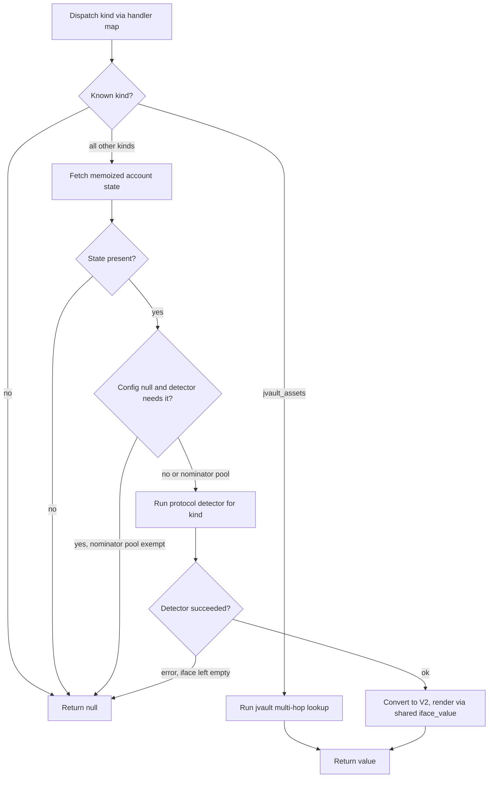

# EmuCelldbLookup

EmuCelldbTier2 is the synchronous shard-state fallback consulted by ParsedBlockLookupSource when tier 1 — interfaces already computed for accounts touched in the current block — misses. It reads raw account state from the trace's shard states and runs protocol detectors (get-method emulation) to resolve a kind+address into the same Value shape tier 1 produces. One instance owns the memo for one classification: constructed per classify call and never shared across traces (ParsedBlockLookupSource is likewise per-call and composes this tier in). Its contract is to never fail a trace over a tier-2 problem: fetch() turns every exception, malformed argument, and detector failure into a null miss. Both account_memo_ (raw state) and value_memo_ (resolved Values) memoize per key, so repeated lookups within the one classification don't re-read celldb or re-run detectors.

## class mch::Tier2Stats

- decl: `ton-index-worker/ton-mch-engine/src/emu/EmuCelldbLookup.h:17`

Per-instance counters: celldb account reads issued and repeats served from the value memo.

## class mch::EmuCelldbTier2

- decl: `ton-index-worker/ton-mch-engine/src/emu/EmuCelldbLookup.h:22`

Synchronous tier-2 interface resolver: memoized shard-state account reads plus protocol detectors.

One instance per classification — the memos are per-call state, and the object is neither thread-safe nor shareable across traces. shard_states_ and config_ are borrowed and must outlive the instance (they belong to the trace view / parsed block); the constructor captures the raw states pointer in account_source_, so the account source keeps working after a move. Every detector except NominatorPoolContract executes get-methods and requires config_ non-null, returning null immediately otherwise.

## memo_key

`std::string memo_key(const std::string & kind, const block::StdAddress & addr)`

- decl: `ton-index-worker/ton-mch-engine/src/emu/EmuCelldbLookup.cpp:18`
- callers: mch::EmuCelldbTier2::fetch (ton-index-worker/ton-mch-engine/src/emu/EmuCelldbLookup.cpp:179)

Value-memo key: kind + NUL + workchain:hex(address), so kind/address pairs can never alias by string concatenation.

## account

`const schema::AccountState * account(const block::StdAddress & addr)`

- decl: `ton-index-worker/ton-mch-engine/src/emu/EmuCelldbLookup.cpp:34`
- callers: mch::EmuCelldbTier2::jvault_assets (ton-index-worker/ton-mch-engine/src/emu/EmuCelldbLookup.cpp:129); mch::EmuCelldbTier2::jvault_assets (ton-index-worker/ton-mch-engine/src/emu/EmuCelldbLookup.cpp:144); mch::EmuCelldbTier2::resolve (ton-index-worker/ton-mch-engine/src/emu/EmuCelldbLookup.cpp:64)

Memoized raw account-state lookup; nullptr covers both absence and read failure.

A memo hit returns immediately — absence is memoized as nullopt, not re-read; a miss bumps stats_.fetched and runs the injected account_source_ (production: lookup_account over the shard states). Two-phase fixpoint rounds reuse the memo and never repeat account reads; set_account_source swaps the reader for fixtures.

## resolve

`Value resolve(const std::string & kind, const block::StdAddress & addr)`

- decl: `ton-index-worker/ton-mch-engine/src/emu/EmuCelldbLookup.cpp:46`
- callers: mch::EmuCelldbTier2::fetch (ton-index-worker/ton-mch-engine/src/emu/EmuCelldbLookup.cpp:188)
- calls: `DedustPoolDetector::detect`, `GetGemsNftAuction::detect`, `JettonWalletDetectorR::detect`, `NftItemDetectorR::detect`, `NominatorPoolContract::detect`, `mch::EmuCelldbTier2::account`, `mch::EmuCelldbTier2::jvault_assets`, `mch::ParsedBlockLookupSource::iface_value`, `mch::Value::null`, `mch::to_v2`

Dispatches a parsed (kind, address) to its protocol detector and renders the result through the shared iface_value.

An unknown kind returns null; jvault_assets short-circuits before any account read. Otherwise account() must produce state, and every detector except NominatorPoolContract demands a non-null config_ (null config returns null without running). A detector error leaves the result empty and null; a success converts via to_v2 and renders through ParsedBlockLookupSource::iface_value — the same shape function tier 1 uses — making tier-1 and tier-2 answers shape-identical by construction.

## operator=

`Tier2Stats & operator=(const Tier2Stats &)`

- decl: `ton-index-worker/ton-mch-engine/src/emu/EmuCelldbLookup.h:17`
- callers: mch::classify_txs (ton-index-worker/ton-mch-engine/src/emu/EmuClassifierActor.cpp:75)

Copy-assigns the counters; how callers snapshot stats out of a live instance.

## EmuCelldbTier2

`void EmuCelldbTier2(EmuCelldbTier2 &&)`

- decl: `ton-index-worker/ton-mch-engine/src/emu/EmuCelldbLookup.h:22`
- callers: mch::Fixture::make (ton-index-worker/ton-mch-engine/harness/EmuCelldbLookupTest.cpp:300)

Move-constructs; safe because account_source_ captures the shard-states pointer rather than this.

## EmuCelldbTier2

`void EmuCelldbTier2(const AllShardStates * shard_states, std::shared_ptr<block::ConfigInfo> config)`

- decl: `ton-index-worker/ton-mch-engine/src/emu/EmuCelldbLookup.h:28`
- callers: mch::Fixture::make (ton-index-worker/ton-mch-engine/harness/EmuCelldbLookupTest.cpp:291); mch::test_memo_and_guards (ton-index-worker/ton-mch-engine/harness/EmuCelldbLookupTest.cpp:422); mch::classify_txs (ton-index-worker/ton-mch-engine/src/emu/EmuClassifierActor.cpp:59); [BatchRunner::classify_trace (ton-index-worker/ton-mch-index/src/BatchRunner.cpp:230)](BatchRunner.md#classify_trace)
- calls: `lookup_account`

Borrows the shard states and config (both must outlive the instance) and wires the production account reader.

The account_source_ lambda captures the raw states pointer, so the reader survives moving the instance; memos and stats start empty.

## fetch

`Value fetch(const std::string & kind, const std::vector<Value> & args)`

- decl: `ton-index-worker/ton-mch-engine/src/emu/EmuCelldbLookup.h:31`
- callers: mch::test_jvault_hook (ton-index-worker/ton-mch-engine/harness/EmuCelldbLookupTest.cpp:316); mch::test_jvault_hook (ton-index-worker/ton-mch-engine/harness/EmuCelldbLookupTest.cpp:322); mch::test_jvault_hook (ton-index-worker/ton-mch-engine/harness/EmuCelldbLookupTest.cpp:339); mch::test_jvault_hook (ton-index-worker/ton-mch-engine/harness/EmuCelldbLookupTest.cpp:350); mch::test_memo_and_guards (ton-index-worker/ton-mch-engine/harness/EmuCelldbLookupTest.cpp:362); mch::test_memo_and_guards (ton-index-worker/ton-mch-engine/harness/EmuCelldbLookupTest.cpp:363); mch::test_memo_and_guards (ton-index-worker/ton-mch-engine/harness/EmuCelldbLookupTest.cpp:374); mch::test_memo_and_guards (ton-index-worker/ton-mch-engine/harness/EmuCelldbLookupTest.cpp:375); mch::test_memo_and_guards (ton-index-worker/ton-mch-engine/harness/EmuCelldbLookupTest.cpp:385); mch::test_memo_and_guards (ton-index-worker/ton-mch-engine/harness/EmuCelldbLookupTest.cpp:386); mch::test_memo_and_guards (ton-index-worker/ton-mch-engine/harness/EmuCelldbLookupTest.cpp:394); mch::test_memo_and_guards (ton-index-worker/ton-mch-engine/harness/EmuCelldbLookupTest.cpp:395); mch::test_memo_and_guards (ton-index-worker/ton-mch-engine/harness/EmuCelldbLookupTest.cpp:397); mch::test_memo_and_guards (ton-index-worker/ton-mch-engine/harness/EmuCelldbLookupTest.cpp:399); mch::test_memo_and_guards (ton-index-worker/ton-mch-engine/harness/EmuCelldbLookupTest.cpp:401); mch::test_memo_and_guards (ton-index-worker/ton-mch-engine/harness/EmuCelldbLookupTest.cpp:404); mch::test_memo_and_guards (ton-index-worker/ton-mch-engine/harness/EmuCelldbLookupTest.cpp:408); mch::test_memo_and_guards (ton-index-worker/ton-mch-engine/harness/EmuCelldbLookupTest.cpp:415); mch::test_memo_and_guards (ton-index-worker/ton-mch-engine/harness/EmuCelldbLookupTest.cpp:424); mch::EmuCelldbTier2::jvault_assets (ton-index-worker/ton-mch-engine/src/emu/EmuCelldbLookup.cpp:154); mch::classify_txs (ton-index-worker/ton-mch-engine/src/emu/EmuClassifierActor.cpp:63); [BatchRunner::classify_trace (ton-index-worker/ton-mch-index/src/BatchRunner.cpp:234)](BatchRunner.md#classify_trace)
- calls: `mch::EmuCelldbTier2::resolve`, `mch::Value::Value`, `mch::Value::null`, `mch::memo_key`

Tier2Hook entry point: validates arguments, consults the value memo, then resolves — with every failure folded into a null miss.

Requires shard states present and non-empty and exactly one Str or non-null Account argument; a malformed address is a clean null. A value_memo_ hit (including a memoized null) returns immediately and bumps memo_hits; on a miss, resolve() runs inside a try/catch-all where ANY exception becomes null — never fail the trace over a tier-2 parse issue — and the outcome, null or not, is memoized before returning.

## stats

`const Tier2Stats & stats() const`

- decl: `ton-index-worker/ton-mch-engine/src/emu/EmuCelldbLookup.h:33`
- callers: mch::test_memo_and_guards (ton-index-worker/ton-mch-engine/harness/EmuCelldbLookupTest.cpp:365); mch::test_memo_and_guards (ton-index-worker/ton-mch-engine/harness/EmuCelldbLookupTest.cpp:366); mch::test_memo_and_guards (ton-index-worker/ton-mch-engine/harness/EmuCelldbLookupTest.cpp:376); mch::test_memo_and_guards (ton-index-worker/ton-mch-engine/harness/EmuCelldbLookupTest.cpp:387); mch::test_memo_and_guards (ton-index-worker/ton-mch-engine/harness/EmuCelldbLookupTest.cpp:405); mch::test_memo_and_guards (ton-index-worker/ton-mch-engine/harness/EmuCelldbLookupTest.cpp:417); mch::classify_txs (ton-index-worker/ton-mch-engine/src/emu/EmuClassifierActor.cpp:75)

Accessor for the instance's fetched/memo_hits counters.

## set_account_source

`void set_account_source(AccountSource src)`

- decl: `ton-index-worker/ton-mch-engine/src/emu/EmuCelldbLookup.h:34`
- callers: mch::Fixture::make (ton-index-worker/ton-mch-engine/harness/EmuCelldbLookupTest.cpp:292)

Swaps the account reader; production uses lookup_account, fixtures inject their own.

## jvault_assets

`Value jvault_assets(const block::StdAddress & stake_wallet)`

- decl: `ton-index-worker/ton-mch-engine/src/emu/EmuCelldbLookup.h:42`
- callers: mch::EmuCelldbTier2::resolve (ton-index-worker/ton-mch-engine/src/emu/EmuCelldbLookup.cpp:61)
- calls: `mch::EmuCelldbTier2::account`, `mch::EmuCelldbTier2::fetch`, `mch::Value::Value`, `mch::Value::field`, `mch::Value::make_asset_jetton`, `mch::Value::make_str`, `mch::Value::null`, `mch::canonicalize_or_passthrough`, `mch::jvault_asset_of`, `mch::jvault_record`, `mch::parse_jvault_pool_lock_wallet`, `mch::parse_jvault_stake_wallet`

Multi-hop jvault lookup: stake wallet to pool to lock wallet to jetton wallet, producing the jvault record with its underlying asset.

Parses the stake wallet for the pool reference, the pool for the lock wallet, then a recursive fetch("jetton_wallet", ...) for the jetton master — every hop through the memos. Any failed parse or missing hop except one returns null; the exception is a missing pool state, which still yields a valid record with a null asset rather than failing the lookup outright. The inner jetton_wallet fetch goes back through the normal resolve path and therefore obeys the config_ requirement.
