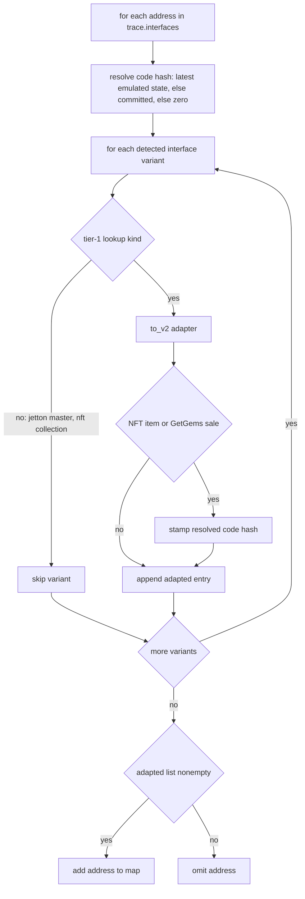

# EmuClassifierBridge

Single-function bridge from the trace emulator's interface detection to the schema V2 interface map used for tier-1 contract lookups. make_interface_map is called by the trace assembler after emulation and turns each address's trace-final interface results into converted V2 entries, deriving NFT code hashes from the trace's own account states so emulated accounts resolve without a celldb round trip. Pure function over the trace; no persistent state and no threading concerns.

## make_interface_map

`ParsedBlockLookupSource::InterfaceMap make_interface_map(const ::Trace & trace)`

- decl: `ton-index-worker/ton-mch-engine/src/emu/EmuClassifierBridge.cpp:15`
- callers: TraceAssembler::apply (ton-index-worker/ton-trace-emulator/src/TraceAssembler.cpp:249)
- calls: `mch::(lambda at /home/verdigos/dev/ton-indexer-private/ton-index-worker/ton-mch-engine/src/emu/EmuClassifierBridge.cpp:20:28)::operator()`, `mch::to_v2`

Builds the address-to-V2 interface map from the emulator's trace-final interface results.

For each address in trace.interfaces, resolves the account's code hash once — latest emulated account state first, then committed state, zero meaning unknown — then converts each detected interface through its to_v2 adapter, stamping the code hash on the NFT item and GetGems sale and auction variants. Variants without a tier-1 lookup kind, namely jetton master and NFT collection, are skipped, and an address whose adapted list ends up empty is omitted entirely. Trace-final interfaces are what let emulated accounts resolve in tier 1.

## operator()

`td::Bits256 operator()(const block::StdAddress & addr) const`

- decl: `ton-index-worker/ton-mch-engine/src/emu/EmuClassifierBridge.cpp:20`
- callers: mch::make_interface_map (ton-index-worker/ton-mch-engine/src/emu/EmuClassifierBridge.cpp:41)

Resolves an address's code hash, preferring emulated state over committed.

Takes the last entry of the emulated-account range for the address and returns its code hash when code is present, otherwise checks the committed account map, and returns zero when neither yields code. Captures the trace by reference and is used only inside make_interface_map.
