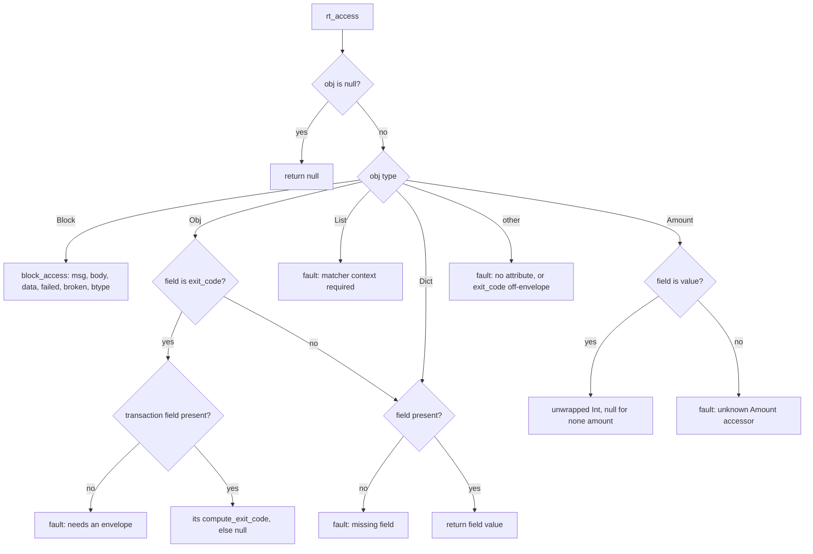
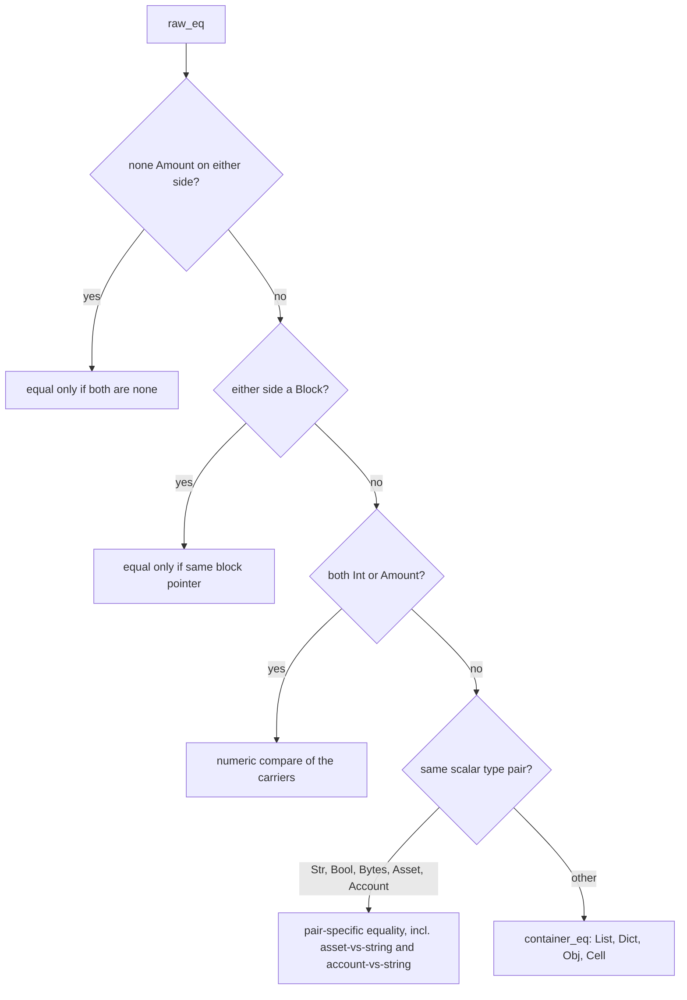

# ExprRuntime

Leaf-operation runtime for the expression language, shared verbatim by the generated matcher code (vectors, wheres, and builds IR call the typed rt_ helpers directly) and the fixtures interpreter. Every operation returns an EvalResult: faults are explicit values carrying a diagnostic message, never exceptions, and each operation defines its own null behavior — typically null propagation for access and arithmetic, faults for type misuse. All functions are pure over their arguments and hold no state, so they run freely on the single thread a classify occupies.

## class mch::EvalResult

- decl: `ton-index-worker/ton-mch-engine/src/ExprRuntime.h:15`

Result of one runtime operation: either a value or a fault with a diagnostic message.

faulted false means the value field is the answer; faulted true means the message holds the reason and the value is a null placeholder. Faults are clean matcher rejections, not exceptional conditions, and the message is diagnostics only. Plain aggregate moved around by value; the only ownership is whatever the carried Value owns.

## class mch::WhereEnv

- decl: `ton-index-worker/ton-mch-engine/src/ExprRuntime.h:27`

Evaluation context for where expressions: the candidate block plus a slot view of the captures.

Holds a borrowed pointer to the block under test and a pointer to the slot array with its length; both must outlive the evaluation and are never written. The slot view is fixed at construction — the matcher entry capture at its slot, nulls elsewhere — and rt_dotfield is the main consumer, reading the block's data for leading-dot access.

## eq_result

`EvalResult eq_result(const Value & l, const Value & r, bool want_eq)`

- decl: `ton-index-worker/ton-mch-engine/src/ExprRuntime.cpp:140`
- callers: mch::rt_eq (ton-index-worker/ton-mch-engine/src/ExprRuntime.cpp:398); mch::rt_ne (ton-index-worker/ton-mch-engine/src/ExprRuntime.cpp:399)
- calls: `mch::Value::make_bool`, `mch::raw_eq`, `mch::rt_fault`, `mch::rt_is_null`, `mch::rt_ok`

Shared core for equality and inequality with null-aware structural comparison.

Two nulls compare equal; exactly one null makes the pair unequal. A TON asset (no jetton master) compared against a string faults rather than answering — a deliberately frozen parity decision. Everything else delegates to raw_eq, and the result is inverted for the not-equal sense.

## ord_result

`EvalResult ord_result(const Value & l, const Value & r, const char * op)`

- decl: `ton-index-worker/ton-mch-engine/src/ExprRuntime.cpp:158`
- callers: mch::rt_lt (ton-index-worker/ton-mch-engine/src/ExprRuntime.cpp:400); mch::rt_le (ton-index-worker/ton-mch-engine/src/ExprRuntime.cpp:401); mch::rt_gt (ton-index-worker/ton-mch-engine/src/ExprRuntime.cpp:402); mch::rt_ge (ton-index-worker/ton-mch-engine/src/ExprRuntime.cpp:403)
- calls: `mch::Value::describe`, `mch::Value::make_bool`, `mch::rt_fault`, `mch::rt_is_null`, `mch::rt_ok`

Shared core for the four ordered comparisons: less, less-or-equal, greater, greater-or-equal.

A null on either side yields false rather than a fault. Only Int/Int and Str/Str pairs are orderable; every other pairing, Amount included, faults with a describe-based message. The op string picks the operator sense from the three-way comparison result.

## coerce_int

`bool coerce_int(const Value & v, td::RefInt256 & out, std::string & err)`

- decl: `ton-index-worker/ton-mch-engine/src/ExprRuntime.cpp:177`
- callers: mch::arith (ton-index-worker/ton-mch-engine/src/ExprRuntime.cpp:196); mch::rt_builtin_sum (ton-index-worker/ton-mch-engine/src/ExprRuntime.cpp:595)
- calls: `mch::Value::describe`, `mch::amount_none`

Extracts the 256-bit integer carrier of an Int or Amount, reporting failure through an error string.

An Amount whose carrier is null (Amount none) fails with its own message so arithmetic stays a containable fault rather than a crash. Any other type fails with a describe-based message. Callers translate a false return into rt_fault; arith and the sum builtin are the consumers.

## amount_none

`bool amount_none(const Value & v)`

- decl: `ton-index-worker/ton-mch-engine/src/ExprRuntime.cpp:19`
- callers: mch::coerce_int (ton-index-worker/ton-mch-engine/src/ExprRuntime.cpp:178); mch::raw_eq (ton-index-worker/ton-mch-engine/src/ExprRuntime.cpp:70); mch::raw_eq (ton-index-worker/ton-mch-engine/src/ExprRuntime.cpp:72)

True when the value is an Amount carrying no number.

Float-backed Amounts cannot be constructed, so a null carrier unambiguously means the none amount; raw_eq uses it to make Amount none equal only to itself.

## arith

`EvalResult arith(const Value & l, const Value & r, char op)`

- decl: `ton-index-worker/ton-mch-engine/src/ExprRuntime.cpp:190`
- callers: mch::rt_add (ton-index-worker/ton-mch-engine/src/ExprRuntime.cpp:404); mch::rt_sub (ton-index-worker/ton-mch-engine/src/ExprRuntime.cpp:405); mch::rt_mul (ton-index-worker/ton-mch-engine/src/ExprRuntime.cpp:406)
- calls: `mch::Value::make_int`, `mch::Value::null`, `mch::coerce_int`, `mch::rt_fault`, `mch::rt_is_null`, `mch::rt_ok`

Null-propagating add, subtract, and multiply over Int and Amount operands.

Either operand null returns null. Operands go through coerce_int and a coercion failure faults with its message. The result is a fresh Int even when both operands were Amounts, and op selects plus, minus, or times.

## rt_name

`EvalResult rt_name(const Env & env, const std::string & id)`

- decl: `ton-index-worker/ton-mch-engine/src/ExprRuntime.cpp:208`
- callers: mch::vec_89 (ton-index-worker/ton-mch-engine/generated/vectors_generated.cpp:1006); mch::vec_89 (ton-index-worker/ton-mch-engine/generated/vectors_generated.cpp:1009); mch::vec_90 (ton-index-worker/ton-mch-engine/generated/vectors_generated.cpp:1020); mch::vec_90 (ton-index-worker/ton-mch-engine/generated/vectors_generated.cpp:1023); mch::vec_91 (ton-index-worker/ton-mch-engine/generated/vectors_generated.cpp:1034); mch::vec_91 (ton-index-worker/ton-mch-engine/generated/vectors_generated.cpp:1037); mch::vec_92 (ton-index-worker/ton-mch-engine/generated/vectors_generated.cpp:1048); mch::vec_11 (ton-index-worker/ton-mch-engine/generated/vectors_generated.cpp:105); mch::vec_92 (ton-index-worker/ton-mch-engine/generated/vectors_generated.cpp:1051); mch::vec_93 (ton-index-worker/ton-mch-engine/generated/vectors_generated.cpp:1062); mch::vec_93 (ton-index-worker/ton-mch-engine/generated/vectors_generated.cpp:1065); mch::vec_94 (ton-index-worker/ton-mch-engine/generated/vectors_generated.cpp:1076); mch::vec_94 (ton-index-worker/ton-mch-engine/generated/vectors_generated.cpp:1079); mch::vec_95 (ton-index-worker/ton-mch-engine/generated/vectors_generated.cpp:1090); mch::vec_95 (ton-index-worker/ton-mch-engine/generated/vectors_generated.cpp:1093); mch::vec_96 (ton-index-worker/ton-mch-engine/generated/vectors_generated.cpp:1104); mch::vec_96 (ton-index-worker/ton-mch-engine/generated/vectors_generated.cpp:1107); mch::vec_97 (ton-index-worker/ton-mch-engine/generated/vectors_generated.cpp:1118); mch::vec_97 (ton-index-worker/ton-mch-engine/generated/vectors_generated.cpp:1121); mch::vec_98 (ton-index-worker/ton-mch-engine/generated/vectors_generated.cpp:1132); mch::vec_98 (ton-index-worker/ton-mch-engine/generated/vectors_generated.cpp:1135); mch::vec_99 (ton-index-worker/ton-mch-engine/generated/vectors_generated.cpp:1146); mch::vec_99 (ton-index-worker/ton-mch-engine/generated/vectors_generated.cpp:1149); mch::vec_12 (ton-index-worker/ton-mch-engine/generated/vectors_generated.cpp:116); mch::vec_100 (ton-index-worker/ton-mch-engine/generated/vectors_generated.cpp:1160); mch::vec_100 (ton-index-worker/ton-mch-engine/generated/vectors_generated.cpp:1167); mch::vec_101 (ton-index-worker/ton-mch-engine/generated/vectors_generated.cpp:1179); mch::vec_101 (ton-index-worker/ton-mch-engine/generated/vectors_generated.cpp:1186); mch::vec_102 (ton-index-worker/ton-mch-engine/generated/vectors_generated.cpp:1198); mch::vec_102 (ton-index-worker/ton-mch-engine/generated/vectors_generated.cpp:1205); mch::vec_103 (ton-index-worker/ton-mch-engine/generated/vectors_generated.cpp:1217); mch::vec_103 (ton-index-worker/ton-mch-engine/generated/vectors_generated.cpp:1222); mch::vec_104 (ton-index-worker/ton-mch-engine/generated/vectors_generated.cpp:1232); mch::vec_104 (ton-index-worker/ton-mch-engine/generated/vectors_generated.cpp:1237); mch::vec_105 (ton-index-worker/ton-mch-engine/generated/vectors_generated.cpp:1247); mch::vec_105 (ton-index-worker/ton-mch-engine/generated/vectors_generated.cpp:1252); mch::vec_105 (ton-index-worker/ton-mch-engine/generated/vectors_generated.cpp:1259); mch::vec_106 (ton-index-worker/ton-mch-engine/generated/vectors_generated.cpp:1269); mch::vec_13 (ton-index-worker/ton-mch-engine/generated/vectors_generated.cpp:127); mch::vec_106 (ton-index-worker/ton-mch-engine/generated/vectors_generated.cpp:1272); mch::vec_107 (ton-index-worker/ton-mch-engine/generated/vectors_generated.cpp:1283); mch::vec_107 (ton-index-worker/ton-mch-engine/generated/vectors_generated.cpp:1286); mch::vec_108 (ton-index-worker/ton-mch-engine/generated/vectors_generated.cpp:1297); mch::vec_108 (ton-index-worker/ton-mch-engine/generated/vectors_generated.cpp:1300); mch::vec_109 (ton-index-worker/ton-mch-engine/generated/vectors_generated.cpp:1311); mch::vec_109 (ton-index-worker/ton-mch-engine/generated/vectors_generated.cpp:1314); mch::vec_109 (ton-index-worker/ton-mch-engine/generated/vectors_generated.cpp:1317); mch::vec_110 (ton-index-worker/ton-mch-engine/generated/vectors_generated.cpp:1331); mch::vec_110 (ton-index-worker/ton-mch-engine/generated/vectors_generated.cpp:1334); mch::vec_110 (ton-index-worker/ton-mch-engine/generated/vectors_generated.cpp:1340); mch::vec_111 (ton-index-worker/ton-mch-engine/generated/vectors_generated.cpp:1351); mch::vec_111 (ton-index-worker/ton-mch-engine/generated/vectors_generated.cpp:1354); mch::vec_111 (ton-index-worker/ton-mch-engine/generated/vectors_generated.cpp:1360); mch::vec_112 (ton-index-worker/ton-mch-engine/generated/vectors_generated.cpp:1371); mch::vec_112 (ton-index-worker/ton-mch-engine/generated/vectors_generated.cpp:1374); mch::vec_14 (ton-index-worker/ton-mch-engine/generated/vectors_generated.cpp:138); mch::vec_112 (ton-index-worker/ton-mch-engine/generated/vectors_generated.cpp:1380); mch::vec_113 (ton-index-worker/ton-mch-engine/generated/vectors_generated.cpp:1391); mch::vec_113 (ton-index-worker/ton-mch-engine/generated/vectors_generated.cpp:1394); mch::vec_114 (ton-index-worker/ton-mch-engine/generated/vectors_generated.cpp:1408); mch::vec_114 (ton-index-worker/ton-mch-engine/generated/vectors_generated.cpp:1411); mch::vec_115 (ton-index-worker/ton-mch-engine/generated/vectors_generated.cpp:1422); mch::vec_115 (ton-index-worker/ton-mch-engine/generated/vectors_generated.cpp:1425); mch::vec_116 (ton-index-worker/ton-mch-engine/generated/vectors_generated.cpp:1436); mch::vec_116 (ton-index-worker/ton-mch-engine/generated/vectors_generated.cpp:1439); mch::vec_117 (ton-index-worker/ton-mch-engine/generated/vectors_generated.cpp:1450); mch::vec_117 (ton-index-worker/ton-mch-engine/generated/vectors_generated.cpp:1453); mch::vec_118 (ton-index-worker/ton-mch-engine/generated/vectors_generated.cpp:1464); mch::vec_118 (ton-index-worker/ton-mch-engine/generated/vectors_generated.cpp:1467); mch::vec_119 (ton-index-worker/ton-mch-engine/generated/vectors_generated.cpp:1478); mch::vec_119 (ton-index-worker/ton-mch-engine/generated/vectors_generated.cpp:1485); mch::vec_15 (ton-index-worker/ton-mch-engine/generated/vectors_generated.cpp:149); mch::vec_119 (ton-index-worker/ton-mch-engine/generated/vectors_generated.cpp:1490); mch::vec_120 (ton-index-worker/ton-mch-engine/generated/vectors_generated.cpp:1500); mch::vec_120 (ton-index-worker/ton-mch-engine/generated/vectors_generated.cpp:1507); mch::vec_120 (ton-index-worker/ton-mch-engine/generated/vectors_generated.cpp:1512); mch::vec_121 (ton-index-worker/ton-mch-engine/generated/vectors_generated.cpp:1522); mch::vec_121 (ton-index-worker/ton-mch-engine/generated/vectors_generated.cpp:1529); mch::vec_121 (ton-index-worker/ton-mch-engine/generated/vectors_generated.cpp:1534); mch::vec_124 (ton-index-worker/ton-mch-engine/generated/vectors_generated.cpp:1562); mch::vec_124 (ton-index-worker/ton-mch-engine/generated/vectors_generated.cpp:1565); mch::vec_128 (ton-index-worker/ton-mch-engine/generated/vectors_generated.cpp:1604); mch::vec_129 (ton-index-worker/ton-mch-engine/generated/vectors_generated.cpp:1618); mch::vec_130 (ton-index-worker/ton-mch-engine/generated/vectors_generated.cpp:1629); mch::vec_131 (ton-index-worker/ton-mch-engine/generated/vectors_generated.cpp:1650); mch::vec_132 (ton-index-worker/ton-mch-engine/generated/vectors_generated.cpp:1670); mch::vec_17 (ton-index-worker/ton-mch-engine/generated/vectors_generated.cpp:168); mch::vec_133 (ton-index-worker/ton-mch-engine/generated/vectors_generated.cpp:1689); mch::vec_134 (ton-index-worker/ton-mch-engine/generated/vectors_generated.cpp:1711); mch::vec_135 (ton-index-worker/ton-mch-engine/generated/vectors_generated.cpp:1732); mch::vec_136 (ton-index-worker/ton-mch-engine/generated/vectors_generated.cpp:1753); mch::vec_137 (ton-index-worker/ton-mch-engine/generated/vectors_generated.cpp:1769); mch::vec_137 (ton-index-worker/ton-mch-engine/generated/vectors_generated.cpp:1780); mch::vec_138 (ton-index-worker/ton-mch-engine/generated/vectors_generated.cpp:1789); mch::vec_18 (ton-index-worker/ton-mch-engine/generated/vectors_generated.cpp:179); mch::vec_139 (ton-index-worker/ton-mch-engine/generated/vectors_generated.cpp:1810); mch::vec_140 (ton-index-worker/ton-mch-engine/generated/vectors_generated.cpp:1831); mch::vec_141 (ton-index-worker/ton-mch-engine/generated/vectors_generated.cpp:1852); mch::vec_142 (ton-index-worker/ton-mch-engine/generated/vectors_generated.cpp:1873); mch::vec_143 (ton-index-worker/ton-mch-engine/generated/vectors_generated.cpp:1894); mch::vec_144 (ton-index-worker/ton-mch-engine/generated/vectors_generated.cpp:1915); mch::vec_145 (ton-index-worker/ton-mch-engine/generated/vectors_generated.cpp:1936); mch::vec_146 (ton-index-worker/ton-mch-engine/generated/vectors_generated.cpp:1957); mch::vec_147 (ton-index-worker/ton-mch-engine/generated/vectors_generated.cpp:1978); mch::vec_20 (ton-index-worker/ton-mch-engine/generated/vectors_generated.cpp:198); mch::vec_21 (ton-index-worker/ton-mch-engine/generated/vectors_generated.cpp:209); mch::vec_22 (ton-index-worker/ton-mch-engine/generated/vectors_generated.cpp:220); mch::vec_23 (ton-index-worker/ton-mch-engine/generated/vectors_generated.cpp:231); mch::vec_24 (ton-index-worker/ton-mch-engine/generated/vectors_generated.cpp:242); mch::vec_25 (ton-index-worker/ton-mch-engine/generated/vectors_generated.cpp:253); mch::vec_27 (ton-index-worker/ton-mch-engine/generated/vectors_generated.cpp:272); mch::vec_28 (ton-index-worker/ton-mch-engine/generated/vectors_generated.cpp:283); mch::vec_29 (ton-index-worker/ton-mch-engine/generated/vectors_generated.cpp:294); mch::vec_30 (ton-index-worker/ton-mch-engine/generated/vectors_generated.cpp:305); mch::vec_31 (ton-index-worker/ton-mch-engine/generated/vectors_generated.cpp:316); mch::vec_32 (ton-index-worker/ton-mch-engine/generated/vectors_generated.cpp:327); mch::vec_33 (ton-index-worker/ton-mch-engine/generated/vectors_generated.cpp:338); mch::vec_34 (ton-index-worker/ton-mch-engine/generated/vectors_generated.cpp:349); mch::vec_35 (ton-index-worker/ton-mch-engine/generated/vectors_generated.cpp:360); mch::vec_36 (ton-index-worker/ton-mch-engine/generated/vectors_generated.cpp:371); mch::vec_37 (ton-index-worker/ton-mch-engine/generated/vectors_generated.cpp:382); mch::vec_38 (ton-index-worker/ton-mch-engine/generated/vectors_generated.cpp:393); mch::vec_39 (ton-index-worker/ton-mch-engine/generated/vectors_generated.cpp:404); mch::vec_40 (ton-index-worker/ton-mch-engine/generated/vectors_generated.cpp:415); mch::vec_41 (ton-index-worker/ton-mch-engine/generated/vectors_generated.cpp:426); mch::vec_42 (ton-index-worker/ton-mch-engine/generated/vectors_generated.cpp:437); mch::vec_43 (ton-index-worker/ton-mch-engine/generated/vectors_generated.cpp:448); mch::vec_44 (ton-index-worker/ton-mch-engine/generated/vectors_generated.cpp:459); mch::vec_45 (ton-index-worker/ton-mch-engine/generated/vectors_generated.cpp:470); mch::vec_46 (ton-index-worker/ton-mch-engine/generated/vectors_generated.cpp:481); mch::vec_47 (ton-index-worker/ton-mch-engine/generated/vectors_generated.cpp:492); mch::vec_48 (ton-index-worker/ton-mch-engine/generated/vectors_generated.cpp:503); mch::vec_49 (ton-index-worker/ton-mch-engine/generated/vectors_generated.cpp:514); mch::vec_50 (ton-index-worker/ton-mch-engine/generated/vectors_generated.cpp:525); mch::vec_6 (ton-index-worker/ton-mch-engine/generated/vectors_generated.cpp:53); mch::vec_51 (ton-index-worker/ton-mch-engine/generated/vectors_generated.cpp:536); mch::vec_52 (ton-index-worker/ton-mch-engine/generated/vectors_generated.cpp:547); mch::vec_53 (ton-index-worker/ton-mch-engine/generated/vectors_generated.cpp:558); mch::vec_54 (ton-index-worker/ton-mch-engine/generated/vectors_generated.cpp:569); mch::vec_55 (ton-index-worker/ton-mch-engine/generated/vectors_generated.cpp:580); mch::vec_56 (ton-index-worker/ton-mch-engine/generated/vectors_generated.cpp:591); mch::vec_57 (ton-index-worker/ton-mch-engine/generated/vectors_generated.cpp:602); mch::vec_7 (ton-index-worker/ton-mch-engine/generated/vectors_generated.cpp:61); mch::vec_58 (ton-index-worker/ton-mch-engine/generated/vectors_generated.cpp:613); mch::vec_59 (ton-index-worker/ton-mch-engine/generated/vectors_generated.cpp:624); mch::vec_60 (ton-index-worker/ton-mch-engine/generated/vectors_generated.cpp:635); mch::vec_61 (ton-index-worker/ton-mch-engine/generated/vectors_generated.cpp:646); mch::vec_62 (ton-index-worker/ton-mch-engine/generated/vectors_generated.cpp:657); mch::vec_63 (ton-index-worker/ton-mch-engine/generated/vectors_generated.cpp:668); mch::vec_64 (ton-index-worker/ton-mch-engine/generated/vectors_generated.cpp:679); mch::vec_8 (ton-index-worker/ton-mch-engine/generated/vectors_generated.cpp:69); mch::vec_65 (ton-index-worker/ton-mch-engine/generated/vectors_generated.cpp:690); mch::vec_65 (ton-index-worker/ton-mch-engine/generated/vectors_generated.cpp:693); mch::vec_66 (ton-index-worker/ton-mch-engine/generated/vectors_generated.cpp:704); mch::vec_66 (ton-index-worker/ton-mch-engine/generated/vectors_generated.cpp:707); mch::vec_67 (ton-index-worker/ton-mch-engine/generated/vectors_generated.cpp:718); mch::vec_67 (ton-index-worker/ton-mch-engine/generated/vectors_generated.cpp:721); mch::vec_68 (ton-index-worker/ton-mch-engine/generated/vectors_generated.cpp:732); mch::vec_68 (ton-index-worker/ton-mch-engine/generated/vectors_generated.cpp:735); mch::vec_69 (ton-index-worker/ton-mch-engine/generated/vectors_generated.cpp:746); mch::vec_69 (ton-index-worker/ton-mch-engine/generated/vectors_generated.cpp:749); mch::vec_70 (ton-index-worker/ton-mch-engine/generated/vectors_generated.cpp:760); mch::vec_70 (ton-index-worker/ton-mch-engine/generated/vectors_generated.cpp:763); mch::vec_71 (ton-index-worker/ton-mch-engine/generated/vectors_generated.cpp:774); mch::vec_71 (ton-index-worker/ton-mch-engine/generated/vectors_generated.cpp:777); mch::vec_72 (ton-index-worker/ton-mch-engine/generated/vectors_generated.cpp:788); mch::vec_72 (ton-index-worker/ton-mch-engine/generated/vectors_generated.cpp:791); mch::vec_9 (ton-index-worker/ton-mch-engine/generated/vectors_generated.cpp:80); mch::vec_73 (ton-index-worker/ton-mch-engine/generated/vectors_generated.cpp:802); mch::vec_73 (ton-index-worker/ton-mch-engine/generated/vectors_generated.cpp:805); mch::vec_74 (ton-index-worker/ton-mch-engine/generated/vectors_generated.cpp:816); mch::vec_74 (ton-index-worker/ton-mch-engine/generated/vectors_generated.cpp:819); mch::vec_75 (ton-index-worker/ton-mch-engine/generated/vectors_generated.cpp:830); mch::vec_75 (ton-index-worker/ton-mch-engine/generated/vectors_generated.cpp:833); mch::vec_76 (ton-index-worker/ton-mch-engine/generated/vectors_generated.cpp:844); mch::vec_76 (ton-index-worker/ton-mch-engine/generated/vectors_generated.cpp:847); mch::vec_77 (ton-index-worker/ton-mch-engine/generated/vectors_generated.cpp:858); mch::vec_77 (ton-index-worker/ton-mch-engine/generated/vectors_generated.cpp:861); mch::vec_78 (ton-index-worker/ton-mch-engine/generated/vectors_generated.cpp:872); mch::vec_78 (ton-index-worker/ton-mch-engine/generated/vectors_generated.cpp:875); mch::vec_79 (ton-index-worker/ton-mch-engine/generated/vectors_generated.cpp:886); mch::vec_80 (ton-index-worker/ton-mch-engine/generated/vectors_generated.cpp:898); mch::vec_81 (ton-index-worker/ton-mch-engine/generated/vectors_generated.cpp:910); mch::vec_82 (ton-index-worker/ton-mch-engine/generated/vectors_generated.cpp:922); mch::vec_83 (ton-index-worker/ton-mch-engine/generated/vectors_generated.cpp:937); mch::vec_10 (ton-index-worker/ton-mch-engine/generated/vectors_generated.cpp:94); mch::vec_84 (ton-index-worker/ton-mch-engine/generated/vectors_generated.cpp:948); mch::vec_85 (ton-index-worker/ton-mch-engine/generated/vectors_generated.cpp:959); mch::vec_86 (ton-index-worker/ton-mch-engine/generated/vectors_generated.cpp:970); mch::vec_87 (ton-index-worker/ton-mch-engine/generated/vectors_generated.cpp:981); mch::vec_88 (ton-index-worker/ton-mch-engine/generated/vectors_generated.cpp:992); mch::vec_88 (ton-index-worker/ton-mch-engine/generated/vectors_generated.cpp:995); mch::ExprEval::eval (ton-index-worker/ton-mch-engine/src/fixtures/ExprEval.cpp:44)
- calls: `mch::Value::Value`, `mch::rt_fault`, `mch::rt_ok`

Name lookup in an expression environment map.

A name missing from the map faults with a not-bound message; otherwise the bound value is returned unchanged. Generated comprehension code calls it for names it cannot bind statically, passing a plain map as the scope.

## msg_envelope

`Value msg_envelope(const Message * m)`

- decl: `ton-index-worker/ton-mch-engine/src/ExprRuntime.cpp:222`
- callers: mch::block_access (ton-index-worker/ton-mch-engine/src/ExprRuntime.cpp:271)
- calls: `mch::(lambda at /home/verdigos/dev/ton-indexer-private/ton-index-worker/ton-mch-engine/src/ExprRuntime.cpp:223:18)::operator()`, `mch::(lambda at /home/verdigos/dev/ton-indexer-private/ton-index-worker/ton-mch-engine/src/ExprRuntime.cpp:226:18)::operator()`, `mch::Value::make_bool`, `mch::Value::make_int64`, `mch::Value::make_obj`, `mch::Value::make_str`, `mch::Value::null`

Builds the Obj view of a block's message envelope for the msg accessor.

The field set is exactly what the trace loader decodes: optional loader fields become null values rather than missing keys, and a loader field the envelope does not carry (fwd_fee, for instance) is simply absent and faults on access. opcode is stored signed, as loaded, unlike block data. The nested transaction object is null when the message has no transaction, and envelope exit_code resolves through it.

## operator()

`Value operator()(const std::optional<std::string> & s) const`

- decl: `ton-index-worker/ton-mch-engine/src/ExprRuntime.cpp:223`
- callers: mch::msg_envelope (ton-index-worker/ton-mch-engine/src/ExprRuntime.cpp:247); mch::msg_envelope (ton-index-worker/ton-mch-engine/src/ExprRuntime.cpp:248)

Converts an optional loader string into a Str value or null when absent.

Local helper inside the envelope builder; a one-line mapping over the optional.

## operator()

`Value operator()(const std::optional<std::int64_t> & n) const`

- decl: `ton-index-worker/ton-mch-engine/src/ExprRuntime.cpp:226`
- callers: mch::msg_envelope (ton-index-worker/ton-mch-engine/src/ExprRuntime.cpp:239); mch::msg_envelope (ton-index-worker/ton-mch-engine/src/ExprRuntime.cpp:249); mch::msg_envelope (ton-index-worker/ton-mch-engine/src/ExprRuntime.cpp:250); mch::msg_envelope (ton-index-worker/ton-mch-engine/src/ExprRuntime.cpp:251); mch::msg_envelope (ton-index-worker/ton-mch-engine/src/ExprRuntime.cpp:252)

Converts an optional loader integer into an Int value or null when absent.

Local helper inside the envelope builder; a one-line mapping over the optional.

## to_lower

`std::string to_lower(std::string s)`

- decl: `ton-index-worker/ton-mch-engine/src/ExprRuntime.cpp:23`
- callers: mch::asset_eq_str (ton-index-worker/ton-mch-engine/src/ExprRuntime.cpp:46)

Lowercases a string in place and returns it.

Byte-wise tolower over an ASCII string; used only for case-insensitive asset master comparison.

## block_access

`EvalResult block_access(const Block * b, const std::string & field)`

- decl: `ton-index-worker/ton-mch-engine/src/ExprRuntime.cpp:262`
- callers: mch::rt_access (ton-index-worker/ton-mch-engine/src/ExprRuntime.cpp:299)
- calls: `mch::Value::Value`, `mch::Value::make_bool`, `mch::Value::make_str`, `mch::Value::null`, `mch::msg_envelope`, `mch::rt_fault`, `mch::rt_ok`

Field access on a Block value: msg envelope, data, failed, broken, and btype.

msg faults when the block has no message envelope at all and returns null when the envelope exists but its message is missing. body always faults in a where context because nothing has been parsed yet. data returns the block's stored value verbatim (possibly null); failed, broken, and btype expose the flags and the type string. Any other field faults with the expected-set message.

## rt_access

`EvalResult rt_access(const Value & obj, const std::string & field)`

- decl: `ton-index-worker/ton-mch-engine/src/ExprRuntime.cpp:294`
- callers: mch::vec_11 (ton-index-worker/ton-mch-engine/generated/vectors_generated.cpp:108); mch::vec_12 (ton-index-worker/ton-mch-engine/generated/vectors_generated.cpp:119); mch::vec_13 (ton-index-worker/ton-mch-engine/generated/vectors_generated.cpp:130); mch::vec_14 (ton-index-worker/ton-mch-engine/generated/vectors_generated.cpp:141); mch::vec_15 (ton-index-worker/ton-mch-engine/generated/vectors_generated.cpp:152); mch::vec_128 (ton-index-worker/ton-mch-engine/generated/vectors_generated.cpp:1610); mch::vec_131 (ton-index-worker/ton-mch-engine/generated/vectors_generated.cpp:1656); mch::vec_133 (ton-index-worker/ton-mch-engine/generated/vectors_generated.cpp:1695); mch::vec_22 (ton-index-worker/ton-mch-engine/generated/vectors_generated.cpp:223); mch::vec_23 (ton-index-worker/ton-mch-engine/generated/vectors_generated.cpp:234); mch::vec_24 (ton-index-worker/ton-mch-engine/generated/vectors_generated.cpp:245); mch::vec_8 (ton-index-worker/ton-mch-engine/generated/vectors_generated.cpp:72); mch::vec_9 (ton-index-worker/ton-mch-engine/generated/vectors_generated.cpp:83); mch::vec_9 (ton-index-worker/ton-mch-engine/generated/vectors_generated.cpp:86); mch::vec_10 (ton-index-worker/ton-mch-engine/generated/vectors_generated.cpp:97); mch::where_279 (ton-index-worker/ton-mch-engine/generated/wheres_ir_generated.cpp:209); mch::where_279 (ton-index-worker/ton-mch-engine/generated/wheres_ir_generated.cpp:212); mch::where_281 (ton-index-worker/ton-mch-engine/generated/wheres_ir_generated.cpp:255); mch::where_281 (ton-index-worker/ton-mch-engine/generated/wheres_ir_generated.cpp:258); [mch::rt_access_build (ton-index-worker/ton-mch-engine/src/BuildRuntime.cpp:150)](BuildRuntime.md#rt_access_build); mch::rt_dotfield (ton-index-worker/ton-mch-engine/src/ExprRuntime.cpp:357); mch::ExprEval::eval (ton-index-worker/ton-mch-engine/src/fixtures/ExprEval.cpp:57)
- calls: `mch::Value::Value`, `mch::Value::describe`, `mch::Value::field`, `mch::Value::make_int`, `mch::Value::null`, `mch::block_access`, `mch::rt_fault`, `mch::rt_is_null`, `mch::rt_ok`

Field access on a non-null value, dispatching per value type.

Null propagates to null before any field test. Block delegates to block_access; Obj and Dict look the field up and fault when it is absent, except the exit_code path on an Obj, which resolves through the nested transaction object to compute_exit_code (missing nested field yields null, a non-object transaction yields null, a missing transaction faults). List access faults because matcher context is required; Amount exposes only value, unwrapping a none amount to null; every other type faults with a describe-based message, as does exit_code on a non-object.

## num_of

`const td::RefInt256 * num_of(const Value & v)`

- decl: `ton-index-worker/ton-mch-engine/src/ExprRuntime.cpp:30`
- callers: mch::raw_eq (ton-index-worker/ton-mch-engine/src/ExprRuntime.cpp:77); mch::raw_eq (ton-index-worker/ton-mch-engine/src/ExprRuntime.cpp:78)

Returns the integer carrier of an Int or Amount, null for everything else.

A borrowed pointer into the Value; valid only while the Value is alive.

## asset_eq

`bool asset_eq(const Value & l, const Value & r)`

- decl: `ton-index-worker/ton-mch-engine/src/ExprRuntime.cpp:34`
- callers: mch::raw_eq (ton-index-worker/ton-mch-engine/src/ExprRuntime.cpp:92)

Structural equality of two Asset values.

Equal when TON-ness and jetton presence match on both sides and, for jetton assets, the master strings are identical.

## rt_dotfield

`EvalResult rt_dotfield(const WhereEnv & w, const std::string & name)`

- decl: `ton-index-worker/ton-mch-engine/src/ExprRuntime.cpp:342`
- callers: mch::where_238 (ton-index-worker/ton-mch-engine/generated/wheres_ir_generated.cpp:108); mch::where_238 (ton-index-worker/ton-mch-engine/generated/wheres_ir_generated.cpp:123); mch::where_255 (ton-index-worker/ton-mch-engine/generated/wheres_ir_generated.cpp:139); mch::where_255 (ton-index-worker/ton-mch-engine/generated/wheres_ir_generated.cpp:150); mch::where_153 (ton-index-worker/ton-mch-engine/generated/wheres_ir_generated.cpp:16); mch::where_255 (ton-index-worker/ton-mch-engine/generated/wheres_ir_generated.cpp:165); mch::where_278 (ton-index-worker/ton-mch-engine/generated/wheres_ir_generated.cpp:181); mch::where_278 (ton-index-worker/ton-mch-engine/generated/wheres_ir_generated.cpp:188); mch::where_279 (ton-index-worker/ton-mch-engine/generated/wheres_ir_generated.cpp:204); mch::where_280 (ton-index-worker/ton-mch-engine/generated/wheres_ir_generated.cpp:223); mch::where_280 (ton-index-worker/ton-mch-engine/generated/wheres_ir_generated.cpp:234); mch::where_281 (ton-index-worker/ton-mch-engine/generated/wheres_ir_generated.cpp:250); mch::where_360 (ton-index-worker/ton-mch-engine/generated/wheres_ir_generated.cpp:269); mch::where_367 (ton-index-worker/ton-mch-engine/generated/wheres_ir_generated.cpp:281); mch::where_157 (ton-index-worker/ton-mch-engine/generated/wheres_ir_generated.cpp:29); mch::where_370 (ton-index-worker/ton-mch-engine/generated/wheres_ir_generated.cpp:293); mch::where_402 (ton-index-worker/ton-mch-engine/generated/wheres_ir_generated.cpp:305); mch::where_409 (ton-index-worker/ton-mch-engine/generated/wheres_ir_generated.cpp:316); mch::where_423 (ton-index-worker/ton-mch-engine/generated/wheres_ir_generated.cpp:327); mch::where_437 (ton-index-worker/ton-mch-engine/generated/wheres_ir_generated.cpp:338); mch::where_471 (ton-index-worker/ton-mch-engine/generated/wheres_ir_generated.cpp:349); mch::where_612 (ton-index-worker/ton-mch-engine/generated/wheres_ir_generated.cpp:361); mch::where_616 (ton-index-worker/ton-mch-engine/generated/wheres_ir_generated.cpp:374); mch::where_159 (ton-index-worker/ton-mch-engine/generated/wheres_ir_generated.cpp:42); mch::where_228 (ton-index-worker/ton-mch-engine/generated/wheres_ir_generated.cpp:55); mch::where_228 (ton-index-worker/ton-mch-engine/generated/wheres_ir_generated.cpp:66); mch::where_228 (ton-index-worker/ton-mch-engine/generated/wheres_ir_generated.cpp:81); mch::where_238 (ton-index-worker/ton-mch-engine/generated/wheres_ir_generated.cpp:97); mch::ExprEval::eval (ton-index-worker/ton-mch-engine/src/fixtures/ExprEval.cpp:50)
- calls: `mch::Value::Value`, `mch::Value::field`, `mch::Value::is_null`, `mch::Value::null`, `mch::rt_access`, `mch::rt_fault`, `mch::rt_ok`

Leading-dot field read on the candidate block's data inside a where expression.

Null block data yields null; dict data does a key lookup that faults on a missing key; any other data value falls through to rt_access. A null candidate block itself is a fault, distinguishing an unset context from absent data.

## rt_lookup

`EvalResult rt_lookup(const Lookups & lk, const std::string & name, const std::vector<Value> & args)`

- decl: `ton-index-worker/ton-mch-engine/src/ExprRuntime.cpp:360`
- callers: mch::vec_128 (ton-index-worker/ton-mch-engine/generated/vectors_generated.cpp:1607); mch::vec_129 (ton-index-worker/ton-mch-engine/generated/vectors_generated.cpp:1621); mch::ExprEval::eval_lookup (ton-index-worker/ton-mch-engine/src/fixtures/ExprEval.cpp:153)
- calls: `mch::Value::Value`, `mch::Value::null`, `mch::rt_fault`, `mch::rt_is_null`, `mch::rt_ok`

Named lookup against a precomputed map, null-strict in the arguments.

Any null argument short-circuits to null before the map is touched. The map is keyed by the lookup name alone — args participate only through the null check — and an unregistered name faults. Values are whatever the caller precomputed per name.

## rt_neg

`EvalResult rt_neg(const Value & x)`

- decl: `ton-index-worker/ton-mch-engine/src/ExprRuntime.cpp:373`
- callers: mch::build_46_multisig_approve_comment (ton-index-worker/ton-mch-engine/generated/builds_ir_generated.cpp:9323); mch::vec_113 (ton-index-worker/ton-mch-engine/generated/vectors_generated.cpp:1397); mch::vec_86 (ton-index-worker/ton-mch-engine/generated/vectors_generated.cpp:973); mch::vec_87 (ton-index-worker/ton-mch-engine/generated/vectors_generated.cpp:984); mch::ExprEval::eval_unary (ton-index-worker/ton-mch-engine/src/fixtures/ExprEval.cpp:162)
- calls: `mch::Value::describe`, `mch::Value::make_int`, `mch::Value::null`, `mch::rt_fault`, `mch::rt_is_null`, `mch::rt_ok`

Unary minus on an Int, null-propagating.

Null yields null and an Int negates its 256-bit carrier. Any other type faults with a describe-based message — Amount is rejected here even though arithmetic accepts it.

## rt_require_bool

`EvalResult rt_require_bool(const Value & x)`

- decl: `ton-index-worker/ton-mch-engine/src/ExprRuntime.cpp:383`
- callers: mch::build_5_coffee_deposit_liquidity (ton-index-worker/ton-mch-engine/generated/builds_ir_generated.cpp:1000); mch::build_53_stonfi_v2_provide_partial (ton-index-worker/ton-mch-engine/generated/builds_ir_generated.cpp:10018); mch::build_54_stonfi_v2_swap (ton-index-worker/ton-mch-engine/generated/builds_ir_generated.cpp:10070); mch::build_5_coffee_deposit_liquidity (ton-index-worker/ton-mch-engine/generated/builds_ir_generated.cpp:1009); mch::build_5_coffee_deposit_liquidity (ton-index-worker/ton-mch-engine/generated/builds_ir_generated.cpp:1016); mch::build_55_stonfi_v2_withdraw (ton-index-worker/ton-mch-engine/generated/builds_ir_generated.cpp:10186); mch::build_55_stonfi_v2_withdraw (ton-index-worker/ton-mch-engine/generated/builds_ir_generated.cpp:10223); mch::build_55_stonfi_v2_withdraw (ton-index-worker/ton-mch-engine/generated/builds_ir_generated.cpp:10271); mch::build_55_stonfi_v2_withdraw (ton-index-worker/ton-mch-engine/generated/builds_ir_generated.cpp:10308); mch::build_5_coffee_deposit_liquidity (ton-index-worker/ton-mch-engine/generated/builds_ir_generated.cpp:1034); mch::build_56_stonfi_v2_withdraw_refund (ton-index-worker/ton-mch-engine/generated/builds_ir_generated.cpp:10402); mch::build_56_stonfi_v2_withdraw_refund (ton-index-worker/ton-mch-engine/generated/builds_ir_generated.cpp:10439); mch::build_56_stonfi_v2_withdraw_refund (ton-index-worker/ton-mch-engine/generated/builds_ir_generated.cpp:10487); mch::build_56_stonfi_v2_withdraw_refund (ton-index-worker/ton-mch-engine/generated/builds_ir_generated.cpp:10524); mch::build_57_telegram_nft_purchase (ton-index-worker/ton-mch-engine/generated/builds_ir_generated.cpp:10586); mch::build_5_coffee_deposit_liquidity (ton-index-worker/ton-mch-engine/generated/builds_ir_generated.cpp:1064); mch::build_58_telegram_nft_assigned (ton-index-worker/ton-mch-engine/generated/builds_ir_generated.cpp:10689); mch::build_58_telegram_nft_assigned (ton-index-worker/ton-mch-engine/generated/builds_ir_generated.cpp:10700); mch::build_59_teleitem_start_auction (ton-index-worker/ton-mch-engine/generated/builds_ir_generated.cpp:10840); mch::build_59_teleitem_start_auction (ton-index-worker/ton-mch-engine/generated/builds_ir_generated.cpp:10850); mch::build_59_teleitem_start_auction (ton-index-worker/ton-mch-engine/generated/builds_ir_generated.cpp:10903); mch::build_60_teleitem_cancel_auction (ton-index-worker/ton-mch-engine/generated/builds_ir_generated.cpp:11026); mch::build_60_teleitem_cancel_auction (ton-index-worker/ton-mch-engine/generated/builds_ir_generated.cpp:11036); mch::build_60_teleitem_cancel_auction (ton-index-worker/ton-mch-engine/generated/builds_ir_generated.cpp:11072); mch::build_61_nft_update_sale (ton-index-worker/ton-mch-engine/generated/builds_ir_generated.cpp:11141); mch::build_61_nft_update_sale (ton-index-worker/ton-mch-engine/generated/builds_ir_generated.cpp:11160); mch::build_5_coffee_deposit_liquidity (ton-index-worker/ton-mch-engine/generated/builds_ir_generated.cpp:1120); mch::build_62_nft_put_on_sale (ton-index-worker/ton-mch-engine/generated/builds_ir_generated.cpp:11300); mch::build_62_nft_put_on_sale (ton-index-worker/ton-mch-engine/generated/builds_ir_generated.cpp:11326); mch::build_62_nft_put_on_sale (ton-index-worker/ton-mch-engine/generated/builds_ir_generated.cpp:11354); mch::build_62_nft_put_on_sale (ton-index-worker/ton-mch-engine/generated/builds_ir_generated.cpp:11363); mch::build_62_nft_put_on_sale (ton-index-worker/ton-mch-engine/generated/builds_ir_generated.cpp:11367); mch::build_62_nft_put_on_sale (ton-index-worker/ton-mch-engine/generated/builds_ir_generated.cpp:11375); mch::build_62_nft_put_on_sale (ton-index-worker/ton-mch-engine/generated/builds_ir_generated.cpp:11402); mch::build_62_nft_put_on_sale (ton-index-worker/ton-mch-engine/generated/builds_ir_generated.cpp:11406); mch::build_62_nft_put_on_sale (ton-index-worker/ton-mch-engine/generated/builds_ir_generated.cpp:11414); mch::build_62_nft_put_on_sale (ton-index-worker/ton-mch-engine/generated/builds_ir_generated.cpp:11438); mch::build_62_nft_put_on_sale (ton-index-worker/ton-mch-engine/generated/builds_ir_generated.cpp:11442); mch::build_62_nft_put_on_sale (ton-index-worker/ton-mch-engine/generated/builds_ir_generated.cpp:11450); mch::build_62_nft_put_on_sale (ton-index-worker/ton-mch-engine/generated/builds_ir_generated.cpp:11477); mch::build_62_nft_put_on_sale (ton-index-worker/ton-mch-engine/generated/builds_ir_generated.cpp:11481); mch::build_62_nft_put_on_sale (ton-index-worker/ton-mch-engine/generated/builds_ir_generated.cpp:11489); mch::build_62_nft_put_on_sale (ton-index-worker/ton-mch-engine/generated/builds_ir_generated.cpp:11513); mch::build_62_nft_put_on_sale (ton-index-worker/ton-mch-engine/generated/builds_ir_generated.cpp:11517); mch::build_62_nft_put_on_sale (ton-index-worker/ton-mch-engine/generated/builds_ir_generated.cpp:11541); mch::build_62_nft_put_on_sale (ton-index-worker/ton-mch-engine/generated/builds_ir_generated.cpp:11550); mch::build_62_nft_put_on_sale (ton-index-worker/ton-mch-engine/generated/builds_ir_generated.cpp:11554); mch::build_62_nft_put_on_sale (ton-index-worker/ton-mch-engine/generated/builds_ir_generated.cpp:11562); mch::build_62_nft_put_on_sale (ton-index-worker/ton-mch-engine/generated/builds_ir_generated.cpp:11571); mch::build_62_nft_put_on_sale (ton-index-worker/ton-mch-engine/generated/builds_ir_generated.cpp:11575); mch::build_62_nft_put_on_sale (ton-index-worker/ton-mch-engine/generated/builds_ir_generated.cpp:11583); mch::build_5_coffee_deposit_liquidity (ton-index-worker/ton-mch-engine/generated/builds_ir_generated.cpp:1164); mch::build_5_coffee_deposit_liquidity (ton-index-worker/ton-mch-engine/generated/builds_ir_generated.cpp:1176); mch::build_5_coffee_deposit_liquidity (ton-index-worker/ton-mch-engine/generated/builds_ir_generated.cpp:1188); mch::build_5_coffee_deposit_liquidity (ton-index-worker/ton-mch-engine/generated/builds_ir_generated.cpp:1200); mch::build_64_auction_bid (ton-index-worker/ton-mch-engine/generated/builds_ir_generated.cpp:12048); mch::build_64_auction_bid (ton-index-worker/ton-mch-engine/generated/builds_ir_generated.cpp:12056); mch::build_5_coffee_deposit_liquidity (ton-index-worker/ton-mch-engine/generated/builds_ir_generated.cpp:1212); mch::build_65_auction_outbid (ton-index-worker/ton-mch-engine/generated/builds_ir_generated.cpp:12134); mch::build_65_auction_outbid (ton-index-worker/ton-mch-engine/generated/builds_ir_generated.cpp:12138); mch::build_65_auction_outbid (ton-index-worker/ton-mch-engine/generated/builds_ir_generated.cpp:12153); mch::build_65_auction_outbid (ton-index-worker/ton-mch-engine/generated/builds_ir_generated.cpp:12176); mch::build_65_auction_outbid (ton-index-worker/ton-mch-engine/generated/builds_ir_generated.cpp:12180); mch::build_65_auction_outbid (ton-index-worker/ton-mch-engine/generated/builds_ir_generated.cpp:12184); mch::build_65_auction_outbid (ton-index-worker/ton-mch-engine/generated/builds_ir_generated.cpp:12191); mch::build_65_auction_outbid (ton-index-worker/ton-mch-engine/generated/builds_ir_generated.cpp:12206); mch::build_65_auction_outbid (ton-index-worker/ton-mch-engine/generated/builds_ir_generated.cpp:12210); mch::build_5_coffee_deposit_liquidity (ton-index-worker/ton-mch-engine/generated/builds_ir_generated.cpp:1224); mch::build_65_auction_outbid (ton-index-worker/ton-mch-engine/generated/builds_ir_generated.cpp:12276); mch::build_66_nft_cancel_sale (ton-index-worker/ton-mch-engine/generated/builds_ir_generated.cpp:12323); mch::build_66_nft_cancel_sale (ton-index-worker/ton-mch-engine/generated/builds_ir_generated.cpp:12349); mch::build_5_coffee_deposit_liquidity (ton-index-worker/ton-mch-engine/generated/builds_ir_generated.cpp:1236); mch::build_66_nft_cancel_sale (ton-index-worker/ton-mch-engine/generated/builds_ir_generated.cpp:12378); mch::build_67_nft_finish_auction (ton-index-worker/ton-mch-engine/generated/builds_ir_generated.cpp:12464); mch::build_67_nft_finish_auction (ton-index-worker/ton-mch-engine/generated/builds_ir_generated.cpp:12487); mch::build_5_coffee_deposit_liquidity (ton-index-worker/ton-mch-engine/generated/builds_ir_generated.cpp:1250); mch::build_68_nft_cancel_auction (ton-index-worker/ton-mch-engine/generated/builds_ir_generated.cpp:12557); mch::build_68_nft_cancel_auction (ton-index-worker/ton-mch-engine/generated/builds_ir_generated.cpp:12583); mch::build_68_nft_cancel_auction (ton-index-worker/ton-mch-engine/generated/builds_ir_generated.cpp:12594); mch::build_1_jetton_transfer (ton-index-worker/ton-mch-engine/generated/builds_ir_generated.cpp:126); mch::build_68_nft_cancel_auction (ton-index-worker/ton-mch-engine/generated/builds_ir_generated.cpp:12609); mch::build_68_nft_cancel_auction (ton-index-worker/ton-mch-engine/generated/builds_ir_generated.cpp:12624); mch::build_68_nft_cancel_auction (ton-index-worker/ton-mch-engine/generated/builds_ir_generated.cpp:12628); mch::build_68_nft_cancel_auction (ton-index-worker/ton-mch-engine/generated/builds_ir_generated.cpp:12632); mch::build_68_nft_cancel_auction (ton-index-worker/ton-mch-engine/generated/builds_ir_generated.cpp:12644); mch::build_68_nft_cancel_auction (ton-index-worker/ton-mch-engine/generated/builds_ir_generated.cpp:12660); mch::build_68_nft_cancel_auction (ton-index-worker/ton-mch-engine/generated/builds_ir_generated.cpp:12676); mch::build_5_coffee_deposit_liquidity (ton-index-worker/ton-mch-engine/generated/builds_ir_generated.cpp:1268); mch::build_68_nft_cancel_auction (ton-index-worker/ton-mch-engine/generated/builds_ir_generated.cpp:12680); mch::build_68_nft_cancel_auction (ton-index-worker/ton-mch-engine/generated/builds_ir_generated.cpp:12684); mch::build_68_nft_cancel_auction (ton-index-worker/ton-mch-engine/generated/builds_ir_generated.cpp:12688); mch::build_68_nft_cancel_auction (ton-index-worker/ton-mch-engine/generated/builds_ir_generated.cpp:12717); mch::build_68_nft_cancel_auction (ton-index-worker/ton-mch-engine/generated/builds_ir_generated.cpp:12810); mch::build_69_tgbtc_mint (ton-index-worker/ton-mch-engine/generated/builds_ir_generated.cpp:12892); mch::build_70_tgbtc_burn (ton-index-worker/ton-mch-engine/generated/builds_ir_generated.cpp:12957); mch::build_70_tgbtc_burn (ton-index-worker/ton-mch-engine/generated/builds_ir_generated.cpp:12990); mch::build_70_tgbtc_burn (ton-index-worker/ton-mch-engine/generated/builds_ir_generated.cpp:13029); mch::build_71_tgbtc_new_key (ton-index-worker/ton-mch-engine/generated/builds_ir_generated.cpp:13073); mch::build_71_tgbtc_new_key (ton-index-worker/ton-mch-engine/generated/builds_ir_generated.cpp:13082); mch::build_71_tgbtc_new_key (ton-index-worker/ton-mch-engine/generated/builds_ir_generated.cpp:13086); mch::build_72_tgbtc_mint_log_only (ton-index-worker/ton-mch-engine/generated/builds_ir_generated.cpp:13150); mch::build_73_tgbtc_burn_log_only (ton-index-worker/ton-mch-engine/generated/builds_ir_generated.cpp:13215); mch::build_74_tgbtc_new_key_log_only (ton-index-worker/ton-mch-engine/generated/builds_ir_generated.cpp:13259); mch::build_75_tgbtc_dkg_log_only (ton-index-worker/ton-mch-engine/generated/builds_ir_generated.cpp:13311); mch::build_76_tonco_deposit_liquidity (ton-index-worker/ton-mch-engine/generated/builds_ir_generated.cpp:13352); mch::build_7_coffee_swap (ton-index-worker/ton-mch-engine/generated/builds_ir_generated.cpp:1359); mch::build_78_tonco_withdraw_liquidity (ton-index-worker/ton-mch-engine/generated/builds_ir_generated.cpp:13619); mch::build_78_tonco_withdraw_liquidity (ton-index-worker/ton-mch-engine/generated/builds_ir_generated.cpp:13627); mch::build_78_tonco_withdraw_liquidity (ton-index-worker/ton-mch-engine/generated/builds_ir_generated.cpp:13666); mch::build_7_coffee_swap (ton-index-worker/ton-mch-engine/generated/builds_ir_generated.cpp:1367); mch::build_79_tonco_swap (ton-index-worker/ton-mch-engine/generated/builds_ir_generated.cpp:13793); mch::build_79_tonco_swap (ton-index-worker/ton-mch-engine/generated/builds_ir_generated.cpp:13801); mch::build_81_tonstakers_deposit (ton-index-worker/ton-mch-engine/generated/builds_ir_generated.cpp:13940); mch::build_81_tonstakers_deposit (ton-index-worker/ton-mch-engine/generated/builds_ir_generated.cpp:13957); mch::build_81_tonstakers_deposit (ton-index-worker/ton-mch-engine/generated/builds_ir_generated.cpp:14005); mch::build_82_tonstakers_withdraw (ton-index-worker/ton-mch-engine/generated/builds_ir_generated.cpp:14051); mch::build_82_tonstakers_withdraw (ton-index-worker/ton-mch-engine/generated/builds_ir_generated.cpp:14079); mch::build_82_tonstakers_withdraw (ton-index-worker/ton-mch-engine/generated/builds_ir_generated.cpp:14112); mch::build_82_tonstakers_withdraw (ton-index-worker/ton-mch-engine/generated/builds_ir_generated.cpp:14122); mch::build_82_tonstakers_withdraw (ton-index-worker/ton-mch-engine/generated/builds_ir_generated.cpp:14131); mch::build_82_tonstakers_withdraw (ton-index-worker/ton-mch-engine/generated/builds_ir_generated.cpp:14135); mch::build_82_tonstakers_withdraw (ton-index-worker/ton-mch-engine/generated/builds_ir_generated.cpp:14144); mch::build_86_coffee_create_pool (ton-index-worker/ton-mch-engine/generated/builds_ir_generated.cpp:14657); mch::build_86_coffee_create_pool (ton-index-worker/ton-mch-engine/generated/builds_ir_generated.cpp:14675); mch::build_86_coffee_create_pool (ton-index-worker/ton-mch-engine/generated/builds_ir_generated.cpp:14704); mch::build_86_coffee_create_pool (ton-index-worker/ton-mch-engine/generated/builds_ir_generated.cpp:14709); mch::build_86_coffee_create_pool (ton-index-worker/ton-mch-engine/generated/builds_ir_generated.cpp:14713); mch::build_86_coffee_create_pool (ton-index-worker/ton-mch-engine/generated/builds_ir_generated.cpp:14725); mch::build_86_coffee_create_pool (ton-index-worker/ton-mch-engine/generated/builds_ir_generated.cpp:14737); mch::build_86_coffee_create_pool (ton-index-worker/ton-mch-engine/generated/builds_ir_generated.cpp:14749); mch::build_8_coffee_withdraw_liquidity (ton-index-worker/ton-mch-engine/generated/builds_ir_generated.cpp:1491); mch::build_94_cocoon_worker_payout (ton-index-worker/ton-mch-engine/generated/builds_ir_generated.cpp:15244); mch::build_8_coffee_withdraw_liquidity (ton-index-worker/ton-mch-engine/generated/builds_ir_generated.cpp:1526); mch::build_94_cocoon_worker_payout (ton-index-worker/ton-mch-engine/generated/builds_ir_generated.cpp:15315); mch::build_95_cocoon_proxy_payout (ton-index-worker/ton-mch-engine/generated/builds_ir_generated.cpp:15406); mch::build_8_coffee_withdraw_liquidity (ton-index-worker/ton-mch-engine/generated/builds_ir_generated.cpp:1548); mch::build_96_cocoon_proxy_charge (ton-index-worker/ton-mch-engine/generated/builds_ir_generated.cpp:15499); mch::build_97_cocoon_client_top_up (ton-index-worker/ton-mch-engine/generated/builds_ir_generated.cpp:15593); mch::build_8_coffee_withdraw_liquidity (ton-index-worker/ton-mch-engine/generated/builds_ir_generated.cpp:1566); mch::build_98_cocoon_register_proxy (ton-index-worker/ton-mch-engine/generated/builds_ir_generated.cpp:15697); mch::build_99_cocoon_unregister_proxy (ton-index-worker/ton-mch-engine/generated/builds_ir_generated.cpp:15754); mch::build_100_cocoon_client_register (ton-index-worker/ton-mch-engine/generated/builds_ir_generated.cpp:15819); mch::build_101_cocoon_client_change_secret_hash (ton-index-worker/ton-mch-engine/generated/builds_ir_generated.cpp:15902); mch::build_102_cocoon_client_request_refund (ton-index-worker/ton-mch-engine/generated/builds_ir_generated.cpp:15985); mch::build_8_coffee_withdraw_liquidity (ton-index-worker/ton-mch-engine/generated/builds_ir_generated.cpp:1604); mch::build_103_cocoon_grant_refund (ton-index-worker/ton-mch-engine/generated/builds_ir_generated.cpp:16066); mch::build_104_cocoon_client_increase_stake (ton-index-worker/ton-mch-engine/generated/builds_ir_generated.cpp:16189); mch::build_105_cocoon_client_withdraw (ton-index-worker/ton-mch-engine/generated/builds_ir_generated.cpp:16275); mch::build_8_coffee_withdraw_liquidity (ton-index-worker/ton-mch-engine/generated/builds_ir_generated.cpp:1639); mch::build_8_coffee_withdraw_liquidity (ton-index-worker/ton-mch-engine/generated/builds_ir_generated.cpp:1661); mch::build_8_coffee_withdraw_liquidity (ton-index-worker/ton-mch-engine/generated/builds_ir_generated.cpp:1679); mch::build_9_dedust_deposit_final (ton-index-worker/ton-mch-engine/generated/builds_ir_generated.cpp:1717); mch::build_9_dedust_deposit_final (ton-index-worker/ton-mch-engine/generated/builds_ir_generated.cpp:1728); mch::build_10_dedust_deposit_partial (ton-index-worker/ton-mch-engine/generated/builds_ir_generated.cpp:1831); mch::build_1_jetton_transfer (ton-index-worker/ton-mch-engine/generated/builds_ir_generated.cpp:190); mch::build_11_dedust_swap (ton-index-worker/ton-mch-engine/generated/builds_ir_generated.cpp:1915); mch::build_11_dedust_swap (ton-index-worker/ton-mch-engine/generated/builds_ir_generated.cpp:1924); mch::build_11_dedust_swap (ton-index-worker/ton-mch-engine/generated/builds_ir_generated.cpp:1941); mch::build_11_dedust_swap (ton-index-worker/ton-mch-engine/generated/builds_ir_generated.cpp:1945); mch::build_11_dedust_swap (ton-index-worker/ton-mch-engine/generated/builds_ir_generated.cpp:1957); mch::build_1_jetton_transfer (ton-index-worker/ton-mch-engine/generated/builds_ir_generated.cpp:198); mch::build_11_dedust_swap (ton-index-worker/ton-mch-engine/generated/builds_ir_generated.cpp:1985); mch::build_1_jetton_transfer (ton-index-worker/ton-mch-engine/generated/builds_ir_generated.cpp:202); mch::build_12_dedust_withdraw (ton-index-worker/ton-mch-engine/generated/builds_ir_generated.cpp:2062); mch::build_12_dedust_withdraw (ton-index-worker/ton-mch-engine/generated/builds_ir_generated.cpp:2138); mch::build_12_dedust_withdraw (ton-index-worker/ton-mch-engine/generated/builds_ir_generated.cpp:2162); mch::build_12_dedust_withdraw (ton-index-worker/ton-mch-engine/generated/builds_ir_generated.cpp:2193); mch::build_12_dedust_withdraw (ton-index-worker/ton-mch-engine/generated/builds_ir_generated.cpp:2215); mch::build_12_dedust_withdraw (ton-index-worker/ton-mch-engine/generated/builds_ir_generated.cpp:2248); mch::build_12_dedust_withdraw (ton-index-worker/ton-mch-engine/generated/builds_ir_generated.cpp:2272); mch::build_12_dedust_withdraw (ton-index-worker/ton-mch-engine/generated/builds_ir_generated.cpp:2303); mch::build_1_jetton_transfer (ton-index-worker/ton-mch-engine/generated/builds_ir_generated.cpp:232); mch::build_12_dedust_withdraw (ton-index-worker/ton-mch-engine/generated/builds_ir_generated.cpp:2325); mch::build_13_dedust_v2_claim_fees (ton-index-worker/ton-mch-engine/generated/builds_ir_generated.cpp:2384); mch::build_13_dedust_v2_claim_fees (ton-index-worker/ton-mch-engine/generated/builds_ir_generated.cpp:2402); mch::build_13_dedust_v2_claim_fees (ton-index-worker/ton-mch-engine/generated/builds_ir_generated.cpp:2421); mch::build_13_dedust_v2_claim_fees (ton-index-worker/ton-mch-engine/generated/builds_ir_generated.cpp:2442); mch::build_13_dedust_v2_claim_fees (ton-index-worker/ton-mch-engine/generated/builds_ir_generated.cpp:2460); mch::build_13_dedust_v2_claim_fees (ton-index-worker/ton-mch-engine/generated/builds_ir_generated.cpp:2486); mch::build_13_dedust_v2_claim_fees (ton-index-worker/ton-mch-engine/generated/builds_ir_generated.cpp:2528); mch::build_13_dedust_v2_claim_fees (ton-index-worker/ton-mch-engine/generated/builds_ir_generated.cpp:2546); mch::build_13_dedust_v2_claim_fees (ton-index-worker/ton-mch-engine/generated/builds_ir_generated.cpp:2565); mch::build_13_dedust_v2_claim_fees (ton-index-worker/ton-mch-engine/generated/builds_ir_generated.cpp:2586); mch::build_13_dedust_v2_claim_fees (ton-index-worker/ton-mch-engine/generated/builds_ir_generated.cpp:2604); mch::build_13_dedust_v2_claim_fees (ton-index-worker/ton-mch-engine/generated/builds_ir_generated.cpp:2630); mch::build_13_dedust_v2_claim_fees (ton-index-worker/ton-mch-engine/generated/builds_ir_generated.cpp:2669); mch::build_13_dedust_v2_claim_fees (ton-index-worker/ton-mch-engine/generated/builds_ir_generated.cpp:2678); mch::build_13_dedust_v2_claim_fees (ton-index-worker/ton-mch-engine/generated/builds_ir_generated.cpp:2686); mch::build_13_dedust_v2_claim_fees (ton-index-worker/ton-mch-engine/generated/builds_ir_generated.cpp:2695); mch::build_13_dedust_v2_claim_fees (ton-index-worker/ton-mch-engine/generated/builds_ir_generated.cpp:2703); mch::build_13_dedust_v2_claim_fees (ton-index-worker/ton-mch-engine/generated/builds_ir_generated.cpp:2712); mch::build_13_dedust_v2_claim_fees (ton-index-worker/ton-mch-engine/generated/builds_ir_generated.cpp:2720); mch::build_13_dedust_v2_claim_fees (ton-index-worker/ton-mch-engine/generated/builds_ir_generated.cpp:2727); mch::build_13_dedust_v2_claim_fees (ton-index-worker/ton-mch-engine/generated/builds_ir_generated.cpp:2731); mch::build_13_dedust_v2_claim_fees (ton-index-worker/ton-mch-engine/generated/builds_ir_generated.cpp:2740); mch::build_13_dedust_v2_claim_fees (ton-index-worker/ton-mch-engine/generated/builds_ir_generated.cpp:2802); mch::build_13_dedust_v2_claim_fees (ton-index-worker/ton-mch-engine/generated/builds_ir_generated.cpp:2810); mch::build_13_dedust_v2_claim_fees (ton-index-worker/ton-mch-engine/generated/builds_ir_generated.cpp:2824); mch::build_13_dedust_v2_claim_fees (ton-index-worker/ton-mch-engine/generated/builds_ir_generated.cpp:2832); mch::build_13_dedust_v2_claim_fees (ton-index-worker/ton-mch-engine/generated/builds_ir_generated.cpp:2846); mch::build_13_dedust_v2_claim_fees (ton-index-worker/ton-mch-engine/generated/builds_ir_generated.cpp:2854); mch::build_13_dedust_v2_claim_fees (ton-index-worker/ton-mch-engine/generated/builds_ir_generated.cpp:2868); mch::build_13_dedust_v2_claim_fees (ton-index-worker/ton-mch-engine/generated/builds_ir_generated.cpp:2876); mch::build_13_dedust_v2_claim_fees (ton-index-worker/ton-mch-engine/generated/builds_ir_generated.cpp:2890); mch::build_13_dedust_v2_claim_fees (ton-index-worker/ton-mch-engine/generated/builds_ir_generated.cpp:2898); mch::build_13_dedust_v2_claim_fees (ton-index-worker/ton-mch-engine/generated/builds_ir_generated.cpp:2912); mch::build_13_dedust_v2_claim_fees (ton-index-worker/ton-mch-engine/generated/builds_ir_generated.cpp:2920); mch::build_13_dedust_v2_claim_fees (ton-index-worker/ton-mch-engine/generated/builds_ir_generated.cpp:2934); mch::build_13_dedust_v2_claim_fees (ton-index-worker/ton-mch-engine/generated/builds_ir_generated.cpp:2942); mch::build_13_dedust_v2_claim_fees (ton-index-worker/ton-mch-engine/generated/builds_ir_generated.cpp:2956); mch::build_13_dedust_v2_claim_fees (ton-index-worker/ton-mch-engine/generated/builds_ir_generated.cpp:2964); mch::build_14_dedust_v2_claim_reward (ton-index-worker/ton-mch-engine/generated/builds_ir_generated.cpp:3061); mch::build_14_dedust_v2_claim_reward (ton-index-worker/ton-mch-engine/generated/builds_ir_generated.cpp:3079); mch::build_14_dedust_v2_claim_reward (ton-index-worker/ton-mch-engine/generated/builds_ir_generated.cpp:3099); mch::build_14_dedust_v2_claim_reward (ton-index-worker/ton-mch-engine/generated/builds_ir_generated.cpp:3121); mch::build_14_dedust_v2_claim_reward (ton-index-worker/ton-mch-engine/generated/builds_ir_generated.cpp:3143); mch::build_14_dedust_v2_claim_reward (ton-index-worker/ton-mch-engine/generated/builds_ir_generated.cpp:3161); mch::build_15_dedust_v2_swap (ton-index-worker/ton-mch-engine/generated/builds_ir_generated.cpp:3208); mch::build_15_dedust_v2_swap (ton-index-worker/ton-mch-engine/generated/builds_ir_generated.cpp:3227); mch::build_15_dedust_v2_swap (ton-index-worker/ton-mch-engine/generated/builds_ir_generated.cpp:3263); mch::build_15_dedust_v2_swap (ton-index-worker/ton-mch-engine/generated/builds_ir_generated.cpp:3272); mch::build_15_dedust_v2_swap (ton-index-worker/ton-mch-engine/generated/builds_ir_generated.cpp:3276); mch::build_15_dedust_v2_swap (ton-index-worker/ton-mch-engine/generated/builds_ir_generated.cpp:3293); mch::build_15_dedust_v2_swap (ton-index-worker/ton-mch-engine/generated/builds_ir_generated.cpp:3305); mch::build_15_dedust_v2_swap (ton-index-worker/ton-mch-engine/generated/builds_ir_generated.cpp:3324); mch::build_15_dedust_v2_swap (ton-index-worker/ton-mch-engine/generated/builds_ir_generated.cpp:3345); mch::build_15_dedust_v2_swap (ton-index-worker/ton-mch-engine/generated/builds_ir_generated.cpp:3349); mch::build_15_dedust_v2_swap (ton-index-worker/ton-mch-engine/generated/builds_ir_generated.cpp:3401); mch::build_15_dedust_v2_swap (ton-index-worker/ton-mch-engine/generated/builds_ir_generated.cpp:3464); mch::build_15_dedust_v2_swap (ton-index-worker/ton-mch-engine/generated/builds_ir_generated.cpp:3486); mch::build_15_dedust_v2_swap (ton-index-worker/ton-mch-engine/generated/builds_ir_generated.cpp:3490); mch::build_15_dedust_v2_swap (ton-index-worker/ton-mch-engine/generated/builds_ir_generated.cpp:3513); mch::build_15_dedust_v2_swap (ton-index-worker/ton-mch-engine/generated/builds_ir_generated.cpp:3535); mch::build_15_dedust_v2_swap (ton-index-worker/ton-mch-engine/generated/builds_ir_generated.cpp:3544); mch::build_15_dedust_v2_swap (ton-index-worker/ton-mch-engine/generated/builds_ir_generated.cpp:3552); mch::build_15_dedust_v2_swap (ton-index-worker/ton-mch-engine/generated/builds_ir_generated.cpp:3591); mch::build_0_nft_mint (ton-index-worker/ton-mch-engine/generated/builds_ir_generated.cpp:36); mch::build_15_dedust_v2_swap (ton-index-worker/ton-mch-engine/generated/builds_ir_generated.cpp:3617); mch::build_15_dedust_v2_swap (ton-index-worker/ton-mch-engine/generated/builds_ir_generated.cpp:3634); mch::build_15_dedust_v2_swap (ton-index-worker/ton-mch-engine/generated/builds_ir_generated.cpp:3660); mch::build_15_dedust_v2_swap (ton-index-worker/ton-mch-engine/generated/builds_ir_generated.cpp:3687); mch::build_15_dedust_v2_swap (ton-index-worker/ton-mch-engine/generated/builds_ir_generated.cpp:3713); mch::build_15_dedust_v2_swap (ton-index-worker/ton-mch-engine/generated/builds_ir_generated.cpp:3730); mch::build_15_dedust_v2_swap (ton-index-worker/ton-mch-engine/generated/builds_ir_generated.cpp:3756); mch::build_15_dedust_v2_swap (ton-index-worker/ton-mch-engine/generated/builds_ir_generated.cpp:3783); mch::build_16_dedust_v2_failed_swap (ton-index-worker/ton-mch-engine/generated/builds_ir_generated.cpp:3868); mch::build_16_dedust_v2_failed_swap (ton-index-worker/ton-mch-engine/generated/builds_ir_generated.cpp:3880); mch::build_16_dedust_v2_failed_swap (ton-index-worker/ton-mch-engine/generated/builds_ir_generated.cpp:3899); mch::build_16_dedust_v2_failed_swap (ton-index-worker/ton-mch-engine/generated/builds_ir_generated.cpp:3936); mch::build_16_dedust_v2_failed_swap (ton-index-worker/ton-mch-engine/generated/builds_ir_generated.cpp:3940); mch::build_16_dedust_v2_failed_swap (ton-index-worker/ton-mch-engine/generated/builds_ir_generated.cpp:3949); mch::build_16_dedust_v2_failed_swap (ton-index-worker/ton-mch-engine/generated/builds_ir_generated.cpp:3953); mch::build_16_dedust_v2_failed_swap (ton-index-worker/ton-mch-engine/generated/builds_ir_generated.cpp:3960); mch::build_16_dedust_v2_failed_swap (ton-index-worker/ton-mch-engine/generated/builds_ir_generated.cpp:3969); mch::build_16_dedust_v2_failed_swap (ton-index-worker/ton-mch-engine/generated/builds_ir_generated.cpp:3973); mch::build_16_dedust_v2_failed_swap (ton-index-worker/ton-mch-engine/generated/builds_ir_generated.cpp:3980); mch::build_16_dedust_v2_failed_swap (ton-index-worker/ton-mch-engine/generated/builds_ir_generated.cpp:3996); mch::build_16_dedust_v2_failed_swap (ton-index-worker/ton-mch-engine/generated/builds_ir_generated.cpp:4000); mch::build_16_dedust_v2_failed_swap (ton-index-worker/ton-mch-engine/generated/builds_ir_generated.cpp:4007); mch::build_16_dedust_v2_failed_swap (ton-index-worker/ton-mch-engine/generated/builds_ir_generated.cpp:4028); mch::build_16_dedust_v2_failed_swap (ton-index-worker/ton-mch-engine/generated/builds_ir_generated.cpp:4032); mch::build_16_dedust_v2_failed_swap (ton-index-worker/ton-mch-engine/generated/builds_ir_generated.cpp:4036); mch::build_16_dedust_v2_failed_swap (ton-index-worker/ton-mch-engine/generated/builds_ir_generated.cpp:4051); mch::build_16_dedust_v2_failed_swap (ton-index-worker/ton-mch-engine/generated/builds_ir_generated.cpp:4055); mch::build_16_dedust_v2_failed_swap (ton-index-worker/ton-mch-engine/generated/builds_ir_generated.cpp:4059); mch::build_16_dedust_v2_failed_swap (ton-index-worker/ton-mch-engine/generated/builds_ir_generated.cpp:4080); mch::build_16_dedust_v2_failed_swap (ton-index-worker/ton-mch-engine/generated/builds_ir_generated.cpp:4084); mch::build_16_dedust_v2_failed_swap (ton-index-worker/ton-mch-engine/generated/builds_ir_generated.cpp:4088); mch::build_16_dedust_v2_failed_swap (ton-index-worker/ton-mch-engine/generated/builds_ir_generated.cpp:4114); mch::build_2_jetton_burn (ton-index-worker/ton-mch-engine/generated/builds_ir_generated.cpp:414); mch::build_16_dedust_v2_failed_swap (ton-index-worker/ton-mch-engine/generated/builds_ir_generated.cpp:4159); mch::build_16_dedust_v2_failed_swap (ton-index-worker/ton-mch-engine/generated/builds_ir_generated.cpp:4170); mch::build_16_dedust_v2_failed_swap (ton-index-worker/ton-mch-engine/generated/builds_ir_generated.cpp:4195); mch::build_16_dedust_v2_failed_swap (ton-index-worker/ton-mch-engine/generated/builds_ir_generated.cpp:4206); mch::build_16_dedust_v2_failed_swap (ton-index-worker/ton-mch-engine/generated/builds_ir_generated.cpp:4231); mch::build_16_dedust_v2_failed_swap (ton-index-worker/ton-mch-engine/generated/builds_ir_generated.cpp:4240); mch::build_16_dedust_v2_failed_swap (ton-index-worker/ton-mch-engine/generated/builds_ir_generated.cpp:4244); mch::build_16_dedust_v2_failed_swap (ton-index-worker/ton-mch-engine/generated/builds_ir_generated.cpp:4256); mch::build_16_dedust_v2_failed_swap (ton-index-worker/ton-mch-engine/generated/builds_ir_generated.cpp:4265); mch::build_16_dedust_v2_failed_swap (ton-index-worker/ton-mch-engine/generated/builds_ir_generated.cpp:4269); mch::build_16_dedust_v2_failed_swap (ton-index-worker/ton-mch-engine/generated/builds_ir_generated.cpp:4283); mch::build_2_jetton_burn (ton-index-worker/ton-mch-engine/generated/builds_ir_generated.cpp:429); mch::build_16_dedust_v2_failed_swap (ton-index-worker/ton-mch-engine/generated/builds_ir_generated.cpp:4298); mch::build_16_dedust_v2_failed_swap (ton-index-worker/ton-mch-engine/generated/builds_ir_generated.cpp:4325); mch::build_16_dedust_v2_failed_swap (ton-index-worker/ton-mch-engine/generated/builds_ir_generated.cpp:4343); mch::build_17_dedust_v2_withdraw (ton-index-worker/ton-mch-engine/generated/builds_ir_generated.cpp:4413); mch::build_17_dedust_v2_withdraw (ton-index-worker/ton-mch-engine/generated/builds_ir_generated.cpp:4462); mch::build_17_dedust_v2_withdraw (ton-index-worker/ton-mch-engine/generated/builds_ir_generated.cpp:4496); mch::build_17_dedust_v2_withdraw (ton-index-worker/ton-mch-engine/generated/builds_ir_generated.cpp:4540); mch::build_17_dedust_v2_withdraw (ton-index-worker/ton-mch-engine/generated/builds_ir_generated.cpp:4558); mch::build_17_dedust_v2_withdraw (ton-index-worker/ton-mch-engine/generated/builds_ir_generated.cpp:4578); mch::build_17_dedust_v2_withdraw (ton-index-worker/ton-mch-engine/generated/builds_ir_generated.cpp:4596); mch::build_17_dedust_v2_withdraw (ton-index-worker/ton-mch-engine/generated/builds_ir_generated.cpp:4623); mch::build_17_dedust_v2_withdraw (ton-index-worker/ton-mch-engine/generated/builds_ir_generated.cpp:4645); mch::build_17_dedust_v2_withdraw (ton-index-worker/ton-mch-engine/generated/builds_ir_generated.cpp:4672); mch::build_17_dedust_v2_withdraw (ton-index-worker/ton-mch-engine/generated/builds_ir_generated.cpp:4690); mch::build_17_dedust_v2_withdraw (ton-index-worker/ton-mch-engine/generated/builds_ir_generated.cpp:4710); mch::build_17_dedust_v2_withdraw (ton-index-worker/ton-mch-engine/generated/builds_ir_generated.cpp:4728); mch::build_17_dedust_v2_withdraw (ton-index-worker/ton-mch-engine/generated/builds_ir_generated.cpp:4755); mch::build_17_dedust_v2_withdraw (ton-index-worker/ton-mch-engine/generated/builds_ir_generated.cpp:4777); mch::build_18_dedust_v2_deposit_final (ton-index-worker/ton-mch-engine/generated/builds_ir_generated.cpp:4821); mch::build_18_dedust_v2_deposit_final (ton-index-worker/ton-mch-engine/generated/builds_ir_generated.cpp:4850); mch::build_3_jetton_mint (ton-index-worker/ton-mch-engine/generated/builds_ir_generated.cpp:486); mch::build_18_dedust_v2_deposit_final (ton-index-worker/ton-mch-engine/generated/builds_ir_generated.cpp:4869); mch::build_18_dedust_v2_deposit_final (ton-index-worker/ton-mch-engine/generated/builds_ir_generated.cpp:4886); mch::build_18_dedust_v2_deposit_final (ton-index-worker/ton-mch-engine/generated/builds_ir_generated.cpp:4922); mch::build_18_dedust_v2_deposit_final (ton-index-worker/ton-mch-engine/generated/builds_ir_generated.cpp:4937); mch::build_18_dedust_v2_deposit_final (ton-index-worker/ton-mch-engine/generated/builds_ir_generated.cpp:4941); mch::build_18_dedust_v2_deposit_final (ton-index-worker/ton-mch-engine/generated/builds_ir_generated.cpp:4949); mch::build_3_jetton_mint (ton-index-worker/ton-mch-engine/generated/builds_ir_generated.cpp:495); mch::build_18_dedust_v2_deposit_final (ton-index-worker/ton-mch-engine/generated/builds_ir_generated.cpp:4964); mch::build_18_dedust_v2_deposit_final (ton-index-worker/ton-mch-engine/generated/builds_ir_generated.cpp:4968); mch::build_18_dedust_v2_deposit_final (ton-index-worker/ton-mch-engine/generated/builds_ir_generated.cpp:4976); mch::build_18_dedust_v2_deposit_final (ton-index-worker/ton-mch-engine/generated/builds_ir_generated.cpp:4994); mch::build_18_dedust_v2_deposit_final (ton-index-worker/ton-mch-engine/generated/builds_ir_generated.cpp:4998); mch::build_18_dedust_v2_deposit_final (ton-index-worker/ton-mch-engine/generated/builds_ir_generated.cpp:5006); mch::build_18_dedust_v2_deposit_final (ton-index-worker/ton-mch-engine/generated/builds_ir_generated.cpp:5036); mch::build_18_dedust_v2_deposit_final (ton-index-worker/ton-mch-engine/generated/builds_ir_generated.cpp:5069); mch::build_3_jetton_mint (ton-index-worker/ton-mch-engine/generated/builds_ir_generated.cpp:510); mch::build_18_dedust_v2_deposit_final (ton-index-worker/ton-mch-engine/generated/builds_ir_generated.cpp:5132); mch::build_18_dedust_v2_deposit_final (ton-index-worker/ton-mch-engine/generated/builds_ir_generated.cpp:5144); mch::build_18_dedust_v2_deposit_final (ton-index-worker/ton-mch-engine/generated/builds_ir_generated.cpp:5167); mch::build_18_dedust_v2_deposit_final (ton-index-worker/ton-mch-engine/generated/builds_ir_generated.cpp:5179); mch::build_3_jetton_mint (ton-index-worker/ton-mch-engine/generated/builds_ir_generated.cpp:519); mch::build_3_jetton_mint (ton-index-worker/ton-mch-engine/generated/builds_ir_generated.cpp:523); mch::build_19_dedust_v2_deposit_rejected (ton-index-worker/ton-mch-engine/generated/builds_ir_generated.cpp:5247); mch::build_19_dedust_v2_deposit_rejected (ton-index-worker/ton-mch-engine/generated/builds_ir_generated.cpp:5276); mch::build_3_jetton_mint (ton-index-worker/ton-mch-engine/generated/builds_ir_generated.cpp:528); mch::build_19_dedust_v2_deposit_rejected (ton-index-worker/ton-mch-engine/generated/builds_ir_generated.cpp:5295); mch::build_19_dedust_v2_deposit_rejected (ton-index-worker/ton-mch-engine/generated/builds_ir_generated.cpp:5312); mch::build_19_dedust_v2_deposit_rejected (ton-index-worker/ton-mch-engine/generated/builds_ir_generated.cpp:5348); mch::build_19_dedust_v2_deposit_rejected (ton-index-worker/ton-mch-engine/generated/builds_ir_generated.cpp:5363); mch::build_19_dedust_v2_deposit_rejected (ton-index-worker/ton-mch-engine/generated/builds_ir_generated.cpp:5367); mch::build_19_dedust_v2_deposit_rejected (ton-index-worker/ton-mch-engine/generated/builds_ir_generated.cpp:5375); mch::build_19_dedust_v2_deposit_rejected (ton-index-worker/ton-mch-engine/generated/builds_ir_generated.cpp:5390); mch::build_19_dedust_v2_deposit_rejected (ton-index-worker/ton-mch-engine/generated/builds_ir_generated.cpp:5394); mch::build_19_dedust_v2_deposit_rejected (ton-index-worker/ton-mch-engine/generated/builds_ir_generated.cpp:5402); mch::build_3_jetton_mint (ton-index-worker/ton-mch-engine/generated/builds_ir_generated.cpp:541); mch::build_19_dedust_v2_deposit_rejected (ton-index-worker/ton-mch-engine/generated/builds_ir_generated.cpp:5420); mch::build_19_dedust_v2_deposit_rejected (ton-index-worker/ton-mch-engine/generated/builds_ir_generated.cpp:5424); mch::build_19_dedust_v2_deposit_rejected (ton-index-worker/ton-mch-engine/generated/builds_ir_generated.cpp:5432); mch::build_19_dedust_v2_deposit_rejected (ton-index-worker/ton-mch-engine/generated/builds_ir_generated.cpp:5462); mch::build_3_jetton_mint (ton-index-worker/ton-mch-engine/generated/builds_ir_generated.cpp:547); mch::build_19_dedust_v2_deposit_rejected (ton-index-worker/ton-mch-engine/generated/builds_ir_generated.cpp:5495); mch::build_19_dedust_v2_deposit_rejected (ton-index-worker/ton-mch-engine/generated/builds_ir_generated.cpp:5533); mch::build_19_dedust_v2_deposit_rejected (ton-index-worker/ton-mch-engine/generated/builds_ir_generated.cpp:5538); mch::build_19_dedust_v2_deposit_rejected (ton-index-worker/ton-mch-engine/generated/builds_ir_generated.cpp:5581); mch::build_19_dedust_v2_deposit_rejected (ton-index-worker/ton-mch-engine/generated/builds_ir_generated.cpp:5593); mch::build_19_dedust_v2_deposit_rejected (ton-index-worker/ton-mch-engine/generated/builds_ir_generated.cpp:5616); mch::build_19_dedust_v2_deposit_rejected (ton-index-worker/ton-mch-engine/generated/builds_ir_generated.cpp:5628); mch::build_20_dedust_v2_deposit_partial (ton-index-worker/ton-mch-engine/generated/builds_ir_generated.cpp:5688); mch::build_20_dedust_v2_deposit_partial (ton-index-worker/ton-mch-engine/generated/builds_ir_generated.cpp:5707); mch::build_20_dedust_v2_deposit_partial (ton-index-worker/ton-mch-engine/generated/builds_ir_generated.cpp:5737); mch::build_3_jetton_mint (ton-index-worker/ton-mch-engine/generated/builds_ir_generated.cpp:574); mch::build_20_dedust_v2_deposit_partial (ton-index-worker/ton-mch-engine/generated/builds_ir_generated.cpp:5786); mch::build_20_dedust_v2_deposit_partial (ton-index-worker/ton-mch-engine/generated/builds_ir_generated.cpp:5798); mch::build_20_dedust_v2_deposit_partial (ton-index-worker/ton-mch-engine/generated/builds_ir_generated.cpp:5810); mch::build_20_dedust_v2_deposit_partial (ton-index-worker/ton-mch-engine/generated/builds_ir_generated.cpp:5822); mch::build_20_dedust_v2_deposit_partial (ton-index-worker/ton-mch-engine/generated/builds_ir_generated.cpp:5834); mch::build_20_dedust_v2_deposit_partial (ton-index-worker/ton-mch-engine/generated/builds_ir_generated.cpp:5846); mch::build_21_change_dns (ton-index-worker/ton-mch-engine/generated/builds_ir_generated.cpp:5884); mch::build_21_change_dns (ton-index-worker/ton-mch-engine/generated/builds_ir_generated.cpp:5895); mch::build_3_jetton_mint (ton-index-worker/ton-mch-engine/generated/builds_ir_generated.cpp:592); mch::build_21_change_dns (ton-index-worker/ton-mch-engine/generated/builds_ir_generated.cpp:5962); mch::build_22_dns_purchase (ton-index-worker/ton-mch-engine/generated/builds_ir_generated.cpp:6083); mch::build_22_dns_purchase (ton-index-worker/ton-mch-engine/generated/builds_ir_generated.cpp:6095); mch::build_22_dns_purchase (ton-index-worker/ton-mch-engine/generated/builds_ir_generated.cpp:6107); mch::build_22_dns_purchase (ton-index-worker/ton-mch-engine/generated/builds_ir_generated.cpp:6111); mch::build_22_dns_purchase (ton-index-worker/ton-mch-engine/generated/builds_ir_generated.cpp:6115); mch::build_22_dns_purchase (ton-index-worker/ton-mch-engine/generated/builds_ir_generated.cpp:6123); mch::build_3_jetton_mint (ton-index-worker/ton-mch-engine/generated/builds_ir_generated.cpp:620); mch::build_23_dns_release (ton-index-worker/ton-mch-engine/generated/builds_ir_generated.cpp:6231); mch::build_23_dns_release (ton-index-worker/ton-mch-engine/generated/builds_ir_generated.cpp:6243); mch::build_23_dns_release (ton-index-worker/ton-mch-engine/generated/builds_ir_generated.cpp:6255); mch::build_23_dns_release (ton-index-worker/ton-mch-engine/generated/builds_ir_generated.cpp:6259); mch::build_23_dns_release (ton-index-worker/ton-mch-engine/generated/builds_ir_generated.cpp:6263); mch::build_23_dns_release (ton-index-worker/ton-mch-engine/generated/builds_ir_generated.cpp:6271); mch::build_24_election_deposit (ton-index-worker/ton-mch-engine/generated/builds_ir_generated.cpp:6348); mch::build_24_election_deposit (ton-index-worker/ton-mch-engine/generated/builds_ir_generated.cpp:6357); mch::build_25_election_recover (ton-index-worker/ton-mch-engine/generated/builds_ir_generated.cpp:6402); mch::build_25_election_recover (ton-index-worker/ton-mch-engine/generated/builds_ir_generated.cpp:6411); mch::build_26_subscribe (ton-index-worker/ton-mch-engine/generated/builds_ir_generated.cpp:6454); mch::build_26_subscribe (ton-index-worker/ton-mch-engine/generated/builds_ir_generated.cpp:6462); mch::build_26_subscribe (ton-index-worker/ton-mch-engine/generated/builds_ir_generated.cpp:6466); mch::build_26_subscribe (ton-index-worker/ton-mch-engine/generated/builds_ir_generated.cpp:6509); mch::build_3_jetton_mint (ton-index-worker/ton-mch-engine/generated/builds_ir_generated.cpp:654); mch::build_27_unsubscribe (ton-index-worker/ton-mch-engine/generated/builds_ir_generated.cpp:6573); mch::build_28_ethena_deposit (ton-index-worker/ton-mch-engine/generated/builds_ir_generated.cpp:6611); mch::build_28_ethena_deposit (ton-index-worker/ton-mch-engine/generated/builds_ir_generated.cpp:6625); mch::build_29_ethena_withdrawal_request (ton-index-worker/ton-mch-engine/generated/builds_ir_generated.cpp:6738); mch::build_29_ethena_withdrawal_request (ton-index-worker/ton-mch-engine/generated/builds_ir_generated.cpp:6746); mch::build_29_ethena_withdrawal_request (ton-index-worker/ton-mch-engine/generated/builds_ir_generated.cpp:6769); mch::build_29_ethena_withdrawal_request (ton-index-worker/ton-mch-engine/generated/builds_ir_generated.cpp:6792); mch::build_29_ethena_withdrawal_request (ton-index-worker/ton-mch-engine/generated/builds_ir_generated.cpp:6815); mch::build_29_ethena_withdrawal_request (ton-index-worker/ton-mch-engine/generated/builds_ir_generated.cpp:6838); mch::build_30_evaa_supply (ton-index-worker/ton-mch-engine/generated/builds_ir_generated.cpp:6931); mch::build_30_evaa_supply (ton-index-worker/ton-mch-engine/generated/builds_ir_generated.cpp:6958); mch::build_30_evaa_supply (ton-index-worker/ton-mch-engine/generated/builds_ir_generated.cpp:6967); mch::build_30_evaa_supply (ton-index-worker/ton-mch-engine/generated/builds_ir_generated.cpp:6971); mch::build_30_evaa_supply (ton-index-worker/ton-mch-engine/generated/builds_ir_generated.cpp:6987); mch::build_4_pton_transfer (ton-index-worker/ton-mch-engine/generated/builds_ir_generated.cpp:705); mch::build_31_evaa_withdraw (ton-index-worker/ton-mch-engine/generated/builds_ir_generated.cpp:7085); mch::build_31_evaa_withdraw (ton-index-worker/ton-mch-engine/generated/builds_ir_generated.cpp:7090); mch::build_31_evaa_withdraw (ton-index-worker/ton-mch-engine/generated/builds_ir_generated.cpp:7094); mch::build_31_evaa_withdraw (ton-index-worker/ton-mch-engine/generated/builds_ir_generated.cpp:7103); mch::build_31_evaa_withdraw (ton-index-worker/ton-mch-engine/generated/builds_ir_generated.cpp:7107); mch::build_31_evaa_withdraw (ton-index-worker/ton-mch-engine/generated/builds_ir_generated.cpp:7111); mch::build_31_evaa_withdraw (ton-index-worker/ton-mch-engine/generated/builds_ir_generated.cpp:7119); mch::build_31_evaa_withdraw (ton-index-worker/ton-mch-engine/generated/builds_ir_generated.cpp:7123); mch::build_31_evaa_withdraw (ton-index-worker/ton-mch-engine/generated/builds_ir_generated.cpp:7132); mch::build_31_evaa_withdraw (ton-index-worker/ton-mch-engine/generated/builds_ir_generated.cpp:7136); mch::build_31_evaa_withdraw (ton-index-worker/ton-mch-engine/generated/builds_ir_generated.cpp:7144); mch::build_31_evaa_withdraw (ton-index-worker/ton-mch-engine/generated/builds_ir_generated.cpp:7153); mch::build_31_evaa_withdraw (ton-index-worker/ton-mch-engine/generated/builds_ir_generated.cpp:7157); mch::build_31_evaa_withdraw (ton-index-worker/ton-mch-engine/generated/builds_ir_generated.cpp:7166); mch::build_31_evaa_withdraw (ton-index-worker/ton-mch-engine/generated/builds_ir_generated.cpp:7170); mch::build_31_evaa_withdraw (ton-index-worker/ton-mch-engine/generated/builds_ir_generated.cpp:7231); mch::build_31_evaa_withdraw (ton-index-worker/ton-mch-engine/generated/builds_ir_generated.cpp:7255); mch::build_31_evaa_withdraw (ton-index-worker/ton-mch-engine/generated/builds_ir_generated.cpp:7260); mch::build_31_evaa_withdraw (ton-index-worker/ton-mch-engine/generated/builds_ir_generated.cpp:7285); mch::build_31_evaa_withdraw (ton-index-worker/ton-mch-engine/generated/builds_ir_generated.cpp:7293); mch::build_31_evaa_withdraw (ton-index-worker/ton-mch-engine/generated/builds_ir_generated.cpp:7297); mch::build_31_evaa_withdraw (ton-index-worker/ton-mch-engine/generated/builds_ir_generated.cpp:7318); mch::build_31_evaa_withdraw (ton-index-worker/ton-mch-engine/generated/builds_ir_generated.cpp:7326); mch::build_4_pton_transfer (ton-index-worker/ton-mch-engine/generated/builds_ir_generated.cpp:733); mch::build_31_evaa_withdraw (ton-index-worker/ton-mch-engine/generated/builds_ir_generated.cpp:7330); mch::build_31_evaa_withdraw (ton-index-worker/ton-mch-engine/generated/builds_ir_generated.cpp:7351); mch::build_31_evaa_withdraw (ton-index-worker/ton-mch-engine/generated/builds_ir_generated.cpp:7363); mch::build_4_pton_transfer (ton-index-worker/ton-mch-engine/generated/builds_ir_generated.cpp:738); mch::build_32_evaa_liquidate (ton-index-worker/ton-mch-engine/generated/builds_ir_generated.cpp:7398); mch::build_0_nft_mint (ton-index-worker/ton-mch-engine/generated/builds_ir_generated.cpp:74); mch::build_4_pton_transfer (ton-index-worker/ton-mch-engine/generated/builds_ir_generated.cpp:742); mch::build_33_nft_transfer (ton-index-worker/ton-mch-engine/generated/builds_ir_generated.cpp:7465); mch::build_4_pton_transfer (ton-index-worker/ton-mch-engine/generated/builds_ir_generated.cpp:747); mch::build_33_nft_transfer (ton-index-worker/ton-mch-engine/generated/builds_ir_generated.cpp:7473); mch::build_4_pton_transfer (ton-index-worker/ton-mch-engine/generated/builds_ir_generated.cpp:754); mch::build_34_getgems_nft_purchase (ton-index-worker/ton-mch-engine/generated/builds_ir_generated.cpp:7561); mch::build_4_pton_transfer (ton-index-worker/ton-mch-engine/generated/builds_ir_generated.cpp:762); mch::build_35_jvault_stake (ton-index-worker/ton-mch-engine/generated/builds_ir_generated.cpp:7733); mch::build_35_jvault_stake (ton-index-worker/ton-mch-engine/generated/builds_ir_generated.cpp:7742); mch::build_35_jvault_stake (ton-index-worker/ton-mch-engine/generated/builds_ir_generated.cpp:7746); mch::build_35_jvault_stake (ton-index-worker/ton-mch-engine/generated/builds_ir_generated.cpp:7754); mch::build_35_jvault_stake (ton-index-worker/ton-mch-engine/generated/builds_ir_generated.cpp:7764); mch::build_35_jvault_stake (ton-index-worker/ton-mch-engine/generated/builds_ir_generated.cpp:7774); mch::build_35_jvault_stake (ton-index-worker/ton-mch-engine/generated/builds_ir_generated.cpp:7782); mch::build_35_jvault_stake (ton-index-worker/ton-mch-engine/generated/builds_ir_generated.cpp:7786); mch::build_36_jvault_unstake (ton-index-worker/ton-mch-engine/generated/builds_ir_generated.cpp:7893); mch::build_36_jvault_unstake (ton-index-worker/ton-mch-engine/generated/builds_ir_generated.cpp:7902); mch::build_36_jvault_unstake (ton-index-worker/ton-mch-engine/generated/builds_ir_generated.cpp:7911); mch::build_36_jvault_unstake (ton-index-worker/ton-mch-engine/generated/builds_ir_generated.cpp:7922); mch::build_36_jvault_unstake (ton-index-worker/ton-mch-engine/generated/builds_ir_generated.cpp:7929); mch::build_36_jvault_unstake (ton-index-worker/ton-mch-engine/generated/builds_ir_generated.cpp:7947); mch::build_36_jvault_unstake (ton-index-worker/ton-mch-engine/generated/builds_ir_generated.cpp:7951); mch::build_36_jvault_unstake (ton-index-worker/ton-mch-engine/generated/builds_ir_generated.cpp:7981); mch::build_36_jvault_unstake (ton-index-worker/ton-mch-engine/generated/builds_ir_generated.cpp:8016); mch::build_36_jvault_unstake (ton-index-worker/ton-mch-engine/generated/builds_ir_generated.cpp:8043); mch::build_36_jvault_unstake (ton-index-worker/ton-mch-engine/generated/builds_ir_generated.cpp:8072); mch::build_38_jvault_unstake_request (ton-index-worker/ton-mch-engine/generated/builds_ir_generated.cpp:8193); mch::build_38_jvault_unstake_request (ton-index-worker/ton-mch-engine/generated/builds_ir_generated.cpp:8202); mch::build_38_jvault_unstake_request (ton-index-worker/ton-mch-engine/generated/builds_ir_generated.cpp:8206); mch::build_38_jvault_unstake_request (ton-index-worker/ton-mch-engine/generated/builds_ir_generated.cpp:8210); mch::build_38_jvault_unstake_request (ton-index-worker/ton-mch-engine/generated/builds_ir_generated.cpp:8222); mch::build_38_jvault_unstake_request (ton-index-worker/ton-mch-engine/generated/builds_ir_generated.cpp:8226); mch::build_38_jvault_unstake_request (ton-index-worker/ton-mch-engine/generated/builds_ir_generated.cpp:8231); mch::build_38_jvault_unstake_request (ton-index-worker/ton-mch-engine/generated/builds_ir_generated.cpp:8240); mch::build_38_jvault_unstake_request (ton-index-worker/ton-mch-engine/generated/builds_ir_generated.cpp:8248); mch::build_38_jvault_unstake_request (ton-index-worker/ton-mch-engine/generated/builds_ir_generated.cpp:8256); mch::build_38_jvault_unstake_request (ton-index-worker/ton-mch-engine/generated/builds_ir_generated.cpp:8260); mch::build_38_jvault_unstake_request (ton-index-worker/ton-mch-engine/generated/builds_ir_generated.cpp:8264); mch::build_38_jvault_unstake_request (ton-index-worker/ton-mch-engine/generated/builds_ir_generated.cpp:8292); mch::build_38_jvault_unstake_request (ton-index-worker/ton-mch-engine/generated/builds_ir_generated.cpp:8334); mch::build_39_layerzero_receive (ton-index-worker/ton-mch-engine/generated/builds_ir_generated.cpp:8387); mch::build_42_layerzero_commit_packet (ton-index-worker/ton-mch-engine/generated/builds_ir_generated.cpp:8799); mch::build_43_layerzero_dvn_verify (ton-index-worker/ton-mch-engine/generated/builds_ir_generated.cpp:8968); mch::build_44_multisig_create_order (ton-index-worker/ton-mch-engine/generated/builds_ir_generated.cpp:9071); mch::build_45_multisig_approve (ton-index-worker/ton-mch-engine/generated/builds_ir_generated.cpp:9200); mch::build_5_coffee_deposit_liquidity (ton-index-worker/ton-mch-engine/generated/builds_ir_generated.cpp:923); mch::build_46_multisig_approve_comment (ton-index-worker/ton-mch-engine/generated/builds_ir_generated.cpp:9289); mch::build_47_multisig_execute (ton-index-worker/ton-mch-engine/generated/builds_ir_generated.cpp:9376); mch::build_5_coffee_deposit_liquidity (ton-index-worker/ton-mch-engine/generated/builds_ir_generated.cpp:946); mch::build_48_nominator_pool_withdraw (ton-index-worker/ton-mch-engine/generated/builds_ir_generated.cpp:9499); mch::build_49_nominator_pool_deposit (ton-index-worker/ton-mch-engine/generated/builds_ir_generated.cpp:9558); mch::build_49_nominator_pool_deposit (ton-index-worker/ton-mch-engine/generated/builds_ir_generated.cpp:9566); mch::build_50_nominator_pool_withdraw_request (ton-index-worker/ton-mch-engine/generated/builds_ir_generated.cpp:9626); mch::build_50_nominator_pool_withdraw_request (ton-index-worker/ton-mch-engine/generated/builds_ir_generated.cpp:9634); mch::build_51_stonfi_v1_swap (ton-index-worker/ton-mch-engine/generated/builds_ir_generated.cpp:9686); mch::build_52_stonfi_v2_provide_final (ton-index-worker/ton-mch-engine/generated/builds_ir_generated.cpp:9771); mch::build_52_stonfi_v2_provide_final (ton-index-worker/ton-mch-engine/generated/builds_ir_generated.cpp:9790); mch::build_52_stonfi_v2_provide_final (ton-index-worker/ton-mch-engine/generated/builds_ir_generated.cpp:9824); mch::build_52_stonfi_v2_provide_final (ton-index-worker/ton-mch-engine/generated/builds_ir_generated.cpp:9859); mch::build_52_stonfi_v2_provide_final (ton-index-worker/ton-mch-engine/generated/builds_ir_generated.cpp:9898); mch::build_53_stonfi_v2_provide_partial (ton-index-worker/ton-mch-engine/generated/builds_ir_generated.cpp:9949); mch::build_53_stonfi_v2_provide_partial (ton-index-worker/ton-mch-engine/generated/builds_ir_generated.cpp:9983); mch::build_34_switch_no_match_rejects (ton-index-worker/ton-mch-engine/generated/builds_vectors_generated.cpp:1150); mch::build_2_reject_false_accept (ton-index-worker/ton-mch-engine/generated/builds_vectors_generated.cpp:122); mch::build_3_reject_true (ton-index-worker/ton-mch-engine/generated/builds_vectors_generated.cpp:147); mch::build_4_reject_fault_nonbool (ton-index-worker/ton-mch-engine/generated/builds_vectors_generated.cpp:167); mch::build_5_failed_broken_shortcircuit (ton-index-worker/ton-mch-engine/generated/builds_vectors_generated.cpp:182); mch::build_5_failed_broken_shortcircuit (ton-index-worker/ton-mch-engine/generated/builds_vectors_generated.cpp:194); mch::build_5_failed_broken_shortcircuit (ton-index-worker/ton-mch-engine/generated/builds_vectors_generated.cpp:200); mch::build_12_lookup_null_value (ton-index-worker/ton-mch-engine/generated/builds_vectors_generated.cpp:399); mch::build_17_lookup_interfaces_dict_shape (ton-index-worker/ton-mch-engine/generated/builds_vectors_generated.cpp:530); mch::build_18_switch_first_arm (ton-index-worker/ton-mch-engine/generated/builds_vectors_generated.cpp:556); mch::build_18_switch_first_arm (ton-index-worker/ton-mch-engine/generated/builds_vectors_generated.cpp:583); mch::build_19_switch_else_arm (ton-index-worker/ton-mch-engine/generated/builds_vectors_generated.cpp:617); mch::build_1_out_optional_keys (ton-index-worker/ton-mch-engine/generated/builds_vectors_generated.cpp:89); mch::vec_100 (ton-index-worker/ton-mch-engine/generated/vectors_generated.cpp:1163); mch::vec_100 (ton-index-worker/ton-mch-engine/generated/vectors_generated.cpp:1170); mch::vec_101 (ton-index-worker/ton-mch-engine/generated/vectors_generated.cpp:1182); mch::vec_101 (ton-index-worker/ton-mch-engine/generated/vectors_generated.cpp:1189); mch::vec_102 (ton-index-worker/ton-mch-engine/generated/vectors_generated.cpp:1201); mch::vec_102 (ton-index-worker/ton-mch-engine/generated/vectors_generated.cpp:1208); mch::vec_119 (ton-index-worker/ton-mch-engine/generated/vectors_generated.cpp:1481); mch::vec_120 (ton-index-worker/ton-mch-engine/generated/vectors_generated.cpp:1503); mch::vec_121 (ton-index-worker/ton-mch-engine/generated/vectors_generated.cpp:1525); mch::where_238 (ton-index-worker/ton-mch-engine/generated/wheres_ir_generated.cpp:104); mch::where_238 (ton-index-worker/ton-mch-engine/generated/wheres_ir_generated.cpp:115); mch::where_238 (ton-index-worker/ton-mch-engine/generated/wheres_ir_generated.cpp:119); mch::where_238 (ton-index-worker/ton-mch-engine/generated/wheres_ir_generated.cpp:130); mch::where_255 (ton-index-worker/ton-mch-engine/generated/wheres_ir_generated.cpp:146); mch::where_255 (ton-index-worker/ton-mch-engine/generated/wheres_ir_generated.cpp:157); mch::where_255 (ton-index-worker/ton-mch-engine/generated/wheres_ir_generated.cpp:161); mch::where_255 (ton-index-worker/ton-mch-engine/generated/wheres_ir_generated.cpp:172); mch::where_278 (ton-index-worker/ton-mch-engine/generated/wheres_ir_generated.cpp:184); mch::where_278 (ton-index-worker/ton-mch-engine/generated/wheres_ir_generated.cpp:195); mch::where_280 (ton-index-worker/ton-mch-engine/generated/wheres_ir_generated.cpp:230); mch::where_280 (ton-index-worker/ton-mch-engine/generated/wheres_ir_generated.cpp:241); mch::where_228 (ton-index-worker/ton-mch-engine/generated/wheres_ir_generated.cpp:62); mch::where_228 (ton-index-worker/ton-mch-engine/generated/wheres_ir_generated.cpp:73); mch::where_228 (ton-index-worker/ton-mch-engine/generated/wheres_ir_generated.cpp:77); mch::where_228 (ton-index-worker/ton-mch-engine/generated/wheres_ir_generated.cpp:88); mch::rt_not (ton-index-worker/ton-mch-engine/src/ExprRuntime.cpp:391); mch::rt_quant (ton-index-worker/ton-mch-engine/src/ExprRuntime.cpp:690); mch::ExprEval::eval_binary (ton-index-worker/ton-mch-engine/src/fixtures/ExprEval.cpp:174); mch::ExprEval::eval_binary (ton-index-worker/ton-mch-engine/src/fixtures/ExprEval.cpp:188); mch::ExprEval::eval (ton-index-worker/ton-mch-engine/src/fixtures/ExprEval.cpp:76)
- calls: `mch::Value::Value`, `mch::Value::describe`, `mch::rt_fault`, `mch::rt_ok`

Asserts the value is a Bool and passes it through.

Anything other than a Bool faults with a describe-based message; it guards conditions, not operands, and quantifier bodies. Null gets no special case and faults like any other non-bool.

## rt_not

`EvalResult rt_not(const Value & x)`

- decl: `ton-index-worker/ton-mch-engine/src/ExprRuntime.cpp:390`
- callers: mch::build_5_coffee_deposit_liquidity (ton-index-worker/ton-mch-engine/generated/builds_ir_generated.cpp:1013); mch::build_59_teleitem_start_auction (ton-index-worker/ton-mch-engine/generated/builds_ir_generated.cpp:10847); mch::build_60_teleitem_cancel_auction (ton-index-worker/ton-mch-engine/generated/builds_ir_generated.cpp:11033); mch::build_65_auction_outbid (ton-index-worker/ton-mch-engine/generated/builds_ir_generated.cpp:12173); mch::build_65_auction_outbid (ton-index-worker/ton-mch-engine/generated/builds_ir_generated.cpp:12188); mch::build_81_tonstakers_deposit (ton-index-worker/ton-mch-engine/generated/builds_ir_generated.cpp:13932); mch::build_9_dedust_deposit_final (ton-index-worker/ton-mch-engine/generated/builds_ir_generated.cpp:1725); mch::build_13_dedust_v2_claim_fees (ton-index-worker/ton-mch-engine/generated/builds_ir_generated.cpp:2666); mch::build_13_dedust_v2_claim_fees (ton-index-worker/ton-mch-engine/generated/builds_ir_generated.cpp:2683); mch::build_13_dedust_v2_claim_fees (ton-index-worker/ton-mch-engine/generated/builds_ir_generated.cpp:2700); mch::build_13_dedust_v2_claim_fees (ton-index-worker/ton-mch-engine/generated/builds_ir_generated.cpp:2717); mch::build_13_dedust_v2_claim_fees (ton-index-worker/ton-mch-engine/generated/builds_ir_generated.cpp:2724); mch::build_15_dedust_v2_swap (ton-index-worker/ton-mch-engine/generated/builds_ir_generated.cpp:3260); mch::build_16_dedust_v2_failed_swap (ton-index-worker/ton-mch-engine/generated/builds_ir_generated.cpp:3957); mch::build_16_dedust_v2_failed_swap (ton-index-worker/ton-mch-engine/generated/builds_ir_generated.cpp:3977); mch::build_16_dedust_v2_failed_swap (ton-index-worker/ton-mch-engine/generated/builds_ir_generated.cpp:4004); mch::build_17_dedust_v2_withdraw (ton-index-worker/ton-mch-engine/generated/builds_ir_generated.cpp:4459); mch::build_17_dedust_v2_withdraw (ton-index-worker/ton-mch-engine/generated/builds_ir_generated.cpp:4526); mch::build_3_jetton_mint (ton-index-worker/ton-mch-engine/generated/builds_ir_generated.cpp:483); mch::build_31_evaa_withdraw (ton-index-worker/ton-mch-engine/generated/builds_ir_generated.cpp:7116); mch::build_31_evaa_withdraw (ton-index-worker/ton-mch-engine/generated/builds_ir_generated.cpp:7290); mch::build_31_evaa_withdraw (ton-index-worker/ton-mch-engine/generated/builds_ir_generated.cpp:7323); mch::build_4_pton_transfer (ton-index-worker/ton-mch-engine/generated/builds_ir_generated.cpp:751); mch::build_36_jvault_unstake (ton-index-worker/ton-mch-engine/generated/builds_ir_generated.cpp:7926); mch::build_36_jvault_unstake (ton-index-worker/ton-mch-engine/generated/builds_ir_generated.cpp:7978); mch::build_36_jvault_unstake (ton-index-worker/ton-mch-engine/generated/builds_ir_generated.cpp:8013); mch::build_36_jvault_unstake (ton-index-worker/ton-mch-engine/generated/builds_ir_generated.cpp:8040); mch::build_36_jvault_unstake (ton-index-worker/ton-mch-engine/generated/builds_ir_generated.cpp:8069); mch::build_38_jvault_unstake_request (ton-index-worker/ton-mch-engine/generated/builds_ir_generated.cpp:8237); mch::build_39_layerzero_receive (ton-index-worker/ton-mch-engine/generated/builds_ir_generated.cpp:8384); mch::build_47_multisig_execute (ton-index-worker/ton-mch-engine/generated/builds_ir_generated.cpp:9403); mch::build_51_stonfi_v1_swap (ton-index-worker/ton-mch-engine/generated/builds_ir_generated.cpp:9683); mch::vec_83 (ton-index-worker/ton-mch-engine/generated/vectors_generated.cpp:940); mch::vec_84 (ton-index-worker/ton-mch-engine/generated/vectors_generated.cpp:951); mch::vec_85 (ton-index-worker/ton-mch-engine/generated/vectors_generated.cpp:962); mch::where_402 (ton-index-worker/ton-mch-engine/generated/wheres_ir_generated.cpp:308); mch::where_409 (ton-index-worker/ton-mch-engine/generated/wheres_ir_generated.cpp:319); mch::where_423 (ton-index-worker/ton-mch-engine/generated/wheres_ir_generated.cpp:330); mch::where_437 (ton-index-worker/ton-mch-engine/generated/wheres_ir_generated.cpp:341); mch::ExprEval::eval_unary (ton-index-worker/ton-mch-engine/src/fixtures/ExprEval.cpp:162)
- calls: `mch::EvalResult::EvalResult`, `mch::Value::make_bool`, `mch::rt_ok`, `mch::rt_require_bool`

Logical negation of a required bool.

Delegates to rt_require_bool and propagates its fault for non-bool inputs, null included, then flips the boolean.

## rt_eq

`EvalResult rt_eq(const Value & l, const Value & r)`

- decl: `ton-index-worker/ton-mch-engine/src/ExprRuntime.cpp:398`
- callers: mch::build_53_stonfi_v2_provide_partial (ton-index-worker/ton-mch-engine/generated/builds_ir_generated.cpp:10015); mch::build_5_coffee_deposit_liquidity (ton-index-worker/ton-mch-engine/generated/builds_ir_generated.cpp:1006); mch::build_57_telegram_nft_purchase (ton-index-worker/ton-mch-engine/generated/builds_ir_generated.cpp:10583); mch::build_58_telegram_nft_assigned (ton-index-worker/ton-mch-engine/generated/builds_ir_generated.cpp:10686); mch::build_59_teleitem_start_auction (ton-index-worker/ton-mch-engine/generated/builds_ir_generated.cpp:10837); mch::build_60_teleitem_cancel_auction (ton-index-worker/ton-mch-engine/generated/builds_ir_generated.cpp:11023); mch::build_61_nft_update_sale (ton-index-worker/ton-mch-engine/generated/builds_ir_generated.cpp:11138); mch::build_62_nft_put_on_sale (ton-index-worker/ton-mch-engine/generated/builds_ir_generated.cpp:11351); mch::build_62_nft_put_on_sale (ton-index-worker/ton-mch-engine/generated/builds_ir_generated.cpp:11360); mch::build_62_nft_put_on_sale (ton-index-worker/ton-mch-engine/generated/builds_ir_generated.cpp:11447); mch::build_62_nft_put_on_sale (ton-index-worker/ton-mch-engine/generated/builds_ir_generated.cpp:11486); mch::build_62_nft_put_on_sale (ton-index-worker/ton-mch-engine/generated/builds_ir_generated.cpp:11547); mch::build_62_nft_put_on_sale (ton-index-worker/ton-mch-engine/generated/builds_ir_generated.cpp:11559); mch::build_62_nft_put_on_sale (ton-index-worker/ton-mch-engine/generated/builds_ir_generated.cpp:11568); mch::build_64_auction_bid (ton-index-worker/ton-mch-engine/generated/builds_ir_generated.cpp:12045); mch::build_65_auction_outbid (ton-index-worker/ton-mch-engine/generated/builds_ir_generated.cpp:12108); mch::build_1_jetton_transfer (ton-index-worker/ton-mch-engine/generated/builds_ir_generated.cpp:123); mch::build_66_nft_cancel_sale (ton-index-worker/ton-mch-engine/generated/builds_ir_generated.cpp:12320); mch::build_67_nft_finish_auction (ton-index-worker/ton-mch-engine/generated/builds_ir_generated.cpp:12461); mch::build_68_nft_cancel_auction (ton-index-worker/ton-mch-engine/generated/builds_ir_generated.cpp:12554); mch::build_68_nft_cancel_auction (ton-index-worker/ton-mch-engine/generated/builds_ir_generated.cpp:12591); mch::build_68_nft_cancel_auction (ton-index-worker/ton-mch-engine/generated/builds_ir_generated.cpp:12606); mch::build_68_nft_cancel_auction (ton-index-worker/ton-mch-engine/generated/builds_ir_generated.cpp:12621); mch::build_68_nft_cancel_auction (ton-index-worker/ton-mch-engine/generated/builds_ir_generated.cpp:12641); mch::build_68_nft_cancel_auction (ton-index-worker/ton-mch-engine/generated/builds_ir_generated.cpp:12657); mch::build_68_nft_cancel_auction (ton-index-worker/ton-mch-engine/generated/builds_ir_generated.cpp:12673); mch::build_69_tgbtc_mint (ton-index-worker/ton-mch-engine/generated/builds_ir_generated.cpp:12889); mch::build_70_tgbtc_burn (ton-index-worker/ton-mch-engine/generated/builds_ir_generated.cpp:12954); mch::build_70_tgbtc_burn (ton-index-worker/ton-mch-engine/generated/builds_ir_generated.cpp:12979); mch::build_71_tgbtc_new_key (ton-index-worker/ton-mch-engine/generated/builds_ir_generated.cpp:13070); mch::build_71_tgbtc_new_key (ton-index-worker/ton-mch-engine/generated/builds_ir_generated.cpp:13079); mch::build_72_tgbtc_mint_log_only (ton-index-worker/ton-mch-engine/generated/builds_ir_generated.cpp:13147); mch::build_73_tgbtc_burn_log_only (ton-index-worker/ton-mch-engine/generated/builds_ir_generated.cpp:13212); mch::build_74_tgbtc_new_key_log_only (ton-index-worker/ton-mch-engine/generated/builds_ir_generated.cpp:13256); mch::build_75_tgbtc_dkg_log_only (ton-index-worker/ton-mch-engine/generated/builds_ir_generated.cpp:13308); mch::build_76_tonco_deposit_liquidity (ton-index-worker/ton-mch-engine/generated/builds_ir_generated.cpp:13349); mch::build_7_coffee_swap (ton-index-worker/ton-mch-engine/generated/builds_ir_generated.cpp:1356); mch::build_78_tonco_withdraw_liquidity (ton-index-worker/ton-mch-engine/generated/builds_ir_generated.cpp:13616); mch::build_79_tonco_swap (ton-index-worker/ton-mch-engine/generated/builds_ir_generated.cpp:13790); mch::build_82_tonstakers_withdraw (ton-index-worker/ton-mch-engine/generated/builds_ir_generated.cpp:14119); mch::build_82_tonstakers_withdraw (ton-index-worker/ton-mch-engine/generated/builds_ir_generated.cpp:14128); mch::build_86_coffee_create_pool (ton-index-worker/ton-mch-engine/generated/builds_ir_generated.cpp:14579); mch::build_86_coffee_create_pool (ton-index-worker/ton-mch-engine/generated/builds_ir_generated.cpp:14584); mch::build_94_cocoon_worker_payout (ton-index-worker/ton-mch-engine/generated/builds_ir_generated.cpp:15312); mch::build_9_dedust_deposit_final (ton-index-worker/ton-mch-engine/generated/builds_ir_generated.cpp:1714); mch::build_10_dedust_deposit_partial (ton-index-worker/ton-mch-engine/generated/builds_ir_generated.cpp:1828); mch::build_11_dedust_swap (ton-index-worker/ton-mch-engine/generated/builds_ir_generated.cpp:1912); mch::build_11_dedust_swap (ton-index-worker/ton-mch-engine/generated/builds_ir_generated.cpp:1921); mch::build_11_dedust_swap (ton-index-worker/ton-mch-engine/generated/builds_ir_generated.cpp:1933); mch::build_11_dedust_swap (ton-index-worker/ton-mch-engine/generated/builds_ir_generated.cpp:1954); mch::build_11_dedust_swap (ton-index-worker/ton-mch-engine/generated/builds_ir_generated.cpp:1982); mch::build_12_dedust_withdraw (ton-index-worker/ton-mch-engine/generated/builds_ir_generated.cpp:2059); mch::build_12_dedust_withdraw (ton-index-worker/ton-mch-engine/generated/builds_ir_generated.cpp:2135); mch::build_12_dedust_withdraw (ton-index-worker/ton-mch-engine/generated/builds_ir_generated.cpp:2159); mch::build_12_dedust_withdraw (ton-index-worker/ton-mch-engine/generated/builds_ir_generated.cpp:2190); mch::build_12_dedust_withdraw (ton-index-worker/ton-mch-engine/generated/builds_ir_generated.cpp:2212); mch::build_12_dedust_withdraw (ton-index-worker/ton-mch-engine/generated/builds_ir_generated.cpp:2245); mch::build_12_dedust_withdraw (ton-index-worker/ton-mch-engine/generated/builds_ir_generated.cpp:2269); mch::build_12_dedust_withdraw (ton-index-worker/ton-mch-engine/generated/builds_ir_generated.cpp:2300); mch::build_12_dedust_withdraw (ton-index-worker/ton-mch-engine/generated/builds_ir_generated.cpp:2322); mch::build_13_dedust_v2_claim_fees (ton-index-worker/ton-mch-engine/generated/builds_ir_generated.cpp:2662); mch::build_13_dedust_v2_claim_fees (ton-index-worker/ton-mch-engine/generated/builds_ir_generated.cpp:2675); mch::build_13_dedust_v2_claim_fees (ton-index-worker/ton-mch-engine/generated/builds_ir_generated.cpp:2692); mch::build_13_dedust_v2_claim_fees (ton-index-worker/ton-mch-engine/generated/builds_ir_generated.cpp:2709); mch::build_13_dedust_v2_claim_fees (ton-index-worker/ton-mch-engine/generated/builds_ir_generated.cpp:2737); mch::build_15_dedust_v2_swap (ton-index-worker/ton-mch-engine/generated/builds_ir_generated.cpp:3204); mch::build_15_dedust_v2_swap (ton-index-worker/ton-mch-engine/generated/builds_ir_generated.cpp:3269); mch::build_15_dedust_v2_swap (ton-index-worker/ton-mch-engine/generated/builds_ir_generated.cpp:3290); mch::build_0_nft_mint (ton-index-worker/ton-mch-engine/generated/builds_ir_generated.cpp:33); mch::build_15_dedust_v2_swap (ton-index-worker/ton-mch-engine/generated/builds_ir_generated.cpp:3301); mch::build_15_dedust_v2_swap (ton-index-worker/ton-mch-engine/generated/builds_ir_generated.cpp:3398); mch::build_16_dedust_v2_failed_swap (ton-index-worker/ton-mch-engine/generated/builds_ir_generated.cpp:3876); mch::build_16_dedust_v2_failed_swap (ton-index-worker/ton-mch-engine/generated/builds_ir_generated.cpp:3933); mch::build_16_dedust_v2_failed_swap (ton-index-worker/ton-mch-engine/generated/builds_ir_generated.cpp:3946); mch::build_16_dedust_v2_failed_swap (ton-index-worker/ton-mch-engine/generated/builds_ir_generated.cpp:3966); mch::build_16_dedust_v2_failed_swap (ton-index-worker/ton-mch-engine/generated/builds_ir_generated.cpp:3993); mch::build_2_jetton_burn (ton-index-worker/ton-mch-engine/generated/builds_ir_generated.cpp:411); mch::build_16_dedust_v2_failed_swap (ton-index-worker/ton-mch-engine/generated/builds_ir_generated.cpp:4156); mch::build_16_dedust_v2_failed_swap (ton-index-worker/ton-mch-engine/generated/builds_ir_generated.cpp:4192); mch::build_18_dedust_v2_deposit_final (ton-index-worker/ton-mch-engine/generated/builds_ir_generated.cpp:4818); mch::build_18_dedust_v2_deposit_final (ton-index-worker/ton-mch-engine/generated/builds_ir_generated.cpp:4846); mch::build_3_jetton_mint (ton-index-worker/ton-mch-engine/generated/builds_ir_generated.cpp:516); mch::build_19_dedust_v2_deposit_rejected (ton-index-worker/ton-mch-engine/generated/builds_ir_generated.cpp:5272); mch::build_19_dedust_v2_deposit_rejected (ton-index-worker/ton-mch-engine/generated/builds_ir_generated.cpp:5530); mch::build_20_dedust_v2_deposit_partial (ton-index-worker/ton-mch-engine/generated/builds_ir_generated.cpp:5684); mch::build_21_change_dns (ton-index-worker/ton-mch-engine/generated/builds_ir_generated.cpp:5959); mch::build_22_dns_purchase (ton-index-worker/ton-mch-engine/generated/builds_ir_generated.cpp:6080); mch::build_3_jetton_mint (ton-index-worker/ton-mch-engine/generated/builds_ir_generated.cpp:617); mch::build_23_dns_release (ton-index-worker/ton-mch-engine/generated/builds_ir_generated.cpp:6228); mch::build_24_election_deposit (ton-index-worker/ton-mch-engine/generated/builds_ir_generated.cpp:6354); mch::build_25_election_recover (ton-index-worker/ton-mch-engine/generated/builds_ir_generated.cpp:6408); mch::build_29_ethena_withdrawal_request (ton-index-worker/ton-mch-engine/generated/builds_ir_generated.cpp:6735); mch::build_29_ethena_withdrawal_request (ton-index-worker/ton-mch-engine/generated/builds_ir_generated.cpp:6743); mch::build_30_evaa_supply (ton-index-worker/ton-mch-engine/generated/builds_ir_generated.cpp:6928); mch::build_30_evaa_supply (ton-index-worker/ton-mch-engine/generated/builds_ir_generated.cpp:6955); mch::build_30_evaa_supply (ton-index-worker/ton-mch-engine/generated/builds_ir_generated.cpp:6964); mch::build_30_evaa_supply (ton-index-worker/ton-mch-engine/generated/builds_ir_generated.cpp:6984); mch::build_4_pton_transfer (ton-index-worker/ton-mch-engine/generated/builds_ir_generated.cpp:702); mch::build_31_evaa_withdraw (ton-index-worker/ton-mch-engine/generated/builds_ir_generated.cpp:7076); mch::build_31_evaa_withdraw (ton-index-worker/ton-mch-engine/generated/builds_ir_generated.cpp:7100); mch::build_31_evaa_withdraw (ton-index-worker/ton-mch-engine/generated/builds_ir_generated.cpp:7129); mch::build_4_pton_transfer (ton-index-worker/ton-mch-engine/generated/builds_ir_generated.cpp:713); mch::build_31_evaa_withdraw (ton-index-worker/ton-mch-engine/generated/builds_ir_generated.cpp:7141); mch::build_31_evaa_withdraw (ton-index-worker/ton-mch-engine/generated/builds_ir_generated.cpp:7150); mch::build_31_evaa_withdraw (ton-index-worker/ton-mch-engine/generated/builds_ir_generated.cpp:7163); mch::build_4_pton_transfer (ton-index-worker/ton-mch-engine/generated/builds_ir_generated.cpp:721); mch::build_4_pton_transfer (ton-index-worker/ton-mch-engine/generated/builds_ir_generated.cpp:729); mch::build_32_evaa_liquidate (ton-index-worker/ton-mch-engine/generated/builds_ir_generated.cpp:7395); mch::build_33_nft_transfer (ton-index-worker/ton-mch-engine/generated/builds_ir_generated.cpp:7462); mch::build_34_getgems_nft_purchase (ton-index-worker/ton-mch-engine/generated/builds_ir_generated.cpp:7558); mch::build_35_jvault_stake (ton-index-worker/ton-mch-engine/generated/builds_ir_generated.cpp:7730); mch::build_35_jvault_stake (ton-index-worker/ton-mch-engine/generated/builds_ir_generated.cpp:7739); mch::build_36_jvault_unstake (ton-index-worker/ton-mch-engine/generated/builds_ir_generated.cpp:7890); mch::build_36_jvault_unstake (ton-index-worker/ton-mch-engine/generated/builds_ir_generated.cpp:7899); mch::build_36_jvault_unstake (ton-index-worker/ton-mch-engine/generated/builds_ir_generated.cpp:7908); mch::build_36_jvault_unstake (ton-index-worker/ton-mch-engine/generated/builds_ir_generated.cpp:7919); mch::build_38_jvault_unstake_request (ton-index-worker/ton-mch-engine/generated/builds_ir_generated.cpp:8189); mch::build_38_jvault_unstake_request (ton-index-worker/ton-mch-engine/generated/builds_ir_generated.cpp:8199); mch::build_38_jvault_unstake_request (ton-index-worker/ton-mch-engine/generated/builds_ir_generated.cpp:8219); mch::build_42_layerzero_commit_packet (ton-index-worker/ton-mch-engine/generated/builds_ir_generated.cpp:8796); mch::build_43_layerzero_dvn_verify (ton-index-worker/ton-mch-engine/generated/builds_ir_generated.cpp:8965); mch::build_44_multisig_create_order (ton-index-worker/ton-mch-engine/generated/builds_ir_generated.cpp:9068); mch::build_45_multisig_approve (ton-index-worker/ton-mch-engine/generated/builds_ir_generated.cpp:9197); mch::build_5_coffee_deposit_liquidity (ton-index-worker/ton-mch-engine/generated/builds_ir_generated.cpp:920); mch::build_46_multisig_approve_comment (ton-index-worker/ton-mch-engine/generated/builds_ir_generated.cpp:9286); mch::build_47_multisig_execute (ton-index-worker/ton-mch-engine/generated/builds_ir_generated.cpp:9373); mch::build_5_coffee_deposit_liquidity (ton-index-worker/ton-mch-engine/generated/builds_ir_generated.cpp:943); mch::build_48_nominator_pool_withdraw (ton-index-worker/ton-mch-engine/generated/builds_ir_generated.cpp:9496); mch::build_49_nominator_pool_deposit (ton-index-worker/ton-mch-engine/generated/builds_ir_generated.cpp:9555); mch::build_50_nominator_pool_withdraw_request (ton-index-worker/ton-mch-engine/generated/builds_ir_generated.cpp:9623); mch::build_52_stonfi_v2_provide_final (ton-index-worker/ton-mch-engine/generated/builds_ir_generated.cpp:9821); mch::build_52_stonfi_v2_provide_final (ton-index-worker/ton-mch-engine/generated/builds_ir_generated.cpp:9856); mch::build_52_stonfi_v2_provide_final (ton-index-worker/ton-mch-engine/generated/builds_ir_generated.cpp:9895); mch::build_5_coffee_deposit_liquidity (ton-index-worker/ton-mch-engine/generated/builds_ir_generated.cpp:996); mch::build_53_stonfi_v2_provide_partial (ton-index-worker/ton-mch-engine/generated/builds_ir_generated.cpp:9980); mch::build_32_parse_coffee_vault_native (ton-index-worker/ton-mch-engine/generated/builds_vectors_generated.cpp:1105); mch::build_34_switch_no_match_rejects (ton-index-worker/ton-mch-engine/generated/builds_vectors_generated.cpp:1147); mch::build_2_reject_false_accept (ton-index-worker/ton-mch-engine/generated/builds_vectors_generated.cpp:119); mch::build_12_lookup_null_value (ton-index-worker/ton-mch-engine/generated/builds_vectors_generated.cpp:396); mch::build_15_lookup_null_arg (ton-index-worker/ton-mch-engine/generated/builds_vectors_generated.cpp:468); mch::build_17_lookup_interfaces_dict_shape (ton-index-worker/ton-mch-engine/generated/builds_vectors_generated.cpp:527); mch::build_18_switch_first_arm (ton-index-worker/ton-mch-engine/generated/builds_vectors_generated.cpp:580); mch::build_19_switch_else_arm (ton-index-worker/ton-mch-engine/generated/builds_vectors_generated.cpp:614); mch::build_1_out_optional_keys (ton-index-worker/ton-mch-engine/generated/builds_vectors_generated.cpp:86); mch::vec_89 (ton-index-worker/ton-mch-engine/generated/vectors_generated.cpp:1012); mch::vec_90 (ton-index-worker/ton-mch-engine/generated/vectors_generated.cpp:1026); mch::vec_91 (ton-index-worker/ton-mch-engine/generated/vectors_generated.cpp:1040); mch::vec_93 (ton-index-worker/ton-mch-engine/generated/vectors_generated.cpp:1068); mch::vec_110 (ton-index-worker/ton-mch-engine/generated/vectors_generated.cpp:1343); mch::vec_88 (ton-index-worker/ton-mch-engine/generated/vectors_generated.cpp:998); mch::where_238 (ton-index-worker/ton-mch-engine/generated/wheres_ir_generated.cpp:101); mch::where_238 (ton-index-worker/ton-mch-engine/generated/wheres_ir_generated.cpp:112); mch::where_238 (ton-index-worker/ton-mch-engine/generated/wheres_ir_generated.cpp:127); mch::where_255 (ton-index-worker/ton-mch-engine/generated/wheres_ir_generated.cpp:143); mch::where_255 (ton-index-worker/ton-mch-engine/generated/wheres_ir_generated.cpp:154); mch::where_255 (ton-index-worker/ton-mch-engine/generated/wheres_ir_generated.cpp:169); mch::where_278 (ton-index-worker/ton-mch-engine/generated/wheres_ir_generated.cpp:192); mch::where_153 (ton-index-worker/ton-mch-engine/generated/wheres_ir_generated.cpp:21); mch::where_279 (ton-index-worker/ton-mch-engine/generated/wheres_ir_generated.cpp:215); mch::where_280 (ton-index-worker/ton-mch-engine/generated/wheres_ir_generated.cpp:227); mch::where_280 (ton-index-worker/ton-mch-engine/generated/wheres_ir_generated.cpp:238); mch::where_281 (ton-index-worker/ton-mch-engine/generated/wheres_ir_generated.cpp:261); mch::where_360 (ton-index-worker/ton-mch-engine/generated/wheres_ir_generated.cpp:273); mch::where_367 (ton-index-worker/ton-mch-engine/generated/wheres_ir_generated.cpp:285); mch::where_370 (ton-index-worker/ton-mch-engine/generated/wheres_ir_generated.cpp:297); mch::where_471 (ton-index-worker/ton-mch-engine/generated/wheres_ir_generated.cpp:353); mch::where_612 (ton-index-worker/ton-mch-engine/generated/wheres_ir_generated.cpp:366); mch::where_616 (ton-index-worker/ton-mch-engine/generated/wheres_ir_generated.cpp:379); mch::where_228 (ton-index-worker/ton-mch-engine/generated/wheres_ir_generated.cpp:59); mch::where_228 (ton-index-worker/ton-mch-engine/generated/wheres_ir_generated.cpp:70); mch::where_228 (ton-index-worker/ton-mch-engine/generated/wheres_ir_generated.cpp:85); [mch::pp_eq (ton-index-worker/ton-mch-engine/src/ClassifyCore.cpp:202)](ClassifyCore.md#pp_eq); mch::ExprEval::eval_binary (ton-index-worker/ton-mch-engine/src/fixtures/ExprEval.cpp:206)
- calls: `mch::eq_result`

Equality through the shared eq_result core.

Delegates to eq_result with the equal sense.

## rt_ne

`EvalResult rt_ne(const Value & l, const Value & r)`

- decl: `ton-index-worker/ton-mch-engine/src/ExprRuntime.cpp:399`
- callers: mch::build_55_stonfi_v2_withdraw (ton-index-worker/ton-mch-engine/generated/builds_ir_generated.cpp:10183); mch::build_55_stonfi_v2_withdraw (ton-index-worker/ton-mch-engine/generated/builds_ir_generated.cpp:10220); mch::build_55_stonfi_v2_withdraw (ton-index-worker/ton-mch-engine/generated/builds_ir_generated.cpp:10268); mch::build_55_stonfi_v2_withdraw (ton-index-worker/ton-mch-engine/generated/builds_ir_generated.cpp:10305); mch::build_5_coffee_deposit_liquidity (ton-index-worker/ton-mch-engine/generated/builds_ir_generated.cpp:1031); mch::build_56_stonfi_v2_withdraw_refund (ton-index-worker/ton-mch-engine/generated/builds_ir_generated.cpp:10399); mch::build_56_stonfi_v2_withdraw_refund (ton-index-worker/ton-mch-engine/generated/builds_ir_generated.cpp:10436); mch::build_56_stonfi_v2_withdraw_refund (ton-index-worker/ton-mch-engine/generated/builds_ir_generated.cpp:10484); mch::build_56_stonfi_v2_withdraw_refund (ton-index-worker/ton-mch-engine/generated/builds_ir_generated.cpp:10521); mch::build_5_coffee_deposit_liquidity (ton-index-worker/ton-mch-engine/generated/builds_ir_generated.cpp:1061); mch::build_58_telegram_nft_assigned (ton-index-worker/ton-mch-engine/generated/builds_ir_generated.cpp:10697); mch::build_5_coffee_deposit_liquidity (ton-index-worker/ton-mch-engine/generated/builds_ir_generated.cpp:1117); mch::build_62_nft_put_on_sale (ton-index-worker/ton-mch-engine/generated/builds_ir_generated.cpp:11297); mch::build_62_nft_put_on_sale (ton-index-worker/ton-mch-engine/generated/builds_ir_generated.cpp:11323); mch::build_62_nft_put_on_sale (ton-index-worker/ton-mch-engine/generated/builds_ir_generated.cpp:11372); mch::build_62_nft_put_on_sale (ton-index-worker/ton-mch-engine/generated/builds_ir_generated.cpp:11399); mch::build_62_nft_put_on_sale (ton-index-worker/ton-mch-engine/generated/builds_ir_generated.cpp:11411); mch::build_62_nft_put_on_sale (ton-index-worker/ton-mch-engine/generated/builds_ir_generated.cpp:11435); mch::build_62_nft_put_on_sale (ton-index-worker/ton-mch-engine/generated/builds_ir_generated.cpp:11474); mch::build_62_nft_put_on_sale (ton-index-worker/ton-mch-engine/generated/builds_ir_generated.cpp:11510); mch::build_62_nft_put_on_sale (ton-index-worker/ton-mch-engine/generated/builds_ir_generated.cpp:11538); mch::build_62_nft_put_on_sale (ton-index-worker/ton-mch-engine/generated/builds_ir_generated.cpp:11580); mch::build_65_auction_outbid (ton-index-worker/ton-mch-engine/generated/builds_ir_generated.cpp:12131); mch::build_65_auction_outbid (ton-index-worker/ton-mch-engine/generated/builds_ir_generated.cpp:12150); mch::build_65_auction_outbid (ton-index-worker/ton-mch-engine/generated/builds_ir_generated.cpp:12203); mch::build_66_nft_cancel_sale (ton-index-worker/ton-mch-engine/generated/builds_ir_generated.cpp:12346); mch::build_66_nft_cancel_sale (ton-index-worker/ton-mch-engine/generated/builds_ir_generated.cpp:12375); mch::build_67_nft_finish_auction (ton-index-worker/ton-mch-engine/generated/builds_ir_generated.cpp:12484); mch::build_68_nft_cancel_auction (ton-index-worker/ton-mch-engine/generated/builds_ir_generated.cpp:12580); mch::build_5_coffee_deposit_liquidity (ton-index-worker/ton-mch-engine/generated/builds_ir_generated.cpp:1265); mch::build_68_nft_cancel_auction (ton-index-worker/ton-mch-engine/generated/builds_ir_generated.cpp:12714); mch::build_68_nft_cancel_auction (ton-index-worker/ton-mch-engine/generated/builds_ir_generated.cpp:12807); mch::build_78_tonco_withdraw_liquidity (ton-index-worker/ton-mch-engine/generated/builds_ir_generated.cpp:13663); mch::build_82_tonstakers_withdraw (ton-index-worker/ton-mch-engine/generated/builds_ir_generated.cpp:14048); mch::build_82_tonstakers_withdraw (ton-index-worker/ton-mch-engine/generated/builds_ir_generated.cpp:14076); mch::build_82_tonstakers_withdraw (ton-index-worker/ton-mch-engine/generated/builds_ir_generated.cpp:14141); mch::build_1_jetton_transfer (ton-index-worker/ton-mch-engine/generated/builds_ir_generated.cpp:146); mch::build_8_coffee_withdraw_liquidity (ton-index-worker/ton-mch-engine/generated/builds_ir_generated.cpp:1488); mch::build_8_coffee_withdraw_liquidity (ton-index-worker/ton-mch-engine/generated/builds_ir_generated.cpp:1523); mch::build_8_coffee_withdraw_liquidity (ton-index-worker/ton-mch-engine/generated/builds_ir_generated.cpp:1545); mch::build_8_coffee_withdraw_liquidity (ton-index-worker/ton-mch-engine/generated/builds_ir_generated.cpp:1563); mch::build_8_coffee_withdraw_liquidity (ton-index-worker/ton-mch-engine/generated/builds_ir_generated.cpp:1601); mch::build_102_cocoon_client_request_refund (ton-index-worker/ton-mch-engine/generated/builds_ir_generated.cpp:16036); mch::build_8_coffee_withdraw_liquidity (ton-index-worker/ton-mch-engine/generated/builds_ir_generated.cpp:1636); mch::build_8_coffee_withdraw_liquidity (ton-index-worker/ton-mch-engine/generated/builds_ir_generated.cpp:1658); mch::build_8_coffee_withdraw_liquidity (ton-index-worker/ton-mch-engine/generated/builds_ir_generated.cpp:1676); mch::build_13_dedust_v2_claim_fees (ton-index-worker/ton-mch-engine/generated/builds_ir_generated.cpp:2381); mch::build_13_dedust_v2_claim_fees (ton-index-worker/ton-mch-engine/generated/builds_ir_generated.cpp:2399); mch::build_13_dedust_v2_claim_fees (ton-index-worker/ton-mch-engine/generated/builds_ir_generated.cpp:2418); mch::build_13_dedust_v2_claim_fees (ton-index-worker/ton-mch-engine/generated/builds_ir_generated.cpp:2439); mch::build_13_dedust_v2_claim_fees (ton-index-worker/ton-mch-engine/generated/builds_ir_generated.cpp:2457); mch::build_13_dedust_v2_claim_fees (ton-index-worker/ton-mch-engine/generated/builds_ir_generated.cpp:2483); mch::build_13_dedust_v2_claim_fees (ton-index-worker/ton-mch-engine/generated/builds_ir_generated.cpp:2525); mch::build_13_dedust_v2_claim_fees (ton-index-worker/ton-mch-engine/generated/builds_ir_generated.cpp:2543); mch::build_13_dedust_v2_claim_fees (ton-index-worker/ton-mch-engine/generated/builds_ir_generated.cpp:2562); mch::build_13_dedust_v2_claim_fees (ton-index-worker/ton-mch-engine/generated/builds_ir_generated.cpp:2583); mch::build_13_dedust_v2_claim_fees (ton-index-worker/ton-mch-engine/generated/builds_ir_generated.cpp:2601); mch::build_13_dedust_v2_claim_fees (ton-index-worker/ton-mch-engine/generated/builds_ir_generated.cpp:2627); mch::build_14_dedust_v2_claim_reward (ton-index-worker/ton-mch-engine/generated/builds_ir_generated.cpp:3058); mch::build_14_dedust_v2_claim_reward (ton-index-worker/ton-mch-engine/generated/builds_ir_generated.cpp:3076); mch::build_14_dedust_v2_claim_reward (ton-index-worker/ton-mch-engine/generated/builds_ir_generated.cpp:3096); mch::build_14_dedust_v2_claim_reward (ton-index-worker/ton-mch-engine/generated/builds_ir_generated.cpp:3118); mch::build_14_dedust_v2_claim_reward (ton-index-worker/ton-mch-engine/generated/builds_ir_generated.cpp:3140); mch::build_14_dedust_v2_claim_reward (ton-index-worker/ton-mch-engine/generated/builds_ir_generated.cpp:3158); mch::build_15_dedust_v2_swap (ton-index-worker/ton-mch-engine/generated/builds_ir_generated.cpp:3342); mch::build_15_dedust_v2_swap (ton-index-worker/ton-mch-engine/generated/builds_ir_generated.cpp:3483); mch::build_15_dedust_v2_swap (ton-index-worker/ton-mch-engine/generated/builds_ir_generated.cpp:3532); mch::build_16_dedust_v2_failed_swap (ton-index-worker/ton-mch-engine/generated/builds_ir_generated.cpp:3865); mch::build_16_dedust_v2_failed_swap (ton-index-worker/ton-mch-engine/generated/builds_ir_generated.cpp:4025); mch::build_16_dedust_v2_failed_swap (ton-index-worker/ton-mch-engine/generated/builds_ir_generated.cpp:4048); mch::build_16_dedust_v2_failed_swap (ton-index-worker/ton-mch-engine/generated/builds_ir_generated.cpp:4077); mch::build_16_dedust_v2_failed_swap (ton-index-worker/ton-mch-engine/generated/builds_ir_generated.cpp:4228); mch::build_16_dedust_v2_failed_swap (ton-index-worker/ton-mch-engine/generated/builds_ir_generated.cpp:4237); mch::build_16_dedust_v2_failed_swap (ton-index-worker/ton-mch-engine/generated/builds_ir_generated.cpp:4253); mch::build_16_dedust_v2_failed_swap (ton-index-worker/ton-mch-engine/generated/builds_ir_generated.cpp:4262); mch::build_17_dedust_v2_withdraw (ton-index-worker/ton-mch-engine/generated/builds_ir_generated.cpp:4418); mch::build_17_dedust_v2_withdraw (ton-index-worker/ton-mch-engine/generated/builds_ir_generated.cpp:4537); mch::build_17_dedust_v2_withdraw (ton-index-worker/ton-mch-engine/generated/builds_ir_generated.cpp:4555); mch::build_17_dedust_v2_withdraw (ton-index-worker/ton-mch-engine/generated/builds_ir_generated.cpp:4575); mch::build_17_dedust_v2_withdraw (ton-index-worker/ton-mch-engine/generated/builds_ir_generated.cpp:4593); mch::build_17_dedust_v2_withdraw (ton-index-worker/ton-mch-engine/generated/builds_ir_generated.cpp:4620); mch::build_17_dedust_v2_withdraw (ton-index-worker/ton-mch-engine/generated/builds_ir_generated.cpp:4642); mch::build_17_dedust_v2_withdraw (ton-index-worker/ton-mch-engine/generated/builds_ir_generated.cpp:4669); mch::build_17_dedust_v2_withdraw (ton-index-worker/ton-mch-engine/generated/builds_ir_generated.cpp:4687); mch::build_17_dedust_v2_withdraw (ton-index-worker/ton-mch-engine/generated/builds_ir_generated.cpp:4707); mch::build_17_dedust_v2_withdraw (ton-index-worker/ton-mch-engine/generated/builds_ir_generated.cpp:4725); mch::build_17_dedust_v2_withdraw (ton-index-worker/ton-mch-engine/generated/builds_ir_generated.cpp:4752); mch::build_17_dedust_v2_withdraw (ton-index-worker/ton-mch-engine/generated/builds_ir_generated.cpp:4774); mch::build_18_dedust_v2_deposit_final (ton-index-worker/ton-mch-engine/generated/builds_ir_generated.cpp:4919); mch::build_3_jetton_mint (ton-index-worker/ton-mch-engine/generated/builds_ir_generated.cpp:492); mch::build_18_dedust_v2_deposit_final (ton-index-worker/ton-mch-engine/generated/builds_ir_generated.cpp:4934); mch::build_18_dedust_v2_deposit_final (ton-index-worker/ton-mch-engine/generated/builds_ir_generated.cpp:4946); mch::build_18_dedust_v2_deposit_final (ton-index-worker/ton-mch-engine/generated/builds_ir_generated.cpp:4961); mch::build_18_dedust_v2_deposit_final (ton-index-worker/ton-mch-engine/generated/builds_ir_generated.cpp:4973); mch::build_18_dedust_v2_deposit_final (ton-index-worker/ton-mch-engine/generated/builds_ir_generated.cpp:4991); mch::build_18_dedust_v2_deposit_final (ton-index-worker/ton-mch-engine/generated/builds_ir_generated.cpp:5003); mch::build_18_dedust_v2_deposit_final (ton-index-worker/ton-mch-engine/generated/builds_ir_generated.cpp:5033); mch::build_18_dedust_v2_deposit_final (ton-index-worker/ton-mch-engine/generated/builds_ir_generated.cpp:5066); mch::build_19_dedust_v2_deposit_rejected (ton-index-worker/ton-mch-engine/generated/builds_ir_generated.cpp:5244); mch::build_19_dedust_v2_deposit_rejected (ton-index-worker/ton-mch-engine/generated/builds_ir_generated.cpp:5345); mch::build_19_dedust_v2_deposit_rejected (ton-index-worker/ton-mch-engine/generated/builds_ir_generated.cpp:5360); mch::build_19_dedust_v2_deposit_rejected (ton-index-worker/ton-mch-engine/generated/builds_ir_generated.cpp:5372); mch::build_19_dedust_v2_deposit_rejected (ton-index-worker/ton-mch-engine/generated/builds_ir_generated.cpp:5387); mch::build_19_dedust_v2_deposit_rejected (ton-index-worker/ton-mch-engine/generated/builds_ir_generated.cpp:5399); mch::build_19_dedust_v2_deposit_rejected (ton-index-worker/ton-mch-engine/generated/builds_ir_generated.cpp:5417); mch::build_19_dedust_v2_deposit_rejected (ton-index-worker/ton-mch-engine/generated/builds_ir_generated.cpp:5429); mch::build_19_dedust_v2_deposit_rejected (ton-index-worker/ton-mch-engine/generated/builds_ir_generated.cpp:5459); mch::build_19_dedust_v2_deposit_rejected (ton-index-worker/ton-mch-engine/generated/builds_ir_generated.cpp:5492); mch::build_22_dns_purchase (ton-index-worker/ton-mch-engine/generated/builds_ir_generated.cpp:6092); mch::build_22_dns_purchase (ton-index-worker/ton-mch-engine/generated/builds_ir_generated.cpp:6104); mch::build_23_dns_release (ton-index-worker/ton-mch-engine/generated/builds_ir_generated.cpp:6240); mch::build_23_dns_release (ton-index-worker/ton-mch-engine/generated/builds_ir_generated.cpp:6252); mch::build_24_election_deposit (ton-index-worker/ton-mch-engine/generated/builds_ir_generated.cpp:6345); mch::build_25_election_recover (ton-index-worker/ton-mch-engine/generated/builds_ir_generated.cpp:6399); mch::build_26_subscribe (ton-index-worker/ton-mch-engine/generated/builds_ir_generated.cpp:6451); mch::build_26_subscribe (ton-index-worker/ton-mch-engine/generated/builds_ir_generated.cpp:6506); mch::build_27_unsubscribe (ton-index-worker/ton-mch-engine/generated/builds_ir_generated.cpp:6570); mch::build_28_ethena_deposit (ton-index-worker/ton-mch-engine/generated/builds_ir_generated.cpp:6608); mch::build_28_ethena_deposit (ton-index-worker/ton-mch-engine/generated/builds_ir_generated.cpp:6622); mch::build_29_ethena_withdrawal_request (ton-index-worker/ton-mch-engine/generated/builds_ir_generated.cpp:6766); mch::build_29_ethena_withdrawal_request (ton-index-worker/ton-mch-engine/generated/builds_ir_generated.cpp:6789); mch::build_29_ethena_withdrawal_request (ton-index-worker/ton-mch-engine/generated/builds_ir_generated.cpp:6812); mch::build_29_ethena_withdrawal_request (ton-index-worker/ton-mch-engine/generated/builds_ir_generated.cpp:6835); mch::build_31_evaa_withdraw (ton-index-worker/ton-mch-engine/generated/builds_ir_generated.cpp:7081); mch::build_31_evaa_withdraw (ton-index-worker/ton-mch-engine/generated/builds_ir_generated.cpp:7360); mch::build_35_jvault_stake (ton-index-worker/ton-mch-engine/generated/builds_ir_generated.cpp:7761); mch::build_35_jvault_stake (ton-index-worker/ton-mch-engine/generated/builds_ir_generated.cpp:7771); mch::build_36_jvault_unstake (ton-index-worker/ton-mch-engine/generated/builds_ir_generated.cpp:7944); mch::build_45_multisig_approve (ton-index-worker/ton-mch-engine/generated/builds_ir_generated.cpp:9228); mch::build_46_multisig_approve_comment (ton-index-worker/ton-mch-engine/generated/builds_ir_generated.cpp:9317); mch::build_52_stonfi_v2_provide_final (ton-index-worker/ton-mch-engine/generated/builds_ir_generated.cpp:9768); mch::build_29_parse_pton_ref_payload (ton-index-worker/ton-mch-engine/generated/builds_vectors_generated.cpp:1000); mch::vec_92 (ton-index-worker/ton-mch-engine/generated/vectors_generated.cpp:1054); mch::where_157 (ton-index-worker/ton-mch-engine/generated/wheres_ir_generated.cpp:34); mch::where_159 (ton-index-worker/ton-mch-engine/generated/wheres_ir_generated.cpp:47); mch::ExprEval::eval_binary (ton-index-worker/ton-mch-engine/src/fixtures/ExprEval.cpp:207)
- calls: `mch::eq_result`

Inequality through the shared eq_result core.

Delegates to eq_result with the result inverted.

## rt_lt

`EvalResult rt_lt(const Value & l, const Value & r)`

- decl: `ton-index-worker/ton-mch-engine/src/ExprRuntime.cpp:400`
- callers: mch::build_70_tgbtc_burn (ton-index-worker/ton-mch-engine/generated/builds_ir_generated.cpp:12987); mch::build_0_nft_mint (ton-index-worker/ton-mch-engine/generated/builds_ir_generated.cpp:71); mch::vec_94 (ton-index-worker/ton-mch-engine/generated/vectors_generated.cpp:1082); mch::vec_98 (ton-index-worker/ton-mch-engine/generated/vectors_generated.cpp:1138); mch::vec_99 (ton-index-worker/ton-mch-engine/generated/vectors_generated.cpp:1152); mch::ExprEval::eval_binary (ton-index-worker/ton-mch-engine/src/fixtures/ExprEval.cpp:208)
- calls: `mch::ord_result`

Less-than through the shared ord_result core.

Delegates to ord_result with the less sense.

## rt_le

`EvalResult rt_le(const Value & l, const Value & r)`

- decl: `ton-index-worker/ton-mch-engine/src/ExprRuntime.cpp:401`
- callers: mch::vec_95 (ton-index-worker/ton-mch-engine/generated/vectors_generated.cpp:1096); mch::ExprEval::eval_binary (ton-index-worker/ton-mch-engine/src/fixtures/ExprEval.cpp:209)
- calls: `mch::ord_result`

Less-or-equal through the shared ord_result core.

Delegates to ord_result with the less-or-equal sense.

## rt_gt

`EvalResult rt_gt(const Value & l, const Value & r)`

- decl: `ton-index-worker/ton-mch-engine/src/ExprRuntime.cpp:402`
- callers: mch::build_15_dedust_v2_swap (ton-index-worker/ton-mch-engine/generated/builds_ir_generated.cpp:3780); mch::build_52_stonfi_v2_provide_final (ton-index-worker/ton-mch-engine/generated/builds_ir_generated.cpp:9787); mch::build_53_stonfi_v2_provide_partial (ton-index-worker/ton-mch-engine/generated/builds_ir_generated.cpp:9946); mch::build_3_reject_true (ton-index-worker/ton-mch-engine/generated/builds_vectors_generated.cpp:144); mch::build_18_switch_first_arm (ton-index-worker/ton-mch-engine/generated/builds_vectors_generated.cpp:553); mch::vec_96 (ton-index-worker/ton-mch-engine/generated/vectors_generated.cpp:1110); mch::vec_138 (ton-index-worker/ton-mch-engine/generated/vectors_generated.cpp:1797); mch::vec_139 (ton-index-worker/ton-mch-engine/generated/vectors_generated.cpp:1818); mch::vec_140 (ton-index-worker/ton-mch-engine/generated/vectors_generated.cpp:1839); mch::vec_141 (ton-index-worker/ton-mch-engine/generated/vectors_generated.cpp:1860); mch::vec_142 (ton-index-worker/ton-mch-engine/generated/vectors_generated.cpp:1881); mch::vec_143 (ton-index-worker/ton-mch-engine/generated/vectors_generated.cpp:1902); mch::vec_144 (ton-index-worker/ton-mch-engine/generated/vectors_generated.cpp:1923); mch::vec_145 (ton-index-worker/ton-mch-engine/generated/vectors_generated.cpp:1944); mch::vec_146 (ton-index-worker/ton-mch-engine/generated/vectors_generated.cpp:1965); mch::ExprEval::eval_binary (ton-index-worker/ton-mch-engine/src/fixtures/ExprEval.cpp:210)
- calls: `mch::ord_result`

Greater-than through the shared ord_result core.

Delegates to ord_result with the greater sense.

## rt_ge

`EvalResult rt_ge(const Value & l, const Value & r)`

- decl: `ton-index-worker/ton-mch-engine/src/ExprRuntime.cpp:403`
- callers: mch::vec_97 (ton-index-worker/ton-mch-engine/generated/vectors_generated.cpp:1124); mch::ExprEval::eval_binary (ton-index-worker/ton-mch-engine/src/fixtures/ExprEval.cpp:211)
- calls: `mch::ord_result`

Greater-or-equal through the shared ord_result core.

Delegates to ord_result with the greater-or-equal sense.

## rt_add

`EvalResult rt_add(const Value & l, const Value & r)`

- decl: `ton-index-worker/ton-mch-engine/src/ExprRuntime.cpp:404`
- callers: mch::build_0_nft_mint (ton-index-worker/ton-mch-engine/generated/builds_ir_generated.cpp:81); mch::build_0_out_basic (ton-index-worker/ton-mch-engine/generated/builds_vectors_generated.cpp:58); mch::vec_106 (ton-index-worker/ton-mch-engine/generated/vectors_generated.cpp:1275); mch::vec_109 (ton-index-worker/ton-mch-engine/generated/vectors_generated.cpp:1323); mch::vec_110 (ton-index-worker/ton-mch-engine/generated/vectors_generated.cpp:1337); mch::vec_114 (ton-index-worker/ton-mch-engine/generated/vectors_generated.cpp:1414); mch::vec_116 (ton-index-worker/ton-mch-engine/generated/vectors_generated.cpp:1442); mch::vec_117 (ton-index-worker/ton-mch-engine/generated/vectors_generated.cpp:1456); mch::vec_118 (ton-index-worker/ton-mch-engine/generated/vectors_generated.cpp:1470); mch::vec_130 (ton-index-worker/ton-mch-engine/generated/vectors_generated.cpp:1637); mch::vec_134 (ton-index-worker/ton-mch-engine/generated/vectors_generated.cpp:1719); mch::vec_135 (ton-index-worker/ton-mch-engine/generated/vectors_generated.cpp:1740); [mch::combine_deposits (ton-index-worker/ton-mch-engine/src/ClassifyCore.cpp:233)](ClassifyCore.md#combine_deposits); mch::ExprEval::eval_binary (ton-index-worker/ton-mch-engine/src/fixtures/ExprEval.cpp:212)
- calls: `mch::arith`

Addition through the shared arith core.

Delegates to arith with the plus operator.

## rt_sub

`EvalResult rt_sub(const Value & l, const Value & r)`

- decl: `ton-index-worker/ton-mch-engine/src/ExprRuntime.cpp:405`
- callers: mch::build_81_tonstakers_deposit (ton-index-worker/ton-mch-engine/generated/builds_ir_generated.cpp:13997); mch::build_82_tonstakers_withdraw (ton-index-worker/ton-mch-engine/generated/builds_ir_generated.cpp:14197); mch::vec_107 (ton-index-worker/ton-mch-engine/generated/vectors_generated.cpp:1289); mch::vec_111 (ton-index-worker/ton-mch-engine/generated/vectors_generated.cpp:1357); mch::vec_111 (ton-index-worker/ton-mch-engine/generated/vectors_generated.cpp:1363); mch::vec_112 (ton-index-worker/ton-mch-engine/generated/vectors_generated.cpp:1383); mch::vec_113 (ton-index-worker/ton-mch-engine/generated/vectors_generated.cpp:1400); mch::vec_115 (ton-index-worker/ton-mch-engine/generated/vectors_generated.cpp:1428); mch::ExprEval::eval_binary (ton-index-worker/ton-mch-engine/src/fixtures/ExprEval.cpp:213)
- calls: `mch::arith`

Subtraction through the shared arith core.

Delegates to arith with the minus operator.

## rt_mul

`EvalResult rt_mul(const Value & l, const Value & r)`

- decl: `ton-index-worker/ton-mch-engine/src/ExprRuntime.cpp:406`
- callers: mch::vec_108 (ton-index-worker/ton-mch-engine/generated/vectors_generated.cpp:1303); mch::vec_109 (ton-index-worker/ton-mch-engine/generated/vectors_generated.cpp:1320); mch::vec_112 (ton-index-worker/ton-mch-engine/generated/vectors_generated.cpp:1377); mch::ExprEval::eval_binary (ton-index-worker/ton-mch-engine/src/fixtures/ExprEval.cpp:214)
- calls: `mch::arith`

Multiplication through the shared arith core.

Delegates to arith with the times operator.

## bi_require_list

`bool bi_require_list(const Value & v, const std::vector<Value> *& out)`

- decl: `ton-index-worker/ton-mch-engine/src/ExprRuntime.cpp:413`
- callers: mch::rt_builtin_first (ton-index-worker/ton-mch-engine/src/ExprRuntime.cpp:569); mch::rt_builtin_last (ton-index-worker/ton-mch-engine/src/ExprRuntime.cpp:576); mch::rt_builtin_len (ton-index-worker/ton-mch-engine/src/ExprRuntime.cpp:583); mch::rt_builtin_sum (ton-index-worker/ton-mch-engine/src/ExprRuntime.cpp:590); mch::rt_builtin_zip (ton-index-worker/ton-mch-engine/src/ExprRuntime.cpp:607); mch::rt_builtin_concat (ton-index-worker/ton-mch-engine/src/ExprRuntime.cpp:619); mch::rt_builtin_map (ton-index-worker/ton-mch-engine/src/ExprRuntime.cpp:646)

Checks for a List and hands back its element vector.

False for any non-List, true with out pointing at the element storage owned by the Value. Builtins turn the false return into their own fault message. The pointer borrows the Value's storage and is only valid while that Value is alive and unchanged.

## bi_open_cell

`bool bi_open_cell(const Value & v, vm::CellSlice & out)`

- decl: `ton-index-worker/ton-mch-engine/src/ExprRuntime.cpp:419`
- callers: mch::rt_builtin_asset_of (ton-index-worker/ton-mch-engine/src/ExprRuntime.cpp:495); mch::rt_builtin_tail_unwrap (ton-index-worker/ton-mch-engine/src/ExprRuntime.cpp:537); mch::rt_builtin_bytes_of (ton-index-worker/ton-mch-engine/src/ExprRuntime.cpp:551)

Opens a Cell value into a CellSlice, absorbing load failures.

Fails for non-Cell values, null cell references, and cells whose slice cannot be loaded, mapping every case to a bare false so callers emit their own diagnostic. The out slice borrows the cell — nothing is copied.

## rt_builtin_account

`EvalResult rt_builtin_account(const Value & x)`

- decl: `ton-index-worker/ton-mch-engine/src/ExprRuntime.cpp:429`
- callers: mch::build_53_stonfi_v2_provide_partial (ton-index-worker/ton-mch-engine/generated/builds_ir_generated.cpp:10009); mch::build_53_stonfi_v2_provide_partial (ton-index-worker/ton-mch-engine/generated/builds_ir_generated.cpp:10048); mch::build_55_stonfi_v2_withdraw (ton-index-worker/ton-mch-engine/generated/builds_ir_generated.cpp:10159); mch::build_56_stonfi_v2_withdraw_refund (ton-index-worker/ton-mch-engine/generated/builds_ir_generated.cpp:10374); mch::build_56_stonfi_v2_withdraw_refund (ton-index-worker/ton-mch-engine/generated/builds_ir_generated.cpp:10387); mch::build_59_teleitem_start_auction (ton-index-worker/ton-mch-engine/generated/builds_ir_generated.cpp:10860); mch::build_59_teleitem_start_auction (ton-index-worker/ton-mch-engine/generated/builds_ir_generated.cpp:10877); mch::build_59_teleitem_start_auction (ton-index-worker/ton-mch-engine/generated/builds_ir_generated.cpp:10919); mch::build_59_teleitem_start_auction (ton-index-worker/ton-mch-engine/generated/builds_ir_generated.cpp:10946); mch::build_5_coffee_deposit_liquidity (ton-index-worker/ton-mch-engine/generated/builds_ir_generated.cpp:1104); mch::build_60_teleitem_cancel_auction (ton-index-worker/ton-mch-engine/generated/builds_ir_generated.cpp:11046); mch::build_60_teleitem_cancel_auction (ton-index-worker/ton-mch-engine/generated/builds_ir_generated.cpp:11083); mch::build_60_teleitem_cancel_auction (ton-index-worker/ton-mch-engine/generated/builds_ir_generated.cpp:11101); mch::build_61_nft_update_sale (ton-index-worker/ton-mch-engine/generated/builds_ir_generated.cpp:11172); mch::build_61_nft_update_sale (ton-index-worker/ton-mch-engine/generated/builds_ir_generated.cpp:11190); mch::build_61_nft_update_sale (ton-index-worker/ton-mch-engine/generated/builds_ir_generated.cpp:11205); mch::build_61_nft_update_sale (ton-index-worker/ton-mch-engine/generated/builds_ir_generated.cpp:11253); mch::build_62_nft_put_on_sale (ton-index-worker/ton-mch-engine/generated/builds_ir_generated.cpp:11281); mch::build_62_nft_put_on_sale (ton-index-worker/ton-mch-engine/generated/builds_ir_generated.cpp:11294); mch::build_5_coffee_deposit_liquidity (ton-index-worker/ton-mch-engine/generated/builds_ir_generated.cpp:1131); mch::build_62_nft_put_on_sale (ton-index-worker/ton-mch-engine/generated/builds_ir_generated.cpp:11310); mch::build_62_nft_put_on_sale (ton-index-worker/ton-mch-engine/generated/builds_ir_generated.cpp:11320); mch::build_62_nft_put_on_sale (ton-index-worker/ton-mch-engine/generated/builds_ir_generated.cpp:11389); mch::build_62_nft_put_on_sale (ton-index-worker/ton-mch-engine/generated/builds_ir_generated.cpp:11396); mch::build_62_nft_put_on_sale (ton-index-worker/ton-mch-engine/generated/builds_ir_generated.cpp:11425); mch::build_62_nft_put_on_sale (ton-index-worker/ton-mch-engine/generated/builds_ir_generated.cpp:11432); mch::build_62_nft_put_on_sale (ton-index-worker/ton-mch-engine/generated/builds_ir_generated.cpp:11464); mch::build_5_coffee_deposit_liquidity (ton-index-worker/ton-mch-engine/generated/builds_ir_generated.cpp:1147); mch::build_62_nft_put_on_sale (ton-index-worker/ton-mch-engine/generated/builds_ir_generated.cpp:11471); mch::build_62_nft_put_on_sale (ton-index-worker/ton-mch-engine/generated/builds_ir_generated.cpp:11500); mch::build_62_nft_put_on_sale (ton-index-worker/ton-mch-engine/generated/builds_ir_generated.cpp:11507); mch::build_62_nft_put_on_sale (ton-index-worker/ton-mch-engine/generated/builds_ir_generated.cpp:11597); mch::build_62_nft_put_on_sale (ton-index-worker/ton-mch-engine/generated/builds_ir_generated.cpp:11632); mch::build_62_nft_put_on_sale (ton-index-worker/ton-mch-engine/generated/builds_ir_generated.cpp:11647); mch::build_62_nft_put_on_sale (ton-index-worker/ton-mch-engine/generated/builds_ir_generated.cpp:11665); mch::build_62_nft_put_on_sale (ton-index-worker/ton-mch-engine/generated/builds_ir_generated.cpp:11683); mch::build_62_nft_put_on_sale (ton-index-worker/ton-mch-engine/generated/builds_ir_generated.cpp:11706); mch::build_62_nft_put_on_sale (ton-index-worker/ton-mch-engine/generated/builds_ir_generated.cpp:11723); mch::build_62_nft_put_on_sale (ton-index-worker/ton-mch-engine/generated/builds_ir_generated.cpp:11746); mch::build_62_nft_put_on_sale (ton-index-worker/ton-mch-engine/generated/builds_ir_generated.cpp:11779); mch::build_62_nft_put_on_sale (ton-index-worker/ton-mch-engine/generated/builds_ir_generated.cpp:11814); mch::build_62_nft_put_on_sale (ton-index-worker/ton-mch-engine/generated/builds_ir_generated.cpp:11829); mch::build_62_nft_put_on_sale (ton-index-worker/ton-mch-engine/generated/builds_ir_generated.cpp:11847); mch::build_62_nft_put_on_sale (ton-index-worker/ton-mch-engine/generated/builds_ir_generated.cpp:11865); mch::build_62_nft_put_on_sale (ton-index-worker/ton-mch-engine/generated/builds_ir_generated.cpp:11880); mch::build_62_nft_put_on_sale (ton-index-worker/ton-mch-engine/generated/builds_ir_generated.cpp:11897); mch::build_62_nft_put_on_sale (ton-index-worker/ton-mch-engine/generated/builds_ir_generated.cpp:11921); mch::build_63_nft_discovery (ton-index-worker/ton-mch-engine/generated/builds_ir_generated.cpp:11969); mch::build_63_nft_discovery (ton-index-worker/ton-mch-engine/generated/builds_ir_generated.cpp:11987); mch::build_63_nft_discovery (ton-index-worker/ton-mch-engine/generated/builds_ir_generated.cpp:12005); mch::build_65_auction_outbid (ton-index-worker/ton-mch-engine/generated/builds_ir_generated.cpp:12118); mch::build_65_auction_outbid (ton-index-worker/ton-mch-engine/generated/builds_ir_generated.cpp:12128); mch::build_65_auction_outbid (ton-index-worker/ton-mch-engine/generated/builds_ir_generated.cpp:12245); mch::build_66_nft_cancel_sale (ton-index-worker/ton-mch-engine/generated/builds_ir_generated.cpp:12336); mch::build_66_nft_cancel_sale (ton-index-worker/ton-mch-engine/generated/builds_ir_generated.cpp:12343); mch::build_66_nft_cancel_sale (ton-index-worker/ton-mch-engine/generated/builds_ir_generated.cpp:12416); mch::build_66_nft_cancel_sale (ton-index-worker/ton-mch-engine/generated/builds_ir_generated.cpp:12431); mch::build_67_nft_finish_auction (ton-index-worker/ton-mch-engine/generated/builds_ir_generated.cpp:12474); mch::build_67_nft_finish_auction (ton-index-worker/ton-mch-engine/generated/builds_ir_generated.cpp:12481); mch::build_67_nft_finish_auction (ton-index-worker/ton-mch-engine/generated/builds_ir_generated.cpp:12522); mch::build_68_nft_cancel_auction (ton-index-worker/ton-mch-engine/generated/builds_ir_generated.cpp:12570); mch::build_68_nft_cancel_auction (ton-index-worker/ton-mch-engine/generated/builds_ir_generated.cpp:12577); mch::build_68_nft_cancel_auction (ton-index-worker/ton-mch-engine/generated/builds_ir_generated.cpp:12755); mch::build_68_nft_cancel_auction (ton-index-worker/ton-mch-engine/generated/builds_ir_generated.cpp:12770); mch::build_68_nft_cancel_auction (ton-index-worker/ton-mch-engine/generated/builds_ir_generated.cpp:12848); mch::build_68_nft_cancel_auction (ton-index-worker/ton-mch-engine/generated/builds_ir_generated.cpp:12863); mch::build_6_coffee_create_vault (ton-index-worker/ton-mch-engine/generated/builds_ir_generated.cpp:1306); mch::build_71_tgbtc_new_key (ton-index-worker/ton-mch-engine/generated/builds_ir_generated.cpp:13097); mch::build_71_tgbtc_new_key (ton-index-worker/ton-mch-engine/generated/builds_ir_generated.cpp:13123); mch::build_72_tgbtc_mint_log_only (ton-index-worker/ton-mch-engine/generated/builds_ir_generated.cpp:13161); mch::build_6_coffee_create_vault (ton-index-worker/ton-mch-engine/generated/builds_ir_generated.cpp:1317); mch::build_72_tgbtc_mint_log_only (ton-index-worker/ton-mch-engine/generated/builds_ir_generated.cpp:13193); mch::build_74_tgbtc_new_key_log_only (ton-index-worker/ton-mch-engine/generated/builds_ir_generated.cpp:13270); mch::build_1_jetton_transfer (ton-index-worker/ton-mch-engine/generated/builds_ir_generated.cpp:133); mch::build_75_tgbtc_dkg_log_only (ton-index-worker/ton-mch-engine/generated/builds_ir_generated.cpp:13322); mch::build_77_tonco_deploy_pool (ton-index-worker/ton-mch-engine/generated/builds_ir_generated.cpp:13462); mch::build_77_tonco_deploy_pool (ton-index-worker/ton-mch-engine/generated/builds_ir_generated.cpp:13473); mch::build_77_tonco_deploy_pool (ton-index-worker/ton-mch-engine/generated/builds_ir_generated.cpp:13484); mch::build_77_tonco_deploy_pool (ton-index-worker/ton-mch-engine/generated/builds_ir_generated.cpp:13495); mch::build_77_tonco_deploy_pool (ton-index-worker/ton-mch-engine/generated/builds_ir_generated.cpp:13506); mch::build_77_tonco_deploy_pool (ton-index-worker/ton-mch-engine/generated/builds_ir_generated.cpp:13523); mch::build_77_tonco_deploy_pool (ton-index-worker/ton-mch-engine/generated/builds_ir_generated.cpp:13540); mch::build_78_tonco_withdraw_liquidity (ton-index-worker/ton-mch-engine/generated/builds_ir_generated.cpp:13639); mch::build_78_tonco_withdraw_liquidity (ton-index-worker/ton-mch-engine/generated/builds_ir_generated.cpp:13650); mch::build_78_tonco_withdraw_liquidity (ton-index-worker/ton-mch-engine/generated/builds_ir_generated.cpp:13696); mch::build_80_tonstakers_delayed_withdrawal (ton-index-worker/ton-mch-engine/generated/builds_ir_generated.cpp:13874); mch::build_80_tonstakers_delayed_withdrawal (ton-index-worker/ton-mch-engine/generated/builds_ir_generated.cpp:13885); mch::build_81_tonstakers_deposit (ton-index-worker/ton-mch-engine/generated/builds_ir_generated.cpp:13952); mch::build_81_tonstakers_deposit (ton-index-worker/ton-mch-engine/generated/builds_ir_generated.cpp:13968); mch::build_81_tonstakers_deposit (ton-index-worker/ton-mch-engine/generated/builds_ir_generated.cpp:13984); mch::build_82_tonstakers_withdraw (ton-index-worker/ton-mch-engine/generated/builds_ir_generated.cpp:14062); mch::build_82_tonstakers_withdraw (ton-index-worker/ton-mch-engine/generated/builds_ir_generated.cpp:14090); mch::build_82_tonstakers_withdraw (ton-index-worker/ton-mch-engine/generated/builds_ir_generated.cpp:14155); mch::build_82_tonstakers_withdraw (ton-index-worker/ton-mch-engine/generated/builds_ir_generated.cpp:14168); mch::build_82_tonstakers_withdraw (ton-index-worker/ton-mch-engine/generated/builds_ir_generated.cpp:14226); mch::build_82_tonstakers_withdraw (ton-index-worker/ton-mch-engine/generated/builds_ir_generated.cpp:14237); mch::build_82_tonstakers_withdraw (ton-index-worker/ton-mch-engine/generated/builds_ir_generated.cpp:14248); mch::build_83_vesting_send_message (ton-index-worker/ton-mch-engine/generated/builds_ir_generated.cpp:14296); mch::build_1_jetton_transfer (ton-index-worker/ton-mch-engine/generated/builds_ir_generated.cpp:143); mch::build_83_vesting_send_message (ton-index-worker/ton-mch-engine/generated/builds_ir_generated.cpp:14307); mch::build_83_vesting_send_message (ton-index-worker/ton-mch-engine/generated/builds_ir_generated.cpp:14337); mch::build_84_vesting_add_whitelist (ton-index-worker/ton-mch-engine/generated/builds_ir_generated.cpp:14379); mch::build_84_vesting_add_whitelist (ton-index-worker/ton-mch-engine/generated/builds_ir_generated.cpp:14390); mch::build_84_vesting_add_whitelist (ton-index-worker/ton-mch-engine/generated/builds_ir_generated.cpp:14412); mch::build_85_coffee_create_pool_creator (ton-index-worker/ton-mch-engine/generated/builds_ir_generated.cpp:14466); mch::build_85_coffee_create_pool_creator (ton-index-worker/ton-mch-engine/generated/builds_ir_generated.cpp:14518); mch::build_8_coffee_withdraw_liquidity (ton-index-worker/ton-mch-engine/generated/builds_ir_generated.cpp:1453); mch::build_85_coffee_create_pool_creator (ton-index-worker/ton-mch-engine/generated/builds_ir_generated.cpp:14535); mch::build_86_coffee_create_pool (ton-index-worker/ton-mch-engine/generated/builds_ir_generated.cpp:14594); mch::build_86_coffee_create_pool (ton-index-worker/ton-mch-engine/generated/builds_ir_generated.cpp:14699); mch::build_87_coffee_mev_protect_hold_funds (ton-index-worker/ton-mch-engine/generated/builds_ir_generated.cpp:14800); mch::build_87_coffee_mev_protect_hold_funds (ton-index-worker/ton-mch-engine/generated/builds_ir_generated.cpp:14811); mch::build_91_coffee_staking_deposit (ton-index-worker/ton-mch-engine/generated/builds_ir_generated.cpp:14975); mch::build_92_coffee_staking_withdraw (ton-index-worker/ton-mch-engine/generated/builds_ir_generated.cpp:15035); mch::build_92_coffee_staking_withdraw (ton-index-worker/ton-mch-engine/generated/builds_ir_generated.cpp:15046); mch::build_92_coffee_staking_withdraw (ton-index-worker/ton-mch-engine/generated/builds_ir_generated.cpp:15090); mch::build_92_coffee_staking_withdraw (ton-index-worker/ton-mch-engine/generated/builds_ir_generated.cpp:15101); mch::build_93_coffee_staking_claim_rewards (ton-index-worker/ton-mch-engine/generated/builds_ir_generated.cpp:15145); mch::build_93_coffee_staking_claim_rewards (ton-index-worker/ton-mch-engine/generated/builds_ir_generated.cpp:15156); mch::build_93_coffee_staking_claim_rewards (ton-index-worker/ton-mch-engine/generated/builds_ir_generated.cpp:15167); mch::build_8_coffee_withdraw_liquidity (ton-index-worker/ton-mch-engine/generated/builds_ir_generated.cpp:1517); mch::build_93_coffee_staking_claim_rewards (ton-index-worker/ton-mch-engine/generated/builds_ir_generated.cpp:15203); mch::build_94_cocoon_worker_payout (ton-index-worker/ton-mch-engine/generated/builds_ir_generated.cpp:15256); mch::build_94_cocoon_worker_payout (ton-index-worker/ton-mch-engine/generated/builds_ir_generated.cpp:15274); mch::build_94_cocoon_worker_payout (ton-index-worker/ton-mch-engine/generated/builds_ir_generated.cpp:15292); mch::build_95_cocoon_proxy_payout (ton-index-worker/ton-mch-engine/generated/builds_ir_generated.cpp:15418); mch::build_95_cocoon_proxy_payout (ton-index-worker/ton-mch-engine/generated/builds_ir_generated.cpp:15436); mch::build_95_cocoon_proxy_payout (ton-index-worker/ton-mch-engine/generated/builds_ir_generated.cpp:15454); mch::build_96_cocoon_proxy_charge (ton-index-worker/ton-mch-engine/generated/builds_ir_generated.cpp:15511); mch::build_96_cocoon_proxy_charge (ton-index-worker/ton-mch-engine/generated/builds_ir_generated.cpp:15529); mch::build_97_cocoon_client_top_up (ton-index-worker/ton-mch-engine/generated/builds_ir_generated.cpp:15605); mch::build_97_cocoon_client_top_up (ton-index-worker/ton-mch-engine/generated/builds_ir_generated.cpp:15623); mch::build_97_cocoon_client_top_up (ton-index-worker/ton-mch-engine/generated/builds_ir_generated.cpp:15641); mch::build_98_cocoon_register_proxy (ton-index-worker/ton-mch-engine/generated/builds_ir_generated.cpp:15709); mch::build_99_cocoon_unregister_proxy (ton-index-worker/ton-mch-engine/generated/builds_ir_generated.cpp:15766); mch::build_8_coffee_withdraw_liquidity (ton-index-worker/ton-mch-engine/generated/builds_ir_generated.cpp:1577); mch::build_100_cocoon_client_register (ton-index-worker/ton-mch-engine/generated/builds_ir_generated.cpp:15831); mch::build_100_cocoon_client_register (ton-index-worker/ton-mch-engine/generated/builds_ir_generated.cpp:15849); mch::build_101_cocoon_client_change_secret_hash (ton-index-worker/ton-mch-engine/generated/builds_ir_generated.cpp:15914); mch::build_101_cocoon_client_change_secret_hash (ton-index-worker/ton-mch-engine/generated/builds_ir_generated.cpp:15932); mch::build_102_cocoon_client_request_refund (ton-index-worker/ton-mch-engine/generated/builds_ir_generated.cpp:15997); mch::build_102_cocoon_client_request_refund (ton-index-worker/ton-mch-engine/generated/builds_ir_generated.cpp:16015); mch::build_103_cocoon_grant_refund (ton-index-worker/ton-mch-engine/generated/builds_ir_generated.cpp:16078); mch::build_103_cocoon_grant_refund (ton-index-worker/ton-mch-engine/generated/builds_ir_generated.cpp:16096); mch::build_103_cocoon_grant_refund (ton-index-worker/ton-mch-engine/generated/builds_ir_generated.cpp:16114); mch::build_104_cocoon_client_increase_stake (ton-index-worker/ton-mch-engine/generated/builds_ir_generated.cpp:16201); mch::build_104_cocoon_client_increase_stake (ton-index-worker/ton-mch-engine/generated/builds_ir_generated.cpp:16219); mch::build_105_cocoon_client_withdraw (ton-index-worker/ton-mch-engine/generated/builds_ir_generated.cpp:16287); mch::build_8_coffee_withdraw_liquidity (ton-index-worker/ton-mch-engine/generated/builds_ir_generated.cpp:1630); mch::build_105_cocoon_client_withdraw (ton-index-worker/ton-mch-engine/generated/builds_ir_generated.cpp:16305); mch::build_8_coffee_withdraw_liquidity (ton-index-worker/ton-mch-engine/generated/builds_ir_generated.cpp:1690); mch::build_11_dedust_swap (ton-index-worker/ton-mch-engine/generated/builds_ir_generated.cpp:1968); mch::build_12_dedust_withdraw (ton-index-worker/ton-mch-engine/generated/builds_ir_generated.cpp:2075); mch::build_12_dedust_withdraw (ton-index-worker/ton-mch-engine/generated/builds_ir_generated.cpp:2086); mch::build_12_dedust_withdraw (ton-index-worker/ton-mch-engine/generated/builds_ir_generated.cpp:2097); mch::build_1_jetton_transfer (ton-index-worker/ton-mch-engine/generated/builds_ir_generated.cpp:216); mch::build_12_dedust_withdraw (ton-index-worker/ton-mch-engine/generated/builds_ir_generated.cpp:2173); mch::build_1_jetton_transfer (ton-index-worker/ton-mch-engine/generated/builds_ir_generated.cpp:227); mch::build_12_dedust_withdraw (ton-index-worker/ton-mch-engine/generated/builds_ir_generated.cpp:2283); mch::build_1_jetton_transfer (ton-index-worker/ton-mch-engine/generated/builds_ir_generated.cpp:240); mch::build_13_dedust_v2_claim_fees (ton-index-worker/ton-mch-engine/generated/builds_ir_generated.cpp:2471); mch::build_1_jetton_transfer (ton-index-worker/ton-mch-engine/generated/builds_ir_generated.cpp:252); mch::build_13_dedust_v2_claim_fees (ton-index-worker/ton-mch-engine/generated/builds_ir_generated.cpp:2615); mch::build_1_jetton_transfer (ton-index-worker/ton-mch-engine/generated/builds_ir_generated.cpp:265); mch::build_13_dedust_v2_claim_fees (ton-index-worker/ton-mch-engine/generated/builds_ir_generated.cpp:2754); mch::build_1_jetton_transfer (ton-index-worker/ton-mch-engine/generated/builds_ir_generated.cpp:276); mch::build_13_dedust_v2_claim_fees (ton-index-worker/ton-mch-engine/generated/builds_ir_generated.cpp:2765); mch::build_13_dedust_v2_claim_fees (ton-index-worker/ton-mch-engine/generated/builds_ir_generated.cpp:2776); mch::build_13_dedust_v2_claim_fees (ton-index-worker/ton-mch-engine/generated/builds_ir_generated.cpp:2787); mch::build_14_dedust_v2_claim_reward (ton-index-worker/ton-mch-engine/generated/builds_ir_generated.cpp:3003); mch::build_14_dedust_v2_claim_reward (ton-index-worker/ton-mch-engine/generated/builds_ir_generated.cpp:3014); mch::build_14_dedust_v2_claim_reward (ton-index-worker/ton-mch-engine/generated/builds_ir_generated.cpp:3025); mch::build_14_dedust_v2_claim_reward (ton-index-worker/ton-mch-engine/generated/builds_ir_generated.cpp:3172); mch::build_15_dedust_v2_swap (ton-index-worker/ton-mch-engine/generated/builds_ir_generated.cpp:3572); mch::build_15_dedust_v2_swap (ton-index-worker/ton-mch-engine/generated/builds_ir_generated.cpp:3611); mch::build_15_dedust_v2_swap (ton-index-worker/ton-mch-engine/generated/builds_ir_generated.cpp:3654); mch::build_15_dedust_v2_swap (ton-index-worker/ton-mch-engine/generated/builds_ir_generated.cpp:3707); mch::build_15_dedust_v2_swap (ton-index-worker/ton-mch-engine/generated/builds_ir_generated.cpp:3750); mch::build_16_dedust_v2_failed_swap (ton-index-worker/ton-mch-engine/generated/builds_ir_generated.cpp:4108); mch::build_16_dedust_v2_failed_swap (ton-index-worker/ton-mch-engine/generated/builds_ir_generated.cpp:4134); mch::build_2_jetton_burn (ton-index-worker/ton-mch-engine/generated/builds_ir_generated.cpp:438); mch::build_17_dedust_v2_withdraw (ton-index-worker/ton-mch-engine/generated/builds_ir_generated.cpp:4476); mch::build_17_dedust_v2_withdraw (ton-index-worker/ton-mch-engine/generated/builds_ir_generated.cpp:4489); mch::build_2_jetton_burn (ton-index-worker/ton-mch-engine/generated/builds_ir_generated.cpp:449); mch::build_17_dedust_v2_withdraw (ton-index-worker/ton-mch-engine/generated/builds_ir_generated.cpp:4607); mch::build_17_dedust_v2_withdraw (ton-index-worker/ton-mch-engine/generated/builds_ir_generated.cpp:4739); mch::build_18_dedust_v2_deposit_final (ton-index-worker/ton-mch-engine/generated/builds_ir_generated.cpp:4831); mch::build_18_dedust_v2_deposit_final (ton-index-worker/ton-mch-engine/generated/builds_ir_generated.cpp:4987); mch::build_18_dedust_v2_deposit_final (ton-index-worker/ton-mch-engine/generated/builds_ir_generated.cpp:5105); mch::build_18_dedust_v2_deposit_final (ton-index-worker/ton-mch-engine/generated/builds_ir_generated.cpp:5116); mch::build_19_dedust_v2_deposit_rejected (ton-index-worker/ton-mch-engine/generated/builds_ir_generated.cpp:5257); mch::build_0_nft_mint (ton-index-worker/ton-mch-engine/generated/builds_ir_generated.cpp:54); mch::build_19_dedust_v2_deposit_rejected (ton-index-worker/ton-mch-engine/generated/builds_ir_generated.cpp:5413); mch::build_3_jetton_mint (ton-index-worker/ton-mch-engine/generated/builds_ir_generated.cpp:555); mch::build_19_dedust_v2_deposit_rejected (ton-index-worker/ton-mch-engine/generated/builds_ir_generated.cpp:5554); mch::build_19_dedust_v2_deposit_rejected (ton-index-worker/ton-mch-engine/generated/builds_ir_generated.cpp:5565); mch::build_3_jetton_mint (ton-index-worker/ton-mch-engine/generated/builds_ir_generated.cpp:567); mch::build_20_dedust_v2_deposit_partial (ton-index-worker/ton-mch-engine/generated/builds_ir_generated.cpp:5757); mch::build_20_dedust_v2_deposit_partial (ton-index-worker/ton-mch-engine/generated/builds_ir_generated.cpp:5770); mch::build_20_dedust_v2_deposit_partial (ton-index-worker/ton-mch-engine/generated/builds_ir_generated.cpp:5781); mch::build_3_jetton_mint (ton-index-worker/ton-mch-engine/generated/builds_ir_generated.cpp:582); mch::build_0_nft_mint (ton-index-worker/ton-mch-engine/generated/builds_ir_generated.cpp:59); mch::build_21_change_dns (ton-index-worker/ton-mch-engine/generated/builds_ir_generated.cpp:5906); mch::build_21_change_dns (ton-index-worker/ton-mch-engine/generated/builds_ir_generated.cpp:5917); mch::build_21_change_dns (ton-index-worker/ton-mch-engine/generated/builds_ir_generated.cpp:5941); mch::build_21_change_dns (ton-index-worker/ton-mch-engine/generated/builds_ir_generated.cpp:5973); mch::build_21_change_dns (ton-index-worker/ton-mch-engine/generated/builds_ir_generated.cpp:5984); mch::build_21_change_dns (ton-index-worker/ton-mch-engine/generated/builds_ir_generated.cpp:5992); mch::build_21_change_dns (ton-index-worker/ton-mch-engine/generated/builds_ir_generated.cpp:6007); mch::build_21_change_dns (ton-index-worker/ton-mch-engine/generated/builds_ir_generated.cpp:6018); mch::build_21_change_dns (ton-index-worker/ton-mch-engine/generated/builds_ir_generated.cpp:6034); mch::build_22_dns_purchase (ton-index-worker/ton-mch-engine/generated/builds_ir_generated.cpp:6058); mch::build_22_dns_purchase (ton-index-worker/ton-mch-engine/generated/builds_ir_generated.cpp:6135); mch::build_22_dns_purchase (ton-index-worker/ton-mch-engine/generated/builds_ir_generated.cpp:6143); mch::build_23_dns_release (ton-index-worker/ton-mch-engine/generated/builds_ir_generated.cpp:6291); mch::build_23_dns_release (ton-index-worker/ton-mch-engine/generated/builds_ir_generated.cpp:6299); mch::build_23_dns_release (ton-index-worker/ton-mch-engine/generated/builds_ir_generated.cpp:6315); mch::build_24_election_deposit (ton-index-worker/ton-mch-engine/generated/builds_ir_generated.cpp:6380); mch::build_25_election_recover (ton-index-worker/ton-mch-engine/generated/builds_ir_generated.cpp:6434); mch::build_26_subscribe (ton-index-worker/ton-mch-engine/generated/builds_ir_generated.cpp:6478); mch::build_26_subscribe (ton-index-worker/ton-mch-engine/generated/builds_ir_generated.cpp:6489); mch::build_26_subscribe (ton-index-worker/ton-mch-engine/generated/builds_ir_generated.cpp:6500); mch::build_27_unsubscribe (ton-index-worker/ton-mch-engine/generated/builds_ir_generated.cpp:6553); mch::build_27_unsubscribe (ton-index-worker/ton-mch-engine/generated/builds_ir_generated.cpp:6564); mch::build_27_unsubscribe (ton-index-worker/ton-mch-engine/generated/builds_ir_generated.cpp:6584); mch::build_28_ethena_deposit (ton-index-worker/ton-mch-engine/generated/builds_ir_generated.cpp:6636); mch::build_28_ethena_deposit (ton-index-worker/ton-mch-engine/generated/builds_ir_generated.cpp:6647); mch::build_28_ethena_deposit (ton-index-worker/ton-mch-engine/generated/builds_ir_generated.cpp:6658); mch::build_29_ethena_withdrawal_request (ton-index-worker/ton-mch-engine/generated/builds_ir_generated.cpp:6753); mch::build_29_ethena_withdrawal_request (ton-index-worker/ton-mch-engine/generated/builds_ir_generated.cpp:6763); mch::build_29_ethena_withdrawal_request (ton-index-worker/ton-mch-engine/generated/builds_ir_generated.cpp:6776); mch::build_29_ethena_withdrawal_request (ton-index-worker/ton-mch-engine/generated/builds_ir_generated.cpp:6786); mch::build_29_ethena_withdrawal_request (ton-index-worker/ton-mch-engine/generated/builds_ir_generated.cpp:6799); mch::build_29_ethena_withdrawal_request (ton-index-worker/ton-mch-engine/generated/builds_ir_generated.cpp:6809); mch::build_29_ethena_withdrawal_request (ton-index-worker/ton-mch-engine/generated/builds_ir_generated.cpp:6822); mch::build_29_ethena_withdrawal_request (ton-index-worker/ton-mch-engine/generated/builds_ir_generated.cpp:6832); mch::build_29_ethena_withdrawal_request (ton-index-worker/ton-mch-engine/generated/builds_ir_generated.cpp:6849); mch::build_29_ethena_withdrawal_request (ton-index-worker/ton-mch-engine/generated/builds_ir_generated.cpp:6860); mch::build_29_ethena_withdrawal_request (ton-index-worker/ton-mch-engine/generated/builds_ir_generated.cpp:6871); mch::build_29_ethena_withdrawal_request (ton-index-worker/ton-mch-engine/generated/builds_ir_generated.cpp:6882); mch::build_29_ethena_withdrawal_request (ton-index-worker/ton-mch-engine/generated/builds_ir_generated.cpp:6890); mch::build_31_evaa_withdraw (ton-index-worker/ton-mch-engine/generated/builds_ir_generated.cpp:7181); mch::build_31_evaa_withdraw (ton-index-worker/ton-mch-engine/generated/builds_ir_generated.cpp:7192); mch::build_31_evaa_withdraw (ton-index-worker/ton-mch-engine/generated/builds_ir_generated.cpp:7203); mch::build_31_evaa_withdraw (ton-index-worker/ton-mch-engine/generated/builds_ir_generated.cpp:7214); mch::build_31_evaa_withdraw (ton-index-worker/ton-mch-engine/generated/builds_ir_generated.cpp:7308); mch::build_31_evaa_withdraw (ton-index-worker/ton-mch-engine/generated/builds_ir_generated.cpp:7341); mch::build_4_pton_transfer (ton-index-worker/ton-mch-engine/generated/builds_ir_generated.cpp:776); mch::build_35_jvault_stake (ton-index-worker/ton-mch-engine/generated/builds_ir_generated.cpp:7798); mch::build_35_jvault_stake (ton-index-worker/ton-mch-engine/generated/builds_ir_generated.cpp:7809); mch::build_35_jvault_stake (ton-index-worker/ton-mch-engine/generated/builds_ir_generated.cpp:7828); mch::build_35_jvault_stake (ton-index-worker/ton-mch-engine/generated/builds_ir_generated.cpp:7839); mch::build_4_pton_transfer (ton-index-worker/ton-mch-engine/generated/builds_ir_generated.cpp:789); mch::build_36_jvault_unstake (ton-index-worker/ton-mch-engine/generated/builds_ir_generated.cpp:7962); mch::build_36_jvault_unstake (ton-index-worker/ton-mch-engine/generated/builds_ir_generated.cpp:7973); mch::build_36_jvault_unstake (ton-index-worker/ton-mch-engine/generated/builds_ir_generated.cpp:7992); mch::build_4_pton_transfer (ton-index-worker/ton-mch-engine/generated/builds_ir_generated.cpp:802); mch::build_37_jvault_claim (ton-index-worker/ton-mch-engine/generated/builds_ir_generated.cpp:8107); mch::build_37_jvault_claim (ton-index-worker/ton-mch-engine/generated/builds_ir_generated.cpp:8118); mch::build_37_jvault_claim (ton-index-worker/ton-mch-engine/generated/builds_ir_generated.cpp:8129); mch::build_37_jvault_claim (ton-index-worker/ton-mch-engine/generated/builds_ir_generated.cpp:8146); mch::build_38_jvault_unstake_request (ton-index-worker/ton-mch-engine/generated/builds_ir_generated.cpp:8276); mch::build_38_jvault_unstake_request (ton-index-worker/ton-mch-engine/generated/builds_ir_generated.cpp:8287); mch::build_38_jvault_unstake_request (ton-index-worker/ton-mch-engine/generated/builds_ir_generated.cpp:8309); mch::build_39_layerzero_receive (ton-index-worker/ton-mch-engine/generated/builds_ir_generated.cpp:8398); mch::build_39_layerzero_receive (ton-index-worker/ton-mch-engine/generated/builds_ir_generated.cpp:8409); mch::build_39_layerzero_receive (ton-index-worker/ton-mch-engine/generated/builds_ir_generated.cpp:8420); mch::build_40_layerzero_send (ton-index-worker/ton-mch-engine/generated/builds_ir_generated.cpp:8526); mch::build_40_layerzero_send (ton-index-worker/ton-mch-engine/generated/builds_ir_generated.cpp:8675); mch::build_40_layerzero_send (ton-index-worker/ton-mch-engine/generated/builds_ir_generated.cpp:8686); mch::build_40_layerzero_send (ton-index-worker/ton-mch-engine/generated/builds_ir_generated.cpp:8697); mch::build_42_layerzero_commit_packet (ton-index-worker/ton-mch-engine/generated/builds_ir_generated.cpp:8810); mch::build_42_layerzero_commit_packet (ton-index-worker/ton-mch-engine/generated/builds_ir_generated.cpp:8821); mch::build_42_layerzero_commit_packet (ton-index-worker/ton-mch-engine/generated/builds_ir_generated.cpp:8832); mch::build_42_layerzero_commit_packet (ton-index-worker/ton-mch-engine/generated/builds_ir_generated.cpp:8843); mch::build_42_layerzero_commit_packet (ton-index-worker/ton-mch-engine/generated/builds_ir_generated.cpp:8854); mch::build_42_layerzero_commit_packet (ton-index-worker/ton-mch-engine/generated/builds_ir_generated.cpp:8865); mch::build_43_layerzero_dvn_verify (ton-index-worker/ton-mch-engine/generated/builds_ir_generated.cpp:8979); mch::build_43_layerzero_dvn_verify (ton-index-worker/ton-mch-engine/generated/builds_ir_generated.cpp:9006); mch::build_43_layerzero_dvn_verify (ton-index-worker/ton-mch-engine/generated/builds_ir_generated.cpp:9017); mch::build_43_layerzero_dvn_verify (ton-index-worker/ton-mch-engine/generated/builds_ir_generated.cpp:9028); mch::build_43_layerzero_dvn_verify (ton-index-worker/ton-mch-engine/generated/builds_ir_generated.cpp:9039); mch::build_44_multisig_create_order (ton-index-worker/ton-mch-engine/generated/builds_ir_generated.cpp:9090); mch::build_44_multisig_create_order (ton-index-worker/ton-mch-engine/generated/builds_ir_generated.cpp:9109); mch::build_44_multisig_create_order (ton-index-worker/ton-mch-engine/generated/builds_ir_generated.cpp:9136); mch::build_45_multisig_approve (ton-index-worker/ton-mch-engine/generated/builds_ir_generated.cpp:9211); mch::build_45_multisig_approve (ton-index-worker/ton-mch-engine/generated/builds_ir_generated.cpp:9222); mch::build_46_multisig_approve_comment (ton-index-worker/ton-mch-engine/generated/builds_ir_generated.cpp:9300); mch::build_46_multisig_approve_comment (ton-index-worker/ton-mch-engine/generated/builds_ir_generated.cpp:9311); mch::build_47_multisig_execute (ton-index-worker/ton-mch-engine/generated/builds_ir_generated.cpp:9395); mch::build_0_nft_mint (ton-index-worker/ton-mch-engine/generated/builds_ir_generated.cpp:94); mch::build_47_multisig_execute (ton-index-worker/ton-mch-engine/generated/builds_ir_generated.cpp:9414); mch::build_48_nominator_pool_withdraw (ton-index-worker/ton-mch-engine/generated/builds_ir_generated.cpp:9510); mch::build_48_nominator_pool_withdraw (ton-index-worker/ton-mch-engine/generated/builds_ir_generated.cpp:9521); mch::build_49_nominator_pool_deposit (ton-index-worker/ton-mch-engine/generated/builds_ir_generated.cpp:9578); mch::build_49_nominator_pool_deposit (ton-index-worker/ton-mch-engine/generated/builds_ir_generated.cpp:9589); mch::build_50_nominator_pool_withdraw_request (ton-index-worker/ton-mch-engine/generated/builds_ir_generated.cpp:9646); mch::build_50_nominator_pool_withdraw_request (ton-index-worker/ton-mch-engine/generated/builds_ir_generated.cpp:9657); mch::build_52_stonfi_v2_provide_final (ton-index-worker/ton-mch-engine/generated/builds_ir_generated.cpp:9850); mch::build_52_stonfi_v2_provide_final (ton-index-worker/ton-mch-engine/generated/builds_ir_generated.cpp:9889); mch::build_35_parse_expr_transfer (ton-index-worker/ton-mch-engine/generated/builds_vectors_generated.cpp:1189); mch::build_0_out_basic (ton-index-worker/ton-mch-engine/generated/builds_vectors_generated.cpp:24); mch::build_6_parse_transfer (ton-index-worker/ton-mch-engine/generated/builds_vectors_generated.cpp:245); mch::build_8_parse_alternatives_first_success (ton-index-worker/ton-mch-engine/generated/builds_vectors_generated.cpp:307); mch::build_11_lookup_value (ton-index-worker/ton-mch-engine/generated/builds_vectors_generated.cpp:365); mch::build_16_lookup_nft_item_shape (ton-index-worker/ton-mch-engine/generated/builds_vectors_generated.cpp:494); mch::build_19_switch_else_arm (ton-index-worker/ton-mch-engine/generated/builds_vectors_generated.cpp:634); mch::build_28_parse_vesting (ton-index-worker/ton-mch-engine/generated/builds_vectors_generated.cpp:928); mch::build_29_parse_pton_ref_payload (ton-index-worker/ton-mch-engine/generated/builds_vectors_generated.cpp:988); mch::vec_132 (ton-index-worker/ton-mch-engine/generated/vectors_generated.cpp:1676); mch::vec_17 (ton-index-worker/ton-mch-engine/generated/vectors_generated.cpp:171); mch::vec_18 (ton-index-worker/ton-mch-engine/generated/vectors_generated.cpp:182); mch::rt_call_builtin (ton-index-worker/ton-mch-engine/src/ExprRuntime.cpp:720)
- calls: `mch::Value::Value`, `mch::Value::describe`, `mch::Value::make_account_raw`, `mch::Value::null`, `mch::normalize_raw_address`, `mch::rt_fault`, `mch::rt_is_null`, `mch::rt_ok`

account builtin: normalizes a string into an Account, passes Accounts through.

Null yields null. A Str goes through address normalization and faults on an invalid form; an Account returns unchanged; anything else faults with a describe-based message.

## rt_builtin_amount

`EvalResult rt_builtin_amount(const Value & x)`

- decl: `ton-index-worker/ton-mch-engine/src/ExprRuntime.cpp:440`
- callers: mch::build_55_stonfi_v2_withdraw (ton-index-worker/ton-mch-engine/generated/builds_ir_generated.cpp:10203); mch::build_5_coffee_deposit_liquidity (ton-index-worker/ton-mch-engine/generated/builds_ir_generated.cpp:1026); mch::build_55_stonfi_v2_withdraw (ton-index-worker/ton-mch-engine/generated/builds_ir_generated.cpp:10288); mch::build_56_stonfi_v2_withdraw_refund (ton-index-worker/ton-mch-engine/generated/builds_ir_generated.cpp:10419); mch::build_56_stonfi_v2_withdraw_refund (ton-index-worker/ton-mch-engine/generated/builds_ir_generated.cpp:10504); mch::build_5_coffee_deposit_liquidity (ton-index-worker/ton-mch-engine/generated/builds_ir_generated.cpp:1084); mch::build_59_teleitem_start_auction (ton-index-worker/ton-mch-engine/generated/builds_ir_generated.cpp:10952); mch::build_59_teleitem_start_auction (ton-index-worker/ton-mch-engine/generated/builds_ir_generated.cpp:10958); mch::build_59_teleitem_start_auction (ton-index-worker/ton-mch-engine/generated/builds_ir_generated.cpp:10966); mch::build_59_teleitem_start_auction (ton-index-worker/ton-mch-engine/generated/builds_ir_generated.cpp:10983); mch::build_59_teleitem_start_auction (ton-index-worker/ton-mch-engine/generated/builds_ir_generated.cpp:11000); mch::build_61_nft_update_sale (ton-index-worker/ton-mch-engine/generated/builds_ir_generated.cpp:11223); mch::build_61_nft_update_sale (ton-index-worker/ton-mch-engine/generated/builds_ir_generated.cpp:11234); mch::build_61_nft_update_sale (ton-index-worker/ton-mch-engine/generated/builds_ir_generated.cpp:11245); mch::build_62_nft_put_on_sale (ton-index-worker/ton-mch-engine/generated/builds_ir_generated.cpp:11698); mch::build_62_nft_put_on_sale (ton-index-worker/ton-mch-engine/generated/builds_ir_generated.cpp:11738); mch::build_62_nft_put_on_sale (ton-index-worker/ton-mch-engine/generated/builds_ir_generated.cpp:11761); mch::build_62_nft_put_on_sale (ton-index-worker/ton-mch-engine/generated/builds_ir_generated.cpp:11905); mch::build_62_nft_put_on_sale (ton-index-worker/ton-mch-engine/generated/builds_ir_generated.cpp:11913); mch::build_62_nft_put_on_sale (ton-index-worker/ton-mch-engine/generated/builds_ir_generated.cpp:11929); mch::build_62_nft_put_on_sale (ton-index-worker/ton-mch-engine/generated/builds_ir_generated.cpp:11937); mch::build_62_nft_put_on_sale (ton-index-worker/ton-mch-engine/generated/builds_ir_generated.cpp:11945); mch::build_65_auction_outbid (ton-index-worker/ton-mch-engine/generated/builds_ir_generated.cpp:12271); mch::build_5_coffee_deposit_liquidity (ton-index-worker/ton-mch-engine/generated/builds_ir_generated.cpp:1279); mch::build_70_tgbtc_burn (ton-index-worker/ton-mch-engine/generated/builds_ir_generated.cpp:13042); mch::build_73_tgbtc_burn_log_only (ton-index-worker/ton-mch-engine/generated/builds_ir_generated.cpp:13232); mch::build_6_coffee_create_vault (ton-index-worker/ton-mch-engine/generated/builds_ir_generated.cpp:1339); mch::build_78_tonco_withdraw_liquidity (ton-index-worker/ton-mch-engine/generated/builds_ir_generated.cpp:13707); mch::build_80_tonstakers_delayed_withdrawal (ton-index-worker/ton-mch-engine/generated/builds_ir_generated.cpp:13901); mch::build_80_tonstakers_delayed_withdrawal (ton-index-worker/ton-mch-engine/generated/builds_ir_generated.cpp:13912); mch::build_81_tonstakers_deposit (ton-index-worker/ton-mch-engine/generated/builds_ir_generated.cpp:14000); mch::build_81_tonstakers_deposit (ton-index-worker/ton-mch-engine/generated/builds_ir_generated.cpp:14016); mch::build_82_tonstakers_withdraw (ton-index-worker/ton-mch-engine/generated/builds_ir_generated.cpp:14179); mch::build_82_tonstakers_withdraw (ton-index-worker/ton-mch-engine/generated/builds_ir_generated.cpp:14200); mch::build_82_tonstakers_withdraw (ton-index-worker/ton-mch-engine/generated/builds_ir_generated.cpp:14259); mch::build_83_vesting_send_message (ton-index-worker/ton-mch-engine/generated/builds_ir_generated.cpp:14348); mch::build_85_coffee_create_pool_creator (ton-index-worker/ton-mch-engine/generated/builds_ir_generated.cpp:14492); mch::build_86_coffee_create_pool (ton-index-worker/ton-mch-engine/generated/builds_ir_generated.cpp:14610); mch::build_86_coffee_create_pool (ton-index-worker/ton-mch-engine/generated/builds_ir_generated.cpp:14626); mch::build_86_coffee_create_pool (ton-index-worker/ton-mch-engine/generated/builds_ir_generated.cpp:14773); mch::build_8_coffee_withdraw_liquidity (ton-index-worker/ton-mch-engine/generated/builds_ir_generated.cpp:1482); mch::build_87_coffee_mev_protect_hold_funds (ton-index-worker/ton-mch-engine/generated/builds_ir_generated.cpp:14832); mch::build_91_coffee_staking_deposit (ton-index-worker/ton-mch-engine/generated/builds_ir_generated.cpp:14986); mch::build_92_coffee_staking_withdraw (ton-index-worker/ton-mch-engine/generated/builds_ir_generated.cpp:15071); mch::build_93_coffee_staking_claim_rewards (ton-index-worker/ton-mch-engine/generated/builds_ir_generated.cpp:15192); mch::build_94_cocoon_worker_payout (ton-index-worker/ton-mch-engine/generated/builds_ir_generated.cpp:15360); mch::build_97_cocoon_client_top_up (ton-index-worker/ton-mch-engine/generated/builds_ir_generated.cpp:15667); mch::build_8_coffee_withdraw_liquidity (ton-index-worker/ton-mch-engine/generated/builds_ir_generated.cpp:1595); mch::build_103_cocoon_grant_refund (ton-index-worker/ton-mch-engine/generated/builds_ir_generated.cpp:16159); mch::build_104_cocoon_client_increase_stake (ton-index-worker/ton-mch-engine/generated/builds_ir_generated.cpp:16245); mch::build_105_cocoon_client_withdraw (ton-index-worker/ton-mch-engine/generated/builds_ir_generated.cpp:16343); mch::build_12_dedust_withdraw (ton-index-worker/ton-mch-engine/generated/builds_ir_generated.cpp:2116); mch::build_12_dedust_withdraw (ton-index-worker/ton-mch-engine/generated/builds_ir_generated.cpp:2129); mch::build_12_dedust_withdraw (ton-index-worker/ton-mch-engine/generated/builds_ir_generated.cpp:2239); mch::build_13_dedust_v2_claim_fees (ton-index-worker/ton-mch-engine/generated/builds_ir_generated.cpp:2792); mch::build_13_dedust_v2_claim_fees (ton-index-worker/ton-mch-engine/generated/builds_ir_generated.cpp:2797); mch::build_1_jetton_transfer (ton-index-worker/ton-mch-engine/generated/builds_ir_generated.cpp:288); mch::build_1_jetton_transfer (ton-index-worker/ton-mch-engine/generated/builds_ir_generated.cpp:299); mch::build_14_dedust_v2_claim_reward (ton-index-worker/ton-mch-engine/generated/builds_ir_generated.cpp:3052); mch::build_1_jetton_transfer (ton-index-worker/ton-mch-engine/generated/builds_ir_generated.cpp:320); mch::build_1_jetton_transfer (ton-index-worker/ton-mch-engine/generated/builds_ir_generated.cpp:331); mch::build_15_dedust_v2_swap (ton-index-worker/ton-mch-engine/generated/builds_ir_generated.cpp:3587); mch::build_15_dedust_v2_swap (ton-index-worker/ton-mch-engine/generated/builds_ir_generated.cpp:3683); mch::build_15_dedust_v2_swap (ton-index-worker/ton-mch-engine/generated/builds_ir_generated.cpp:3797); mch::build_15_dedust_v2_swap (ton-index-worker/ton-mch-engine/generated/builds_ir_generated.cpp:3815); mch::build_15_dedust_v2_swap (ton-index-worker/ton-mch-engine/generated/builds_ir_generated.cpp:3846); mch::build_16_dedust_v2_failed_swap (ton-index-worker/ton-mch-engine/generated/builds_ir_generated.cpp:4318); mch::build_16_dedust_v2_failed_swap (ton-index-worker/ton-mch-engine/generated/builds_ir_generated.cpp:4364); mch::build_16_dedust_v2_failed_swap (ton-index-worker/ton-mch-engine/generated/builds_ir_generated.cpp:4383); mch::build_17_dedust_v2_withdraw (ton-index-worker/ton-mch-engine/generated/builds_ir_generated.cpp:4507); mch::build_17_dedust_v2_withdraw (ton-index-worker/ton-mch-engine/generated/builds_ir_generated.cpp:4519); mch::build_17_dedust_v2_withdraw (ton-index-worker/ton-mch-engine/generated/builds_ir_generated.cpp:4531); mch::build_2_jetton_burn (ton-index-worker/ton-mch-engine/generated/builds_ir_generated.cpp:454); mch::build_17_dedust_v2_withdraw (ton-index-worker/ton-mch-engine/generated/builds_ir_generated.cpp:4663); mch::build_18_dedust_v2_deposit_final (ton-index-worker/ton-mch-engine/generated/builds_ir_generated.cpp:5083); mch::build_18_dedust_v2_deposit_final (ton-index-worker/ton-mch-engine/generated/builds_ir_generated.cpp:5127); mch::build_18_dedust_v2_deposit_final (ton-index-worker/ton-mch-engine/generated/builds_ir_generated.cpp:5162); mch::build_18_dedust_v2_deposit_final (ton-index-worker/ton-mch-engine/generated/builds_ir_generated.cpp:5194); mch::build_18_dedust_v2_deposit_final (ton-index-worker/ton-mch-engine/generated/builds_ir_generated.cpp:5202); mch::build_18_dedust_v2_deposit_final (ton-index-worker/ton-mch-engine/generated/builds_ir_generated.cpp:5213); mch::build_19_dedust_v2_deposit_rejected (ton-index-worker/ton-mch-engine/generated/builds_ir_generated.cpp:5509); mch::build_19_dedust_v2_deposit_rejected (ton-index-worker/ton-mch-engine/generated/builds_ir_generated.cpp:5576); mch::build_19_dedust_v2_deposit_rejected (ton-index-worker/ton-mch-engine/generated/builds_ir_generated.cpp:5611); mch::build_19_dedust_v2_deposit_rejected (ton-index-worker/ton-mch-engine/generated/builds_ir_generated.cpp:5643); mch::build_19_dedust_v2_deposit_rejected (ton-index-worker/ton-mch-engine/generated/builds_ir_generated.cpp:5651); mch::build_20_dedust_v2_deposit_partial (ton-index-worker/ton-mch-engine/generated/builds_ir_generated.cpp:5730); mch::build_3_jetton_mint (ton-index-worker/ton-mch-engine/generated/builds_ir_generated.cpp:603); mch::build_22_dns_purchase (ton-index-worker/ton-mch-engine/generated/builds_ir_generated.cpp:6179); mch::build_22_dns_purchase (ton-index-worker/ton-mch-engine/generated/builds_ir_generated.cpp:6196); mch::build_3_jetton_mint (ton-index-worker/ton-mch-engine/generated/builds_ir_generated.cpp:631); mch::build_23_dns_release (ton-index-worker/ton-mch-engine/generated/builds_ir_generated.cpp:6326); mch::build_24_election_deposit (ton-index-worker/ton-mch-engine/generated/builds_ir_generated.cpp:6369); mch::build_25_election_recover (ton-index-worker/ton-mch-engine/generated/builds_ir_generated.cpp:6423); mch::build_3_jetton_mint (ton-index-worker/ton-mch-engine/generated/builds_ir_generated.cpp:649); mch::build_26_subscribe (ton-index-worker/ton-mch-engine/generated/builds_ir_generated.cpp:6520); mch::build_26_subscribe (ton-index-worker/ton-mch-engine/generated/builds_ir_generated.cpp:6532); mch::build_28_ethena_deposit (ton-index-worker/ton-mch-engine/generated/builds_ir_generated.cpp:6669); mch::build_28_ethena_deposit (ton-index-worker/ton-mch-engine/generated/builds_ir_generated.cpp:6680); mch::build_29_ethena_withdrawal_request (ton-index-worker/ton-mch-engine/generated/builds_ir_generated.cpp:6901); mch::build_29_ethena_withdrawal_request (ton-index-worker/ton-mch-engine/generated/builds_ir_generated.cpp:6912); mch::build_4_pton_transfer (ton-index-worker/ton-mch-engine/generated/builds_ir_generated.cpp:820); mch::build_4_pton_transfer (ton-index-worker/ton-mch-engine/generated/builds_ir_generated.cpp:847); mch::build_48_nominator_pool_withdraw (ton-index-worker/ton-mch-engine/generated/builds_ir_generated.cpp:9532); mch::build_49_nominator_pool_deposit (ton-index-worker/ton-mch-engine/generated/builds_ir_generated.cpp:9600); mch::build_52_stonfi_v2_provide_final (ton-index-worker/ton-mch-engine/generated/builds_ir_generated.cpp:9801); mch::build_52_stonfi_v2_provide_final (ton-index-worker/ton-mch-engine/generated/builds_ir_generated.cpp:9813); mch::build_52_stonfi_v2_provide_final (ton-index-worker/ton-mch-engine/generated/builds_ir_generated.cpp:9912); mch::build_53_stonfi_v2_provide_partial (ton-index-worker/ton-mch-engine/generated/builds_ir_generated.cpp:9960); mch::build_53_stonfi_v2_provide_partial (ton-index-worker/ton-mch-engine/generated/builds_ir_generated.cpp:9972); mch::build_31_parse_dedust_payout (ton-index-worker/ton-mch-engine/generated/builds_vectors_generated.cpp:1055); mch::build_35_parse_expr_transfer (ton-index-worker/ton-mch-engine/generated/builds_vectors_generated.cpp:1181); mch::build_6_parse_transfer (ton-index-worker/ton-mch-engine/generated/builds_vectors_generated.cpp:234); mch::build_0_out_basic (ton-index-worker/ton-mch-engine/generated/builds_vectors_generated.cpp:37); mch::build_28_parse_vesting (ton-index-worker/ton-mch-engine/generated/builds_vectors_generated.cpp:939); mch::vec_20 (ton-index-worker/ton-mch-engine/generated/vectors_generated.cpp:201); mch::vec_21 (ton-index-worker/ton-mch-engine/generated/vectors_generated.cpp:212); mch::rt_call_builtin (ton-index-worker/ton-mch-engine/src/ExprRuntime.cpp:721)
- calls: `mch::Value::describe`, `mch::Value::make_amount`, `mch::Value::null`, `mch::rt_fault`, `mch::rt_is_null`, `mch::rt_ok`

amount builtin: builds a fresh Amount from an Int or Amount.

Null yields null; Int and Amount inputs are accepted and rebuilt through the amount constructor; every other type faults with a describe-based message.

## rt_builtin_asset

`EvalResult rt_builtin_asset(const Value & x)`

- decl: `ton-index-worker/ton-mch-engine/src/ExprRuntime.cpp:446`
- callers: mch::build_81_tonstakers_deposit (ton-index-worker/ton-mch-engine/generated/builds_ir_generated.cpp:14032); mch::build_82_tonstakers_withdraw (ton-index-worker/ton-mch-engine/generated/builds_ir_generated.cpp:14211); mch::build_82_tonstakers_withdraw (ton-index-worker/ton-mch-engine/generated/builds_ir_generated.cpp:14272); mch::build_12_dedust_withdraw (ton-index-worker/ton-mch-engine/generated/builds_ir_generated.cpp:2105); mch::build_1_jetton_transfer (ton-index-worker/ton-mch-engine/generated/builds_ir_generated.cpp:315); mch::build_16_dedust_v2_failed_swap (ton-index-worker/ton-mch-engine/generated/builds_ir_generated.cpp:4183); mch::build_16_dedust_v2_failed_swap (ton-index-worker/ton-mch-engine/generated/builds_ir_generated.cpp:4219); mch::build_2_jetton_burn (ton-index-worker/ton-mch-engine/generated/builds_ir_generated.cpp:462); mch::build_3_jetton_mint (ton-index-worker/ton-mch-engine/generated/builds_ir_generated.cpp:662); mch::build_3_jetton_mint (ton-index-worker/ton-mch-engine/generated/builds_ir_generated.cpp:674); mch::build_4_pton_transfer (ton-index-worker/ton-mch-engine/generated/builds_ir_generated.cpp:836); mch::build_11_lookup_value (ton-index-worker/ton-mch-engine/generated/builds_vectors_generated.cpp:373); mch::vec_25 (ton-index-worker/ton-mch-engine/generated/vectors_generated.cpp:256); mch::rt_call_builtin (ton-index-worker/ton-mch-engine/src/ExprRuntime.cpp:722)
- calls: `mch::Value::describe`, `mch::Value::make_asset_jetton`, `mch::Value::null`, `mch::normalize_raw_address`, `mch::rt_fault`, `mch::rt_is_null`, `mch::rt_ok`

asset builtin: builds a jetton Asset from a master address string or Account.

Null yields null. A Str is normalized as a jetton master address and faults when invalid; an Account is used directly unless it is the none address, which faults alongside every other type. The result is always a jetton asset — there is no string form of the TON asset here.

## asset_eq_str

`bool asset_eq_str(const Value & asset, const std::string & s)`

- decl: `ton-index-worker/ton-mch-engine/src/ExprRuntime.cpp:45`
- callers: mch::raw_eq (ton-index-worker/ton-mch-engine/src/ExprRuntime.cpp:95); mch::raw_eq (ton-index-worker/ton-mch-engine/src/ExprRuntime.cpp:98)
- calls: `mch::to_lower`

Case-insensitive compare of an Asset's jetton master against a string.

Only a jetton asset can match; the TON asset has no master string. eq_result faults that pairing before control reaches here, so the absent guard is intentional and frozen.

## rt_builtin_ton_asset

`EvalResult rt_builtin_ton_asset()`

- decl: `ton-index-worker/ton-mch-engine/src/ExprRuntime.cpp:457`
- callers: mch::build_55_stonfi_v2_withdraw (ton-index-worker/ton-mch-engine/generated/builds_ir_generated.cpp:10227); mch::build_55_stonfi_v2_withdraw (ton-index-worker/ton-mch-engine/generated/builds_ir_generated.cpp:10312); mch::build_56_stonfi_v2_withdraw_refund (ton-index-worker/ton-mch-engine/generated/builds_ir_generated.cpp:10443); mch::build_56_stonfi_v2_withdraw_refund (ton-index-worker/ton-mch-engine/generated/builds_ir_generated.cpp:10528); mch::build_5_coffee_deposit_liquidity (ton-index-worker/ton-mch-engine/generated/builds_ir_generated.cpp:1068); mch::build_85_coffee_create_pool_creator (ton-index-worker/ton-mch-engine/generated/builds_ir_generated.cpp:14505); mch::build_87_coffee_mev_protect_hold_funds (ton-index-worker/ton-mch-engine/generated/builds_ir_generated.cpp:14815); mch::build_89_coffee_mev_protect_failed_swap (ton-index-worker/ton-mch-engine/generated/builds_ir_generated.cpp:14902); mch::build_8_coffee_withdraw_liquidity (ton-index-worker/ton-mch-engine/generated/builds_ir_generated.cpp:1504); mch::build_8_coffee_withdraw_liquidity (ton-index-worker/ton-mch-engine/generated/builds_ir_generated.cpp:1617); mch::build_11_dedust_swap (ton-index-worker/ton-mch-engine/generated/builds_ir_generated.cpp:1989); mch::build_12_dedust_withdraw (ton-index-worker/ton-mch-engine/generated/builds_ir_generated.cpp:2142); mch::build_12_dedust_withdraw (ton-index-worker/ton-mch-engine/generated/builds_ir_generated.cpp:2252); mch::build_13_dedust_v2_claim_fees (ton-index-worker/ton-mch-engine/generated/builds_ir_generated.cpp:2406); mch::build_13_dedust_v2_claim_fees (ton-index-worker/ton-mch-engine/generated/builds_ir_generated.cpp:2550); mch::build_14_dedust_v2_claim_reward (ton-index-worker/ton-mch-engine/generated/builds_ir_generated.cpp:3083); mch::build_15_dedust_v2_swap (ton-index-worker/ton-mch-engine/generated/builds_ir_generated.cpp:3221); mch::build_15_dedust_v2_swap (ton-index-worker/ton-mch-engine/generated/builds_ir_generated.cpp:3318); mch::build_15_dedust_v2_swap (ton-index-worker/ton-mch-engine/generated/builds_ir_generated.cpp:3414); mch::build_16_dedust_v2_failed_swap (ton-index-worker/ton-mch-engine/generated/builds_ir_generated.cpp:3893); mch::build_16_dedust_v2_failed_swap (ton-index-worker/ton-mch-engine/generated/builds_ir_generated.cpp:4174); mch::build_16_dedust_v2_failed_swap (ton-index-worker/ton-mch-engine/generated/builds_ir_generated.cpp:4210); mch::build_17_dedust_v2_withdraw (ton-index-worker/ton-mch-engine/generated/builds_ir_generated.cpp:4562); mch::build_17_dedust_v2_withdraw (ton-index-worker/ton-mch-engine/generated/builds_ir_generated.cpp:4694); mch::build_18_dedust_v2_deposit_final (ton-index-worker/ton-mch-engine/generated/builds_ir_generated.cpp:4863); mch::build_18_dedust_v2_deposit_final (ton-index-worker/ton-mch-engine/generated/builds_ir_generated.cpp:5073); mch::build_19_dedust_v2_deposit_rejected (ton-index-worker/ton-mch-engine/generated/builds_ir_generated.cpp:5289); mch::build_19_dedust_v2_deposit_rejected (ton-index-worker/ton-mch-engine/generated/builds_ir_generated.cpp:5499); mch::build_20_dedust_v2_deposit_partial (ton-index-worker/ton-mch-engine/generated/builds_ir_generated.cpp:5701); mch::build_31_evaa_withdraw (ton-index-worker/ton-mch-engine/generated/builds_ir_generated.cpp:7264); mch::build_5_coffee_deposit_liquidity (ton-index-worker/ton-mch-engine/generated/builds_ir_generated.cpp:927); mch::build_52_stonfi_v2_provide_final (ton-index-worker/ton-mch-engine/generated/builds_ir_generated.cpp:9828); mch::build_53_stonfi_v2_provide_partial (ton-index-worker/ton-mch-engine/generated/builds_ir_generated.cpp:9987); mch::build_32_parse_coffee_vault_native (ton-index-worker/ton-mch-engine/generated/builds_vectors_generated.cpp:1102); mch::vec_26 (ton-index-worker/ton-mch-engine/generated/vectors_generated.cpp:264); mch::rt_call_builtin (ton-index-worker/ton-mch-engine/src/ExprRuntime.cpp:723)
- calls: `mch::Value::make_asset_ton`, `mch::rt_ok`

ton_asset builtin: the constant TON asset value.

Always succeeds; a constant with no arguments or fault paths.

## rt_builtin_addr_none

`EvalResult rt_builtin_addr_none()`

- decl: `ton-index-worker/ton-mch-engine/src/ExprRuntime.cpp:459`
- callers: mch::build_59_teleitem_start_auction (ton-index-worker/ton-mch-engine/generated/builds_ir_generated.cpp:10865); mch::build_59_teleitem_start_auction (ton-index-worker/ton-mch-engine/generated/builds_ir_generated.cpp:10882); mch::build_60_teleitem_cancel_auction (ton-index-worker/ton-mch-engine/generated/builds_ir_generated.cpp:11051); mch::build_60_teleitem_cancel_auction (ton-index-worker/ton-mch-engine/generated/builds_ir_generated.cpp:11088); mch::build_5_coffee_deposit_liquidity (ton-index-worker/ton-mch-engine/generated/builds_ir_generated.cpp:1109); mch::build_60_teleitem_cancel_auction (ton-index-worker/ton-mch-engine/generated/builds_ir_generated.cpp:11106); mch::build_61_nft_update_sale (ton-index-worker/ton-mch-engine/generated/builds_ir_generated.cpp:11177); mch::build_61_nft_update_sale (ton-index-worker/ton-mch-engine/generated/builds_ir_generated.cpp:11195); mch::build_61_nft_update_sale (ton-index-worker/ton-mch-engine/generated/builds_ir_generated.cpp:11210); mch::build_61_nft_update_sale (ton-index-worker/ton-mch-engine/generated/builds_ir_generated.cpp:11258); mch::build_62_nft_put_on_sale (ton-index-worker/ton-mch-engine/generated/builds_ir_generated.cpp:11602); mch::build_62_nft_put_on_sale (ton-index-worker/ton-mch-engine/generated/builds_ir_generated.cpp:11637); mch::build_62_nft_put_on_sale (ton-index-worker/ton-mch-engine/generated/builds_ir_generated.cpp:11652); mch::build_62_nft_put_on_sale (ton-index-worker/ton-mch-engine/generated/builds_ir_generated.cpp:11670); mch::build_62_nft_put_on_sale (ton-index-worker/ton-mch-engine/generated/builds_ir_generated.cpp:11688); mch::build_62_nft_put_on_sale (ton-index-worker/ton-mch-engine/generated/builds_ir_generated.cpp:11711); mch::build_62_nft_put_on_sale (ton-index-worker/ton-mch-engine/generated/builds_ir_generated.cpp:11728); mch::build_62_nft_put_on_sale (ton-index-worker/ton-mch-engine/generated/builds_ir_generated.cpp:11751); mch::build_62_nft_put_on_sale (ton-index-worker/ton-mch-engine/generated/builds_ir_generated.cpp:11784); mch::build_62_nft_put_on_sale (ton-index-worker/ton-mch-engine/generated/builds_ir_generated.cpp:11819); mch::build_62_nft_put_on_sale (ton-index-worker/ton-mch-engine/generated/builds_ir_generated.cpp:11834); mch::build_62_nft_put_on_sale (ton-index-worker/ton-mch-engine/generated/builds_ir_generated.cpp:11852); mch::build_62_nft_put_on_sale (ton-index-worker/ton-mch-engine/generated/builds_ir_generated.cpp:11870); mch::build_62_nft_put_on_sale (ton-index-worker/ton-mch-engine/generated/builds_ir_generated.cpp:11885); mch::build_63_nft_discovery (ton-index-worker/ton-mch-engine/generated/builds_ir_generated.cpp:11974); mch::build_63_nft_discovery (ton-index-worker/ton-mch-engine/generated/builds_ir_generated.cpp:11992); mch::build_63_nft_discovery (ton-index-worker/ton-mch-engine/generated/builds_ir_generated.cpp:12010); mch::build_65_auction_outbid (ton-index-worker/ton-mch-engine/generated/builds_ir_generated.cpp:12250); mch::build_66_nft_cancel_sale (ton-index-worker/ton-mch-engine/generated/builds_ir_generated.cpp:12421); mch::build_66_nft_cancel_sale (ton-index-worker/ton-mch-engine/generated/builds_ir_generated.cpp:12436); mch::build_67_nft_finish_auction (ton-index-worker/ton-mch-engine/generated/builds_ir_generated.cpp:12527); mch::build_68_nft_cancel_auction (ton-index-worker/ton-mch-engine/generated/builds_ir_generated.cpp:12760); mch::build_68_nft_cancel_auction (ton-index-worker/ton-mch-engine/generated/builds_ir_generated.cpp:12775); mch::build_68_nft_cancel_auction (ton-index-worker/ton-mch-engine/generated/builds_ir_generated.cpp:12853); mch::build_68_nft_cancel_auction (ton-index-worker/ton-mch-engine/generated/builds_ir_generated.cpp:12868); mch::build_82_tonstakers_withdraw (ton-index-worker/ton-mch-engine/generated/builds_ir_generated.cpp:14067); mch::build_82_tonstakers_withdraw (ton-index-worker/ton-mch-engine/generated/builds_ir_generated.cpp:14095); mch::build_84_vesting_add_whitelist (ton-index-worker/ton-mch-engine/generated/builds_ir_generated.cpp:14417); mch::build_85_coffee_create_pool_creator (ton-index-worker/ton-mch-engine/generated/builds_ir_generated.cpp:14479); mch::build_87_coffee_mev_protect_hold_funds (ton-index-worker/ton-mch-engine/generated/builds_ir_generated.cpp:14819); mch::build_94_cocoon_worker_payout (ton-index-worker/ton-mch-engine/generated/builds_ir_generated.cpp:15261); mch::build_94_cocoon_worker_payout (ton-index-worker/ton-mch-engine/generated/builds_ir_generated.cpp:15279); mch::build_94_cocoon_worker_payout (ton-index-worker/ton-mch-engine/generated/builds_ir_generated.cpp:15297); mch::build_95_cocoon_proxy_payout (ton-index-worker/ton-mch-engine/generated/builds_ir_generated.cpp:15423); mch::build_95_cocoon_proxy_payout (ton-index-worker/ton-mch-engine/generated/builds_ir_generated.cpp:15441); mch::build_95_cocoon_proxy_payout (ton-index-worker/ton-mch-engine/generated/builds_ir_generated.cpp:15459); mch::build_96_cocoon_proxy_charge (ton-index-worker/ton-mch-engine/generated/builds_ir_generated.cpp:15516); mch::build_96_cocoon_proxy_charge (ton-index-worker/ton-mch-engine/generated/builds_ir_generated.cpp:15534); mch::build_97_cocoon_client_top_up (ton-index-worker/ton-mch-engine/generated/builds_ir_generated.cpp:15610); mch::build_97_cocoon_client_top_up (ton-index-worker/ton-mch-engine/generated/builds_ir_generated.cpp:15628); mch::build_97_cocoon_client_top_up (ton-index-worker/ton-mch-engine/generated/builds_ir_generated.cpp:15646); mch::build_98_cocoon_register_proxy (ton-index-worker/ton-mch-engine/generated/builds_ir_generated.cpp:15714); mch::build_99_cocoon_unregister_proxy (ton-index-worker/ton-mch-engine/generated/builds_ir_generated.cpp:15771); mch::build_100_cocoon_client_register (ton-index-worker/ton-mch-engine/generated/builds_ir_generated.cpp:15836); mch::build_100_cocoon_client_register (ton-index-worker/ton-mch-engine/generated/builds_ir_generated.cpp:15854); mch::build_101_cocoon_client_change_secret_hash (ton-index-worker/ton-mch-engine/generated/builds_ir_generated.cpp:15919); mch::build_101_cocoon_client_change_secret_hash (ton-index-worker/ton-mch-engine/generated/builds_ir_generated.cpp:15937); mch::build_102_cocoon_client_request_refund (ton-index-worker/ton-mch-engine/generated/builds_ir_generated.cpp:16002); mch::build_102_cocoon_client_request_refund (ton-index-worker/ton-mch-engine/generated/builds_ir_generated.cpp:16020); mch::build_103_cocoon_grant_refund (ton-index-worker/ton-mch-engine/generated/builds_ir_generated.cpp:16083); mch::build_103_cocoon_grant_refund (ton-index-worker/ton-mch-engine/generated/builds_ir_generated.cpp:16101); mch::build_103_cocoon_grant_refund (ton-index-worker/ton-mch-engine/generated/builds_ir_generated.cpp:16119); mch::build_104_cocoon_client_increase_stake (ton-index-worker/ton-mch-engine/generated/builds_ir_generated.cpp:16206); mch::build_104_cocoon_client_increase_stake (ton-index-worker/ton-mch-engine/generated/builds_ir_generated.cpp:16224); mch::build_105_cocoon_client_withdraw (ton-index-worker/ton-mch-engine/generated/builds_ir_generated.cpp:16292); mch::build_105_cocoon_client_withdraw (ton-index-worker/ton-mch-engine/generated/builds_ir_generated.cpp:16310); mch::build_1_jetton_transfer (ton-index-worker/ton-mch-engine/generated/builds_ir_generated.cpp:281); mch::build_22_dns_purchase (ton-index-worker/ton-mch-engine/generated/builds_ir_generated.cpp:6063); mch::build_4_pton_transfer (ton-index-worker/ton-mch-engine/generated/builds_ir_generated.cpp:807); mch::vec_19 (ton-index-worker/ton-mch-engine/generated/vectors_generated.cpp:190); mch::rt_call_builtin (ton-index-worker/ton-mch-engine/src/ExprRuntime.cpp:724)
- calls: `mch::Value::make_account_none`, `mch::rt_ok`

addr_none builtin: the constant none Account value.

Always succeeds; a constant with no arguments or fault paths.

## rt_builtin_b64

`EvalResult rt_builtin_b64(const Value & x)`

- decl: `ton-index-worker/ton-mch-engine/src/ExprRuntime.cpp:461`
- callers: mch::build_83_vesting_send_message (ton-index-worker/ton-mch-engine/generated/builds_ir_generated.cpp:14326); mch::build_1_jetton_transfer (ton-index-worker/ton-mch-engine/generated/builds_ir_generated.cpp:342); mch::build_1_jetton_transfer (ton-index-worker/ton-mch-engine/generated/builds_ir_generated.cpp:353); mch::build_21_change_dns (ton-index-worker/ton-mch-engine/generated/builds_ir_generated.cpp:5955); mch::build_4_pton_transfer (ton-index-worker/ton-mch-engine/generated/builds_ir_generated.cpp:858); mch::build_4_pton_transfer (ton-index-worker/ton-mch-engine/generated/builds_ir_generated.cpp:869); mch::build_44_multisig_create_order (ton-index-worker/ton-mch-engine/generated/builds_ir_generated.cpp:9163); mch::build_47_multisig_execute (ton-index-worker/ton-mch-engine/generated/builds_ir_generated.cpp:9452); mch::build_47_multisig_execute (ton-index-worker/ton-mch-engine/generated/builds_ir_generated.cpp:9463); mch::build_30_parse_pton_inline_payload (ton-index-worker/ton-mch-engine/generated/builds_vectors_generated.cpp:1025); mch::build_31_parse_dedust_payout (ton-index-worker/ton-mch-engine/generated/builds_vectors_generated.cpp:1066); mch::build_23_parse_dns_next_resolver (ton-index-worker/ton-mch-engine/generated/builds_vectors_generated.cpp:758); mch::build_28_parse_vesting (ton-index-worker/ton-mch-engine/generated/builds_vectors_generated.cpp:958); mch::vec_27 (ton-index-worker/ton-mch-engine/generated/vectors_generated.cpp:275); mch::vec_28 (ton-index-worker/ton-mch-engine/generated/vectors_generated.cpp:286); mch::rt_call_builtin (ton-index-worker/ton-mch-engine/src/ExprRuntime.cpp:725)
- calls: `mch::Value::describe`, `mch::Value::make_str`, `mch::Value::null`, `mch::rt_fault`, `mch::rt_is_null`, `mch::rt_ok`, `mch::td_boc_serialize`

b64 builtin: base64 of Bytes, or of a cell's BOC serialization.

Null yields null. Bytes encode directly; a Cell is first serialized with the standard BOC writer and a serialization failure faults. The base64 text of a multi-ref tree may differ across writers even though every consumer decodes it back to the same cell, which the source calls out as accepted.

## rt_builtin_asset_of

`EvalResult rt_builtin_asset_of(const Value & x)`

- decl: `ton-index-worker/ton-mch-engine/src/ExprRuntime.cpp:475`
- callers: mch::build_6_coffee_create_vault (ton-index-worker/ton-mch-engine/generated/builds_ir_generated.cpp:1328); mch::build_85_coffee_create_pool_creator (ton-index-worker/ton-mch-engine/generated/builds_ir_generated.cpp:14445); mch::build_85_coffee_create_pool_creator (ton-index-worker/ton-mch-engine/generated/builds_ir_generated.cpp:14455); mch::build_5_coffee_deposit_liquidity (ton-index-worker/ton-mch-engine/generated/builds_ir_generated.cpp:975); mch::build_5_coffee_deposit_liquidity (ton-index-worker/ton-mch-engine/generated/builds_ir_generated.cpp:991); mch::build_32_parse_coffee_vault_native (ton-index-worker/ton-mch-engine/generated/builds_vectors_generated.cpp:1088); mch::build_32_parse_coffee_vault_native (ton-index-worker/ton-mch-engine/generated/builds_vectors_generated.cpp:1099); mch::build_33_parse_coffee_vault_jetton (ton-index-worker/ton-mch-engine/generated/builds_vectors_generated.cpp:1127); mch::vec_29 (ton-index-worker/ton-mch-engine/generated/vectors_generated.cpp:297); mch::vec_30 (ton-index-worker/ton-mch-engine/generated/vectors_generated.cpp:308); mch::vec_31 (ton-index-worker/ton-mch-engine/generated/vectors_generated.cpp:319); mch::vec_32 (ton-index-worker/ton-mch-engine/generated/vectors_generated.cpp:330); mch::vec_33 (ton-index-worker/ton-mch-engine/generated/vectors_generated.cpp:341); mch::vec_34 (ton-index-worker/ton-mch-engine/generated/vectors_generated.cpp:352); mch::vec_35 (ton-index-worker/ton-mch-engine/generated/vectors_generated.cpp:363); mch::rt_call_builtin (ton-index-worker/ton-mch-engine/src/ExprRuntime.cpp:726); [mch::coffee_swap (ton-index-worker/ton-mch-engine/src/host/HostCoffee.cpp:111)](HostCoffee.md#coffee_swap); [mch::dedust_swap_legs (ton-index-worker/ton-mch-engine/src/host/HostDedust.cpp:160)](HostDedust.md#dedust_swap_legs); [mch::dedust_swap_legs (ton-index-worker/ton-mch-engine/src/host/HostDedust.cpp:161)](HostDedust.md#dedust_swap_legs); [mch::parse_pool_deposit (ton-index-worker/ton-mch-engine/src/host/HostDedustDeposit.cpp:106)](HostDedustDeposit.md#parse_pool_deposit); [mch::parse_pool_deposit (ton-index-worker/ton-mch-engine/src/host/HostDedustDeposit.cpp:107)](HostDedustDeposit.md#parse_pool_deposit)
- calls: `mch::Value::describe`, `mch::Value::field`, `mch::Value::make_asset_jetton`, `mch::Value::make_asset_ton`, `mch::Value::null`, `mch::bi_open_cell`, `mch::normalize_raw_address`, `mch::rt_fault`, `mch::rt_is_null`, `mch::rt_ok`

asset_of builtin: converts a frozen ABI Asset object into an Asset value.

The object's dollar-tag must be AssetTon or AssetJetton; anything else faults. The jetton arm requires an Int workchain and a hash cell of exactly 256 bits with no refs, fetches the bytes, formats workchain colon hex, and normalizes; any violation or a non-canonical result faults with a message naming the failed check. Null input yields null.

## account_eq

`bool account_eq(const Value & l, const Value & r)`

- decl: `ton-index-worker/ton-mch-engine/src/ExprRuntime.cpp:49`
- callers: mch::raw_eq (ton-index-worker/ton-mch-engine/src/ExprRuntime.cpp:101)

Equality of two Account values, with addr_none as its own identity.

If either side is the none address both must be; otherwise the raw strings compare. Accounts hold canonical strings, so no normalization happens here.

## rt_builtin_tail_unwrap

`EvalResult rt_builtin_tail_unwrap(const Value & x)`

- decl: `ton-index-worker/ton-mch-engine/src/ExprRuntime.cpp:511`
- callers: mch::build_30_parse_pton_inline_payload (ton-index-worker/ton-mch-engine/generated/builds_vectors_generated.cpp:1022); mch::vec_36 (ton-index-worker/ton-mch-engine/generated/vectors_generated.cpp:374); mch::vec_37 (ton-index-worker/ton-mch-engine/generated/vectors_generated.cpp:385); mch::vec_38 (ton-index-worker/ton-mch-engine/generated/vectors_generated.cpp:396); mch::vec_39 (ton-index-worker/ton-mch-engine/generated/vectors_generated.cpp:407); mch::vec_40 (ton-index-worker/ton-mch-engine/generated/vectors_generated.cpp:418); mch::vec_41 (ton-index-worker/ton-mch-engine/generated/vectors_generated.cpp:429); mch::vec_42 (ton-index-worker/ton-mch-engine/generated/vectors_generated.cpp:440); mch::vec_43 (ton-index-worker/ton-mch-engine/generated/vectors_generated.cpp:451); mch::vec_44 (ton-index-worker/ton-mch-engine/generated/vectors_generated.cpp:462); mch::vec_45 (ton-index-worker/ton-mch-engine/generated/vectors_generated.cpp:473); mch::vec_46 (ton-index-worker/ton-mch-engine/generated/vectors_generated.cpp:484); mch::rt_call_builtin (ton-index-worker/ton-mch-engine/src/ExprRuntime.cpp:727); [mch::dedust_deposit_partial_data (ton-index-worker/ton-mch-engine/src/host/HostDedustDeposit.cpp:447)](HostDedustDeposit.md#dedust_deposit_partial_data); [mch::pton_self_transfer (ton-index-worker/ton-mch-engine/src/host/HostStonfi.cpp:506)](HostStonfi.md#pton_self_transfer); [mch::tonco_deposit_liquidity_data (ton-index-worker/ton-mch-engine/src/host/HostTonco.cpp:280)](HostTonco.md#tonco_deposit_liquidity_data); [mch::tonco_swap_data (ton-index-worker/ton-mch-engine/src/host/HostTonco.cpp:665)](HostTonco.md#tonco_swap_data)
- calls: `mch::Value::Value`, `mch::Value::describe`, `mch::Value::field`, `mch::Value::null`, `mch::bi_open_cell`, `mch::rt_fault`, `mch::rt_is_null`, `mch::rt_ok`

tail_unwrap builtin: unwraps a forward-payload tail object per its frozen ABI arm.

The dollar tag selects the policy: Ref arms return the value cell verbatim; JettonForwardPayloadInline returns null for an empty bit body and the cell otherwise; PTonForwardPayloadInline does the same keyed on refs. Unknown tags, a missing or non-cell value, and a value cell that cannot be opened each fault; null input yields null.

## rt_builtin_bytes_of

`EvalResult rt_builtin_bytes_of(const Value & x)`

- decl: `ton-index-worker/ton-mch-engine/src/ExprRuntime.cpp:547`
- callers: mch::build_47_multisig_execute (ton-index-worker/ton-mch-engine/generated/builds_ir_generated.cpp:9449); mch::vec_47 (ton-index-worker/ton-mch-engine/generated/vectors_generated.cpp:495); mch::vec_48 (ton-index-worker/ton-mch-engine/generated/vectors_generated.cpp:506); mch::vec_49 (ton-index-worker/ton-mch-engine/generated/vectors_generated.cpp:517); mch::vec_50 (ton-index-worker/ton-mch-engine/generated/vectors_generated.cpp:528); mch::vec_51 (ton-index-worker/ton-mch-engine/generated/vectors_generated.cpp:539); mch::vec_52 (ton-index-worker/ton-mch-engine/generated/vectors_generated.cpp:550); mch::rt_call_builtin (ton-index-worker/ton-mch-engine/src/ExprRuntime.cpp:728)
- calls: `mch::Value::Value`, `mch::Value::describe`, `mch::Value::make_bytes`, `mch::Value::null`, `mch::bi_open_cell`, `mch::rt_fault`, `mch::rt_is_null`, `mch::rt_ok`

bytes_of builtin: extracts raw bytes from Bytes or a byte-aligned cell.

Null yields null and Bytes pass through unchanged. A Cell must be byte-aligned with zero refs and its bits are fetched into a fresh Bytes value; non-cell values, misaligned cells, and ref-carrying cells fault.

## account_eq_str

`bool account_eq_str(const Value & acc, const std::string & s)`

- decl: `ton-index-worker/ton-mch-engine/src/ExprRuntime.cpp:56`
- callers: mch::raw_eq (ton-index-worker/ton-mch-engine/src/ExprRuntime.cpp:104); mch::raw_eq (ton-index-worker/ton-mch-engine/src/ExprRuntime.cpp:107)
- calls: `mch::normalize_raw_address`

Account-versus-string equality, normalizing the string first.

The string goes through address normalization and is compared to the account's canonical form; an invalid string simply does not match rather than faulting. A none-address account never equals a string.

## rt_builtin_first

`EvalResult rt_builtin_first(const Value & x)`

- decl: `ton-index-worker/ton-mch-engine/src/ExprRuntime.cpp:566`
- callers: mch::build_15_dedust_v2_swap (ton-index-worker/ton-mch-engine/generated/builds_ir_generated.cpp:3280); mch::build_15_dedust_v2_swap (ton-index-worker/ton-mch-engine/generated/builds_ir_generated.cpp:3584); mch::build_15_dedust_v2_swap (ton-index-worker/ton-mch-engine/generated/builds_ir_generated.cpp:3791); mch::build_15_dedust_v2_swap (ton-index-worker/ton-mch-engine/generated/builds_ir_generated.cpp:3794); mch::build_15_dedust_v2_swap (ton-index-worker/ton-mch-engine/generated/builds_ir_generated.cpp:3804); mch::build_15_dedust_v2_swap (ton-index-worker/ton-mch-engine/generated/builds_ir_generated.cpp:3809); mch::build_16_dedust_v2_failed_swap (ton-index-worker/ton-mch-engine/generated/builds_ir_generated.cpp:4147); mch::build_37_jvault_claim (ton-index-worker/ton-mch-engine/generated/builds_ir_generated.cpp:8143); mch::build_21_list_parse_and_body (ton-index-worker/ton-mch-engine/generated/builds_vectors_generated.cpp:690); mch::vec_53 (ton-index-worker/ton-mch-engine/generated/vectors_generated.cpp:561); mch::vec_54 (ton-index-worker/ton-mch-engine/generated/vectors_generated.cpp:572); mch::vec_55 (ton-index-worker/ton-mch-engine/generated/vectors_generated.cpp:583); mch::rt_call_builtin (ton-index-worker/ton-mch-engine/src/ExprRuntime.cpp:729)
- calls: `mch::Value::Value`, `mch::Value::describe`, `mch::Value::null`, `mch::bi_require_list`, `mch::rt_fault`, `mch::rt_is_null`, `mch::rt_ok`

first builtin: head of a list, null for empty or null input.

A non-list input faults; the empty list is null, not a fault.

## rt_builtin_last

`EvalResult rt_builtin_last(const Value & x)`

- decl: `ton-index-worker/ton-mch-engine/src/ExprRuntime.cpp:573`
- callers: mch::build_15_dedust_v2_swap (ton-index-worker/ton-mch-engine/generated/builds_ir_generated.cpp:3680); mch::build_15_dedust_v2_swap (ton-index-worker/ton-mch-engine/generated/builds_ir_generated.cpp:3801); mch::build_15_dedust_v2_swap (ton-index-worker/ton-mch-engine/generated/builds_ir_generated.cpp:3812); mch::build_15_dedust_v2_swap (ton-index-worker/ton-mch-engine/generated/builds_ir_generated.cpp:3819); mch::build_15_dedust_v2_swap (ton-index-worker/ton-mch-engine/generated/builds_ir_generated.cpp:3822); mch::build_16_dedust_v2_failed_swap (ton-index-worker/ton-mch-engine/generated/builds_ir_generated.cpp:4151); mch::vec_56 (ton-index-worker/ton-mch-engine/generated/vectors_generated.cpp:594); mch::rt_call_builtin (ton-index-worker/ton-mch-engine/src/ExprRuntime.cpp:730)
- calls: `mch::Value::Value`, `mch::Value::describe`, `mch::Value::null`, `mch::bi_require_list`, `mch::rt_fault`, `mch::rt_is_null`, `mch::rt_ok`

last builtin: tail of a list, null for empty or null input.

A non-list input faults; the empty list is null, not a fault.

## rt_builtin_len

`EvalResult rt_builtin_len(const Value & x)`

- decl: `ton-index-worker/ton-mch-engine/src/ExprRuntime.cpp:580`
- callers: mch::build_15_dedust_v2_swap (ton-index-worker/ton-mch-engine/generated/builds_ir_generated.cpp:3775); mch::build_19_dedust_v2_deposit_rejected (ton-index-worker/ton-mch-engine/generated/builds_ir_generated.cpp:5525); mch::build_20_well_knowns (ton-index-worker/ton-mch-engine/generated/builds_vectors_generated.cpp:649); mch::build_21_list_parse_and_body (ton-index-worker/ton-mch-engine/generated/builds_vectors_generated.cpp:679); mch::vec_57 (ton-index-worker/ton-mch-engine/generated/vectors_generated.cpp:605); mch::vec_58 (ton-index-worker/ton-mch-engine/generated/vectors_generated.cpp:616); mch::vec_59 (ton-index-worker/ton-mch-engine/generated/vectors_generated.cpp:627); mch::vec_60 (ton-index-worker/ton-mch-engine/generated/vectors_generated.cpp:638); mch::rt_call_builtin (ton-index-worker/ton-mch-engine/src/ExprRuntime.cpp:731)
- calls: `mch::Value::describe`, `mch::Value::make_int64`, `mch::Value::null`, `mch::bi_require_list`, `mch::rt_fault`, `mch::rt_is_null`, `mch::rt_ok`

len builtin: element count of a list as an Int.

A null input yields null and a non-list faults; the count is returned as a 64-bit Int.

## rt_builtin_sum

`EvalResult rt_builtin_sum(const Value & x)`

- decl: `ton-index-worker/ton-mch-engine/src/ExprRuntime.cpp:587`
- callers: mch::vec_133 (ton-index-worker/ton-mch-engine/generated/vectors_generated.cpp:1703); mch::vec_61 (ton-index-worker/ton-mch-engine/generated/vectors_generated.cpp:649); mch::vec_62 (ton-index-worker/ton-mch-engine/generated/vectors_generated.cpp:660); mch::vec_63 (ton-index-worker/ton-mch-engine/generated/vectors_generated.cpp:671); mch::vec_64 (ton-index-worker/ton-mch-engine/generated/vectors_generated.cpp:682); mch::vec_82 (ton-index-worker/ton-mch-engine/generated/vectors_generated.cpp:929); mch::rt_call_builtin (ton-index-worker/ton-mch-engine/src/ExprRuntime.cpp:732)
- calls: `mch::Value::describe`, `mch::Value::make_int`, `mch::Value::null`, `mch::bi_require_list`, `mch::coerce_int`, `mch::rt_fault`, `mch::rt_is_null`, `mch::rt_ok`

sum builtin: integer sum over a list of Ints and Amounts.

Null yields null and a non-list faults. Every element must coerce through coerce_int, so a none Amount or a foreign type faults mid-accumulation. The result is a plain Int — Amount-ness of the elements does not propagate.

## rt_builtin_zip

`EvalResult rt_builtin_zip(const Value & a, const Value & b)`

- decl: `ton-index-worker/ton-mch-engine/src/ExprRuntime.cpp:603`
- callers: mch::build_15_dedust_v2_swap (ton-index-worker/ton-mch-engine/generated/builds_ir_generated.cpp:3437); mch::build_15_dedust_v2_swap (ton-index-worker/ton-mch-engine/generated/builds_ir_generated.cpp:3442); mch::build_15_dedust_v2_swap (ton-index-worker/ton-mch-engine/generated/builds_ir_generated.cpp:3445); mch::vec_65 (ton-index-worker/ton-mch-engine/generated/vectors_generated.cpp:696); mch::vec_66 (ton-index-worker/ton-mch-engine/generated/vectors_generated.cpp:710); mch::rt_call_builtin (ton-index-worker/ton-mch-engine/src/ExprRuntime.cpp:733)
- calls: `mch::Value::make_list`, `mch::Value::null`, `mch::bi_require_list`, `mch::rt_fault`, `mch::rt_is_null`, `mch::rt_ok`

zip builtin: pairs two lists element-wise up to the shorter length.

Either argument null yields null and both must be lists or the call faults. The result is a list of two-element lists; the tail of the longer input is dropped silently.

## rt_builtin_concat

`EvalResult rt_builtin_concat(const Value & a, const Value & b)`

- decl: `ton-index-worker/ton-mch-engine/src/ExprRuntime.cpp:615`
- callers: mch::build_15_dedust_v2_swap (ton-index-worker/ton-mch-engine/generated/builds_ir_generated.cpp:3368); mch::build_15_dedust_v2_swap (ton-index-worker/ton-mch-engine/generated/builds_ir_generated.cpp:3387); mch::build_15_dedust_v2_swap (ton-index-worker/ton-mch-engine/generated/builds_ir_generated.cpp:3426); mch::build_15_dedust_v2_swap (ton-index-worker/ton-mch-engine/generated/builds_ir_generated.cpp:3432); mch::build_18_dedust_v2_deposit_final (ton-index-worker/ton-mch-engine/generated/builds_ir_generated.cpp:5061); mch::build_18_dedust_v2_deposit_final (ton-index-worker/ton-mch-engine/generated/builds_ir_generated.cpp:5219); mch::build_19_dedust_v2_deposit_rejected (ton-index-worker/ton-mch-engine/generated/builds_ir_generated.cpp:5487); mch::build_19_dedust_v2_deposit_rejected (ton-index-worker/ton-mch-engine/generated/builds_ir_generated.cpp:5521); mch::vec_67 (ton-index-worker/ton-mch-engine/generated/vectors_generated.cpp:724); mch::vec_68 (ton-index-worker/ton-mch-engine/generated/vectors_generated.cpp:738); mch::vec_69 (ton-index-worker/ton-mch-engine/generated/vectors_generated.cpp:752); mch::vec_70 (ton-index-worker/ton-mch-engine/generated/vectors_generated.cpp:766); mch::rt_call_builtin (ton-index-worker/ton-mch-engine/src/ExprRuntime.cpp:735)
- calls: `mch::Value::make_list`, `mch::Value::null`, `mch::bi_require_list`, `mch::rt_fault`, `mch::rt_is_null`, `mch::rt_ok`

concat builtin: appends one list to another.

Either argument null yields null and non-lists fault. The result is a fresh list with the first list's elements followed by the second's.

## rt_builtin_contains

`EvalResult rt_builtin_contains(const Value & a, const Value & b)`

- decl: `ton-index-worker/ton-mch-engine/src/ExprRuntime.cpp:632`
- callers: mch::build_65_auction_outbid (ton-index-worker/ton-mch-engine/generated/builds_ir_generated.cpp:12170); mch::vec_71 (ton-index-worker/ton-mch-engine/generated/vectors_generated.cpp:780); mch::vec_72 (ton-index-worker/ton-mch-engine/generated/vectors_generated.cpp:794); mch::vec_73 (ton-index-worker/ton-mch-engine/generated/vectors_generated.cpp:808); mch::vec_74 (ton-index-worker/ton-mch-engine/generated/vectors_generated.cpp:822); mch::vec_75 (ton-index-worker/ton-mch-engine/generated/vectors_generated.cpp:836); mch::vec_76 (ton-index-worker/ton-mch-engine/generated/vectors_generated.cpp:850); mch::vec_77 (ton-index-worker/ton-mch-engine/generated/vectors_generated.cpp:864); mch::vec_78 (ton-index-worker/ton-mch-engine/generated/vectors_generated.cpp:878); mch::rt_call_builtin (ton-index-worker/ton-mch-engine/src/ExprRuntime.cpp:736)
- calls: `mch::Value::describe`, `mch::Value::make_bool`, `mch::Value::null`, `mch::rt_fault`, `mch::rt_is_null`, `mch::rt_ok`

contains builtin: case-sensitive substring test over two strings.

Either argument null yields null; a non-string haystack or needle faults rather than answering false. An empty needle is contained in everything, matching std::string find semantics.

## rt_builtin_map

`EvalResult rt_builtin_map(const Value & a, const Value & b)`

- decl: `ton-index-worker/ton-mch-engine/src/ExprRuntime.cpp:643`
- callers: mch::build_15_dedust_v2_swap (ton-index-worker/ton-mch-engine/generated/builds_ir_generated.cpp:3365); mch::build_15_dedust_v2_swap (ton-index-worker/ton-mch-engine/generated/builds_ir_generated.cpp:3384); mch::build_21_list_parse_and_body (ton-index-worker/ton-mch-engine/generated/builds_vectors_generated.cpp:685); mch::vec_79 (ton-index-worker/ton-mch-engine/generated/vectors_generated.cpp:890); mch::vec_80 (ton-index-worker/ton-mch-engine/generated/vectors_generated.cpp:902); mch::vec_81 (ton-index-worker/ton-mch-engine/generated/vectors_generated.cpp:914); mch::vec_82 (ton-index-worker/ton-mch-engine/generated/vectors_generated.cpp:926); mch::rt_call_builtin (ton-index-worker/ton-mch-engine/src/ExprRuntime.cpp:734)
- calls: `mch::Value::describe`, `mch::Value::field`, `mch::Value::make_list`, `mch::Value::null`, `mch::bi_require_list`, `mch::rt_fault`, `mch::rt_is_null`, `mch::rt_ok`

map builtin: projects one named field out of every element of a list.

Null in either argument yields null; the first argument must be a list and the second a field-name string. Null elements map to null; Dict and Obj elements yield the field value or fault when it is absent; any other element type faults. There is no callback form — the field name is the whole projection.

## container_eq

`bool container_eq(const Value & l, const Value & r)`

- decl: `ton-index-worker/ton-mch-engine/src/ExprRuntime.cpp:66`
- callers: mch::raw_eq (ton-index-worker/ton-mch-engine/src/ExprRuntime.cpp:109)
- calls: `mch::Value::field`, `mch::raw_eq`

Structural equality of List, Dict, Obj, and Cell pairs, recursing through raw_eq.

Lists need equal length and element-wise equality; Dict and Obj pairs need the same map size and per-key equal values on both sides. Cells compare by root hash, with two null cells equal. Any other or mismatched pairing is unequal, never a fault.

## rt_mapc

`EvalResult rt_mapc(const Value & xs, const ElementFn & body)`

- decl: `ton-index-worker/ton-mch-engine/src/ExprRuntime.cpp:667`
- callers: mch::build_84_vesting_add_whitelist (ton-index-worker/ton-mch-engine/generated/builds_ir_generated.cpp:14424); mch::build_15_dedust_v2_swap (ton-index-worker/ton-mch-engine/generated/builds_ir_generated.cpp:3421); mch::build_15_dedust_v2_swap (ton-index-worker/ton-mch-engine/generated/builds_ir_generated.cpp:3829); mch::build_37_jvault_claim (ton-index-worker/ton-mch-engine/generated/builds_ir_generated.cpp:8151); mch::vec_130 (ton-index-worker/ton-mch-engine/generated/vectors_generated.cpp:1642); mch::vec_131 (ton-index-worker/ton-mch-engine/generated/vectors_generated.cpp:1662); mch::vec_132 (ton-index-worker/ton-mch-engine/generated/vectors_generated.cpp:1681); mch::vec_133 (ton-index-worker/ton-mch-engine/generated/vectors_generated.cpp:1700); mch::vec_134 (ton-index-worker/ton-mch-engine/generated/vectors_generated.cpp:1724); mch::vec_135 (ton-index-worker/ton-mch-engine/generated/vectors_generated.cpp:1745); mch::vec_136 (ton-index-worker/ton-mch-engine/generated/vectors_generated.cpp:1761); mch::vec_137 (ton-index-worker/ton-mch-engine/generated/vectors_generated.cpp:1777); mch::ExprEval::eval (ton-index-worker/ton-mch-engine/src/fixtures/ExprEval.cpp:120)
- calls: `mch::EvalResult::EvalResult`, `mch::Value::describe`, `mch::Value::make_list`, `mch::Value::null`, `mch::rt_fault`, `mch::rt_is_null`, `mch::rt_ok`

Core for map comprehensions: applies the body per element and collects the results.

A null input list yields null and a non-list faults. Each element result that faults aborts the whole comprehension with that fault. The body runs once per element with the element as its only argument, so the output length equals the input length.

## rt_quant

`EvalResult rt_quant(bool is_all, const Value & xs, const ElementFn & body)`

- decl: `ton-index-worker/ton-mch-engine/src/ExprRuntime.cpp:680`
- callers: mch::build_11_dedust_swap (ton-index-worker/ton-mch-engine/generated/builds_ir_generated.cpp:1938); mch::build_15_dedust_v2_swap (ton-index-worker/ton-mch-engine/generated/builds_ir_generated.cpp:3541); mch::vec_138 (ton-index-worker/ton-mch-engine/generated/vectors_generated.cpp:1802); mch::vec_139 (ton-index-worker/ton-mch-engine/generated/vectors_generated.cpp:1823); mch::vec_140 (ton-index-worker/ton-mch-engine/generated/vectors_generated.cpp:1844); mch::vec_141 (ton-index-worker/ton-mch-engine/generated/vectors_generated.cpp:1865); mch::vec_142 (ton-index-worker/ton-mch-engine/generated/vectors_generated.cpp:1886); mch::vec_143 (ton-index-worker/ton-mch-engine/generated/vectors_generated.cpp:1907); mch::vec_144 (ton-index-worker/ton-mch-engine/generated/vectors_generated.cpp:1928); mch::vec_145 (ton-index-worker/ton-mch-engine/generated/vectors_generated.cpp:1949); mch::vec_146 (ton-index-worker/ton-mch-engine/generated/vectors_generated.cpp:1970); mch::vec_147 (ton-index-worker/ton-mch-engine/generated/vectors_generated.cpp:1986); mch::ExprEval::eval (ton-index-worker/ton-mch-engine/src/fixtures/ExprEval.cpp:122)
- calls: `mch::EvalResult::EvalResult`, `mch::Value::describe`, `mch::Value::make_bool`, `mch::Value::null`, `mch::rt_fault`, `mch::rt_is_null`, `mch::rt_ok`, `mch::rt_require_bool`

Core for any and all comprehensions with short-circuit semantics.

A null input list yields null and a non-list faults. Each body result must be a Bool — rt_require_bool runs per element and its fault aborts. any stops at the first true and all at the first false; an empty list yields false for any and true for all.

## raw_eq

`bool raw_eq(const Value & l, const Value & r)`

- decl: `ton-index-worker/ton-mch-engine/src/ExprRuntime.cpp:69`
- callers: mch::container_eq (ton-index-worker/ton-mch-engine/src/ExprRuntime.cpp:121); mch::container_eq (ton-index-worker/ton-mch-engine/src/ExprRuntime.cpp:129); mch::eq_result (ton-index-worker/ton-mch-engine/src/ExprRuntime.cpp:151)
- calls: `mch::account_eq`, `mch::account_eq_str`, `mch::amount_none`, `mch::asset_eq`, `mch::asset_eq_str`, `mch::container_eq`, `mch::num_of`

Structural equality of two non-null values across every type pairing.

Amount none equals only Amount none; Blocks compare by pointer; Int and Amount carriers compare numerically; Str, Bool, Bytes, Asset, and Account have dedicated pairings including the asymmetric asset-versus-string and account-versus-string cases. Everything else lands in container_eq for List, Dict, Obj, and Cell, and mismatched types are simply unequal.

## rt_call_builtin

`EvalResult rt_call_builtin(const std::string & name, const std::vector<Value> & args)`

- decl: `ton-index-worker/ton-mch-engine/src/ExprRuntime.cpp:704`
- callers: mch::ExprEval::eval_call (ton-index-worker/ton-mch-engine/src/fixtures/ExprEval.cpp:141)
- calls: `mch::rt_builtin_account`, `mch::rt_builtin_addr_none`, `mch::rt_builtin_amount`, `mch::rt_builtin_asset`, `mch::rt_builtin_asset_of`, `mch::rt_builtin_b64`, `mch::rt_builtin_bytes_of`, `mch::rt_builtin_concat`, `mch::rt_builtin_contains`, `mch::rt_builtin_first`, `mch::rt_builtin_last`, `mch::rt_builtin_len`, `mch::rt_builtin_map`, `mch::rt_builtin_sum`, `mch::rt_builtin_tail_unwrap`, `mch::rt_builtin_ton_asset`, `mch::rt_builtin_zip`, `mch::rt_fault`

Name-keyed builtin dispatch for the interpreter path.

Validates the name against a static arity table — unknown names and arity mismatches fault — then forwards to the typed rt_builtin core. Generated code calls the typed cores directly, so the dispatch exists for the fixtures interpreter alone. Null-strictness lives inside each core, not here.

## EvalResult

`void EvalResult(EvalResult &&)`

- decl: `ton-index-worker/ton-mch-engine/src/ExprRuntime.h:15`
- callers: mch::build_84_vesting_add_whitelist (ton-index-worker/ton-mch-engine/generated/builds_ir_generated.cpp:14413); mch::build_84_vesting_add_whitelist (ton-index-worker/ton-mch-engine/generated/builds_ir_generated.cpp:14418); mch::build_11_dedust_swap (ton-index-worker/ton-mch-engine/generated/builds_ir_generated.cpp:1934); mch::build_15_dedust_v2_swap (ton-index-worker/ton-mch-engine/generated/builds_ir_generated.cpp:3395); mch::build_15_dedust_v2_swap (ton-index-worker/ton-mch-engine/generated/builds_ir_generated.cpp:3399); mch::build_15_dedust_v2_swap (ton-index-worker/ton-mch-engine/generated/builds_ir_generated.cpp:3402); mch::build_15_dedust_v2_swap (ton-index-worker/ton-mch-engine/generated/builds_ir_generated.cpp:3407); mch::build_15_dedust_v2_swap (ton-index-worker/ton-mch-engine/generated/builds_ir_generated.cpp:3410); mch::build_15_dedust_v2_swap (ton-index-worker/ton-mch-engine/generated/builds_ir_generated.cpp:3415); mch::build_15_dedust_v2_swap (ton-index-worker/ton-mch-engine/generated/builds_ir_generated.cpp:3500); mch::build_15_dedust_v2_swap (ton-index-worker/ton-mch-engine/generated/builds_ir_generated.cpp:3503); mch::build_15_dedust_v2_swap (ton-index-worker/ton-mch-engine/generated/builds_ir_generated.cpp:3506); mch::build_15_dedust_v2_swap (ton-index-worker/ton-mch-engine/generated/builds_ir_generated.cpp:3514); mch::build_15_dedust_v2_swap (ton-index-worker/ton-mch-engine/generated/builds_ir_generated.cpp:3519); mch::build_15_dedust_v2_swap (ton-index-worker/ton-mch-engine/generated/builds_ir_generated.cpp:3522); mch::build_15_dedust_v2_swap (ton-index-worker/ton-mch-engine/generated/builds_ir_generated.cpp:3533); mch::build_15_dedust_v2_swap (ton-index-worker/ton-mch-engine/generated/builds_ir_generated.cpp:3536); mch::build_15_dedust_v2_swap (ton-index-worker/ton-mch-engine/generated/builds_ir_generated.cpp:3792); mch::build_15_dedust_v2_swap (ton-index-worker/ton-mch-engine/generated/builds_ir_generated.cpp:3795); mch::build_15_dedust_v2_swap (ton-index-worker/ton-mch-engine/generated/builds_ir_generated.cpp:3798); mch::build_15_dedust_v2_swap (ton-index-worker/ton-mch-engine/generated/builds_ir_generated.cpp:3802); mch::build_15_dedust_v2_swap (ton-index-worker/ton-mch-engine/generated/builds_ir_generated.cpp:3805); mch::build_15_dedust_v2_swap (ton-index-worker/ton-mch-engine/generated/builds_ir_generated.cpp:3810); mch::build_15_dedust_v2_swap (ton-index-worker/ton-mch-engine/generated/builds_ir_generated.cpp:3813); mch::build_15_dedust_v2_swap (ton-index-worker/ton-mch-engine/generated/builds_ir_generated.cpp:3816); mch::build_15_dedust_v2_swap (ton-index-worker/ton-mch-engine/generated/builds_ir_generated.cpp:3820); mch::build_15_dedust_v2_swap (ton-index-worker/ton-mch-engine/generated/builds_ir_generated.cpp:3823); mch::build_37_jvault_claim (ton-index-worker/ton-mch-engine/generated/builds_ir_generated.cpp:8144); mch::build_37_jvault_claim (ton-index-worker/ton-mch-engine/generated/builds_ir_generated.cpp:8147); mch::vec_89 (ton-index-worker/ton-mch-engine/generated/vectors_generated.cpp:1007); mch::vec_89 (ton-index-worker/ton-mch-engine/generated/vectors_generated.cpp:1010); mch::vec_89 (ton-index-worker/ton-mch-engine/generated/vectors_generated.cpp:1013); mch::vec_90 (ton-index-worker/ton-mch-engine/generated/vectors_generated.cpp:1021); mch::vec_90 (ton-index-worker/ton-mch-engine/generated/vectors_generated.cpp:1024); mch::vec_90 (ton-index-worker/ton-mch-engine/generated/vectors_generated.cpp:1027); mch::vec_91 (ton-index-worker/ton-mch-engine/generated/vectors_generated.cpp:1035); mch::vec_91 (ton-index-worker/ton-mch-engine/generated/vectors_generated.cpp:1038); mch::vec_91 (ton-index-worker/ton-mch-engine/generated/vectors_generated.cpp:1041); mch::vec_92 (ton-index-worker/ton-mch-engine/generated/vectors_generated.cpp:1049); mch::vec_92 (ton-index-worker/ton-mch-engine/generated/vectors_generated.cpp:1052); mch::vec_92 (ton-index-worker/ton-mch-engine/generated/vectors_generated.cpp:1055); mch::vec_11 (ton-index-worker/ton-mch-engine/generated/vectors_generated.cpp:106); mch::vec_93 (ton-index-worker/ton-mch-engine/generated/vectors_generated.cpp:1063); mch::vec_93 (ton-index-worker/ton-mch-engine/generated/vectors_generated.cpp:1066); mch::vec_93 (ton-index-worker/ton-mch-engine/generated/vectors_generated.cpp:1069); mch::vec_94 (ton-index-worker/ton-mch-engine/generated/vectors_generated.cpp:1077); mch::vec_94 (ton-index-worker/ton-mch-engine/generated/vectors_generated.cpp:1080); mch::vec_94 (ton-index-worker/ton-mch-engine/generated/vectors_generated.cpp:1083); mch::vec_11 (ton-index-worker/ton-mch-engine/generated/vectors_generated.cpp:109); mch::vec_95 (ton-index-worker/ton-mch-engine/generated/vectors_generated.cpp:1091); mch::vec_95 (ton-index-worker/ton-mch-engine/generated/vectors_generated.cpp:1094); mch::vec_95 (ton-index-worker/ton-mch-engine/generated/vectors_generated.cpp:1097); mch::vec_96 (ton-index-worker/ton-mch-engine/generated/vectors_generated.cpp:1105); mch::vec_96 (ton-index-worker/ton-mch-engine/generated/vectors_generated.cpp:1108); mch::vec_96 (ton-index-worker/ton-mch-engine/generated/vectors_generated.cpp:1111); mch::vec_97 (ton-index-worker/ton-mch-engine/generated/vectors_generated.cpp:1119); mch::vec_97 (ton-index-worker/ton-mch-engine/generated/vectors_generated.cpp:1122); mch::vec_97 (ton-index-worker/ton-mch-engine/generated/vectors_generated.cpp:1125); mch::vec_98 (ton-index-worker/ton-mch-engine/generated/vectors_generated.cpp:1133); mch::vec_98 (ton-index-worker/ton-mch-engine/generated/vectors_generated.cpp:1136); mch::vec_98 (ton-index-worker/ton-mch-engine/generated/vectors_generated.cpp:1139); mch::vec_99 (ton-index-worker/ton-mch-engine/generated/vectors_generated.cpp:1147); mch::vec_99 (ton-index-worker/ton-mch-engine/generated/vectors_generated.cpp:1150); mch::vec_99 (ton-index-worker/ton-mch-engine/generated/vectors_generated.cpp:1153); mch::vec_100 (ton-index-worker/ton-mch-engine/generated/vectors_generated.cpp:1161); mch::vec_100 (ton-index-worker/ton-mch-engine/generated/vectors_generated.cpp:1164); mch::vec_100 (ton-index-worker/ton-mch-engine/generated/vectors_generated.cpp:1168); mch::vec_12 (ton-index-worker/ton-mch-engine/generated/vectors_generated.cpp:117); mch::vec_100 (ton-index-worker/ton-mch-engine/generated/vectors_generated.cpp:1171); mch::vec_101 (ton-index-worker/ton-mch-engine/generated/vectors_generated.cpp:1180); mch::vec_101 (ton-index-worker/ton-mch-engine/generated/vectors_generated.cpp:1183); mch::vec_101 (ton-index-worker/ton-mch-engine/generated/vectors_generated.cpp:1187); mch::vec_101 (ton-index-worker/ton-mch-engine/generated/vectors_generated.cpp:1190); mch::vec_102 (ton-index-worker/ton-mch-engine/generated/vectors_generated.cpp:1199); mch::vec_12 (ton-index-worker/ton-mch-engine/generated/vectors_generated.cpp:120); mch::vec_102 (ton-index-worker/ton-mch-engine/generated/vectors_generated.cpp:1202); mch::vec_102 (ton-index-worker/ton-mch-engine/generated/vectors_generated.cpp:1206); mch::vec_102 (ton-index-worker/ton-mch-engine/generated/vectors_generated.cpp:1209); mch::vec_103 (ton-index-worker/ton-mch-engine/generated/vectors_generated.cpp:1218); mch::vec_103 (ton-index-worker/ton-mch-engine/generated/vectors_generated.cpp:1223); mch::vec_104 (ton-index-worker/ton-mch-engine/generated/vectors_generated.cpp:1233); mch::vec_104 (ton-index-worker/ton-mch-engine/generated/vectors_generated.cpp:1238); mch::vec_105 (ton-index-worker/ton-mch-engine/generated/vectors_generated.cpp:1248); mch::vec_105 (ton-index-worker/ton-mch-engine/generated/vectors_generated.cpp:1253); mch::vec_105 (ton-index-worker/ton-mch-engine/generated/vectors_generated.cpp:1260); mch::vec_106 (ton-index-worker/ton-mch-engine/generated/vectors_generated.cpp:1270); mch::vec_106 (ton-index-worker/ton-mch-engine/generated/vectors_generated.cpp:1273); mch::vec_106 (ton-index-worker/ton-mch-engine/generated/vectors_generated.cpp:1276); mch::vec_13 (ton-index-worker/ton-mch-engine/generated/vectors_generated.cpp:128); mch::vec_107 (ton-index-worker/ton-mch-engine/generated/vectors_generated.cpp:1284); mch::vec_107 (ton-index-worker/ton-mch-engine/generated/vectors_generated.cpp:1287); mch::vec_107 (ton-index-worker/ton-mch-engine/generated/vectors_generated.cpp:1290); mch::vec_108 (ton-index-worker/ton-mch-engine/generated/vectors_generated.cpp:1298); mch::vec_108 (ton-index-worker/ton-mch-engine/generated/vectors_generated.cpp:1301); mch::vec_108 (ton-index-worker/ton-mch-engine/generated/vectors_generated.cpp:1304); mch::vec_13 (ton-index-worker/ton-mch-engine/generated/vectors_generated.cpp:131); mch::vec_109 (ton-index-worker/ton-mch-engine/generated/vectors_generated.cpp:1312); mch::vec_109 (ton-index-worker/ton-mch-engine/generated/vectors_generated.cpp:1315); mch::vec_109 (ton-index-worker/ton-mch-engine/generated/vectors_generated.cpp:1318); mch::vec_109 (ton-index-worker/ton-mch-engine/generated/vectors_generated.cpp:1321); mch::vec_109 (ton-index-worker/ton-mch-engine/generated/vectors_generated.cpp:1324); mch::vec_110 (ton-index-worker/ton-mch-engine/generated/vectors_generated.cpp:1332); mch::vec_110 (ton-index-worker/ton-mch-engine/generated/vectors_generated.cpp:1335); mch::vec_110 (ton-index-worker/ton-mch-engine/generated/vectors_generated.cpp:1338); mch::vec_110 (ton-index-worker/ton-mch-engine/generated/vectors_generated.cpp:1341); mch::vec_110 (ton-index-worker/ton-mch-engine/generated/vectors_generated.cpp:1344); mch::vec_111 (ton-index-worker/ton-mch-engine/generated/vectors_generated.cpp:1352); mch::vec_111 (ton-index-worker/ton-mch-engine/generated/vectors_generated.cpp:1355); mch::vec_111 (ton-index-worker/ton-mch-engine/generated/vectors_generated.cpp:1358); mch::vec_111 (ton-index-worker/ton-mch-engine/generated/vectors_generated.cpp:1361); mch::vec_111 (ton-index-worker/ton-mch-engine/generated/vectors_generated.cpp:1364); mch::vec_112 (ton-index-worker/ton-mch-engine/generated/vectors_generated.cpp:1372); mch::vec_112 (ton-index-worker/ton-mch-engine/generated/vectors_generated.cpp:1375); mch::vec_112 (ton-index-worker/ton-mch-engine/generated/vectors_generated.cpp:1378); mch::vec_112 (ton-index-worker/ton-mch-engine/generated/vectors_generated.cpp:1381); mch::vec_112 (ton-index-worker/ton-mch-engine/generated/vectors_generated.cpp:1384); mch::vec_14 (ton-index-worker/ton-mch-engine/generated/vectors_generated.cpp:139); mch::vec_113 (ton-index-worker/ton-mch-engine/generated/vectors_generated.cpp:1392); mch::vec_113 (ton-index-worker/ton-mch-engine/generated/vectors_generated.cpp:1395); mch::vec_113 (ton-index-worker/ton-mch-engine/generated/vectors_generated.cpp:1398); mch::vec_113 (ton-index-worker/ton-mch-engine/generated/vectors_generated.cpp:1401); mch::vec_114 (ton-index-worker/ton-mch-engine/generated/vectors_generated.cpp:1409); mch::vec_114 (ton-index-worker/ton-mch-engine/generated/vectors_generated.cpp:1412); mch::vec_114 (ton-index-worker/ton-mch-engine/generated/vectors_generated.cpp:1415); mch::vec_14 (ton-index-worker/ton-mch-engine/generated/vectors_generated.cpp:142); mch::vec_115 (ton-index-worker/ton-mch-engine/generated/vectors_generated.cpp:1423); mch::vec_115 (ton-index-worker/ton-mch-engine/generated/vectors_generated.cpp:1426); mch::vec_115 (ton-index-worker/ton-mch-engine/generated/vectors_generated.cpp:1429); mch::vec_116 (ton-index-worker/ton-mch-engine/generated/vectors_generated.cpp:1437); mch::vec_116 (ton-index-worker/ton-mch-engine/generated/vectors_generated.cpp:1440); mch::vec_116 (ton-index-worker/ton-mch-engine/generated/vectors_generated.cpp:1443); mch::vec_117 (ton-index-worker/ton-mch-engine/generated/vectors_generated.cpp:1451); mch::vec_117 (ton-index-worker/ton-mch-engine/generated/vectors_generated.cpp:1454); mch::vec_117 (ton-index-worker/ton-mch-engine/generated/vectors_generated.cpp:1457); mch::vec_118 (ton-index-worker/ton-mch-engine/generated/vectors_generated.cpp:1465); mch::vec_118 (ton-index-worker/ton-mch-engine/generated/vectors_generated.cpp:1468); mch::vec_118 (ton-index-worker/ton-mch-engine/generated/vectors_generated.cpp:1471); mch::vec_119 (ton-index-worker/ton-mch-engine/generated/vectors_generated.cpp:1479); mch::vec_119 (ton-index-worker/ton-mch-engine/generated/vectors_generated.cpp:1482); mch::vec_119 (ton-index-worker/ton-mch-engine/generated/vectors_generated.cpp:1486); mch::vec_119 (ton-index-worker/ton-mch-engine/generated/vectors_generated.cpp:1491); mch::vec_15 (ton-index-worker/ton-mch-engine/generated/vectors_generated.cpp:150); mch::vec_120 (ton-index-worker/ton-mch-engine/generated/vectors_generated.cpp:1501); mch::vec_120 (ton-index-worker/ton-mch-engine/generated/vectors_generated.cpp:1504); mch::vec_120 (ton-index-worker/ton-mch-engine/generated/vectors_generated.cpp:1508); mch::vec_120 (ton-index-worker/ton-mch-engine/generated/vectors_generated.cpp:1513); mch::vec_121 (ton-index-worker/ton-mch-engine/generated/vectors_generated.cpp:1523); mch::vec_121 (ton-index-worker/ton-mch-engine/generated/vectors_generated.cpp:1526); mch::vec_15 (ton-index-worker/ton-mch-engine/generated/vectors_generated.cpp:153); mch::vec_121 (ton-index-worker/ton-mch-engine/generated/vectors_generated.cpp:1530); mch::vec_121 (ton-index-worker/ton-mch-engine/generated/vectors_generated.cpp:1535); mch::vec_124 (ton-index-worker/ton-mch-engine/generated/vectors_generated.cpp:1563); mch::vec_124 (ton-index-worker/ton-mch-engine/generated/vectors_generated.cpp:1566); mch::vec_128 (ton-index-worker/ton-mch-engine/generated/vectors_generated.cpp:1605); mch::vec_128 (ton-index-worker/ton-mch-engine/generated/vectors_generated.cpp:1608); mch::vec_16 (ton-index-worker/ton-mch-engine/generated/vectors_generated.cpp:161); mch::vec_128 (ton-index-worker/ton-mch-engine/generated/vectors_generated.cpp:1611); mch::vec_129 (ton-index-worker/ton-mch-engine/generated/vectors_generated.cpp:1619); mch::vec_129 (ton-index-worker/ton-mch-engine/generated/vectors_generated.cpp:1622); mch::vec_130 (ton-index-worker/ton-mch-engine/generated/vectors_generated.cpp:1630); mch::vec_130 (ton-index-worker/ton-mch-engine/generated/vectors_generated.cpp:1638); mch::vec_130 (ton-index-worker/ton-mch-engine/generated/vectors_generated.cpp:1643); mch::vec_131 (ton-index-worker/ton-mch-engine/generated/vectors_generated.cpp:1651); mch::vec_131 (ton-index-worker/ton-mch-engine/generated/vectors_generated.cpp:1657); mch::vec_131 (ton-index-worker/ton-mch-engine/generated/vectors_generated.cpp:1663); mch::vec_132 (ton-index-worker/ton-mch-engine/generated/vectors_generated.cpp:1671); mch::vec_132 (ton-index-worker/ton-mch-engine/generated/vectors_generated.cpp:1677); mch::vec_132 (ton-index-worker/ton-mch-engine/generated/vectors_generated.cpp:1682); mch::vec_17 (ton-index-worker/ton-mch-engine/generated/vectors_generated.cpp:169); mch::vec_133 (ton-index-worker/ton-mch-engine/generated/vectors_generated.cpp:1690); mch::vec_133 (ton-index-worker/ton-mch-engine/generated/vectors_generated.cpp:1696); mch::vec_133 (ton-index-worker/ton-mch-engine/generated/vectors_generated.cpp:1701); mch::vec_133 (ton-index-worker/ton-mch-engine/generated/vectors_generated.cpp:1704); mch::vec_134 (ton-index-worker/ton-mch-engine/generated/vectors_generated.cpp:1712); mch::vec_17 (ton-index-worker/ton-mch-engine/generated/vectors_generated.cpp:172); mch::vec_134 (ton-index-worker/ton-mch-engine/generated/vectors_generated.cpp:1720); mch::vec_134 (ton-index-worker/ton-mch-engine/generated/vectors_generated.cpp:1725); mch::vec_135 (ton-index-worker/ton-mch-engine/generated/vectors_generated.cpp:1733); mch::vec_135 (ton-index-worker/ton-mch-engine/generated/vectors_generated.cpp:1741); mch::vec_135 (ton-index-worker/ton-mch-engine/generated/vectors_generated.cpp:1746); mch::vec_136 (ton-index-worker/ton-mch-engine/generated/vectors_generated.cpp:1754); mch::vec_136 (ton-index-worker/ton-mch-engine/generated/vectors_generated.cpp:1762); mch::vec_137 (ton-index-worker/ton-mch-engine/generated/vectors_generated.cpp:1770); mch::vec_137 (ton-index-worker/ton-mch-engine/generated/vectors_generated.cpp:1778); mch::vec_137 (ton-index-worker/ton-mch-engine/generated/vectors_generated.cpp:1781); mch::vec_138 (ton-index-worker/ton-mch-engine/generated/vectors_generated.cpp:1790); mch::vec_138 (ton-index-worker/ton-mch-engine/generated/vectors_generated.cpp:1798); mch::vec_18 (ton-index-worker/ton-mch-engine/generated/vectors_generated.cpp:180); mch::vec_138 (ton-index-worker/ton-mch-engine/generated/vectors_generated.cpp:1803); mch::vec_139 (ton-index-worker/ton-mch-engine/generated/vectors_generated.cpp:1811); mch::vec_139 (ton-index-worker/ton-mch-engine/generated/vectors_generated.cpp:1819); mch::vec_139 (ton-index-worker/ton-mch-engine/generated/vectors_generated.cpp:1824); mch::vec_18 (ton-index-worker/ton-mch-engine/generated/vectors_generated.cpp:183); mch::vec_140 (ton-index-worker/ton-mch-engine/generated/vectors_generated.cpp:1832); mch::vec_140 (ton-index-worker/ton-mch-engine/generated/vectors_generated.cpp:1840); mch::vec_140 (ton-index-worker/ton-mch-engine/generated/vectors_generated.cpp:1845); mch::vec_141 (ton-index-worker/ton-mch-engine/generated/vectors_generated.cpp:1853); mch::vec_141 (ton-index-worker/ton-mch-engine/generated/vectors_generated.cpp:1861); mch::vec_141 (ton-index-worker/ton-mch-engine/generated/vectors_generated.cpp:1866); mch::vec_142 (ton-index-worker/ton-mch-engine/generated/vectors_generated.cpp:1874); mch::vec_142 (ton-index-worker/ton-mch-engine/generated/vectors_generated.cpp:1882); mch::vec_142 (ton-index-worker/ton-mch-engine/generated/vectors_generated.cpp:1887); mch::vec_143 (ton-index-worker/ton-mch-engine/generated/vectors_generated.cpp:1895); mch::vec_143 (ton-index-worker/ton-mch-engine/generated/vectors_generated.cpp:1903); mch::vec_143 (ton-index-worker/ton-mch-engine/generated/vectors_generated.cpp:1908); mch::vec_19 (ton-index-worker/ton-mch-engine/generated/vectors_generated.cpp:191); mch::vec_144 (ton-index-worker/ton-mch-engine/generated/vectors_generated.cpp:1916); mch::vec_144 (ton-index-worker/ton-mch-engine/generated/vectors_generated.cpp:1924); mch::vec_144 (ton-index-worker/ton-mch-engine/generated/vectors_generated.cpp:1929); mch::vec_145 (ton-index-worker/ton-mch-engine/generated/vectors_generated.cpp:1937); mch::vec_145 (ton-index-worker/ton-mch-engine/generated/vectors_generated.cpp:1945); mch::vec_145 (ton-index-worker/ton-mch-engine/generated/vectors_generated.cpp:1950); mch::vec_146 (ton-index-worker/ton-mch-engine/generated/vectors_generated.cpp:1958); mch::vec_146 (ton-index-worker/ton-mch-engine/generated/vectors_generated.cpp:1966); mch::vec_146 (ton-index-worker/ton-mch-engine/generated/vectors_generated.cpp:1971); mch::vec_147 (ton-index-worker/ton-mch-engine/generated/vectors_generated.cpp:1979); mch::vec_147 (ton-index-worker/ton-mch-engine/generated/vectors_generated.cpp:1987); mch::vec_20 (ton-index-worker/ton-mch-engine/generated/vectors_generated.cpp:199); mch::vec_20 (ton-index-worker/ton-mch-engine/generated/vectors_generated.cpp:202); mch::vec_21 (ton-index-worker/ton-mch-engine/generated/vectors_generated.cpp:210); mch::vec_21 (ton-index-worker/ton-mch-engine/generated/vectors_generated.cpp:213); mch::vec_22 (ton-index-worker/ton-mch-engine/generated/vectors_generated.cpp:221); mch::vec_22 (ton-index-worker/ton-mch-engine/generated/vectors_generated.cpp:224); mch::vec_23 (ton-index-worker/ton-mch-engine/generated/vectors_generated.cpp:232); mch::vec_23 (ton-index-worker/ton-mch-engine/generated/vectors_generated.cpp:235); mch::vec_24 (ton-index-worker/ton-mch-engine/generated/vectors_generated.cpp:243); mch::vec_24 (ton-index-worker/ton-mch-engine/generated/vectors_generated.cpp:246); mch::vec_25 (ton-index-worker/ton-mch-engine/generated/vectors_generated.cpp:254); mch::vec_25 (ton-index-worker/ton-mch-engine/generated/vectors_generated.cpp:257); mch::vec_26 (ton-index-worker/ton-mch-engine/generated/vectors_generated.cpp:265); mch::vec_27 (ton-index-worker/ton-mch-engine/generated/vectors_generated.cpp:273); mch::vec_27 (ton-index-worker/ton-mch-engine/generated/vectors_generated.cpp:276); mch::vec_28 (ton-index-worker/ton-mch-engine/generated/vectors_generated.cpp:284); mch::vec_28 (ton-index-worker/ton-mch-engine/generated/vectors_generated.cpp:287); mch::vec_29 (ton-index-worker/ton-mch-engine/generated/vectors_generated.cpp:295); mch::vec_29 (ton-index-worker/ton-mch-engine/generated/vectors_generated.cpp:298); mch::vec_30 (ton-index-worker/ton-mch-engine/generated/vectors_generated.cpp:306); mch::vec_30 (ton-index-worker/ton-mch-engine/generated/vectors_generated.cpp:309); mch::vec_31 (ton-index-worker/ton-mch-engine/generated/vectors_generated.cpp:317); mch::vec_31 (ton-index-worker/ton-mch-engine/generated/vectors_generated.cpp:320); mch::vec_32 (ton-index-worker/ton-mch-engine/generated/vectors_generated.cpp:328); mch::vec_32 (ton-index-worker/ton-mch-engine/generated/vectors_generated.cpp:331); mch::vec_33 (ton-index-worker/ton-mch-engine/generated/vectors_generated.cpp:339); mch::vec_33 (ton-index-worker/ton-mch-engine/generated/vectors_generated.cpp:342); mch::vec_34 (ton-index-worker/ton-mch-engine/generated/vectors_generated.cpp:350); mch::vec_34 (ton-index-worker/ton-mch-engine/generated/vectors_generated.cpp:353); mch::vec_35 (ton-index-worker/ton-mch-engine/generated/vectors_generated.cpp:361); mch::vec_35 (ton-index-worker/ton-mch-engine/generated/vectors_generated.cpp:364); mch::vec_36 (ton-index-worker/ton-mch-engine/generated/vectors_generated.cpp:372); mch::vec_36 (ton-index-worker/ton-mch-engine/generated/vectors_generated.cpp:375); mch::vec_37 (ton-index-worker/ton-mch-engine/generated/vectors_generated.cpp:383); mch::vec_37 (ton-index-worker/ton-mch-engine/generated/vectors_generated.cpp:386); mch::vec_38 (ton-index-worker/ton-mch-engine/generated/vectors_generated.cpp:394); mch::vec_38 (ton-index-worker/ton-mch-engine/generated/vectors_generated.cpp:397); mch::vec_39 (ton-index-worker/ton-mch-engine/generated/vectors_generated.cpp:405); mch::vec_39 (ton-index-worker/ton-mch-engine/generated/vectors_generated.cpp:408); mch::vec_40 (ton-index-worker/ton-mch-engine/generated/vectors_generated.cpp:416); mch::vec_40 (ton-index-worker/ton-mch-engine/generated/vectors_generated.cpp:419); mch::vec_41 (ton-index-worker/ton-mch-engine/generated/vectors_generated.cpp:427); mch::vec_41 (ton-index-worker/ton-mch-engine/generated/vectors_generated.cpp:430); mch::vec_42 (ton-index-worker/ton-mch-engine/generated/vectors_generated.cpp:438); mch::vec_42 (ton-index-worker/ton-mch-engine/generated/vectors_generated.cpp:441); mch::vec_43 (ton-index-worker/ton-mch-engine/generated/vectors_generated.cpp:449); mch::vec_43 (ton-index-worker/ton-mch-engine/generated/vectors_generated.cpp:452); mch::vec_44 (ton-index-worker/ton-mch-engine/generated/vectors_generated.cpp:460); mch::vec_44 (ton-index-worker/ton-mch-engine/generated/vectors_generated.cpp:463); mch::vec_45 (ton-index-worker/ton-mch-engine/generated/vectors_generated.cpp:471); mch::vec_45 (ton-index-worker/ton-mch-engine/generated/vectors_generated.cpp:474); mch::vec_46 (ton-index-worker/ton-mch-engine/generated/vectors_generated.cpp:482); mch::vec_46 (ton-index-worker/ton-mch-engine/generated/vectors_generated.cpp:485); mch::vec_47 (ton-index-worker/ton-mch-engine/generated/vectors_generated.cpp:493); mch::vec_47 (ton-index-worker/ton-mch-engine/generated/vectors_generated.cpp:496); mch::vec_48 (ton-index-worker/ton-mch-engine/generated/vectors_generated.cpp:504); mch::vec_48 (ton-index-worker/ton-mch-engine/generated/vectors_generated.cpp:507); mch::vec_49 (ton-index-worker/ton-mch-engine/generated/vectors_generated.cpp:515); mch::vec_49 (ton-index-worker/ton-mch-engine/generated/vectors_generated.cpp:518); mch::vec_50 (ton-index-worker/ton-mch-engine/generated/vectors_generated.cpp:526); mch::vec_50 (ton-index-worker/ton-mch-engine/generated/vectors_generated.cpp:529); mch::vec_51 (ton-index-worker/ton-mch-engine/generated/vectors_generated.cpp:537); mch::vec_6 (ton-index-worker/ton-mch-engine/generated/vectors_generated.cpp:54); mch::vec_51 (ton-index-worker/ton-mch-engine/generated/vectors_generated.cpp:540); mch::vec_52 (ton-index-worker/ton-mch-engine/generated/vectors_generated.cpp:548); mch::vec_52 (ton-index-worker/ton-mch-engine/generated/vectors_generated.cpp:551); mch::vec_53 (ton-index-worker/ton-mch-engine/generated/vectors_generated.cpp:559); mch::vec_53 (ton-index-worker/ton-mch-engine/generated/vectors_generated.cpp:562); mch::vec_54 (ton-index-worker/ton-mch-engine/generated/vectors_generated.cpp:570); mch::vec_54 (ton-index-worker/ton-mch-engine/generated/vectors_generated.cpp:573); mch::vec_55 (ton-index-worker/ton-mch-engine/generated/vectors_generated.cpp:581); mch::vec_55 (ton-index-worker/ton-mch-engine/generated/vectors_generated.cpp:584); mch::vec_56 (ton-index-worker/ton-mch-engine/generated/vectors_generated.cpp:592); mch::vec_56 (ton-index-worker/ton-mch-engine/generated/vectors_generated.cpp:595); mch::vec_57 (ton-index-worker/ton-mch-engine/generated/vectors_generated.cpp:603); mch::vec_57 (ton-index-worker/ton-mch-engine/generated/vectors_generated.cpp:606); mch::vec_58 (ton-index-worker/ton-mch-engine/generated/vectors_generated.cpp:614); mch::vec_58 (ton-index-worker/ton-mch-engine/generated/vectors_generated.cpp:617); mch::vec_7 (ton-index-worker/ton-mch-engine/generated/vectors_generated.cpp:62); mch::vec_59 (ton-index-worker/ton-mch-engine/generated/vectors_generated.cpp:625); mch::vec_59 (ton-index-worker/ton-mch-engine/generated/vectors_generated.cpp:628); mch::vec_60 (ton-index-worker/ton-mch-engine/generated/vectors_generated.cpp:636); mch::vec_60 (ton-index-worker/ton-mch-engine/generated/vectors_generated.cpp:639); mch::vec_61 (ton-index-worker/ton-mch-engine/generated/vectors_generated.cpp:647); mch::vec_61 (ton-index-worker/ton-mch-engine/generated/vectors_generated.cpp:650); mch::vec_62 (ton-index-worker/ton-mch-engine/generated/vectors_generated.cpp:658); mch::vec_62 (ton-index-worker/ton-mch-engine/generated/vectors_generated.cpp:661); mch::vec_63 (ton-index-worker/ton-mch-engine/generated/vectors_generated.cpp:669); mch::vec_63 (ton-index-worker/ton-mch-engine/generated/vectors_generated.cpp:672); mch::vec_64 (ton-index-worker/ton-mch-engine/generated/vectors_generated.cpp:680); mch::vec_64 (ton-index-worker/ton-mch-engine/generated/vectors_generated.cpp:683); mch::vec_65 (ton-index-worker/ton-mch-engine/generated/vectors_generated.cpp:691); mch::vec_65 (ton-index-worker/ton-mch-engine/generated/vectors_generated.cpp:694); mch::vec_65 (ton-index-worker/ton-mch-engine/generated/vectors_generated.cpp:697); mch::vec_8 (ton-index-worker/ton-mch-engine/generated/vectors_generated.cpp:70); mch::vec_66 (ton-index-worker/ton-mch-engine/generated/vectors_generated.cpp:705); mch::vec_66 (ton-index-worker/ton-mch-engine/generated/vectors_generated.cpp:708); mch::vec_66 (ton-index-worker/ton-mch-engine/generated/vectors_generated.cpp:711); mch::vec_67 (ton-index-worker/ton-mch-engine/generated/vectors_generated.cpp:719); mch::vec_67 (ton-index-worker/ton-mch-engine/generated/vectors_generated.cpp:722); mch::vec_67 (ton-index-worker/ton-mch-engine/generated/vectors_generated.cpp:725); mch::vec_8 (ton-index-worker/ton-mch-engine/generated/vectors_generated.cpp:73); mch::vec_68 (ton-index-worker/ton-mch-engine/generated/vectors_generated.cpp:733); mch::vec_68 (ton-index-worker/ton-mch-engine/generated/vectors_generated.cpp:736); mch::vec_68 (ton-index-worker/ton-mch-engine/generated/vectors_generated.cpp:739); mch::vec_69 (ton-index-worker/ton-mch-engine/generated/vectors_generated.cpp:747); mch::vec_69 (ton-index-worker/ton-mch-engine/generated/vectors_generated.cpp:750); mch::vec_69 (ton-index-worker/ton-mch-engine/generated/vectors_generated.cpp:753); mch::vec_70 (ton-index-worker/ton-mch-engine/generated/vectors_generated.cpp:761); mch::vec_70 (ton-index-worker/ton-mch-engine/generated/vectors_generated.cpp:764); mch::vec_70 (ton-index-worker/ton-mch-engine/generated/vectors_generated.cpp:767); mch::vec_71 (ton-index-worker/ton-mch-engine/generated/vectors_generated.cpp:775); mch::vec_71 (ton-index-worker/ton-mch-engine/generated/vectors_generated.cpp:778); mch::vec_71 (ton-index-worker/ton-mch-engine/generated/vectors_generated.cpp:781); mch::vec_72 (ton-index-worker/ton-mch-engine/generated/vectors_generated.cpp:789); mch::vec_72 (ton-index-worker/ton-mch-engine/generated/vectors_generated.cpp:792); mch::vec_72 (ton-index-worker/ton-mch-engine/generated/vectors_generated.cpp:795); mch::vec_73 (ton-index-worker/ton-mch-engine/generated/vectors_generated.cpp:803); mch::vec_73 (ton-index-worker/ton-mch-engine/generated/vectors_generated.cpp:806); mch::vec_73 (ton-index-worker/ton-mch-engine/generated/vectors_generated.cpp:809); mch::vec_9 (ton-index-worker/ton-mch-engine/generated/vectors_generated.cpp:81); mch::vec_74 (ton-index-worker/ton-mch-engine/generated/vectors_generated.cpp:817); mch::vec_74 (ton-index-worker/ton-mch-engine/generated/vectors_generated.cpp:820); mch::vec_74 (ton-index-worker/ton-mch-engine/generated/vectors_generated.cpp:823); mch::vec_75 (ton-index-worker/ton-mch-engine/generated/vectors_generated.cpp:831); mch::vec_75 (ton-index-worker/ton-mch-engine/generated/vectors_generated.cpp:834); mch::vec_75 (ton-index-worker/ton-mch-engine/generated/vectors_generated.cpp:837); mch::vec_9 (ton-index-worker/ton-mch-engine/generated/vectors_generated.cpp:84); mch::vec_76 (ton-index-worker/ton-mch-engine/generated/vectors_generated.cpp:845); mch::vec_76 (ton-index-worker/ton-mch-engine/generated/vectors_generated.cpp:848); mch::vec_76 (ton-index-worker/ton-mch-engine/generated/vectors_generated.cpp:851); mch::vec_77 (ton-index-worker/ton-mch-engine/generated/vectors_generated.cpp:859); mch::vec_77 (ton-index-worker/ton-mch-engine/generated/vectors_generated.cpp:862); mch::vec_77 (ton-index-worker/ton-mch-engine/generated/vectors_generated.cpp:865); mch::vec_9 (ton-index-worker/ton-mch-engine/generated/vectors_generated.cpp:87); mch::vec_78 (ton-index-worker/ton-mch-engine/generated/vectors_generated.cpp:873); mch::vec_78 (ton-index-worker/ton-mch-engine/generated/vectors_generated.cpp:876); mch::vec_78 (ton-index-worker/ton-mch-engine/generated/vectors_generated.cpp:879); mch::vec_79 (ton-index-worker/ton-mch-engine/generated/vectors_generated.cpp:887); mch::vec_79 (ton-index-worker/ton-mch-engine/generated/vectors_generated.cpp:891); mch::vec_80 (ton-index-worker/ton-mch-engine/generated/vectors_generated.cpp:899); mch::vec_80 (ton-index-worker/ton-mch-engine/generated/vectors_generated.cpp:903); mch::vec_81 (ton-index-worker/ton-mch-engine/generated/vectors_generated.cpp:911); mch::vec_81 (ton-index-worker/ton-mch-engine/generated/vectors_generated.cpp:915); mch::vec_82 (ton-index-worker/ton-mch-engine/generated/vectors_generated.cpp:923); mch::vec_82 (ton-index-worker/ton-mch-engine/generated/vectors_generated.cpp:927); mch::vec_82 (ton-index-worker/ton-mch-engine/generated/vectors_generated.cpp:930); mch::vec_83 (ton-index-worker/ton-mch-engine/generated/vectors_generated.cpp:938); mch::vec_83 (ton-index-worker/ton-mch-engine/generated/vectors_generated.cpp:941); mch::vec_84 (ton-index-worker/ton-mch-engine/generated/vectors_generated.cpp:949); mch::vec_10 (ton-index-worker/ton-mch-engine/generated/vectors_generated.cpp:95); mch::vec_84 (ton-index-worker/ton-mch-engine/generated/vectors_generated.cpp:952); mch::vec_85 (ton-index-worker/ton-mch-engine/generated/vectors_generated.cpp:960); mch::vec_85 (ton-index-worker/ton-mch-engine/generated/vectors_generated.cpp:963); mch::vec_86 (ton-index-worker/ton-mch-engine/generated/vectors_generated.cpp:971); mch::vec_86 (ton-index-worker/ton-mch-engine/generated/vectors_generated.cpp:974); mch::vec_10 (ton-index-worker/ton-mch-engine/generated/vectors_generated.cpp:98); mch::vec_87 (ton-index-worker/ton-mch-engine/generated/vectors_generated.cpp:982); mch::vec_87 (ton-index-worker/ton-mch-engine/generated/vectors_generated.cpp:985); mch::vec_88 (ton-index-worker/ton-mch-engine/generated/vectors_generated.cpp:993); mch::vec_88 (ton-index-worker/ton-mch-engine/generated/vectors_generated.cpp:996); mch::vec_88 (ton-index-worker/ton-mch-engine/generated/vectors_generated.cpp:999); mch::where_238 (ton-index-worker/ton-mch-engine/generated/wheres_ir_generated.cpp:102); mch::where_238 (ton-index-worker/ton-mch-engine/generated/wheres_ir_generated.cpp:105); mch::where_238 (ton-index-worker/ton-mch-engine/generated/wheres_ir_generated.cpp:109); mch::where_238 (ton-index-worker/ton-mch-engine/generated/wheres_ir_generated.cpp:113); mch::where_238 (ton-index-worker/ton-mch-engine/generated/wheres_ir_generated.cpp:116); mch::where_238 (ton-index-worker/ton-mch-engine/generated/wheres_ir_generated.cpp:120); mch::where_238 (ton-index-worker/ton-mch-engine/generated/wheres_ir_generated.cpp:124); mch::where_238 (ton-index-worker/ton-mch-engine/generated/wheres_ir_generated.cpp:128); mch::where_238 (ton-index-worker/ton-mch-engine/generated/wheres_ir_generated.cpp:131); mch::where_255 (ton-index-worker/ton-mch-engine/generated/wheres_ir_generated.cpp:140); mch::where_255 (ton-index-worker/ton-mch-engine/generated/wheres_ir_generated.cpp:144); mch::where_255 (ton-index-worker/ton-mch-engine/generated/wheres_ir_generated.cpp:147); mch::where_255 (ton-index-worker/ton-mch-engine/generated/wheres_ir_generated.cpp:151); mch::where_255 (ton-index-worker/ton-mch-engine/generated/wheres_ir_generated.cpp:155); mch::where_255 (ton-index-worker/ton-mch-engine/generated/wheres_ir_generated.cpp:158); mch::where_255 (ton-index-worker/ton-mch-engine/generated/wheres_ir_generated.cpp:162); mch::where_255 (ton-index-worker/ton-mch-engine/generated/wheres_ir_generated.cpp:166); mch::where_153 (ton-index-worker/ton-mch-engine/generated/wheres_ir_generated.cpp:17); mch::where_255 (ton-index-worker/ton-mch-engine/generated/wheres_ir_generated.cpp:170); mch::where_255 (ton-index-worker/ton-mch-engine/generated/wheres_ir_generated.cpp:173); mch::where_278 (ton-index-worker/ton-mch-engine/generated/wheres_ir_generated.cpp:182); mch::where_278 (ton-index-worker/ton-mch-engine/generated/wheres_ir_generated.cpp:185); mch::where_278 (ton-index-worker/ton-mch-engine/generated/wheres_ir_generated.cpp:189); mch::where_278 (ton-index-worker/ton-mch-engine/generated/wheres_ir_generated.cpp:193); mch::where_278 (ton-index-worker/ton-mch-engine/generated/wheres_ir_generated.cpp:196); mch::where_279 (ton-index-worker/ton-mch-engine/generated/wheres_ir_generated.cpp:205); mch::where_279 (ton-index-worker/ton-mch-engine/generated/wheres_ir_generated.cpp:210); mch::where_279 (ton-index-worker/ton-mch-engine/generated/wheres_ir_generated.cpp:213); mch::where_279 (ton-index-worker/ton-mch-engine/generated/wheres_ir_generated.cpp:216); mch::where_153 (ton-index-worker/ton-mch-engine/generated/wheres_ir_generated.cpp:22); mch::where_280 (ton-index-worker/ton-mch-engine/generated/wheres_ir_generated.cpp:224); mch::where_280 (ton-index-worker/ton-mch-engine/generated/wheres_ir_generated.cpp:228); mch::where_280 (ton-index-worker/ton-mch-engine/generated/wheres_ir_generated.cpp:231); mch::where_280 (ton-index-worker/ton-mch-engine/generated/wheres_ir_generated.cpp:235); mch::where_280 (ton-index-worker/ton-mch-engine/generated/wheres_ir_generated.cpp:239); mch::where_280 (ton-index-worker/ton-mch-engine/generated/wheres_ir_generated.cpp:242); mch::where_281 (ton-index-worker/ton-mch-engine/generated/wheres_ir_generated.cpp:251); mch::where_281 (ton-index-worker/ton-mch-engine/generated/wheres_ir_generated.cpp:256); mch::where_281 (ton-index-worker/ton-mch-engine/generated/wheres_ir_generated.cpp:259); mch::where_281 (ton-index-worker/ton-mch-engine/generated/wheres_ir_generated.cpp:262); mch::where_360 (ton-index-worker/ton-mch-engine/generated/wheres_ir_generated.cpp:270); mch::where_360 (ton-index-worker/ton-mch-engine/generated/wheres_ir_generated.cpp:274); mch::where_367 (ton-index-worker/ton-mch-engine/generated/wheres_ir_generated.cpp:282); mch::where_367 (ton-index-worker/ton-mch-engine/generated/wheres_ir_generated.cpp:286); mch::where_370 (ton-index-worker/ton-mch-engine/generated/wheres_ir_generated.cpp:294); mch::where_370 (ton-index-worker/ton-mch-engine/generated/wheres_ir_generated.cpp:298); mch::where_157 (ton-index-worker/ton-mch-engine/generated/wheres_ir_generated.cpp:30); mch::where_402 (ton-index-worker/ton-mch-engine/generated/wheres_ir_generated.cpp:306); mch::where_402 (ton-index-worker/ton-mch-engine/generated/wheres_ir_generated.cpp:309); mch::where_409 (ton-index-worker/ton-mch-engine/generated/wheres_ir_generated.cpp:317); mch::where_409 (ton-index-worker/ton-mch-engine/generated/wheres_ir_generated.cpp:320); mch::where_423 (ton-index-worker/ton-mch-engine/generated/wheres_ir_generated.cpp:328); mch::where_423 (ton-index-worker/ton-mch-engine/generated/wheres_ir_generated.cpp:331); mch::where_437 (ton-index-worker/ton-mch-engine/generated/wheres_ir_generated.cpp:339); mch::where_437 (ton-index-worker/ton-mch-engine/generated/wheres_ir_generated.cpp:342); mch::where_157 (ton-index-worker/ton-mch-engine/generated/wheres_ir_generated.cpp:35); mch::where_471 (ton-index-worker/ton-mch-engine/generated/wheres_ir_generated.cpp:350); mch::where_471 (ton-index-worker/ton-mch-engine/generated/wheres_ir_generated.cpp:354); mch::where_612 (ton-index-worker/ton-mch-engine/generated/wheres_ir_generated.cpp:362); mch::where_612 (ton-index-worker/ton-mch-engine/generated/wheres_ir_generated.cpp:367); mch::where_616 (ton-index-worker/ton-mch-engine/generated/wheres_ir_generated.cpp:375); mch::where_616 (ton-index-worker/ton-mch-engine/generated/wheres_ir_generated.cpp:380); mch::where_159 (ton-index-worker/ton-mch-engine/generated/wheres_ir_generated.cpp:43); mch::where_159 (ton-index-worker/ton-mch-engine/generated/wheres_ir_generated.cpp:48); mch::where_228 (ton-index-worker/ton-mch-engine/generated/wheres_ir_generated.cpp:56); mch::where_228 (ton-index-worker/ton-mch-engine/generated/wheres_ir_generated.cpp:60); mch::where_228 (ton-index-worker/ton-mch-engine/generated/wheres_ir_generated.cpp:63); mch::where_228 (ton-index-worker/ton-mch-engine/generated/wheres_ir_generated.cpp:67); mch::where_228 (ton-index-worker/ton-mch-engine/generated/wheres_ir_generated.cpp:71); mch::where_228 (ton-index-worker/ton-mch-engine/generated/wheres_ir_generated.cpp:74); mch::where_228 (ton-index-worker/ton-mch-engine/generated/wheres_ir_generated.cpp:78); mch::where_228 (ton-index-worker/ton-mch-engine/generated/wheres_ir_generated.cpp:82); mch::where_228 (ton-index-worker/ton-mch-engine/generated/wheres_ir_generated.cpp:86); mch::where_228 (ton-index-worker/ton-mch-engine/generated/wheres_ir_generated.cpp:89); mch::where_238 (ton-index-worker/ton-mch-engine/generated/wheres_ir_generated.cpp:98); [mch::rt_parse_expr (ton-index-worker/ton-mch-engine/src/BuildRuntime.cpp:113)](BuildRuntime.md#rt_parse_expr); [mch::rt_parse (ton-index-worker/ton-mch-engine/src/BuildRuntime.cpp:83)](BuildRuntime.md#rt_parse); [mch::rt_parse (ton-index-worker/ton-mch-engine/src/BuildRuntime.cpp:93)](BuildRuntime.md#rt_parse); mch::rt_not (ton-index-worker/ton-mch-engine/src/ExprRuntime.cpp:393); mch::rt_mapc (ton-index-worker/ton-mch-engine/src/ExprRuntime.cpp:674); mch::rt_quant (ton-index-worker/ton-mch-engine/src/ExprRuntime.cpp:689); mch::rt_quant (ton-index-worker/ton-mch-engine/src/ExprRuntime.cpp:691); [mch::rt_call_hostfn (ton-index-worker/ton-mch-engine/src/HostRegistry.cpp:66)](HostRegistry.md#rt_call_hostfn); [mch::rt_call_hostfn (ton-index-worker/ton-mch-engine/src/HostRegistry.cpp:72)](HostRegistry.md#rt_call_hostfn); mch::ExprEval::eval (ton-index-worker/ton-mch-engine/src/fixtures/ExprEval.cpp:107); mch::ExprEval::eval_call (ton-index-worker/ton-mch-engine/src/fixtures/ExprEval.cpp:137); mch::ExprEval::eval_lookup (ton-index-worker/ton-mch-engine/src/fixtures/ExprEval.cpp:149); mch::ExprEval::eval_unary (ton-index-worker/ton-mch-engine/src/fixtures/ExprEval.cpp:160); mch::ExprEval::eval_binary (ton-index-worker/ton-mch-engine/src/fixtures/ExprEval.cpp:172); mch::ExprEval::eval_binary (ton-index-worker/ton-mch-engine/src/fixtures/ExprEval.cpp:176); mch::ExprEval::eval_binary (ton-index-worker/ton-mch-engine/src/fixtures/ExprEval.cpp:186); mch::ExprEval::eval_binary (ton-index-worker/ton-mch-engine/src/fixtures/ExprEval.cpp:193); mch::ExprEval::eval_binary (ton-index-worker/ton-mch-engine/src/fixtures/ExprEval.cpp:200); mch::ExprEval::eval_binary (ton-index-worker/ton-mch-engine/src/fixtures/ExprEval.cpp:204); mch::ExprEval::eval (ton-index-worker/ton-mch-engine/src/fixtures/ExprEval.cpp:55); mch::ExprEval::eval (ton-index-worker/ton-mch-engine/src/fixtures/ExprEval.cpp:74); mch::ExprEval::eval (ton-index-worker/ton-mch-engine/src/fixtures/ExprEval.cpp:78); mch::ExprEval::eval (ton-index-worker/ton-mch-engine/src/fixtures/ExprEval.cpp:87); mch::ExprEval::eval (ton-index-worker/ton-mch-engine/src/fixtures/ExprEval.cpp:98); [mch::coffee_swap_data (ton-index-worker/ton-mch-engine/src/host/HostCoffee.cpp:216)](HostCoffee.md#coffee_swap_data); [mch::dedust_swap_legs (ton-index-worker/ton-mch-engine/src/host/HostDedust.cpp:112)](HostDedust.md#dedust_swap_legs); [mch::dedust_swap_legs (ton-index-worker/ton-mch-engine/src/host/HostDedust.cpp:162)](HostDedust.md#dedust_swap_legs); [mch::dedust_swap_legs (ton-index-worker/ton-mch-engine/src/host/HostDedust.cpp:163)](HostDedust.md#dedust_swap_legs); [mch::dedust_swap_legs (ton-index-worker/ton-mch-engine/src/host/HostDedust.cpp:310)](HostDedust.md#dedust_swap_legs); [mch::nft_transfer_data (ton-index-worker/ton-mch-engine/src/host/HostNft.cpp:309)](HostNft.md#nft_transfer_data); [mch::telegram_nft_purchase_data (ton-index-worker/ton-mch-engine/src/host/HostNft.cpp:429)](HostNft.md#telegram_nft_purchase_data); [mch::stonfi_v2_swap_data (ton-index-worker/ton-mch-engine/src/host/HostStonfi.cpp:556)](HostStonfi.md#stonfi_v2_swap_data)

Implicitly generated move constructor for the result aggregate.

Compiler-provided; moving transfers the Value and message without deep copies.

## rt_ok

`EvalResult rt_ok(Value v)`

- decl: `ton-index-worker/ton-mch-engine/src/ExprRuntime.h:33`
- callers: mch::build_84_vesting_add_whitelist (ton-index-worker/ton-mch-engine/generated/builds_ir_generated.cpp:14422); mch::build_11_dedust_swap (ton-index-worker/ton-mch-engine/generated/builds_ir_generated.cpp:1936); mch::build_15_dedust_v2_swap (ton-index-worker/ton-mch-engine/generated/builds_ir_generated.cpp:3419); mch::build_15_dedust_v2_swap (ton-index-worker/ton-mch-engine/generated/builds_ir_generated.cpp:3539); mch::build_15_dedust_v2_swap (ton-index-worker/ton-mch-engine/generated/builds_ir_generated.cpp:3827); mch::build_37_jvault_claim (ton-index-worker/ton-mch-engine/generated/builds_ir_generated.cpp:8149); mch::vec_10 (ton-index-worker/ton-mch-engine/generated/vectors_generated.cpp:100); mch::vec_88 (ton-index-worker/ton-mch-engine/generated/vectors_generated.cpp:1001); mch::vec_89 (ton-index-worker/ton-mch-engine/generated/vectors_generated.cpp:1015); mch::vec_90 (ton-index-worker/ton-mch-engine/generated/vectors_generated.cpp:1029); mch::vec_91 (ton-index-worker/ton-mch-engine/generated/vectors_generated.cpp:1043); mch::vec_92 (ton-index-worker/ton-mch-engine/generated/vectors_generated.cpp:1057); mch::vec_93 (ton-index-worker/ton-mch-engine/generated/vectors_generated.cpp:1071); mch::vec_94 (ton-index-worker/ton-mch-engine/generated/vectors_generated.cpp:1085); mch::vec_95 (ton-index-worker/ton-mch-engine/generated/vectors_generated.cpp:1099); mch::vec_11 (ton-index-worker/ton-mch-engine/generated/vectors_generated.cpp:111); mch::vec_96 (ton-index-worker/ton-mch-engine/generated/vectors_generated.cpp:1113); mch::vec_97 (ton-index-worker/ton-mch-engine/generated/vectors_generated.cpp:1127); mch::vec_98 (ton-index-worker/ton-mch-engine/generated/vectors_generated.cpp:1141); mch::vec_99 (ton-index-worker/ton-mch-engine/generated/vectors_generated.cpp:1155); mch::vec_100 (ton-index-worker/ton-mch-engine/generated/vectors_generated.cpp:1174); mch::vec_101 (ton-index-worker/ton-mch-engine/generated/vectors_generated.cpp:1193); mch::vec_102 (ton-index-worker/ton-mch-engine/generated/vectors_generated.cpp:1212); mch::vec_12 (ton-index-worker/ton-mch-engine/generated/vectors_generated.cpp:122); mch::vec_103 (ton-index-worker/ton-mch-engine/generated/vectors_generated.cpp:1227); mch::vec_104 (ton-index-worker/ton-mch-engine/generated/vectors_generated.cpp:1242); mch::vec_105 (ton-index-worker/ton-mch-engine/generated/vectors_generated.cpp:1264); mch::vec_106 (ton-index-worker/ton-mch-engine/generated/vectors_generated.cpp:1278); mch::vec_107 (ton-index-worker/ton-mch-engine/generated/vectors_generated.cpp:1292); mch::vec_108 (ton-index-worker/ton-mch-engine/generated/vectors_generated.cpp:1306); mch::vec_109 (ton-index-worker/ton-mch-engine/generated/vectors_generated.cpp:1326); mch::vec_13 (ton-index-worker/ton-mch-engine/generated/vectors_generated.cpp:133); mch::vec_110 (ton-index-worker/ton-mch-engine/generated/vectors_generated.cpp:1346); mch::vec_111 (ton-index-worker/ton-mch-engine/generated/vectors_generated.cpp:1366); mch::vec_112 (ton-index-worker/ton-mch-engine/generated/vectors_generated.cpp:1386); mch::vec_113 (ton-index-worker/ton-mch-engine/generated/vectors_generated.cpp:1403); mch::vec_114 (ton-index-worker/ton-mch-engine/generated/vectors_generated.cpp:1417); mch::vec_115 (ton-index-worker/ton-mch-engine/generated/vectors_generated.cpp:1431); mch::vec_14 (ton-index-worker/ton-mch-engine/generated/vectors_generated.cpp:144); mch::vec_116 (ton-index-worker/ton-mch-engine/generated/vectors_generated.cpp:1445); mch::vec_117 (ton-index-worker/ton-mch-engine/generated/vectors_generated.cpp:1459); mch::vec_118 (ton-index-worker/ton-mch-engine/generated/vectors_generated.cpp:1473); mch::vec_119 (ton-index-worker/ton-mch-engine/generated/vectors_generated.cpp:1495); mch::vec_120 (ton-index-worker/ton-mch-engine/generated/vectors_generated.cpp:1517); mch::vec_121 (ton-index-worker/ton-mch-engine/generated/vectors_generated.cpp:1539); mch::vec_122 (ton-index-worker/ton-mch-engine/generated/vectors_generated.cpp:1545); mch::vec_15 (ton-index-worker/ton-mch-engine/generated/vectors_generated.cpp:155); mch::vec_123 (ton-index-worker/ton-mch-engine/generated/vectors_generated.cpp:1557); mch::vec_124 (ton-index-worker/ton-mch-engine/generated/vectors_generated.cpp:1569); mch::vec_125 (ton-index-worker/ton-mch-engine/generated/vectors_generated.cpp:1575); mch::vec_126 (ton-index-worker/ton-mch-engine/generated/vectors_generated.cpp:1585); mch::vec_127 (ton-index-worker/ton-mch-engine/generated/vectors_generated.cpp:1599); mch::vec_128 (ton-index-worker/ton-mch-engine/generated/vectors_generated.cpp:1613); mch::vec_129 (ton-index-worker/ton-mch-engine/generated/vectors_generated.cpp:1624); mch::vec_16 (ton-index-worker/ton-mch-engine/generated/vectors_generated.cpp:163); mch::vec_130 (ton-index-worker/ton-mch-engine/generated/vectors_generated.cpp:1640); mch::vec_130 (ton-index-worker/ton-mch-engine/generated/vectors_generated.cpp:1645); mch::vec_131 (ton-index-worker/ton-mch-engine/generated/vectors_generated.cpp:1660); mch::vec_131 (ton-index-worker/ton-mch-engine/generated/vectors_generated.cpp:1665); mch::vec_132 (ton-index-worker/ton-mch-engine/generated/vectors_generated.cpp:1679); mch::vec_132 (ton-index-worker/ton-mch-engine/generated/vectors_generated.cpp:1684); mch::vec_133 (ton-index-worker/ton-mch-engine/generated/vectors_generated.cpp:1698); mch::vec_0 (ton-index-worker/ton-mch-engine/generated/vectors_generated.cpp:17); mch::vec_133 (ton-index-worker/ton-mch-engine/generated/vectors_generated.cpp:1706); mch::vec_134 (ton-index-worker/ton-mch-engine/generated/vectors_generated.cpp:1722); mch::vec_134 (ton-index-worker/ton-mch-engine/generated/vectors_generated.cpp:1727); mch::vec_17 (ton-index-worker/ton-mch-engine/generated/vectors_generated.cpp:174); mch::vec_135 (ton-index-worker/ton-mch-engine/generated/vectors_generated.cpp:1743); mch::vec_135 (ton-index-worker/ton-mch-engine/generated/vectors_generated.cpp:1748); mch::vec_136 (ton-index-worker/ton-mch-engine/generated/vectors_generated.cpp:1759); mch::vec_136 (ton-index-worker/ton-mch-engine/generated/vectors_generated.cpp:1764); mch::vec_137 (ton-index-worker/ton-mch-engine/generated/vectors_generated.cpp:1775); mch::vec_137 (ton-index-worker/ton-mch-engine/generated/vectors_generated.cpp:1784); mch::vec_138 (ton-index-worker/ton-mch-engine/generated/vectors_generated.cpp:1800); mch::vec_138 (ton-index-worker/ton-mch-engine/generated/vectors_generated.cpp:1805); mch::vec_139 (ton-index-worker/ton-mch-engine/generated/vectors_generated.cpp:1821); mch::vec_139 (ton-index-worker/ton-mch-engine/generated/vectors_generated.cpp:1826); mch::vec_140 (ton-index-worker/ton-mch-engine/generated/vectors_generated.cpp:1842); mch::vec_140 (ton-index-worker/ton-mch-engine/generated/vectors_generated.cpp:1847); mch::vec_18 (ton-index-worker/ton-mch-engine/generated/vectors_generated.cpp:185); mch::vec_141 (ton-index-worker/ton-mch-engine/generated/vectors_generated.cpp:1863); mch::vec_141 (ton-index-worker/ton-mch-engine/generated/vectors_generated.cpp:1868); mch::vec_142 (ton-index-worker/ton-mch-engine/generated/vectors_generated.cpp:1884); mch::vec_142 (ton-index-worker/ton-mch-engine/generated/vectors_generated.cpp:1889); mch::vec_143 (ton-index-worker/ton-mch-engine/generated/vectors_generated.cpp:1905); mch::vec_143 (ton-index-worker/ton-mch-engine/generated/vectors_generated.cpp:1910); mch::vec_144 (ton-index-worker/ton-mch-engine/generated/vectors_generated.cpp:1926); mch::vec_19 (ton-index-worker/ton-mch-engine/generated/vectors_generated.cpp:193); mch::vec_144 (ton-index-worker/ton-mch-engine/generated/vectors_generated.cpp:1931); mch::vec_145 (ton-index-worker/ton-mch-engine/generated/vectors_generated.cpp:1947); mch::vec_145 (ton-index-worker/ton-mch-engine/generated/vectors_generated.cpp:1952); mch::vec_146 (ton-index-worker/ton-mch-engine/generated/vectors_generated.cpp:1968); mch::vec_146 (ton-index-worker/ton-mch-engine/generated/vectors_generated.cpp:1973); mch::vec_147 (ton-index-worker/ton-mch-engine/generated/vectors_generated.cpp:1984); mch::vec_147 (ton-index-worker/ton-mch-engine/generated/vectors_generated.cpp:1989); mch::vec_20 (ton-index-worker/ton-mch-engine/generated/vectors_generated.cpp:204); mch::vec_21 (ton-index-worker/ton-mch-engine/generated/vectors_generated.cpp:215); mch::vec_22 (ton-index-worker/ton-mch-engine/generated/vectors_generated.cpp:226); mch::vec_23 (ton-index-worker/ton-mch-engine/generated/vectors_generated.cpp:237); mch::vec_1 (ton-index-worker/ton-mch-engine/generated/vectors_generated.cpp:24); mch::vec_24 (ton-index-worker/ton-mch-engine/generated/vectors_generated.cpp:248); mch::vec_25 (ton-index-worker/ton-mch-engine/generated/vectors_generated.cpp:259); mch::vec_26 (ton-index-worker/ton-mch-engine/generated/vectors_generated.cpp:267); mch::vec_27 (ton-index-worker/ton-mch-engine/generated/vectors_generated.cpp:278); mch::vec_28 (ton-index-worker/ton-mch-engine/generated/vectors_generated.cpp:289); mch::vec_2 (ton-index-worker/ton-mch-engine/generated/vectors_generated.cpp:30); mch::vec_29 (ton-index-worker/ton-mch-engine/generated/vectors_generated.cpp:300); mch::vec_30 (ton-index-worker/ton-mch-engine/generated/vectors_generated.cpp:311); mch::vec_31 (ton-index-worker/ton-mch-engine/generated/vectors_generated.cpp:322); mch::vec_32 (ton-index-worker/ton-mch-engine/generated/vectors_generated.cpp:333); mch::vec_33 (ton-index-worker/ton-mch-engine/generated/vectors_generated.cpp:344); mch::vec_34 (ton-index-worker/ton-mch-engine/generated/vectors_generated.cpp:355); mch::vec_3 (ton-index-worker/ton-mch-engine/generated/vectors_generated.cpp:36); mch::vec_35 (ton-index-worker/ton-mch-engine/generated/vectors_generated.cpp:366); mch::vec_36 (ton-index-worker/ton-mch-engine/generated/vectors_generated.cpp:377); mch::vec_37 (ton-index-worker/ton-mch-engine/generated/vectors_generated.cpp:388); mch::vec_38 (ton-index-worker/ton-mch-engine/generated/vectors_generated.cpp:399); mch::vec_39 (ton-index-worker/ton-mch-engine/generated/vectors_generated.cpp:410); mch::vec_4 (ton-index-worker/ton-mch-engine/generated/vectors_generated.cpp:42); mch::vec_40 (ton-index-worker/ton-mch-engine/generated/vectors_generated.cpp:421); mch::vec_41 (ton-index-worker/ton-mch-engine/generated/vectors_generated.cpp:432); mch::vec_42 (ton-index-worker/ton-mch-engine/generated/vectors_generated.cpp:443); mch::vec_43 (ton-index-worker/ton-mch-engine/generated/vectors_generated.cpp:454); mch::vec_44 (ton-index-worker/ton-mch-engine/generated/vectors_generated.cpp:465); mch::vec_45 (ton-index-worker/ton-mch-engine/generated/vectors_generated.cpp:476); mch::vec_5 (ton-index-worker/ton-mch-engine/generated/vectors_generated.cpp:48); mch::vec_46 (ton-index-worker/ton-mch-engine/generated/vectors_generated.cpp:487); mch::vec_47 (ton-index-worker/ton-mch-engine/generated/vectors_generated.cpp:498); mch::vec_48 (ton-index-worker/ton-mch-engine/generated/vectors_generated.cpp:509); mch::vec_49 (ton-index-worker/ton-mch-engine/generated/vectors_generated.cpp:520); mch::vec_50 (ton-index-worker/ton-mch-engine/generated/vectors_generated.cpp:531); mch::vec_51 (ton-index-worker/ton-mch-engine/generated/vectors_generated.cpp:542); mch::vec_52 (ton-index-worker/ton-mch-engine/generated/vectors_generated.cpp:553); mch::vec_6 (ton-index-worker/ton-mch-engine/generated/vectors_generated.cpp:56); mch::vec_53 (ton-index-worker/ton-mch-engine/generated/vectors_generated.cpp:564); mch::vec_54 (ton-index-worker/ton-mch-engine/generated/vectors_generated.cpp:575); mch::vec_55 (ton-index-worker/ton-mch-engine/generated/vectors_generated.cpp:586); mch::vec_56 (ton-index-worker/ton-mch-engine/generated/vectors_generated.cpp:597); mch::vec_57 (ton-index-worker/ton-mch-engine/generated/vectors_generated.cpp:608); mch::vec_58 (ton-index-worker/ton-mch-engine/generated/vectors_generated.cpp:619); mch::vec_59 (ton-index-worker/ton-mch-engine/generated/vectors_generated.cpp:630); mch::vec_7 (ton-index-worker/ton-mch-engine/generated/vectors_generated.cpp:64); mch::vec_60 (ton-index-worker/ton-mch-engine/generated/vectors_generated.cpp:641); mch::vec_61 (ton-index-worker/ton-mch-engine/generated/vectors_generated.cpp:652); mch::vec_62 (ton-index-worker/ton-mch-engine/generated/vectors_generated.cpp:663); mch::vec_63 (ton-index-worker/ton-mch-engine/generated/vectors_generated.cpp:674); mch::vec_64 (ton-index-worker/ton-mch-engine/generated/vectors_generated.cpp:685); mch::vec_65 (ton-index-worker/ton-mch-engine/generated/vectors_generated.cpp:699); mch::vec_66 (ton-index-worker/ton-mch-engine/generated/vectors_generated.cpp:713); mch::vec_67 (ton-index-worker/ton-mch-engine/generated/vectors_generated.cpp:727); mch::vec_68 (ton-index-worker/ton-mch-engine/generated/vectors_generated.cpp:741); mch::vec_8 (ton-index-worker/ton-mch-engine/generated/vectors_generated.cpp:75); mch::vec_69 (ton-index-worker/ton-mch-engine/generated/vectors_generated.cpp:755); mch::vec_70 (ton-index-worker/ton-mch-engine/generated/vectors_generated.cpp:769); mch::vec_71 (ton-index-worker/ton-mch-engine/generated/vectors_generated.cpp:783); mch::vec_72 (ton-index-worker/ton-mch-engine/generated/vectors_generated.cpp:797); mch::vec_73 (ton-index-worker/ton-mch-engine/generated/vectors_generated.cpp:811); mch::vec_74 (ton-index-worker/ton-mch-engine/generated/vectors_generated.cpp:825); mch::vec_75 (ton-index-worker/ton-mch-engine/generated/vectors_generated.cpp:839); mch::vec_76 (ton-index-worker/ton-mch-engine/generated/vectors_generated.cpp:853); mch::vec_77 (ton-index-worker/ton-mch-engine/generated/vectors_generated.cpp:867); mch::vec_78 (ton-index-worker/ton-mch-engine/generated/vectors_generated.cpp:881); mch::vec_9 (ton-index-worker/ton-mch-engine/generated/vectors_generated.cpp:89); mch::vec_79 (ton-index-worker/ton-mch-engine/generated/vectors_generated.cpp:893); mch::vec_80 (ton-index-worker/ton-mch-engine/generated/vectors_generated.cpp:905); mch::vec_81 (ton-index-worker/ton-mch-engine/generated/vectors_generated.cpp:917); mch::vec_82 (ton-index-worker/ton-mch-engine/generated/vectors_generated.cpp:932); mch::vec_83 (ton-index-worker/ton-mch-engine/generated/vectors_generated.cpp:943); mch::vec_84 (ton-index-worker/ton-mch-engine/generated/vectors_generated.cpp:954); mch::vec_85 (ton-index-worker/ton-mch-engine/generated/vectors_generated.cpp:965); mch::vec_86 (ton-index-worker/ton-mch-engine/generated/vectors_generated.cpp:976); mch::vec_87 (ton-index-worker/ton-mch-engine/generated/vectors_generated.cpp:987); mch::where_238 (ton-index-worker/ton-mch-engine/generated/wheres_ir_generated.cpp:134); mch::where_255 (ton-index-worker/ton-mch-engine/generated/wheres_ir_generated.cpp:176); mch::where_278 (ton-index-worker/ton-mch-engine/generated/wheres_ir_generated.cpp:199); mch::where_279 (ton-index-worker/ton-mch-engine/generated/wheres_ir_generated.cpp:218); mch::where_153 (ton-index-worker/ton-mch-engine/generated/wheres_ir_generated.cpp:24); mch::where_280 (ton-index-worker/ton-mch-engine/generated/wheres_ir_generated.cpp:245); mch::where_281 (ton-index-worker/ton-mch-engine/generated/wheres_ir_generated.cpp:264); mch::where_360 (ton-index-worker/ton-mch-engine/generated/wheres_ir_generated.cpp:276); mch::where_367 (ton-index-worker/ton-mch-engine/generated/wheres_ir_generated.cpp:288); mch::where_370 (ton-index-worker/ton-mch-engine/generated/wheres_ir_generated.cpp:300); mch::where_402 (ton-index-worker/ton-mch-engine/generated/wheres_ir_generated.cpp:311); mch::where_409 (ton-index-worker/ton-mch-engine/generated/wheres_ir_generated.cpp:322); mch::where_423 (ton-index-worker/ton-mch-engine/generated/wheres_ir_generated.cpp:333); mch::where_437 (ton-index-worker/ton-mch-engine/generated/wheres_ir_generated.cpp:344); mch::where_471 (ton-index-worker/ton-mch-engine/generated/wheres_ir_generated.cpp:356); mch::where_612 (ton-index-worker/ton-mch-engine/generated/wheres_ir_generated.cpp:369); mch::where_157 (ton-index-worker/ton-mch-engine/generated/wheres_ir_generated.cpp:37); mch::where_616 (ton-index-worker/ton-mch-engine/generated/wheres_ir_generated.cpp:382); mch::where_159 (ton-index-worker/ton-mch-engine/generated/wheres_ir_generated.cpp:50); mch::where_228 (ton-index-worker/ton-mch-engine/generated/wheres_ir_generated.cpp:92); [mch::rt_parse_expr (ton-index-worker/ton-mch-engine/src/BuildRuntime.cpp:107)](BuildRuntime.md#rt_parse_expr); [mch::rt_parse_expr (ton-index-worker/ton-mch-engine/src/BuildRuntime.cpp:116)](BuildRuntime.md#rt_parse_expr); [mch::rt_parse_expr (ton-index-worker/ton-mch-engine/src/BuildRuntime.cpp:119)](BuildRuntime.md#rt_parse_expr); [mch::rt_access_build (ton-index-worker/ton-mch-engine/src/BuildRuntime.cpp:129)](BuildRuntime.md#rt_access_build); [mch::rt_access_build (ton-index-worker/ton-mch-engine/src/BuildRuntime.cpp:147)](BuildRuntime.md#rt_access_build); [mch::rt_lookup_build (ton-index-worker/ton-mch-engine/src/BuildRuntime.cpp:246)](BuildRuntime.md#rt_lookup_build); [mch::rt_lookup_build (ton-index-worker/ton-mch-engine/src/BuildRuntime.cpp:249)](BuildRuntime.md#rt_lookup_build); [mch::host_reject (ton-index-worker/ton-mch-engine/src/BuildRuntime.cpp:286)](BuildRuntime.md#host_reject); [mch::soft_parse (ton-index-worker/ton-mch-engine/src/BuildRuntime.cpp:43)](BuildRuntime.md#soft_parse); [mch::soft_parse (ton-index-worker/ton-mch-engine/src/BuildRuntime.cpp:47)](BuildRuntime.md#soft_parse); [mch::rt_parse (ton-index-worker/ton-mch-engine/src/BuildRuntime.cpp:87)](BuildRuntime.md#rt_parse); [mch::rt_parse (ton-index-worker/ton-mch-engine/src/BuildRuntime.cpp:96)](BuildRuntime.md#rt_parse); [mch::rt_parse (ton-index-worker/ton-mch-engine/src/BuildRuntime.cpp:99)](BuildRuntime.md#rt_parse); mch::eq_result (ton-index-worker/ton-mch-engine/src/ExprRuntime.cpp:153); mch::ord_result (ton-index-worker/ton-mch-engine/src/ExprRuntime.cpp:160); mch::ord_result (ton-index-worker/ton-mch-engine/src/ExprRuntime.cpp:172); mch::arith (ton-index-worker/ton-mch-engine/src/ExprRuntime.cpp:192); mch::arith (ton-index-worker/ton-mch-engine/src/ExprRuntime.cpp:199); mch::arith (ton-index-worker/ton-mch-engine/src/ExprRuntime.cpp:200); mch::arith (ton-index-worker/ton-mch-engine/src/ExprRuntime.cpp:201); mch::rt_name (ton-index-worker/ton-mch-engine/src/ExprRuntime.cpp:213); mch::block_access (ton-index-worker/ton-mch-engine/src/ExprRuntime.cpp:269); mch::block_access (ton-index-worker/ton-mch-engine/src/ExprRuntime.cpp:271); mch::block_access (ton-index-worker/ton-mch-engine/src/ExprRuntime.cpp:277); mch::block_access (ton-index-worker/ton-mch-engine/src/ExprRuntime.cpp:280); mch::block_access (ton-index-worker/ton-mch-engine/src/ExprRuntime.cpp:283); mch::block_access (ton-index-worker/ton-mch-engine/src/ExprRuntime.cpp:286); mch::rt_access (ton-index-worker/ton-mch-engine/src/ExprRuntime.cpp:296); mch::rt_access (ton-index-worker/ton-mch-engine/src/ExprRuntime.cpp:309); mch::rt_access (ton-index-worker/ton-mch-engine/src/ExprRuntime.cpp:311); mch::rt_access (ton-index-worker/ton-mch-engine/src/ExprRuntime.cpp:317); mch::rt_access (ton-index-worker/ton-mch-engine/src/ExprRuntime.cpp:324); mch::rt_access (ton-index-worker/ton-mch-engine/src/ExprRuntime.cpp:332); mch::rt_dotfield (ton-index-worker/ton-mch-engine/src/ExprRuntime.cpp:348); mch::rt_dotfield (ton-index-worker/ton-mch-engine/src/ExprRuntime.cpp:355); mch::rt_lookup (ton-index-worker/ton-mch-engine/src/ExprRuntime.cpp:363); mch::rt_lookup (ton-index-worker/ton-mch-engine/src/ExprRuntime.cpp:370); mch::rt_neg (ton-index-worker/ton-mch-engine/src/ExprRuntime.cpp:375); mch::rt_neg (ton-index-worker/ton-mch-engine/src/ExprRuntime.cpp:378); mch::rt_require_bool (ton-index-worker/ton-mch-engine/src/ExprRuntime.cpp:387); mch::rt_not (ton-index-worker/ton-mch-engine/src/ExprRuntime.cpp:395); mch::rt_builtin_account (ton-index-worker/ton-mch-engine/src/ExprRuntime.cpp:430); mch::rt_builtin_account (ton-index-worker/ton-mch-engine/src/ExprRuntime.cpp:431); mch::rt_builtin_account (ton-index-worker/ton-mch-engine/src/ExprRuntime.cpp:435); mch::rt_builtin_amount (ton-index-worker/ton-mch-engine/src/ExprRuntime.cpp:441); mch::rt_builtin_amount (ton-index-worker/ton-mch-engine/src/ExprRuntime.cpp:442); mch::rt_builtin_asset (ton-index-worker/ton-mch-engine/src/ExprRuntime.cpp:447); mch::rt_builtin_asset (ton-index-worker/ton-mch-engine/src/ExprRuntime.cpp:451); mch::rt_builtin_asset (ton-index-worker/ton-mch-engine/src/ExprRuntime.cpp:453); mch::rt_builtin_ton_asset (ton-index-worker/ton-mch-engine/src/ExprRuntime.cpp:457); mch::rt_builtin_addr_none (ton-index-worker/ton-mch-engine/src/ExprRuntime.cpp:459); mch::rt_builtin_b64 (ton-index-worker/ton-mch-engine/src/ExprRuntime.cpp:462); mch::rt_builtin_b64 (ton-index-worker/ton-mch-engine/src/ExprRuntime.cpp:463); mch::rt_builtin_b64 (ton-index-worker/ton-mch-engine/src/ExprRuntime.cpp:470); mch::rt_builtin_asset_of (ton-index-worker/ton-mch-engine/src/ExprRuntime.cpp:476); mch::rt_builtin_asset_of (ton-index-worker/ton-mch-engine/src/ExprRuntime.cpp:486); mch::rt_builtin_asset_of (ton-index-worker/ton-mch-engine/src/ExprRuntime.cpp:508); mch::rt_builtin_tail_unwrap (ton-index-worker/ton-mch-engine/src/ExprRuntime.cpp:512); mch::rt_builtin_tail_unwrap (ton-index-worker/ton-mch-engine/src/ExprRuntime.cpp:534); mch::rt_builtin_tail_unwrap (ton-index-worker/ton-mch-engine/src/ExprRuntime.cpp:539); mch::rt_builtin_tail_unwrap (ton-index-worker/ton-mch-engine/src/ExprRuntime.cpp:542); mch::rt_builtin_tail_unwrap (ton-index-worker/ton-mch-engine/src/ExprRuntime.cpp:544); mch::rt_builtin_bytes_of (ton-index-worker/ton-mch-engine/src/ExprRuntime.cpp:548); mch::rt_builtin_bytes_of (ton-index-worker/ton-mch-engine/src/ExprRuntime.cpp:549); mch::rt_builtin_bytes_of (ton-index-worker/ton-mch-engine/src/ExprRuntime.cpp:563); mch::rt_builtin_first (ton-index-worker/ton-mch-engine/src/ExprRuntime.cpp:567); mch::rt_builtin_first (ton-index-worker/ton-mch-engine/src/ExprRuntime.cpp:570); mch::rt_builtin_last (ton-index-worker/ton-mch-engine/src/ExprRuntime.cpp:574); mch::rt_builtin_last (ton-index-worker/ton-mch-engine/src/ExprRuntime.cpp:577); mch::rt_builtin_len (ton-index-worker/ton-mch-engine/src/ExprRuntime.cpp:581); mch::rt_builtin_len (ton-index-worker/ton-mch-engine/src/ExprRuntime.cpp:584); mch::rt_builtin_sum (ton-index-worker/ton-mch-engine/src/ExprRuntime.cpp:588); mch::rt_builtin_sum (ton-index-worker/ton-mch-engine/src/ExprRuntime.cpp:600); mch::rt_builtin_zip (ton-index-worker/ton-mch-engine/src/ExprRuntime.cpp:604); mch::rt_builtin_zip (ton-index-worker/ton-mch-engine/src/ExprRuntime.cpp:612); mch::rt_builtin_concat (ton-index-worker/ton-mch-engine/src/ExprRuntime.cpp:616); mch::rt_builtin_concat (ton-index-worker/ton-mch-engine/src/ExprRuntime.cpp:626); mch::rt_builtin_contains (ton-index-worker/ton-mch-engine/src/ExprRuntime.cpp:633); mch::rt_builtin_contains (ton-index-worker/ton-mch-engine/src/ExprRuntime.cpp:640); mch::rt_builtin_map (ton-index-worker/ton-mch-engine/src/ExprRuntime.cpp:644); mch::rt_builtin_map (ton-index-worker/ton-mch-engine/src/ExprRuntime.cpp:664); mch::rt_mapc (ton-index-worker/ton-mch-engine/src/ExprRuntime.cpp:668); mch::rt_mapc (ton-index-worker/ton-mch-engine/src/ExprRuntime.cpp:677); mch::rt_quant (ton-index-worker/ton-mch-engine/src/ExprRuntime.cpp:681); mch::rt_quant (ton-index-worker/ton-mch-engine/src/ExprRuntime.cpp:701); mch::ExprEval::eval (ton-index-worker/ton-mch-engine/src/fixtures/ExprEval.cpp:102); mch::ExprEval::eval_binary (ton-index-worker/ton-mch-engine/src/fixtures/ExprEval.cpp:179); mch::ExprEval::eval_binary (ton-index-worker/ton-mch-engine/src/fixtures/ExprEval.cpp:182); mch::ExprEval::eval (ton-index-worker/ton-mch-engine/src/fixtures/ExprEval.cpp:32); mch::ExprEval::eval (ton-index-worker/ton-mch-engine/src/fixtures/ExprEval.cpp:35); mch::ExprEval::eval (ton-index-worker/ton-mch-engine/src/fixtures/ExprEval.cpp:38); mch::ExprEval::eval (ton-index-worker/ton-mch-engine/src/fixtures/ExprEval.cpp:41); mch::ExprEval::eval (ton-index-worker/ton-mch-engine/src/fixtures/ExprEval.cpp:91); [mch::decode_consumed (ton-index-worker/ton-mch-engine/src/host/HostAdapter.cpp:23)](HostAdapter.md#decode_consumed); [mch::cocoon_expected_address (ton-index-worker/ton-mch-engine/src/host/HostCocoon.cpp:69)](HostCocoon.md#cocoon_expected_address); [mch::cocoon_expected_address (ton-index-worker/ton-mch-engine/src/host/HostCocoon.cpp:72)](HostCocoon.md#cocoon_expected_address); [mch::cocoon_expected_address (ton-index-worker/ton-mch-engine/src/host/HostCocoon.cpp:75)](HostCocoon.md#cocoon_expected_address); [mch::cocoon_expected_address (ton-index-worker/ton-mch-engine/src/host/HostCocoon.cpp:77)](HostCocoon.md#cocoon_expected_address); [mch::coffee_swap (ton-index-worker/ton-mch-engine/src/host/HostCoffee.cpp:206)](HostCoffee.md#coffee_swap); [mch::dedust_swap_legs (ton-index-worker/ton-mch-engine/src/host/HostDedust.cpp:202)](HostDedust.md#dedust_swap_legs); [mch::dedust_swap_legs (ton-index-worker/ton-mch-engine/src/host/HostDedust.cpp:357)](HostDedust.md#dedust_swap_legs); [mch::dedust_v2_payload_cell (ton-index-worker/ton-mch-engine/src/host/HostDedust.cpp:416)](HostDedust.md#dedust_v2_payload_cell); [mch::dedust_v2_payload_cell (ton-index-worker/ton-mch-engine/src/host/HostDedust.cpp:420)](HostDedust.md#dedust_v2_payload_cell); [mch::dedust_v2_payload_cell (ton-index-worker/ton-mch-engine/src/host/HostDedust.cpp:422)](HostDedust.md#dedust_v2_payload_cell); [mch::dedust_v2_swap_min_out (ton-index-worker/ton-mch-engine/src/host/HostDedust.cpp:428)](HostDedust.md#dedust_v2_swap_min_out); [mch::dedust_v2_swap_min_out (ton-index-worker/ton-mch-engine/src/host/HostDedust.cpp:434)](HostDedust.md#dedust_v2_swap_min_out); [mch::dedust_v2_swap_min_out (ton-index-worker/ton-mch-engine/src/host/HostDedust.cpp:442)](HostDedust.md#dedust_v2_swap_min_out); [mch::dedust_v2_swap_min_out (ton-index-worker/ton-mch-engine/src/host/HostDedust.cpp:445)](HostDedust.md#dedust_v2_swap_min_out); [mch::dedust_v2_swap_min_out (ton-index-worker/ton-mch-engine/src/host/HostDedust.cpp:462)](HostDedust.md#dedust_v2_swap_min_out); [mch::dedust_v2_swap_min_out (ton-index-worker/ton-mch-engine/src/host/HostDedust.cpp:463)](HostDedust.md#dedust_v2_swap_min_out); [mch::dedust_seq_destination (ton-index-worker/ton-mch-engine/src/host/HostDedust.cpp:71)](HostDedust.md#dedust_seq_destination); [mch::dedust_deposit_final_data (ton-index-worker/ton-mch-engine/src/host/HostDedustDeposit.cpp:125)](HostDedustDeposit.md#dedust_deposit_final_data); [mch::dedust_deposit_final_data (ton-index-worker/ton-mch-engine/src/host/HostDedustDeposit.cpp:135)](HostDedustDeposit.md#dedust_deposit_final_data); [mch::dedust_deposit_final_data (ton-index-worker/ton-mch-engine/src/host/HostDedustDeposit.cpp:185)](HostDedustDeposit.md#dedust_deposit_final_data); [mch::dedust_deposit_final_data (ton-index-worker/ton-mch-engine/src/host/HostDedustDeposit.cpp:189)](HostDedustDeposit.md#dedust_deposit_final_data); [mch::dedust_deposit_final_data (ton-index-worker/ton-mch-engine/src/host/HostDedustDeposit.cpp:202)](HostDedustDeposit.md#dedust_deposit_final_data); [mch::dedust_deposit_final_data (ton-index-worker/ton-mch-engine/src/host/HostDedustDeposit.cpp:206)](HostDedustDeposit.md#dedust_deposit_final_data); [mch::dedust_deposit_final_data (ton-index-worker/ton-mch-engine/src/host/HostDedustDeposit.cpp:216)](HostDedustDeposit.md#dedust_deposit_final_data); [mch::dedust_deposit_final_data (ton-index-worker/ton-mch-engine/src/host/HostDedustDeposit.cpp:225)](HostDedustDeposit.md#dedust_deposit_final_data); [mch::dedust_deposit_final_data (ton-index-worker/ton-mch-engine/src/host/HostDedustDeposit.cpp:229)](HostDedustDeposit.md#dedust_deposit_final_data); [mch::dedust_deposit_final_data (ton-index-worker/ton-mch-engine/src/host/HostDedustDeposit.cpp:234)](HostDedustDeposit.md#dedust_deposit_final_data); [mch::dedust_deposit_final_data (ton-index-worker/ton-mch-engine/src/host/HostDedustDeposit.cpp:238)](HostDedustDeposit.md#dedust_deposit_final_data); [mch::dedust_deposit_final_data (ton-index-worker/ton-mch-engine/src/host/HostDedustDeposit.cpp:243)](HostDedustDeposit.md#dedust_deposit_final_data); [mch::dedust_deposit_final_data (ton-index-worker/ton-mch-engine/src/host/HostDedustDeposit.cpp:247)](HostDedustDeposit.md#dedust_deposit_final_data); [mch::dedust_deposit_final_data (ton-index-worker/ton-mch-engine/src/host/HostDedustDeposit.cpp:251)](HostDedustDeposit.md#dedust_deposit_final_data); [mch::dedust_deposit_final_data (ton-index-worker/ton-mch-engine/src/host/HostDedustDeposit.cpp:257)](HostDedustDeposit.md#dedust_deposit_final_data); [mch::dedust_deposit_final_data (ton-index-worker/ton-mch-engine/src/host/HostDedustDeposit.cpp:262)](HostDedustDeposit.md#dedust_deposit_final_data); [mch::dedust_deposit_final_data (ton-index-worker/ton-mch-engine/src/host/HostDedustDeposit.cpp:339)](HostDedustDeposit.md#dedust_deposit_final_data); [mch::dedust_deposit_partial_data (ton-index-worker/ton-mch-engine/src/host/HostDedustDeposit.cpp:345)](HostDedustDeposit.md#dedust_deposit_partial_data); [mch::dedust_deposit_partial_data (ton-index-worker/ton-mch-engine/src/host/HostDedustDeposit.cpp:353)](HostDedustDeposit.md#dedust_deposit_partial_data); [mch::dedust_deposit_partial_data (ton-index-worker/ton-mch-engine/src/host/HostDedustDeposit.cpp:361)](HostDedustDeposit.md#dedust_deposit_partial_data); [mch::dedust_deposit_partial_data (ton-index-worker/ton-mch-engine/src/host/HostDedustDeposit.cpp:365)](HostDedustDeposit.md#dedust_deposit_partial_data); [mch::dedust_deposit_partial_data (ton-index-worker/ton-mch-engine/src/host/HostDedustDeposit.cpp:381)](HostDedustDeposit.md#dedust_deposit_partial_data); [mch::dedust_deposit_partial_data (ton-index-worker/ton-mch-engine/src/host/HostDedustDeposit.cpp:385)](HostDedustDeposit.md#dedust_deposit_partial_data); [mch::dedust_deposit_partial_data (ton-index-worker/ton-mch-engine/src/host/HostDedustDeposit.cpp:397)](HostDedustDeposit.md#dedust_deposit_partial_data); [mch::dedust_deposit_partial_data (ton-index-worker/ton-mch-engine/src/host/HostDedustDeposit.cpp:402)](HostDedustDeposit.md#dedust_deposit_partial_data); [mch::dedust_deposit_partial_data (ton-index-worker/ton-mch-engine/src/host/HostDedustDeposit.cpp:406)](HostDedustDeposit.md#dedust_deposit_partial_data); [mch::dedust_deposit_partial_data (ton-index-worker/ton-mch-engine/src/host/HostDedustDeposit.cpp:413)](HostDedustDeposit.md#dedust_deposit_partial_data); [mch::dedust_deposit_partial_data (ton-index-worker/ton-mch-engine/src/host/HostDedustDeposit.cpp:422)](HostDedustDeposit.md#dedust_deposit_partial_data); [mch::dedust_deposit_partial_data (ton-index-worker/ton-mch-engine/src/host/HostDedustDeposit.cpp:428)](HostDedustDeposit.md#dedust_deposit_partial_data); [mch::dedust_deposit_partial_data (ton-index-worker/ton-mch-engine/src/host/HostDedustDeposit.cpp:436)](HostDedustDeposit.md#dedust_deposit_partial_data); [mch::dedust_deposit_partial_data (ton-index-worker/ton-mch-engine/src/host/HostDedustDeposit.cpp:445)](HostDedustDeposit.md#dedust_deposit_partial_data); [mch::dedust_deposit_partial_data (ton-index-worker/ton-mch-engine/src/host/HostDedustDeposit.cpp:449)](HostDedustDeposit.md#dedust_deposit_partial_data); [mch::dedust_deposit_partial_data (ton-index-worker/ton-mch-engine/src/host/HostDedustDeposit.cpp:456)](HostDedustDeposit.md#dedust_deposit_partial_data); [mch::dedust_deposit_partial_data (ton-index-worker/ton-mch-engine/src/host/HostDedustDeposit.cpp:459)](HostDedustDeposit.md#dedust_deposit_partial_data); [mch::dedust_deposit_partial_data (ton-index-worker/ton-mch-engine/src/host/HostDedustDeposit.cpp:465)](HostDedustDeposit.md#dedust_deposit_partial_data); [mch::dedust_deposit_partial_data (ton-index-worker/ton-mch-engine/src/host/HostDedustDeposit.cpp:473)](HostDedustDeposit.md#dedust_deposit_partial_data); [mch::dedust_deposit_partial_data (ton-index-worker/ton-mch-engine/src/host/HostDedustDeposit.cpp:481)](HostDedustDeposit.md#dedust_deposit_partial_data); [mch::dedust_deposit_partial_data (ton-index-worker/ton-mch-engine/src/host/HostDedustDeposit.cpp:489)](HostDedustDeposit.md#dedust_deposit_partial_data); [mch::dedust_deposit_partial_data (ton-index-worker/ton-mch-engine/src/host/HostDedustDeposit.cpp:495)](HostDedustDeposit.md#dedust_deposit_partial_data); [mch::dedust_deposit_partial_data (ton-index-worker/ton-mch-engine/src/host/HostDedustDeposit.cpp:513)](HostDedustDeposit.md#dedust_deposit_partial_data); [mch::evaa_supply_data (ton-index-worker/ton-mch-engine/src/host/HostEvaa.cpp:400)](HostEvaa.md#evaa_supply_data); [mch::evaa_liquidate_data (ton-index-worker/ton-mch-engine/src/host/HostEvaa.cpp:461)](HostEvaa.md#evaa_liquidate_data); [mch::layerzero_dst_oapp_matches (ton-index-worker/ton-mch-engine/src/host/HostLayerZero.cpp:15)](HostLayerZero.md#layerzero_dst_oapp_matches); [mch::layerzero_dst_oapp_matches (ton-index-worker/ton-mch-engine/src/host/HostLayerZero.cpp:30)](HostLayerZero.md#layerzero_dst_oapp_matches); [mch::get_nft_data (ton-index-worker/ton-mch-engine/src/host/HostNft.cpp:245)](HostNft.md#get_nft_data); [mch::nft_transfer_data (ton-index-worker/ton-mch-engine/src/host/HostNft.cpp:314)](HostNft.md#nft_transfer_data); [mch::nft_transfer_data (ton-index-worker/ton-mch-engine/src/host/HostNft.cpp:398)](HostNft.md#nft_transfer_data); [mch::telegram_nft_purchase_data (ton-index-worker/ton-mch-engine/src/host/HostNft.cpp:434)](HostNft.md#telegram_nft_purchase_data); [mch::telegram_nft_purchase_data (ton-index-worker/ton-mch-engine/src/host/HostNft.cpp:517)](HostNft.md#telegram_nft_purchase_data); [mch::is_teleitem (ton-index-worker/ton-mch-engine/src/host/HostNft.cpp:527)](HostNft.md#is_teleitem); [mch::is_teleitem (ton-index-worker/ton-mch-engine/src/host/HostNft.cpp:531)](HostNft.md#is_teleitem); [mch::getgems_sale_init (ton-index-worker/ton-mch-engine/src/host/HostNftSale.cpp:379)](HostNftSale.md#getgems_sale_init); [mch::getgems_sale_init (ton-index-worker/ton-mch-engine/src/host/HostNftSale.cpp:383)](HostNftSale.md#getgems_sale_init); [mch::getgems_sale_init (ton-index-worker/ton-mch-engine/src/host/HostNftSale.cpp:386)](HostNftSale.md#getgems_sale_init); [mch::getgems_auction_init (ton-index-worker/ton-mch-engine/src/host/HostNftSale.cpp:393)](HostNftSale.md#getgems_auction_init); [mch::getgems_auction_init (ton-index-worker/ton-mch-engine/src/host/HostNftSale.cpp:397)](HostNftSale.md#getgems_auction_init); [mch::getgems_auction_init (ton-index-worker/ton-mch-engine/src/host/HostNftSale.cpp:414)](HostNftSale.md#getgems_auction_init); [mch::getgems_auction_init (ton-index-worker/ton-mch-engine/src/host/HostNftSale.cpp:424)](HostNftSale.md#getgems_auction_init); [mch::auction_bid_data (ton-index-worker/ton-mch-engine/src/host/HostNftSale.cpp:435)](HostNftSale.md#auction_bid_data); [mch::auction_bid_data (ton-index-worker/ton-mch-engine/src/host/HostNftSale.cpp:465)](HostNftSale.md#auction_bid_data); [mch::auction_bid_data (ton-index-worker/ton-mch-engine/src/host/HostNftSale.cpp:471)](HostNftSale.md#auction_bid_data); [mch::auction_bid_data (ton-index-worker/ton-mch-engine/src/host/HostNftSale.cpp:475)](HostNftSale.md#auction_bid_data); [mch::auction_bid_data (ton-index-worker/ton-mch-engine/src/host/HostNftSale.cpp:480)](HostNftSale.md#auction_bid_data); [mch::auction_bid_data (ton-index-worker/ton-mch-engine/src/host/HostNftSale.cpp:493)](HostNftSale.md#auction_bid_data); [mch::nominator_withdraw_payout_amount (ton-index-worker/ton-mch-engine/src/host/HostNominator.cpp:45)](HostNominator.md#nominator_withdraw_payout_amount); [mch::nominator_withdraw_payout_amount (ton-index-worker/ton-mch-engine/src/host/HostNominator.cpp:52)](HostNominator.md#nominator_withdraw_payout_amount); [mch::nominator_withdraw_payout_amount (ton-index-worker/ton-mch-engine/src/host/HostNominator.cpp:55)](HostNominator.md#nominator_withdraw_payout_amount); [mch::stonfi_v1_swap_data (ton-index-worker/ton-mch-engine/src/host/HostStonfi.cpp:466)](HostStonfi.md#stonfi_v1_swap_data); [mch::stonfi_v2_swap_data (ton-index-worker/ton-mch-engine/src/host/HostStonfi.cpp:873)](HostStonfi.md#stonfi_v2_swap_data); [mch::tgbtc_mint_data (ton-index-worker/ton-mch-engine/src/host/HostTgbtc.cpp:142)](HostTgbtc.md#tgbtc_mint_data); [mch::tgbtc_mint_data (ton-index-worker/ton-mch-engine/src/host/HostTgbtc.cpp:155)](HostTgbtc.md#tgbtc_mint_data); [mch::tgbtc_mint_data (ton-index-worker/ton-mch-engine/src/host/HostTgbtc.cpp:165)](HostTgbtc.md#tgbtc_mint_data); [mch::tgbtc_mint_data (ton-index-worker/ton-mch-engine/src/host/HostTgbtc.cpp:169)](HostTgbtc.md#tgbtc_mint_data); [mch::tgbtc_mint_data (ton-index-worker/ton-mch-engine/src/host/HostTgbtc.cpp:174)](HostTgbtc.md#tgbtc_mint_data); [mch::tgbtc_mint_data (ton-index-worker/ton-mch-engine/src/host/HostTgbtc.cpp:179)](HostTgbtc.md#tgbtc_mint_data); [mch::tgbtc_mint_data (ton-index-worker/ton-mch-engine/src/host/HostTgbtc.cpp:206)](HostTgbtc.md#tgbtc_mint_data); [mch::tgbtc_mint_log (ton-index-worker/ton-mch-engine/src/host/HostTgbtc.cpp:214)](HostTgbtc.md#tgbtc_mint_log); [mch::tgbtc_mint_log (ton-index-worker/ton-mch-engine/src/host/HostTgbtc.cpp:218)](HostTgbtc.md#tgbtc_mint_log); [mch::tgbtc_mint_log (ton-index-worker/ton-mch-engine/src/host/HostTgbtc.cpp:224)](HostTgbtc.md#tgbtc_mint_log); [mch::tgbtc_burn_log (ton-index-worker/ton-mch-engine/src/host/HostTgbtc.cpp:233)](HostTgbtc.md#tgbtc_burn_log); [mch::tgbtc_burn_log (ton-index-worker/ton-mch-engine/src/host/HostTgbtc.cpp:238)](HostTgbtc.md#tgbtc_burn_log); [mch::tgbtc_burn_log (ton-index-worker/ton-mch-engine/src/host/HostTgbtc.cpp:254)](HostTgbtc.md#tgbtc_burn_log); [mch::tgbtc_new_key_log (ton-index-worker/ton-mch-engine/src/host/HostTgbtc.cpp:261)](HostTgbtc.md#tgbtc_new_key_log); [mch::tgbtc_new_key_log (ton-index-worker/ton-mch-engine/src/host/HostTgbtc.cpp:266)](HostTgbtc.md#tgbtc_new_key_log); [mch::tgbtc_new_key_log (ton-index-worker/ton-mch-engine/src/host/HostTgbtc.cpp:270)](HostTgbtc.md#tgbtc_new_key_log); [mch::tgbtc_new_key_log (ton-index-worker/ton-mch-engine/src/host/HostTgbtc.cpp:274)](HostTgbtc.md#tgbtc_new_key_log); [mch::tgbtc_new_key_log (ton-index-worker/ton-mch-engine/src/host/HostTgbtc.cpp:279)](HostTgbtc.md#tgbtc_new_key_log); [mch::tgbtc_new_key_log (ton-index-worker/ton-mch-engine/src/host/HostTgbtc.cpp:285)](HostTgbtc.md#tgbtc_new_key_log); [mch::tgbtc_dkg_completed_log (ton-index-worker/ton-mch-engine/src/host/HostTgbtc.cpp:292)](HostTgbtc.md#tgbtc_dkg_completed_log); [mch::tgbtc_dkg_completed_log (ton-index-worker/ton-mch-engine/src/host/HostTgbtc.cpp:296)](HostTgbtc.md#tgbtc_dkg_completed_log); [mch::tgbtc_dkg_completed_log (ton-index-worker/ton-mch-engine/src/host/HostTgbtc.cpp:301)](HostTgbtc.md#tgbtc_dkg_completed_log); [mch::tgbtc_dkg_completed_log (ton-index-worker/ton-mch-engine/src/host/HostTgbtc.cpp:306)](HostTgbtc.md#tgbtc_dkg_completed_log); [mch::tonco_deposit_liquidity_data (ton-index-worker/ton-mch-engine/src/host/HostTonco.cpp:390)](HostTonco.md#tonco_deposit_liquidity_data); [mch::tonco_withdraw_payouts (ton-index-worker/ton-mch-engine/src/host/HostTonco.cpp:504)](HostTonco.md#tonco_withdraw_payouts); [mch::tonco_swap_data (ton-index-worker/ton-mch-engine/src/host/HostTonco.cpp:794)](HostTonco.md#tonco_swap_data); [mch::tonstakers_pool_addr (ton-index-worker/ton-mch-engine/src/host/HostTonstakers.cpp:22)](HostTonstakers.md#tonstakers_pool_addr); [mch::tonstakers_pool_addr (ton-index-worker/ton-mch-engine/src/host/HostTonstakers.cpp:36)](HostTonstakers.md#tonstakers_pool_addr); [mch::tonstakers_pool_addr (ton-index-worker/ton-mch-engine/src/host/HostTonstakers.cpp:39)](HostTonstakers.md#tonstakers_pool_addr); [mch::tonstakers_pool_addr (ton-index-worker/ton-mch-engine/src/host/HostTonstakers.cpp:47)](HostTonstakers.md#tonstakers_pool_addr); [mch::vesting_message_was_sent (ton-index-worker/ton-mch-engine/src/host/HostVesting.cpp:47)](HostVesting.md#vesting_message_was_sent); [mch::vesting_message_was_sent (ton-index-worker/ton-mch-engine/src/host/HostVesting.cpp:51)](HostVesting.md#vesting_message_was_sent); [mch::vesting_message_was_sent (ton-index-worker/ton-mch-engine/src/host/HostVesting.cpp:57)](HostVesting.md#vesting_message_was_sent); [mch::vesting_message_was_sent (ton-index-worker/ton-mch-engine/src/host/HostVesting.cpp:73)](HostVesting.md#vesting_message_was_sent); [mch::vesting_message_was_sent (ton-index-worker/ton-mch-engine/src/host/HostVesting.cpp:79)](HostVesting.md#vesting_message_was_sent); [mch::vesting_message_was_sent (ton-index-worker/ton-mch-engine/src/host/HostVesting.cpp:82)](HostVesting.md#vesting_message_was_sent)

Wraps a value as a non-faulted result.

The inline counterpart of rt_fault; the message stays empty.

## rt_fault

`EvalResult rt_fault(const std::string & msg)`

- decl: `ton-index-worker/ton-mch-engine/src/ExprRuntime.h:34`
- callers: mch::vec_16 (ton-index-worker/ton-mch-engine/generated/vectors_generated.cpp:160); mch::where_279 (ton-index-worker/ton-mch-engine/generated/wheres_ir_generated.cpp:207); mch::where_281 (ton-index-worker/ton-mch-engine/generated/wheres_ir_generated.cpp:253); [mch::rt_parse_expr (ton-index-worker/ton-mch-engine/src/BuildRuntime.cpp:108)](BuildRuntime.md#rt_parse_expr); [mch::rt_parse_expr (ton-index-worker/ton-mch-engine/src/BuildRuntime.cpp:117)](BuildRuntime.md#rt_parse_expr); [mch::rt_access_build (ton-index-worker/ton-mch-engine/src/BuildRuntime.cpp:127)](BuildRuntime.md#rt_access_build); [mch::rt_access_build (ton-index-worker/ton-mch-engine/src/BuildRuntime.cpp:139)](BuildRuntime.md#rt_access_build); [mch::rt_access_build (ton-index-worker/ton-mch-engine/src/BuildRuntime.cpp:143)](BuildRuntime.md#rt_access_build); [mch::rt_lookup_build (ton-index-worker/ton-mch-engine/src/BuildRuntime.cpp:242)](BuildRuntime.md#rt_lookup_build); [mch::soft_parse (ton-index-worker/ton-mch-engine/src/BuildRuntime.cpp:35)](BuildRuntime.md#soft_parse); mch::eq_result (ton-index-worker/ton-mch-engine/src/ExprRuntime.cpp:149); mch::ord_result (ton-index-worker/ton-mch-engine/src/ExprRuntime.cpp:169); mch::arith (ton-index-worker/ton-mch-engine/src/ExprRuntime.cpp:197); mch::rt_name (ton-index-worker/ton-mch-engine/src/ExprRuntime.cpp:211); mch::block_access (ton-index-worker/ton-mch-engine/src/ExprRuntime.cpp:265); mch::block_access (ton-index-worker/ton-mch-engine/src/ExprRuntime.cpp:274); mch::block_access (ton-index-worker/ton-mch-engine/src/ExprRuntime.cpp:288); mch::rt_access (ton-index-worker/ton-mch-engine/src/ExprRuntime.cpp:305); mch::rt_access (ton-index-worker/ton-mch-engine/src/ExprRuntime.cpp:315); mch::rt_access (ton-index-worker/ton-mch-engine/src/ExprRuntime.cpp:322); mch::rt_access (ton-index-worker/ton-mch-engine/src/ExprRuntime.cpp:327); mch::rt_access (ton-index-worker/ton-mch-engine/src/ExprRuntime.cpp:334); mch::rt_access (ton-index-worker/ton-mch-engine/src/ExprRuntime.cpp:337); mch::rt_access (ton-index-worker/ton-mch-engine/src/ExprRuntime.cpp:339); mch::rt_dotfield (ton-index-worker/ton-mch-engine/src/ExprRuntime.cpp:344); mch::rt_dotfield (ton-index-worker/ton-mch-engine/src/ExprRuntime.cpp:353); mch::rt_lookup (ton-index-worker/ton-mch-engine/src/ExprRuntime.cpp:368); mch::rt_neg (ton-index-worker/ton-mch-engine/src/ExprRuntime.cpp:380); mch::rt_require_bool (ton-index-worker/ton-mch-engine/src/ExprRuntime.cpp:385); mch::rt_builtin_account (ton-index-worker/ton-mch-engine/src/ExprRuntime.cpp:434); mch::rt_builtin_account (ton-index-worker/ton-mch-engine/src/ExprRuntime.cpp:437); mch::rt_builtin_amount (ton-index-worker/ton-mch-engine/src/ExprRuntime.cpp:443); mch::rt_builtin_asset (ton-index-worker/ton-mch-engine/src/ExprRuntime.cpp:450); mch::rt_builtin_asset (ton-index-worker/ton-mch-engine/src/ExprRuntime.cpp:454); mch::rt_builtin_b64 (ton-index-worker/ton-mch-engine/src/ExprRuntime.cpp:469); mch::rt_builtin_b64 (ton-index-worker/ton-mch-engine/src/ExprRuntime.cpp:472); mch::rt_builtin_asset_of (ton-index-worker/ton-mch-engine/src/ExprRuntime.cpp:477); mch::rt_builtin_asset_of (ton-index-worker/ton-mch-engine/src/ExprRuntime.cpp:480); mch::rt_builtin_asset_of (ton-index-worker/ton-mch-engine/src/ExprRuntime.cpp:487); mch::rt_builtin_asset_of (ton-index-worker/ton-mch-engine/src/ExprRuntime.cpp:492); mch::rt_builtin_asset_of (ton-index-worker/ton-mch-engine/src/ExprRuntime.cpp:496); mch::rt_builtin_asset_of (ton-index-worker/ton-mch-engine/src/ExprRuntime.cpp:499); mch::rt_builtin_asset_of (ton-index-worker/ton-mch-engine/src/ExprRuntime.cpp:503); mch::rt_builtin_asset_of (ton-index-worker/ton-mch-engine/src/ExprRuntime.cpp:507); mch::rt_builtin_tail_unwrap (ton-index-worker/ton-mch-engine/src/ExprRuntime.cpp:513); mch::rt_builtin_tail_unwrap (ton-index-worker/ton-mch-engine/src/ExprRuntime.cpp:516); mch::rt_builtin_tail_unwrap (ton-index-worker/ton-mch-engine/src/ExprRuntime.cpp:528); mch::rt_builtin_tail_unwrap (ton-index-worker/ton-mch-engine/src/ExprRuntime.cpp:532); mch::rt_builtin_tail_unwrap (ton-index-worker/ton-mch-engine/src/ExprRuntime.cpp:537); mch::rt_builtin_bytes_of (ton-index-worker/ton-mch-engine/src/ExprRuntime.cpp:552); mch::rt_builtin_bytes_of (ton-index-worker/ton-mch-engine/src/ExprRuntime.cpp:555); mch::rt_builtin_bytes_of (ton-index-worker/ton-mch-engine/src/ExprRuntime.cpp:561); mch::rt_builtin_first (ton-index-worker/ton-mch-engine/src/ExprRuntime.cpp:569); mch::rt_builtin_last (ton-index-worker/ton-mch-engine/src/ExprRuntime.cpp:576); mch::rt_builtin_len (ton-index-worker/ton-mch-engine/src/ExprRuntime.cpp:583); mch::rt_builtin_sum (ton-index-worker/ton-mch-engine/src/ExprRuntime.cpp:590); mch::rt_builtin_sum (ton-index-worker/ton-mch-engine/src/ExprRuntime.cpp:596); mch::rt_builtin_zip (ton-index-worker/ton-mch-engine/src/ExprRuntime.cpp:607); mch::rt_builtin_concat (ton-index-worker/ton-mch-engine/src/ExprRuntime.cpp:620); mch::rt_builtin_contains (ton-index-worker/ton-mch-engine/src/ExprRuntime.cpp:635); mch::rt_builtin_contains (ton-index-worker/ton-mch-engine/src/ExprRuntime.cpp:638); mch::rt_builtin_map (ton-index-worker/ton-mch-engine/src/ExprRuntime.cpp:646); mch::rt_builtin_map (ton-index-worker/ton-mch-engine/src/ExprRuntime.cpp:647); mch::rt_builtin_map (ton-index-worker/ton-mch-engine/src/ExprRuntime.cpp:658); mch::rt_builtin_map (ton-index-worker/ton-mch-engine/src/ExprRuntime.cpp:661); mch::rt_mapc (ton-index-worker/ton-mch-engine/src/ExprRuntime.cpp:669); mch::rt_quant (ton-index-worker/ton-mch-engine/src/ExprRuntime.cpp:683); mch::rt_call_builtin (ton-index-worker/ton-mch-engine/src/ExprRuntime.cpp:714); mch::rt_call_builtin (ton-index-worker/ton-mch-engine/src/ExprRuntime.cpp:717); mch::rt_call_builtin (ton-index-worker/ton-mch-engine/src/ExprRuntime.cpp:737); [mch::rt_call_hostfn (ton-index-worker/ton-mch-engine/src/HostRegistry.cpp:54)](HostRegistry.md#rt_call_hostfn); [mch::rt_call_hostfn (ton-index-worker/ton-mch-engine/src/HostRegistry.cpp:64)](HostRegistry.md#rt_call_hostfn); mch::ExprEval::eval (ton-index-worker/ton-mch-engine/src/fixtures/ExprEval.cpp:127); mch::ExprEval::eval (ton-index-worker/ton-mch-engine/src/fixtures/ExprEval.cpp:129); mch::ExprEval::eval_binary (ton-index-worker/ton-mch-engine/src/fixtures/ExprEval.cpp:215); mch::ExprEval::eval (ton-index-worker/ton-mch-engine/src/fixtures/ExprEval.cpp:27); mch::ExprEval::eval (ton-index-worker/ton-mch-engine/src/fixtures/ExprEval.cpp:48); [mch::decode_consumed (ton-index-worker/ton-mch-engine/src/host/HostAdapter.cpp:11)](HostAdapter.md#decode_consumed); [mch::decode_consumed (ton-index-worker/ton-mch-engine/src/host/HostAdapter.cpp:21)](HostAdapter.md#decode_consumed); [mch::coffee_swap (ton-index-worker/ton-mch-engine/src/host/HostCoffee.cpp:100)](HostCoffee.md#coffee_swap); [mch::coffee_swap (ton-index-worker/ton-mch-engine/src/host/HostCoffee.cpp:104)](HostCoffee.md#coffee_swap); [mch::coffee_swap (ton-index-worker/ton-mch-engine/src/host/HostCoffee.cpp:109)](HostCoffee.md#coffee_swap); [mch::coffee_swap (ton-index-worker/ton-mch-engine/src/host/HostCoffee.cpp:113)](HostCoffee.md#coffee_swap); [mch::coffee_swap (ton-index-worker/ton-mch-engine/src/host/HostCoffee.cpp:136)](HostCoffee.md#coffee_swap); [mch::coffee_swap (ton-index-worker/ton-mch-engine/src/host/HostCoffee.cpp:140)](HostCoffee.md#coffee_swap); [mch::coffee_swap (ton-index-worker/ton-mch-engine/src/host/HostCoffee.cpp:145)](HostCoffee.md#coffee_swap); [mch::coffee_swap (ton-index-worker/ton-mch-engine/src/host/HostCoffee.cpp:150)](HostCoffee.md#coffee_swap); [mch::coffee_swap (ton-index-worker/ton-mch-engine/src/host/HostCoffee.cpp:165)](HostCoffee.md#coffee_swap); [mch::coffee_swap (ton-index-worker/ton-mch-engine/src/host/HostCoffee.cpp:169)](HostCoffee.md#coffee_swap); [mch::coffee_swap (ton-index-worker/ton-mch-engine/src/host/HostCoffee.cpp:174)](HostCoffee.md#coffee_swap); [mch::coffee_swap (ton-index-worker/ton-mch-engine/src/host/HostCoffee.cpp:180)](HostCoffee.md#coffee_swap); [mch::dedust_swap_legs (ton-index-worker/ton-mch-engine/src/host/HostDedust.cpp:145)](HostDedust.md#dedust_swap_legs); [mch::dedust_swap_legs (ton-index-worker/ton-mch-engine/src/host/HostDedust.cpp:149)](HostDedust.md#dedust_swap_legs); [mch::dedust_swap_legs (ton-index-worker/ton-mch-engine/src/host/HostDedust.cpp:158)](HostDedust.md#dedust_swap_legs); [mch::dedust_swap_legs (ton-index-worker/ton-mch-engine/src/host/HostDedust.cpp:199)](HostDedust.md#dedust_swap_legs); [mch::dedust_swap_legs (ton-index-worker/ton-mch-engine/src/host/HostDedust.cpp:207)](HostDedust.md#dedust_swap_legs); [mch::dedust_swap_legs (ton-index-worker/ton-mch-engine/src/host/HostDedust.cpp:211)](HostDedust.md#dedust_swap_legs); [mch::dedust_swap_legs (ton-index-worker/ton-mch-engine/src/host/HostDedust.cpp:218)](HostDedust.md#dedust_swap_legs); [mch::dedust_swap_legs (ton-index-worker/ton-mch-engine/src/host/HostDedust.cpp:221)](HostDedust.md#dedust_swap_legs); [mch::dedust_swap_legs (ton-index-worker/ton-mch-engine/src/host/HostDedust.cpp:225)](HostDedust.md#dedust_swap_legs); [mch::dedust_swap_legs (ton-index-worker/ton-mch-engine/src/host/HostDedust.cpp:234)](HostDedust.md#dedust_swap_legs); [mch::dedust_swap_legs (ton-index-worker/ton-mch-engine/src/host/HostDedust.cpp:241)](HostDedust.md#dedust_swap_legs); [mch::dedust_swap_legs (ton-index-worker/ton-mch-engine/src/host/HostDedust.cpp:244)](HostDedust.md#dedust_swap_legs); [mch::dedust_swap_legs (ton-index-worker/ton-mch-engine/src/host/HostDedust.cpp:248)](HostDedust.md#dedust_swap_legs); [mch::dedust_swap_legs (ton-index-worker/ton-mch-engine/src/host/HostDedust.cpp:253)](HostDedust.md#dedust_swap_legs); [mch::dedust_swap_legs (ton-index-worker/ton-mch-engine/src/host/HostDedust.cpp:266)](HostDedust.md#dedust_swap_legs); [mch::dedust_swap_legs (ton-index-worker/ton-mch-engine/src/host/HostDedust.cpp:277)](HostDedust.md#dedust_swap_legs); [mch::dedust_swap_legs (ton-index-worker/ton-mch-engine/src/host/HostDedust.cpp:281)](HostDedust.md#dedust_swap_legs); [mch::dedust_seq_destination (ton-index-worker/ton-mch-engine/src/host/HostDedust.cpp:45)](HostDedust.md#dedust_seq_destination); [mch::dedust_seq_destination (ton-index-worker/ton-mch-engine/src/host/HostDedust.cpp:49)](HostDedust.md#dedust_seq_destination); [mch::get_nft_data (ton-index-worker/ton-mch-engine/src/host/HostNft.cpp:200)](HostNft.md#get_nft_data); [mch::nft_transfer_data (ton-index-worker/ton-mch-engine/src/host/HostNft.cpp:256)](HostNft.md#nft_transfer_data); [mch::nft_transfer_data (ton-index-worker/ton-mch-engine/src/host/HostNft.cpp:260)](HostNft.md#nft_transfer_data); [mch::nft_transfer_data (ton-index-worker/ton-mch-engine/src/host/HostNft.cpp:265)](HostNft.md#nft_transfer_data); [mch::nft_transfer_data (ton-index-worker/ton-mch-engine/src/host/HostNft.cpp:269)](HostNft.md#nft_transfer_data); [mch::nft_transfer_data (ton-index-worker/ton-mch-engine/src/host/HostNft.cpp:279)](HostNft.md#nft_transfer_data); [mch::nft_transfer_data (ton-index-worker/ton-mch-engine/src/host/HostNft.cpp:283)](HostNft.md#nft_transfer_data); [mch::telegram_nft_purchase_data (ton-index-worker/ton-mch-engine/src/host/HostNft.cpp:409)](HostNft.md#telegram_nft_purchase_data); [mch::telegram_nft_purchase_data (ton-index-worker/ton-mch-engine/src/host/HostNft.cpp:415)](HostNft.md#telegram_nft_purchase_data); [mch::telegram_nft_purchase_data (ton-index-worker/ton-mch-engine/src/host/HostNft.cpp:419)](HostNft.md#telegram_nft_purchase_data); [mch::stonfi_v1_swap_data (ton-index-worker/ton-mch-engine/src/host/HostStonfi.cpp:300)](HostStonfi.md#stonfi_v1_swap_data); [mch::stonfi_v1_swap_data (ton-index-worker/ton-mch-engine/src/host/HostStonfi.cpp:308)](HostStonfi.md#stonfi_v1_swap_data); [mch::stonfi_v1_swap_data (ton-index-worker/ton-mch-engine/src/host/HostStonfi.cpp:310)](HostStonfi.md#stonfi_v1_swap_data); [mch::stonfi_v1_swap_data (ton-index-worker/ton-mch-engine/src/host/HostStonfi.cpp:325)](HostStonfi.md#stonfi_v1_swap_data); [mch::stonfi_v1_swap_data (ton-index-worker/ton-mch-engine/src/host/HostStonfi.cpp:327)](HostStonfi.md#stonfi_v1_swap_data); [mch::stonfi_v1_swap_data (ton-index-worker/ton-mch-engine/src/host/HostStonfi.cpp:330)](HostStonfi.md#stonfi_v1_swap_data); [mch::stonfi_v1_swap_data (ton-index-worker/ton-mch-engine/src/host/HostStonfi.cpp:389)](HostStonfi.md#stonfi_v1_swap_data); [mch::stonfi_v1_swap_data (ton-index-worker/ton-mch-engine/src/host/HostStonfi.cpp:401)](HostStonfi.md#stonfi_v1_swap_data); [mch::stonfi_v1_swap_data (ton-index-worker/ton-mch-engine/src/host/HostStonfi.cpp:404)](HostStonfi.md#stonfi_v1_swap_data); [mch::stonfi_v2_swap_data (ton-index-worker/ton-mch-engine/src/host/HostStonfi.cpp:588)](HostStonfi.md#stonfi_v2_swap_data); [mch::stonfi_v2_swap_data (ton-index-worker/ton-mch-engine/src/host/HostStonfi.cpp:594)](HostStonfi.md#stonfi_v2_swap_data); [mch::stonfi_v2_swap_data (ton-index-worker/ton-mch-engine/src/host/HostStonfi.cpp:620)](HostStonfi.md#stonfi_v2_swap_data); [mch::stonfi_v2_swap_data (ton-index-worker/ton-mch-engine/src/host/HostStonfi.cpp:624)](HostStonfi.md#stonfi_v2_swap_data); [mch::stonfi_v2_swap_data (ton-index-worker/ton-mch-engine/src/host/HostStonfi.cpp:632)](HostStonfi.md#stonfi_v2_swap_data); [mch::stonfi_v2_swap_data (ton-index-worker/ton-mch-engine/src/host/HostStonfi.cpp:636)](HostStonfi.md#stonfi_v2_swap_data); [mch::stonfi_v2_swap_data (ton-index-worker/ton-mch-engine/src/host/HostStonfi.cpp:647)](HostStonfi.md#stonfi_v2_swap_data); [mch::stonfi_v2_swap_data (ton-index-worker/ton-mch-engine/src/host/HostStonfi.cpp:664)](HostStonfi.md#stonfi_v2_swap_data); [mch::stonfi_v2_swap_data (ton-index-worker/ton-mch-engine/src/host/HostStonfi.cpp:677)](HostStonfi.md#stonfi_v2_swap_data); [mch::stonfi_v2_swap_data (ton-index-worker/ton-mch-engine/src/host/HostStonfi.cpp:687)](HostStonfi.md#stonfi_v2_swap_data); [mch::stonfi_v2_swap_data (ton-index-worker/ton-mch-engine/src/host/HostStonfi.cpp:700)](HostStonfi.md#stonfi_v2_swap_data); [mch::stonfi_v2_swap_data (ton-index-worker/ton-mch-engine/src/host/HostStonfi.cpp:705)](HostStonfi.md#stonfi_v2_swap_data); [mch::stonfi_v2_swap_data (ton-index-worker/ton-mch-engine/src/host/HostStonfi.cpp:709)](HostStonfi.md#stonfi_v2_swap_data); [mch::stonfi_v2_swap_data (ton-index-worker/ton-mch-engine/src/host/HostStonfi.cpp:745)](HostStonfi.md#stonfi_v2_swap_data); [mch::stonfi_v2_swap_data (ton-index-worker/ton-mch-engine/src/host/HostStonfi.cpp:763)](HostStonfi.md#stonfi_v2_swap_data); [mch::stonfi_v2_swap_data (ton-index-worker/ton-mch-engine/src/host/HostStonfi.cpp:784)](HostStonfi.md#stonfi_v2_swap_data); [mch::stonfi_v2_swap_data (ton-index-worker/ton-mch-engine/src/host/HostStonfi.cpp:801)](HostStonfi.md#stonfi_v2_swap_data); [mch::stonfi_v2_swap_data (ton-index-worker/ton-mch-engine/src/host/HostStonfi.cpp:813)](HostStonfi.md#stonfi_v2_swap_data); [mch::stonfi_v2_swap_data (ton-index-worker/ton-mch-engine/src/host/HostStonfi.cpp:818)](HostStonfi.md#stonfi_v2_swap_data); [mch::stonfi_v2_swap_data (ton-index-worker/ton-mch-engine/src/host/HostStonfi.cpp:822)](HostStonfi.md#stonfi_v2_swap_data); [mch::tgbtc_mint_data (ton-index-worker/ton-mch-engine/src/host/HostTgbtc.cpp:138)](HostTgbtc.md#tgbtc_mint_data)
- calls: `mch::Value::null`

Builds a faulted result carrying the diagnostic and a null value.

Faults are values: callers branch on the faulted flag rather than catching anything.

## rt_is_null

`bool rt_is_null(const Value & v)`

- decl: `ton-index-worker/ton-mch-engine/src/ExprRuntime.h:35`
- callers: mch::build_55_stonfi_v2_withdraw (ton-index-worker/ton-mch-engine/generated/builds_ir_generated.cpp:10198); mch::build_55_stonfi_v2_withdraw (ton-index-worker/ton-mch-engine/generated/builds_ir_generated.cpp:10283); mch::build_56_stonfi_v2_withdraw_refund (ton-index-worker/ton-mch-engine/generated/builds_ir_generated.cpp:10414); mch::build_56_stonfi_v2_withdraw_refund (ton-index-worker/ton-mch-engine/generated/builds_ir_generated.cpp:10499); mch::build_5_coffee_deposit_liquidity (ton-index-worker/ton-mch-engine/generated/builds_ir_generated.cpp:1079); mch::build_59_teleitem_start_auction (ton-index-worker/ton-mch-engine/generated/builds_ir_generated.cpp:10864); mch::build_59_teleitem_start_auction (ton-index-worker/ton-mch-engine/generated/builds_ir_generated.cpp:10881); mch::build_59_teleitem_start_auction (ton-index-worker/ton-mch-engine/generated/builds_ir_generated.cpp:10899); mch::build_60_teleitem_cancel_auction (ton-index-worker/ton-mch-engine/generated/builds_ir_generated.cpp:11050); mch::build_60_teleitem_cancel_auction (ton-index-worker/ton-mch-engine/generated/builds_ir_generated.cpp:11068); mch::build_5_coffee_deposit_liquidity (ton-index-worker/ton-mch-engine/generated/builds_ir_generated.cpp:1108); mch::build_60_teleitem_cancel_auction (ton-index-worker/ton-mch-engine/generated/builds_ir_generated.cpp:11087); mch::build_60_teleitem_cancel_auction (ton-index-worker/ton-mch-engine/generated/builds_ir_generated.cpp:11105); mch::build_61_nft_update_sale (ton-index-worker/ton-mch-engine/generated/builds_ir_generated.cpp:11156); mch::build_61_nft_update_sale (ton-index-worker/ton-mch-engine/generated/builds_ir_generated.cpp:11176); mch::build_61_nft_update_sale (ton-index-worker/ton-mch-engine/generated/builds_ir_generated.cpp:11194); mch::build_61_nft_update_sale (ton-index-worker/ton-mch-engine/generated/builds_ir_generated.cpp:11209); mch::build_61_nft_update_sale (ton-index-worker/ton-mch-engine/generated/builds_ir_generated.cpp:11257); mch::build_5_coffee_deposit_liquidity (ton-index-worker/ton-mch-engine/generated/builds_ir_generated.cpp:1153); mch::build_5_coffee_deposit_liquidity (ton-index-worker/ton-mch-engine/generated/builds_ir_generated.cpp:1158); mch::build_62_nft_put_on_sale (ton-index-worker/ton-mch-engine/generated/builds_ir_generated.cpp:11601); mch::build_62_nft_put_on_sale (ton-index-worker/ton-mch-engine/generated/builds_ir_generated.cpp:11636); mch::build_62_nft_put_on_sale (ton-index-worker/ton-mch-engine/generated/builds_ir_generated.cpp:11651); mch::build_62_nft_put_on_sale (ton-index-worker/ton-mch-engine/generated/builds_ir_generated.cpp:11669); mch::build_62_nft_put_on_sale (ton-index-worker/ton-mch-engine/generated/builds_ir_generated.cpp:11687); mch::build_62_nft_put_on_sale (ton-index-worker/ton-mch-engine/generated/builds_ir_generated.cpp:11710); mch::build_62_nft_put_on_sale (ton-index-worker/ton-mch-engine/generated/builds_ir_generated.cpp:11727); mch::build_62_nft_put_on_sale (ton-index-worker/ton-mch-engine/generated/builds_ir_generated.cpp:11750); mch::build_62_nft_put_on_sale (ton-index-worker/ton-mch-engine/generated/builds_ir_generated.cpp:11783); mch::build_62_nft_put_on_sale (ton-index-worker/ton-mch-engine/generated/builds_ir_generated.cpp:11818); mch::build_62_nft_put_on_sale (ton-index-worker/ton-mch-engine/generated/builds_ir_generated.cpp:11833); mch::build_62_nft_put_on_sale (ton-index-worker/ton-mch-engine/generated/builds_ir_generated.cpp:11851); mch::build_62_nft_put_on_sale (ton-index-worker/ton-mch-engine/generated/builds_ir_generated.cpp:11869); mch::build_62_nft_put_on_sale (ton-index-worker/ton-mch-engine/generated/builds_ir_generated.cpp:11884); mch::build_63_nft_discovery (ton-index-worker/ton-mch-engine/generated/builds_ir_generated.cpp:11973); mch::build_63_nft_discovery (ton-index-worker/ton-mch-engine/generated/builds_ir_generated.cpp:11991); mch::build_63_nft_discovery (ton-index-worker/ton-mch-engine/generated/builds_ir_generated.cpp:12009); mch::build_65_auction_outbid (ton-index-worker/ton-mch-engine/generated/builds_ir_generated.cpp:12165); mch::build_65_auction_outbid (ton-index-worker/ton-mch-engine/generated/builds_ir_generated.cpp:12249); mch::build_66_nft_cancel_sale (ton-index-worker/ton-mch-engine/generated/builds_ir_generated.cpp:12420); mch::build_66_nft_cancel_sale (ton-index-worker/ton-mch-engine/generated/builds_ir_generated.cpp:12435); mch::build_67_nft_finish_auction (ton-index-worker/ton-mch-engine/generated/builds_ir_generated.cpp:12526); mch::build_68_nft_cancel_auction (ton-index-worker/ton-mch-engine/generated/builds_ir_generated.cpp:12759); mch::build_68_nft_cancel_auction (ton-index-worker/ton-mch-engine/generated/builds_ir_generated.cpp:12774); mch::build_68_nft_cancel_auction (ton-index-worker/ton-mch-engine/generated/builds_ir_generated.cpp:12852); mch::build_68_nft_cancel_auction (ton-index-worker/ton-mch-engine/generated/builds_ir_generated.cpp:12867); mch::build_70_tgbtc_burn (ton-index-worker/ton-mch-engine/generated/builds_ir_generated.cpp:12972); mch::build_82_tonstakers_withdraw (ton-index-worker/ton-mch-engine/generated/builds_ir_generated.cpp:14066); mch::build_82_tonstakers_withdraw (ton-index-worker/ton-mch-engine/generated/builds_ir_generated.cpp:14094); mch::build_84_vesting_add_whitelist (ton-index-worker/ton-mch-engine/generated/builds_ir_generated.cpp:14416); mch::build_85_coffee_create_pool_creator (ton-index-worker/ton-mch-engine/generated/builds_ir_generated.cpp:14478); mch::build_85_coffee_create_pool_creator (ton-index-worker/ton-mch-engine/generated/builds_ir_generated.cpp:14504); mch::build_86_coffee_create_pool (ton-index-worker/ton-mch-engine/generated/builds_ir_generated.cpp:14605); mch::build_86_coffee_create_pool (ton-index-worker/ton-mch-engine/generated/builds_ir_generated.cpp:14621); mch::build_86_coffee_create_pool (ton-index-worker/ton-mch-engine/generated/builds_ir_generated.cpp:14768); mch::build_92_coffee_staking_withdraw (ton-index-worker/ton-mch-engine/generated/builds_ir_generated.cpp:15066); mch::build_92_coffee_staking_withdraw (ton-index-worker/ton-mch-engine/generated/builds_ir_generated.cpp:15121); mch::build_93_coffee_staking_claim_rewards (ton-index-worker/ton-mch-engine/generated/builds_ir_generated.cpp:15187); mch::build_94_cocoon_worker_payout (ton-index-worker/ton-mch-engine/generated/builds_ir_generated.cpp:15240); mch::build_94_cocoon_worker_payout (ton-index-worker/ton-mch-engine/generated/builds_ir_generated.cpp:15260); mch::build_94_cocoon_worker_payout (ton-index-worker/ton-mch-engine/generated/builds_ir_generated.cpp:15278); mch::build_94_cocoon_worker_payout (ton-index-worker/ton-mch-engine/generated/builds_ir_generated.cpp:15296); mch::build_95_cocoon_proxy_payout (ton-index-worker/ton-mch-engine/generated/builds_ir_generated.cpp:15402); mch::build_95_cocoon_proxy_payout (ton-index-worker/ton-mch-engine/generated/builds_ir_generated.cpp:15422); mch::build_95_cocoon_proxy_payout (ton-index-worker/ton-mch-engine/generated/builds_ir_generated.cpp:15440); mch::build_95_cocoon_proxy_payout (ton-index-worker/ton-mch-engine/generated/builds_ir_generated.cpp:15458); mch::build_96_cocoon_proxy_charge (ton-index-worker/ton-mch-engine/generated/builds_ir_generated.cpp:15495); mch::build_96_cocoon_proxy_charge (ton-index-worker/ton-mch-engine/generated/builds_ir_generated.cpp:15515); mch::build_96_cocoon_proxy_charge (ton-index-worker/ton-mch-engine/generated/builds_ir_generated.cpp:15533); mch::build_97_cocoon_client_top_up (ton-index-worker/ton-mch-engine/generated/builds_ir_generated.cpp:15589); mch::build_97_cocoon_client_top_up (ton-index-worker/ton-mch-engine/generated/builds_ir_generated.cpp:15609); mch::build_97_cocoon_client_top_up (ton-index-worker/ton-mch-engine/generated/builds_ir_generated.cpp:15627); mch::build_97_cocoon_client_top_up (ton-index-worker/ton-mch-engine/generated/builds_ir_generated.cpp:15645); mch::build_98_cocoon_register_proxy (ton-index-worker/ton-mch-engine/generated/builds_ir_generated.cpp:15693); mch::build_1_jetton_transfer (ton-index-worker/ton-mch-engine/generated/builds_ir_generated.cpp:157); mch::build_98_cocoon_register_proxy (ton-index-worker/ton-mch-engine/generated/builds_ir_generated.cpp:15713); mch::build_99_cocoon_unregister_proxy (ton-index-worker/ton-mch-engine/generated/builds_ir_generated.cpp:15750); mch::build_99_cocoon_unregister_proxy (ton-index-worker/ton-mch-engine/generated/builds_ir_generated.cpp:15770); mch::build_100_cocoon_client_register (ton-index-worker/ton-mch-engine/generated/builds_ir_generated.cpp:15815); mch::build_100_cocoon_client_register (ton-index-worker/ton-mch-engine/generated/builds_ir_generated.cpp:15835); mch::build_100_cocoon_client_register (ton-index-worker/ton-mch-engine/generated/builds_ir_generated.cpp:15853); mch::build_101_cocoon_client_change_secret_hash (ton-index-worker/ton-mch-engine/generated/builds_ir_generated.cpp:15898); mch::build_101_cocoon_client_change_secret_hash (ton-index-worker/ton-mch-engine/generated/builds_ir_generated.cpp:15918); mch::build_101_cocoon_client_change_secret_hash (ton-index-worker/ton-mch-engine/generated/builds_ir_generated.cpp:15936); mch::build_102_cocoon_client_request_refund (ton-index-worker/ton-mch-engine/generated/builds_ir_generated.cpp:15981); mch::build_102_cocoon_client_request_refund (ton-index-worker/ton-mch-engine/generated/builds_ir_generated.cpp:16001); mch::build_102_cocoon_client_request_refund (ton-index-worker/ton-mch-engine/generated/builds_ir_generated.cpp:16019); mch::build_103_cocoon_grant_refund (ton-index-worker/ton-mch-engine/generated/builds_ir_generated.cpp:16062); mch::build_103_cocoon_grant_refund (ton-index-worker/ton-mch-engine/generated/builds_ir_generated.cpp:16082); mch::build_103_cocoon_grant_refund (ton-index-worker/ton-mch-engine/generated/builds_ir_generated.cpp:16100); mch::build_103_cocoon_grant_refund (ton-index-worker/ton-mch-engine/generated/builds_ir_generated.cpp:16118); mch::build_104_cocoon_client_increase_stake (ton-index-worker/ton-mch-engine/generated/builds_ir_generated.cpp:16185); mch::build_104_cocoon_client_increase_stake (ton-index-worker/ton-mch-engine/generated/builds_ir_generated.cpp:16205); mch::build_104_cocoon_client_increase_stake (ton-index-worker/ton-mch-engine/generated/builds_ir_generated.cpp:16223); mch::build_105_cocoon_client_withdraw (ton-index-worker/ton-mch-engine/generated/builds_ir_generated.cpp:16271); mch::build_105_cocoon_client_withdraw (ton-index-worker/ton-mch-engine/generated/builds_ir_generated.cpp:16291); mch::build_105_cocoon_client_withdraw (ton-index-worker/ton-mch-engine/generated/builds_ir_generated.cpp:16309); mch::build_105_cocoon_client_withdraw (ton-index-worker/ton-mch-engine/generated/builds_ir_generated.cpp:16338); mch::build_1_jetton_transfer (ton-index-worker/ton-mch-engine/generated/builds_ir_generated.cpp:175); mch::build_13_dedust_v2_claim_fees (ton-index-worker/ton-mch-engine/generated/builds_ir_generated.cpp:2369); mch::build_13_dedust_v2_claim_fees (ton-index-worker/ton-mch-engine/generated/builds_ir_generated.cpp:2513); mch::build_1_jetton_transfer (ton-index-worker/ton-mch-engine/generated/builds_ir_generated.cpp:280); mch::build_15_dedust_v2_swap (ton-index-worker/ton-mch-engine/generated/builds_ir_generated.cpp:3284); mch::build_15_dedust_v2_swap (ton-index-worker/ton-mch-engine/generated/builds_ir_generated.cpp:3460); mch::build_15_dedust_v2_swap (ton-index-worker/ton-mch-engine/generated/builds_ir_generated.cpp:3476); mch::build_15_dedust_v2_swap (ton-index-worker/ton-mch-engine/generated/builds_ir_generated.cpp:3509); mch::build_15_dedust_v2_swap (ton-index-worker/ton-mch-engine/generated/builds_ir_generated.cpp:3525); mch::build_17_dedust_v2_withdraw (ton-index-worker/ton-mch-engine/generated/builds_ir_generated.cpp:4429); mch::build_17_dedust_v2_withdraw (ton-index-worker/ton-mch-engine/generated/builds_ir_generated.cpp:4447); mch::build_22_dns_purchase (ton-index-worker/ton-mch-engine/generated/builds_ir_generated.cpp:6062); mch::build_34_getgems_nft_purchase (ton-index-worker/ton-mch-engine/generated/builds_ir_generated.cpp:7552); mch::build_36_jvault_unstake (ton-index-worker/ton-mch-engine/generated/builds_ir_generated.cpp:8028); mch::build_4_pton_transfer (ton-index-worker/ton-mch-engine/generated/builds_ir_generated.cpp:806); mch::build_45_multisig_approve (ton-index-worker/ton-mch-engine/generated/builds_ir_generated.cpp:9248); mch::build_45_multisig_approve (ton-index-worker/ton-mch-engine/generated/builds_ir_generated.cpp:9259); mch::build_46_multisig_approve_comment (ton-index-worker/ton-mch-engine/generated/builds_ir_generated.cpp:9335); mch::build_46_multisig_approve_comment (ton-index-worker/ton-mch-engine/generated/builds_ir_generated.cpp:9346); mch::build_47_multisig_execute (ton-index-worker/ton-mch-engine/generated/builds_ir_generated.cpp:9472); mch::build_52_stonfi_v2_provide_final (ton-index-worker/ton-mch-engine/generated/builds_ir_generated.cpp:9761); mch::build_53_stonfi_v2_provide_partial (ton-index-worker/ton-mch-engine/generated/builds_ir_generated.cpp:9930); mch::vec_103 (ton-index-worker/ton-mch-engine/generated/vectors_generated.cpp:1221); mch::vec_104 (ton-index-worker/ton-mch-engine/generated/vectors_generated.cpp:1236); mch::vec_105 (ton-index-worker/ton-mch-engine/generated/vectors_generated.cpp:1251); mch::vec_105 (ton-index-worker/ton-mch-engine/generated/vectors_generated.cpp:1258); mch::eq_result (ton-index-worker/ton-mch-engine/src/ExprRuntime.cpp:142); mch::eq_result (ton-index-worker/ton-mch-engine/src/ExprRuntime.cpp:143); mch::ord_result (ton-index-worker/ton-mch-engine/src/ExprRuntime.cpp:159); mch::arith (ton-index-worker/ton-mch-engine/src/ExprRuntime.cpp:191); mch::rt_access (ton-index-worker/ton-mch-engine/src/ExprRuntime.cpp:295); mch::rt_lookup (ton-index-worker/ton-mch-engine/src/ExprRuntime.cpp:362); mch::rt_neg (ton-index-worker/ton-mch-engine/src/ExprRuntime.cpp:374); mch::rt_builtin_account (ton-index-worker/ton-mch-engine/src/ExprRuntime.cpp:430); mch::rt_builtin_amount (ton-index-worker/ton-mch-engine/src/ExprRuntime.cpp:441); mch::rt_builtin_asset (ton-index-worker/ton-mch-engine/src/ExprRuntime.cpp:447); mch::rt_builtin_b64 (ton-index-worker/ton-mch-engine/src/ExprRuntime.cpp:462); mch::rt_builtin_asset_of (ton-index-worker/ton-mch-engine/src/ExprRuntime.cpp:476); mch::rt_builtin_tail_unwrap (ton-index-worker/ton-mch-engine/src/ExprRuntime.cpp:512); mch::rt_builtin_bytes_of (ton-index-worker/ton-mch-engine/src/ExprRuntime.cpp:548); mch::rt_builtin_first (ton-index-worker/ton-mch-engine/src/ExprRuntime.cpp:567); mch::rt_builtin_last (ton-index-worker/ton-mch-engine/src/ExprRuntime.cpp:574); mch::rt_builtin_len (ton-index-worker/ton-mch-engine/src/ExprRuntime.cpp:581); mch::rt_builtin_sum (ton-index-worker/ton-mch-engine/src/ExprRuntime.cpp:588); mch::rt_builtin_zip (ton-index-worker/ton-mch-engine/src/ExprRuntime.cpp:604); mch::rt_builtin_concat (ton-index-worker/ton-mch-engine/src/ExprRuntime.cpp:616); mch::rt_builtin_contains (ton-index-worker/ton-mch-engine/src/ExprRuntime.cpp:633); mch::rt_builtin_map (ton-index-worker/ton-mch-engine/src/ExprRuntime.cpp:644); mch::rt_builtin_map (ton-index-worker/ton-mch-engine/src/ExprRuntime.cpp:652); mch::rt_mapc (ton-index-worker/ton-mch-engine/src/ExprRuntime.cpp:668); mch::rt_quant (ton-index-worker/ton-mch-engine/src/ExprRuntime.cpp:681); mch::ExprEval::eval_binary (ton-index-worker/ton-mch-engine/src/fixtures/ExprEval.cpp:192)

True when the value's type tag is Null.

A pure tag check with no null-carrier subtleties — Amount none is a distinct case handled by amount_none.
