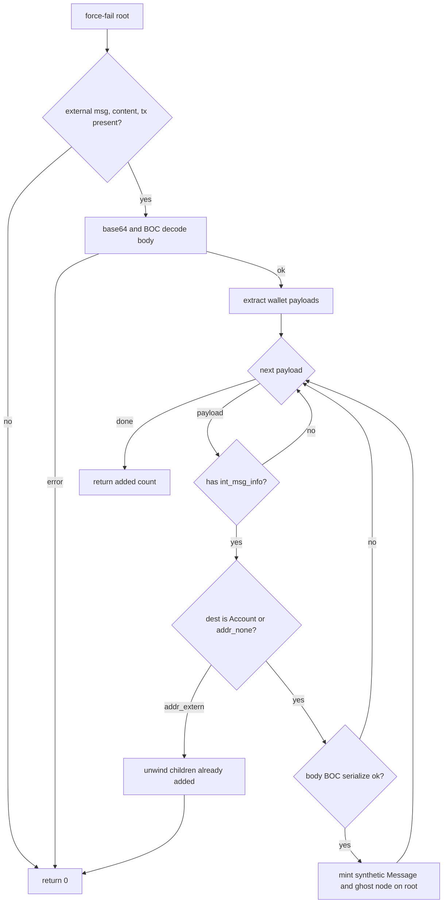
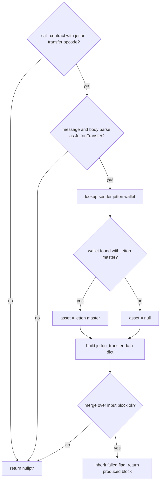

# GhostExternal

GhostExternal is the last-resort path for a lone failed wallet external: when normal serialization produced nothing, classify decodes the unsent messages packed inside the wallet body and materializes them as ghost EventNodes so the trace describes what the wallet intended to do. synthesize_ghost_children force-fails the external root and appends ghost children carrying synthetic Message objects owned by the EventTree; fallback_jetton_transfer then turns jetton-transfer ghost calls into produced jetton_transfer blocks, resolving the asset from the sender's wallet interface via the lookup source. The decoder is deliberately version-blind: three whole-body attempts (v3, v4, v5r1) run in fixed order and the first full success wins, so the exact failure modes of one version act as the discriminator for the next. Nothing here runs during normal matching or building; it operates on a fresh block tree after the main path declined the trace, never throws, and reports zero appended children when the body is not a decodable wallet external.

## class mch::WalletPayload

- decl: `ton-index-worker/ton-mch-engine/src/GhostExternal.cpp:37`

One decoded-but-unsent outgoing message from a wallet external body.

Carries the int_msg_info fields ghost synthesis needs: destination as an Account value or addr_none, nanoton value, bounce flags, body cell, masked 32-bit opcode, and the payload cell hash used to mint a synthetic msg_hash. has_info false means the cell was not an int_msg_info (tag bit set); such a payload is skipped without failing the wallet attempt.

## payloads_from_refs

`td::Result<std::vector<WalletPayload>> payloads_from_refs(vm::CellSlice & cs)`

- decl: `ton-index-worker/ton-mch-engine/src/GhostExternal.cpp:120`
- callers: mch::parse_wallet_v3 (ton-index-worker/ton-mch-engine/src/GhostExternal.cpp:133); mch::parse_wallet_v4 (ton-index-worker/ton-mch-engine/src/GhostExternal.cpp:140)
- calls: `mch::parse_payload`

Shared v3/v4 tail: treats every remaining ref of the body slice as one message payload.

Loops fetch_ref over the slice and collects parse_payload results in ref order. One bad payload aborts the whole attempt with its error, which is what lets the next wallet version be tried instead of yielding a half-decoded message list.

## parse_wallet_v3

`td::Result<std::vector<WalletPayload>> parse_wallet_v3(vm::CellSlice cs)`

- decl: `ton-index-worker/ton-mch-engine/src/GhostExternal.cpp:130`
- callers: none found in parsed TU set
- calls: `mch::payloads_from_refs`

Decodes a wallet v3 external: skips the 512-bit signature and 96-bit subwallet, valid_until, seqno header, then reads every ref as a message.

Header underflow fails the attempt; otherwise the tail delegates to payloads_from_refs. A v4 body is also accepted here because v4 only appends one op byte the v3 reader never reads and the message refs sit at the same place, so the v3 attempt running first is harmless.

## parse_wallet_v4

`td::Result<std::vector<WalletPayload>> parse_wallet_v4(vm::CellSlice cs)`

- decl: `ton-index-worker/ton-mch-engine/src/GhostExternal.cpp:137`
- callers: none found in parsed TU set
- calls: `mch::payloads_from_refs`

Decodes a wallet v4 external: the v3 header plus one 8-bit op byte, then every ref as a message.

Header underflow fails the attempt; the op byte is advanced past without being read and the tail again delegates to payloads_from_refs. This attempt only ever sees bodies the v3 reader already rejected.

## parse_wallet_v5r1

`td::Result<std::vector<WalletPayload>> parse_wallet_v5r1(vm::CellSlice cs)`

- decl: `ton-index-worker/ton-mch-engine/src/GhostExternal.cpp:147`
- callers: none found in parsed TU set
- calls: `mch::open_ref_cell`, `mch::parse_payload`

Decodes a wallet v5r1 external: skips the 128-bit header and walks the out_actions OutList ref-first.

After the header, an optional Maybe ref leads into the OutList chain where each node's ref 0 is the previous list node and ref 1 the message; the walk ends at the empty node. Neither the 0x7369676e opcode nor the action tags are read — the ref layout alone is the discriminator, which is exactly why v3 and v4 bodies fail this reader and vice versa.

## extract_payload_from_wallet_message

`std::vector<WalletPayload> extract_payload_from_wallet_message(const td::Ref<vm::Cell> & body)`

- decl: `ton-index-worker/ton-mch-engine/src/GhostExternal.cpp:169`
- callers: mch::synthesize_ghost_children (ton-index-worker/ton-mch-engine/src/GhostExternal.cpp:195)
- calls: `mch::attempt`, `mch::open_ref_cell`

Runs the three whole-body wallet decoders (v3, v4, v5r1) over the body and returns the first success.

The body cell is opened once and each attempt receives its own copy of the slice, so a failed attempt cannot corrupt the cursor for the next. An unopenable body or three failures return an empty vector; errors never propagate, an undecodable body simply means no payloads.

## attempt

`attempt`

- decl: `ton-index-worker/ton-mch-engine/src/GhostExternal.cpp:175`
- callers: mch::extract_payload_from_wallet_message (ton-index-worker/ton-mch-engine/src/GhostExternal.cpp:176)

Static table of the three whole-body wallet decoders tried in fixed v3, v4, v5r1 order.

## synthesize_ghost_children

`std::size_t synthesize_ghost_children(EventTree & tree, EventNode * root)`

- decl: `ton-index-worker/ton-mch-engine/src/GhostExternal.cpp:184`
- callers: [mch::ghost_external_rows (ton-index-worker/ton-mch-engine/src/ClassifyCore.cpp:610)](ClassifyCore.md#ghost_external_rows)
- calls: `mch::Value::is_null`, `mch::extract_payload_from_wallet_message`, `mch::td_boc_serialize`

Force-fails the external root and appends one ghost child node per decoded wallet payload.

Marks the root forced_failed up front, then base64-decodes and BOC-parses the external body; any decode failure returns 0 with the node otherwise untouched. Each payload with int_msg_info becomes a synthetic Message — msg_hash minted from payload cell hash plus slot index so duplicate payloads stay distinct, body re-serialized to base64 BOC, source and lt fields taken from the external's own transaction — and a ghost EventNode hung on the root and owned by the tree. A destination that is neither an Account nor addr_none means addr_extern: children already added are unwound and 0 returned, so reporting 0 always means the node is untouched. Never throws; returns the number of children added.

## fallback_jetton_transfer

`Block * fallback_jetton_transfer(Block * block, BlockArena & arena, const LookupSource & src)`

- decl: `ton-index-worker/ton-mch-engine/src/GhostExternal.cpp:249`
- callers: [mch::ghost_external_rows (ton-index-worker/ton-mch-engine/src/ClassifyCore.cpp:622)](ClassifyCore.md#ghost_external_rows)
- calls: `mch::(lambda at /home/verdigos/dev/ton-indexer-private/ton-index-worker/ton-mch-engine/src/GhostExternal.cpp:261:14)::operator()`, `mch::Block::merge_blocks`, `mch::BlockArena::make`, `mch::LookupSource::fetch`, `mch::Value::Value`, `mch::Value::field`, `mch::Value::is_null`, `mch::Value::make_asset_jetton`, `mch::Value::make_bool`, `mch::Value::make_dict`, `mch::Value::null`, `mch::account_from_opt`, `mch::block_body`, `mch::block_msg`, `mch::parse_jetton_transfer`, `mch::to_amount`

Turns a jetton-transfer ghost call into a produced jetton_transfer block, taking the asset from the sender's wallet interface.

Guards first that the block is a call_contract with the jetton-transfer opcode, that a message exists, and that the body parses as a JettonTransfer; any failure returns nullptr, mirroring a build that would have raised. The produced dict reproduces the normal build's field set with has_internal_transfer fixed false, receiver_wallet null, and asset resolved through a jetton_wallet lookup on the sender's wallet, a missing lookup leaving the asset null. The produced block merge-absorbs the input block, inherits its failed flag, and returns nullptr when the merge finds no earliest common block.

## operator()

`Value operator()(const char * name) const`

- decl: `ton-index-worker/ton-mch-engine/src/GhostExternal.cpp:261`
- callers: mch::fallback_jetton_transfer (ton-index-worker/ton-mch-engine/src/GhostExternal.cpp:283); mch::fallback_jetton_transfer (ton-index-worker/ton-mch-engine/src/GhostExternal.cpp:285); mch::fallback_jetton_transfer (ton-index-worker/ton-mch-engine/src/GhostExternal.cpp:286); mch::fallback_jetton_transfer (ton-index-worker/ton-mch-engine/src/GhostExternal.cpp:287); mch::fallback_jetton_transfer (ton-index-worker/ton-mch-engine/src/GhostExternal.cpp:289); mch::fallback_jetton_transfer (ton-index-worker/ton-mch-engine/src/GhostExternal.cpp:292); mch::fallback_jetton_transfer (ton-index-worker/ton-mch-engine/src/GhostExternal.cpp:293); mch::fallback_jetton_transfer (ton-index-worker/ton-mch-engine/src/GhostExternal.cpp:294); mch::fallback_jetton_transfer (ton-index-worker/ton-mch-engine/src/GhostExternal.cpp:295); mch::fallback_jetton_transfer (ton-index-worker/ton-mch-engine/src/GhostExternal.cpp:296); mch::fallback_jetton_transfer (ton-index-worker/ton-mch-engine/src/GhostExternal.cpp:297)

Field accessor over the parsed JettonTransfer dict; a missing field reads as Value null.

## WalletPayload

`void WalletPayload()`

- decl: `ton-index-worker/ton-mch-engine/src/GhostExternal.cpp:37`
- callers: mch::parse_payload (ton-index-worker/ton-mch-engine/src/GhostExternal.cpp:90)

Implicit default constructor; all-optional aggregate with member defaults.

## load_int_msg_info

`td::Status load_int_msg_info(vm::CellSlice & cs, bool with_extra, WalletPayload & p)`

- decl: `ton-index-worker/ton-mch-engine/src/GhostExternal.cpp:56`
- callers: mch::parse_payload (ton-index-worker/ton-mch-engine/src/GhostExternal.cpp:102); mch::parse_payload (ton-index-worker/ton-mch-engine/src/GhostExternal.cpp:95)
- calls: `mch::load_address_py`, `mch::load_coins_py`

Reads one int_msg_info prefix from the slice into the payload, with or without the extra-currency collection.

The with_extra flag picks between the TL-B-correct variant (grams followed by a Maybe ref to the extra-currency dict) and a grams-only retry for bodies the first variant rejects; a present extra dict ref is skipped, never deep-validated, bit-equivalent for every well-formed dict. Any underflow or malformed address returns a td::Status error that aborts the current attempt. Source, fees, and the created_lt and created_at bits are consumed but discarded, since ghost synthesis overwrites them with the external's own transaction values.

## parse_payload

`td::Result<WalletPayload> parse_payload(const td::Ref<vm::Cell> & cell)`

- decl: `ton-index-worker/ton-mch-engine/src/GhostExternal.cpp:89`
- callers: mch::payloads_from_refs (ton-index-worker/ton-mch-engine/src/GhostExternal.cpp:123); mch::parse_wallet_v5r1 (ton-index-worker/ton-mch-engine/src/GhostExternal.cpp:162)
- calls: `mch::WalletPayload::WalletPayload`, `mch::load_int_msg_info`, `mch::message_any_body`, `mch::open_ref_cell`

Parses one payload cell into a WalletPayload: header, body, and opcode.

Records the payload cell hash, then tries the int_msg_info header with the extra-currency variant first and falls back to grams-only; a tag bit of 1 is not an error — the payload returns with has_info false so the caller skips it without failing the wallet attempt. The remaining slice becomes the message body, and the opcode is the first 32 body bits when the body opens and holds them, unset otherwise. A hard parse failure returns the error and aborts the enclosing attempt.
