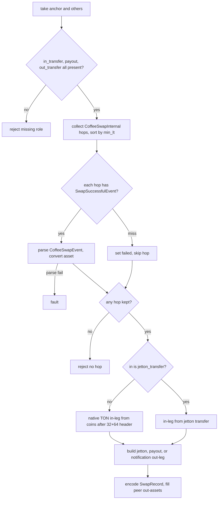

# HostCoffee

Host bindings for the Coffee DEX in the mch classifier engine. One arity-1 host fn, coffee_swap_data, is dispatched by name from HostRegistry after an arity check. It decodes the consumed match set and derives a SwapRecord. Missing in_transfer, payout, or out_transfer roles, and a hop list with no successful event, reject with Null. Body and event parse failures fault. Message bodies are parsed inline. TON-arm is reachable via CoffeeSwapNative in and CoffeePayout or CoffeeNotification out; jetton legs need a jetton_transfer block.

## coffee_swap_data

`EvalResult coffee_swap_data(BuildEnv & env, const std::vector<Value> & args)`

- decl: `ton-index-worker/ton-mch-engine/src/host/HostCoffee.cpp:212`
- callers: none found in parsed TU set
- calls: `mch::ConsumedBlocks::ConsumedBlocks`, `mch::EvalResult::EvalResult`, `mch::coffee_swap`, `mch::decode_consumed`

Registered thunk that decodes the consumed set and delegates to coffee_swap.

env is unused. decode_consumed faults on a bad or empty list under the binding name coffee_swap_data. Arity 1 is enforced by HostRegistry before entry.

## ton_leg

`TransferLeg ton_leg(Value amount, Value source, Value dest)`

- decl: `ton-index-worker/ton-mch-engine/src/host/HostCoffee.cpp:39`
- callers: mch::coffee_swap (ton-index-worker/ton-mch-engine/src/host/HostCoffee.cpp:154); mch::coffee_swap (ton-index-worker/ton-mch-engine/src/host/HostCoffee.cpp:183); mch::coffee_swap (ton-index-worker/ton-mch-engine/src/host/HostCoffee.cpp:189)
- calls: `mch::TransferLeg::TransferLeg`, `mch::Value::make_asset_ton`, `mch::Value::null`

Builds a TON-asset TransferLeg with both jetton wallets Null.

Used for the CoffeeSwapNative in-arm and the CoffeePayout and CoffeeNotification out-arms. amount, source, and dest are moved in as given.

## coffee_swap

`EvalResult coffee_swap(const ConsumedBlocks & consumed)`

- decl: `ton-index-worker/ton-mch-engine/src/host/HostCoffee.cpp:53`
- callers: mch::coffee_swap_data (ton-index-worker/ton-mch-engine/src/host/HostCoffee.cpp:217)
- calls: `mch::ConsumedBlocks::anchor`, `mch::ConsumedBlocks::others`, `mch::PeerSwap::PeerSwap`, `mch::SwapRecord::SwapRecord`, `mch::SwapRecord::encode`, `mch::SwapRecord::fill_peer_out_assets`, `mch::TransferLeg::TransferLeg`, `mch::TransferLeg::from_jetton_transfer`, `mch::Value::Value`, `mch::Value::field`, `mch::Value::make_amount`, `mch::Value::null`, `mch::account_from_opt`, `mch::all_calls`, `mch::block_body`, `mch::block_in`, `mch::block_msg`, `mch::data_field`, `mch::first_call`, `mch::first_next_call`, `mch::host_reject`, `mch::is_call_op`, `mch::load_address_py`, `mch::load_coins_py`, `mch::msg_value_amount`, `mch::open_body`, `mch::parse_message_body`, `mch::rt_builtin_asset_of`, `mch::rt_fault`, `mch::rt_ok`, `mch::to_amount`, `mch::ton_leg`, `mch::unique_lt_sorted`

Derives a Coffee SwapRecord from the consumed set, or Null where a role is missing or there is no hop.

in_transfer is previous only if it sits in others and is a jetton_transfer or CoffeeSwapNative 0xc0ffee00. payout is the first CoffeePayoutInternal 0xc0ffee21 in others. out_transfer is the first later block whose previous_block is that payout and that is a jetton_transfer, CoffeePayout 0xc0ffee32, or CoffeeNotification 0xc0ffee36. Missing any of the three rejects. Each CoffeeSwapInternal needs a CoffeeSwapSuccessfulEvent 0xc0ffee30 child; a miss sets failed and skips the hop, while a body or CoffeeSwapEvent parse failure faults. peer out-assets are filled after all hops.

