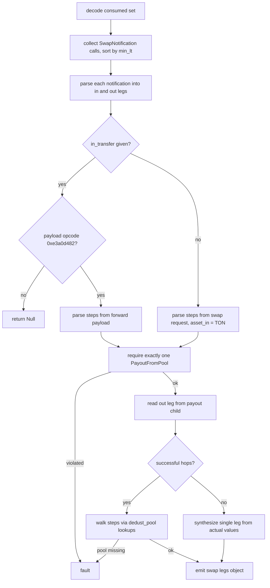

# HostDedust

Host bindings for the DeDust protocol in the mch classifier engine, registering three host fns: dedust_swap_legs takes the consumed match set plus the in-transfer and swap-request blocks and rebuilds the hop-by-hop swap legs, while dedust_v2_payload_cell and dedust_v2_swap_min_out read the v2 swap payload's PayJetton wrapper and its step chain. All three receive Block-valued arguments produced by matcher captures and return an EvalResult, using Null to reject on payload opcode mismatch and faults to reject on malformed traces or missing dedust_pool lookups. Hop blocks are ordered with stable sorts on min_lt so equal-lt runs keep a deterministic in-leg/out-leg assignment.

## dedust_swap_legs

`EvalResult dedust_swap_legs(BuildEnv & env, const std::vector<Value> & args)`

- decl: `ton-index-worker/ton-mch-engine/src/host/HostDedust.cpp:108`
- callers: none found in parsed TU set
- calls: `mch::ConsumedBlocks::ConsumedBlocks`, `mch::EvalResult::EvalResult`, `mch::Value::Value`, `mch::Value::field`, `mch::Value::is_null`, `mch::Value::make_asset_ton`, `mch::Value::make_dict`, `mch::Value::make_int`, `mch::Value::make_list`, `mch::Value::make_obj`, `mch::Value::null`, `mch::account_from_opt`, `mch::as_block`, `mch::block_body`, `mch::block_msg`, `mch::cell_from_pystr`, `mch::data_field`, `mch::decode_consumed`, `mch::dedust_seq_destination`, `mch::is_call_op`, `mch::load_coins_py`, `mch::parse_dedust_steps`, `mch::parse_message_body`, `mch::rt_builtin_asset_of`, `mch::rt_fault`, `mch::rt_ok`, `mch::to_amount`

Rebuilds a DeDust v1 swap-legs record from the consumed match set, the incoming jetton transfer, and the swap request.

Arguments are the consumed set, the in-transfer block, and the swap-request block. DedustSwapNotification calls in the consumed set are ordered by min_lt and parsed into in/out leg pairs; a payload opcode other than 0xe3a0d482 on the in transfer returns Null, while body, parse, and field failures are faults. Step addresses come from the in transfer's forward_payload BOC after skipping a 32-bit sum-type tag, or from the swap-request body after a 32+64-bit header and a coins field, the latter fixing asset_in to TON. Exactly one PayoutFromPool call must exist among the non-anchor blocks and the actual out leg comes from its jetton-transfer or Payout child; the destination asset walks the steps through dedust_pool lookups, where a missing pool faults. With no successful hop a single leg is synthesized from the actual in and out values.

## dv2_read_step

`td::Status dv2_read_step(vm::CellSlice & cs, td::RefInt256 & min_out, td::Ref<vm::Cell> & next)`

- decl: `ton-index-worker/ton-mch-engine/src/host/HostDedust.cpp:366`
- callers: mch::dedust_v2_swap_min_out (ton-index-worker/ton-mch-engine/src/host/HostDedust.cpp:457)
- calls: `mch::load_address_py`, `mch::load_coins_py`

Reads one inline DedustV2SwapStep: pool address, min-out coins, a 40-bit deadline, and the maybe-ref to the next step.

The struct is inline with no opcode prefix, so the caller must already be positioned at the pool address. Any bit or ref underflow, or a null next ref behind a set flag, is a Status error that the caller converts into a Null result rather than a fault. The pool address is parsed and discarded.

## dedust_seq_destination

`EvalResult dedust_seq_destination(BuildEnv & env, const std::vector<std::string> & steps, const Value & seed)`

- decl: `ton-index-worker/ton-mch-engine/src/host/HostDedust.cpp:39`
- callers: mch::dedust_swap_legs (ton-index-worker/ton-mch-engine/src/host/HostDedust.cpp:308)
- calls: `mch::LookupTable::get`, `mch::Value::Value`, `mch::Value::field`, `mch::Value::is_null`, `mch::Value::make_asset_jetton`, `mch::Value::make_asset_ton`, `mch::Value::make_str`, `mch::rt_fault`, `mch::rt_ok`, `mch::value_truthy`

Folds the step pool-address chain into the final destination asset, starting from the seed in-asset.

Each step address is looked up as dedust_pool and the pool's assets list is scanned for the first asset that differs from the current one, matching TON by flag and jettons by address string. A missing pool or an assets field that is not a list is an rt_fault reject. An empty step list returns the seed unchanged.

## resolve_dv2_payload_cell

`td::Result<td::Ref<vm::Cell>> resolve_dv2_payload_cell(const Value & arg)`

- decl: `ton-index-worker/ton-mch-engine/src/host/HostDedust.cpp:391`
- callers: mch::dedust_v2_payload_cell (ton-index-worker/ton-mch-engine/src/host/HostDedust.cpp:418)
- calls: `mch::open_ref_cell`

Extracts the v2 swap payload cell from a PayNative payment_payload cell or a base64 PayJetton wrapper string.

A Cell argument is returned directly. A Str argument is base64-decoded, deserialized as a BOC and opened as a ref, must begin with the PayJetton opcode 0xcbc33949, and then yields the payment_payload ref after consuming the payout_config ref, which must also be present even though its contents are unused. Any other value type, decode failure, or missing ref is a Status error.

## dedust_v2_payload_cell

`EvalResult dedust_v2_payload_cell(BuildEnv &, const std::vector<Value> & args)`

- decl: `ton-index-worker/ton-mch-engine/src/host/HostDedust.cpp:414`
- callers: none found in parsed TU set
- calls: `mch::Value::is_null`, `mch::Value::make_cell`, `mch::Value::null`, `mch::resolve_dv2_payload_cell`, `mch::rt_ok`

Returns the resolved v2 swap payload cell, or Null when the argument is null or resolution fails.

A null argument short-circuits to Null, and a resolve error or null cell also maps to Null, so this host fn never faults.

## dedust_v2_swap_min_out

`EvalResult dedust_v2_swap_min_out(BuildEnv &, const std::vector<Value> & args)`

- decl: `ton-index-worker/ton-mch-engine/src/host/HostDedust.cpp:426`
- callers: none found in parsed TU set
- calls: `mch::Value::field`, `mch::Value::is_null`, `mch::Value::make_int`, `mch::Value::null`, `mch::dv2_read_step`, `mch::open_ref_cell`, `mch::rt_ok`

Returns the minimum output of the final step in a parsed v2 swap payload's step chain, or Null when the chain is unreadable.

The argument supplies minimal_amount_out and a next cell; the chain is walked up to sixteen steps, with dv2_read_step overwriting min_out on every hop so the final step's value survives. Malformed field types, a next that is neither Cell nor null, or any step error yields Null rather than a fault.

## parse_dedust_steps

`td::Result<std::vector<std::string>> parse_dedust_steps(vm::CellSlice cs)`

- decl: `ton-index-worker/ton-mch-engine/src/host/HostDedust.cpp:79`
- callers: mch::dedust_swap_legs (ton-index-worker/ton-mch-engine/src/host/HostDedust.cpp:223); mch::dedust_swap_legs (ton-index-worker/ton-mch-engine/src/host/HostDedust.cpp:251)
- calls: `mch::load_address_py`, `mch::load_coins_py`, `mch::open_ref_cell`

Walks the v1 SwapStep chain collecting pool addresses, one link being an address, a flag bit, coins, and a maybe-ref to the next step.

Walk errors are Status errors the caller converts to an rt_fault reject; the walk terminates on the first clear maybe-ref bit. An addr_none pool address is kept as the literal string addr_none, and the coins field of each link is parsed but discarded. The slice must already sit past the sum-type header when the walk begins.
