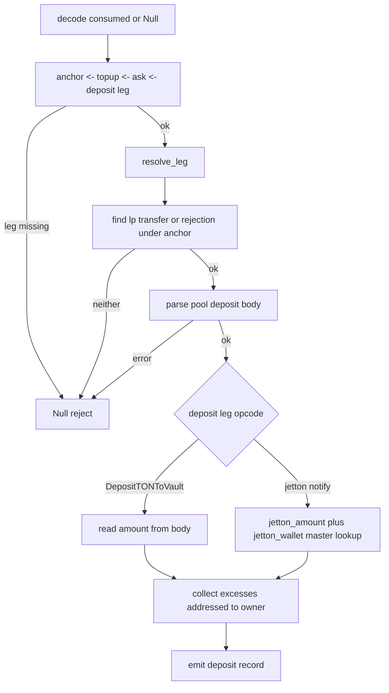
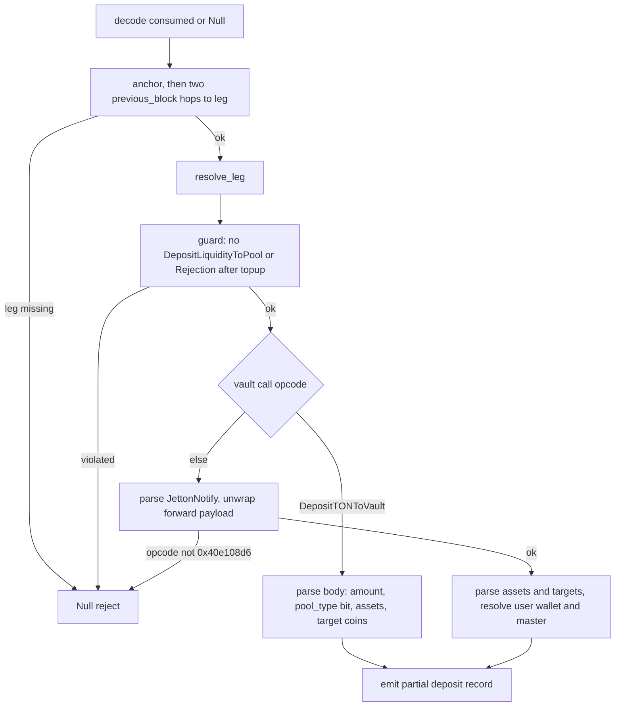

# HostDedustDeposit

Host bindings for DeDust liquidity deposits in the mch classifier engine, registering dedust_deposit_final_data and dedust_deposit_partial_data as arity-one host fns that each take the consumed match set. Both reconstruct label roles by walking previous_block links off the anchor and return Null to reject on any parse or navigation miss rather than faulting. Final deposits anchor on a DepositLiquidityToPool call preceded by a topup and an ask; partial deposits anchor on the topup itself, with the vault-facing leg either a DepositTONToVault call or a jetton notify whose forward payload carries the JettonForwardPayload opcode. Asset and wallet resolution goes through the engine's jetton_wallet lookup table.

## class mch::Leg

- decl: `ton-index-worker/ton-mch-engine/src/host/HostDedustDeposit.cpp:61`

Resolution result tying a deposit leg to the vault-facing call and its raw user jetton-transfer calls.

Non-owning block pointers produced by resolve_leg and consumed within the same host-fn call. jt_none marks that jt_calls is empty and the caller must gather the jetton transfers from the consumed set instead of the leg's children.

## class mch::PoolDeposit

- decl: `ton-index-worker/ton-mch-engine/src/host/HostDedustDeposit.cpp:89`

Parsed DedustDepositLiquidityToPool fields: owner, both target assets, and their amounts.

Built by parse_pool_deposit from the anchor body and read immediately inside dedust_deposit_final_data; the two assets are already converted through the asset-of builtin, so a conversion fault never escapes as a partial value.

## dedust_deposit_final_data

`EvalResult dedust_deposit_final_data(BuildEnv & env, const std::vector<Value> & args)`

- decl: `ton-index-worker/ton-mch-engine/src/host/HostDedustDeposit.cpp:122`
- callers: none found in parsed TU set
- calls: `mch::(lambda at /home/verdigos/dev/ton-indexer-private/ton-index-worker/ton-mch-engine/src/host/HostDedustDeposit.cpp:169:21)::operator()`, `mch::LookupTable::get`, `mch::Value::Value`, `mch::Value::field`, `mch::Value::is_null`, `mch::Value::make_account_none`, `mch::Value::make_amount`, `mch::Value::make_amount_none`, `mch::Value::make_asset_jetton`, `mch::Value::make_asset_ton`, `mch::Value::make_bool`, `mch::Value::make_list`, `mch::Value::make_obj`, `mch::Value::make_str`, `mch::Value::null`, `mch::account_from_opt`, `mch::amount_or_zero`, `mch::block_body`, `mch::block_msg`, `mch::data_field`, `mch::decode_consumed_or_none`, `mch::excess_pair`, `mch::is_call_op`, `mch::load_coins_py`, `mch::msg_value_amount`, `mch::open_body`, `mch::parse_message_body`, `mch::parse_pool_deposit`, `mch::resolve_leg`, `mch::rt_ok`, `mch::same_account`, `mch::to_amount`, `mch::wallet_jetton_master_str`

Classifies a completed DeDust liquidity deposit into a record with sender, pool, lp tokens, target and actual amounts, and vault excesses.

Three previous_block hops from the anchor reach the deposit leg; leg, outcome, or body misses all return Null. The outcome is the consumed JettonInternalTransfer whose previous block is the anchor, giving the lp tokens from its amount, or a Rejection call under the anchor; anything else rejects. Actual amounts come from the vault-facing call, TON via the DepositTONToVault body or jetton via a JettonNotify plus a jetton_wallet lookup that must yield the wallet's jetton master. Vault excesses are the DedustPayout and jetton-transfer children of ReturnExcessFromVault calls whose receiver equals the deposit owner, and success is a non-null lp token value.

## operator()

`bool operator()(const Block * p) const`

- decl: `ton-index-worker/ton-mch-engine/src/host/HostDedustDeposit.cpp:169`
- callers: mch::dedust_deposit_final_data (ton-index-worker/ton-mch-engine/src/host/HostDedustDeposit.cpp:175); mch::dedust_deposit_final_data (ton-index-worker/ton-mch-engine/src/host/HostDedustDeposit.cpp:178)

Membership test against the collected ReturnExcessFromVault calls.

## dedust_deposit_partial_data

`EvalResult dedust_deposit_partial_data(BuildEnv & env, const std::vector<Value> & args)`

- decl: `ton-index-worker/ton-mch-engine/src/host/HostDedustDeposit.cpp:342`
- callers: none found in parsed TU set
- calls: `mch::LookupTable::get`, `mch::Value::Value`, `mch::Value::field`, `mch::Value::make_account_none`, `mch::Value::make_amount`, `mch::Value::make_amount_none`, `mch::Value::make_asset_jetton`, `mch::Value::make_asset_ton`, `mch::Value::make_obj`, `mch::Value::make_str`, `mch::Value::null`, `mch::account_from_opt`, `mch::amount_or_zero`, `mch::block_body`, `mch::block_msg`, `mch::decode_consumed_or_none`, `mch::first_call`, `mch::is_call_op`, `mch::load_asset_4`, `mch::load_coins_py`, `mch::open_body`, `mch::parse_message_body`, `mch::resolve_leg`, `mch::rt_builtin_tail_unwrap`, `mch::rt_ok`, `mch::to_amount`, `mch::wallet_jetton_master_str`

Classifies a topped-up DeDust liquidity deposit whose vault leg arrives as a TON deposit or a jetton notify.

Two previous_block hops reach the leg, and the topup's next blocks must contain no DepositLiquidityToPool or Rejection call, else the trace follows the final-deposit contract and rejects. The TON branch reads the amount, a pool_type bit, two 4-bit-tagged assets, and three coins from the payload ref; the jetton branch parses the notify, tail-unwraps the forward payload, requires opcode 0x40e108d6, then reads the same tail. The jetton branch additionally resolves the user wallet from the vault call's previous-block source and the actual asset from the dex wallet's jetton master. Every miss returns Null.

## load_asset_4

`td::Result<Value> load_asset_4(vm::CellSlice & cs)`

- decl: `ton-index-worker/ton-mch-engine/src/host/HostDedustDeposit.cpp:42`
- callers: mch::dedust_deposit_partial_data (ton-index-worker/ton-mch-engine/src/host/HostDedustDeposit.cpp:410); mch::dedust_deposit_partial_data (ton-index-worker/ton-mch-engine/src/host/HostDedustDeposit.cpp:411); mch::dedust_deposit_partial_data (ton-index-worker/ton-mch-engine/src/host/HostDedustDeposit.cpp:462); mch::dedust_deposit_partial_data (ton-index-worker/ton-mch-engine/src/host/HostDedustDeposit.cpp:463)
- calls: `mch::Value::make_asset_jetton`, `mch::Value::make_asset_ton`, `mch::hex_upper`

Decodes a 4-bit-tagged DeDust asset into an Asset value, advancing the slice.

Kind 0 yields TON; any other kind reads a workchain byte and 32 account-id bytes and yields a jetton asset. Kind or jetton-tail underflow is a Status error that the callers turn into a Null reject.

## Leg

`void Leg()`

- decl: `ton-index-worker/ton-mch-engine/src/host/HostDedustDeposit.cpp:61`
- callers: mch::resolve_leg (ton-index-worker/ton-mch-engine/src/host/HostDedustDeposit.cpp:68)

Default leg with no deposit and no jetton calls.

## Leg

`void Leg(Leg &&)`

- decl: `ton-index-worker/ton-mch-engine/src/host/HostDedustDeposit.cpp:61`
- callers: mch::resolve_leg (ton-index-worker/ton-mch-engine/src/host/HostDedustDeposit.cpp:71); mch::resolve_leg (ton-index-worker/ton-mch-engine/src/host/HostDedustDeposit.cpp:80); mch::resolve_leg (ton-index-worker/ton-mch-engine/src/host/HostDedustDeposit.cpp:84)

Move constructor, used when resolve_leg returns by value.

## resolve_leg

`Leg resolve_leg(const Block * leg)`

- decl: `ton-index-worker/ton-mch-engine/src/host/HostDedustDeposit.cpp:67`
- callers: mch::dedust_deposit_final_data (ton-index-worker/ton-mch-engine/src/host/HostDedustDeposit.cpp:137); mch::dedust_deposit_partial_data (ton-index-worker/ton-mch-engine/src/host/HostDedustDeposit.cpp:355)
- calls: `mch::Leg::Leg`, `mch::first_call`, `mch::is_call_op`

Classifies a deposit leg into the vault-facing call plus its raw user jetton-transfer calls.

A DepositTONToVault call is its own deposit with no jetton calls. A jetton-transfer block maps deposit to its first JettonNotify child and collects the JettonTransfer calls among its children. Any other block becomes the deposit with jt_none set, telling the caller to gather the jetton calls from the consumed set instead of the leg's children.

## PoolDeposit

`void PoolDeposit()`

- decl: `ton-index-worker/ton-mch-engine/src/host/HostDedustDeposit.cpp:89`
- callers: mch::parse_pool_deposit (ton-index-worker/ton-mch-engine/src/host/HostDedustDeposit.cpp:111)

Default-constructed pool deposit; fields are filled by the parser.

## parse_pool_deposit

`td::Result<PoolDeposit> parse_pool_deposit(const td::Ref<vm::Cell> & body)`

- decl: `ton-index-worker/ton-mch-engine/src/host/HostDedustDeposit.cpp:94`
- callers: mch::dedust_deposit_final_data (ton-index-worker/ton-mch-engine/src/host/HostDedustDeposit.cpp:187)
- calls: `mch::PoolDeposit::PoolDeposit`, `mch::Value::field`, `mch::parse_message_body`, `mch::rt_builtin_asset_of`

Unpacks a DedustDepositLiquidityToPool body into owner, both target assets, and their amounts.

Parsing goes through the generated message-body parser, with the two assets taken from the field4 ref and converted through the asset-of builtin; a missing ref or field, or a conversion fault, is a Status error. The owner and the two target amounts are copied straight from the parsed object.
