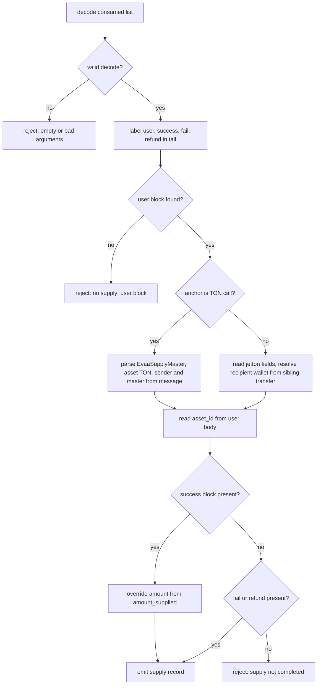
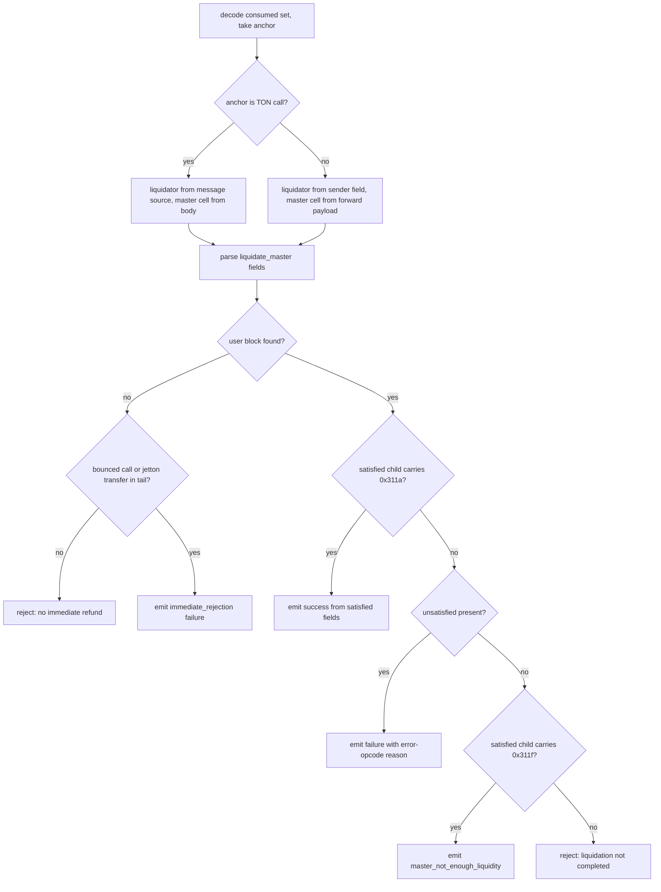

# HostEvaa

Registers the EVAA lending protocol bindings into the classifier engine: two host fns, evaa_supply_data (arity 2) and evaa_liquidate_data (arity 1), and nine predicates covering the user withdraw, supply, and liquidate messages, the supply and liquidate master anchors, the liquidate success header, and bounced calls. rt_call_hostfn dispatches these by name out of the HostRegistry maps after an arity check, and any host_reject inside them surfaces through the reject context with the fn and anchor attached. All user-contract parsing accounts for the variable EVAA header (coins version, optional upgrade-info ref, two exec bits) that precedes the 32-bit opcode, and the master side accepts both a direct TON call and a jetton transfer whose forward payload opens with the master opcode. Key invariants: malformed or short bodies make predicates return false rather than match, and the data fns reject rather than fault when the consumed set lacks a required block, leaving the matcher free to try other candidates.

## class mch::LiquidateSatisfiedData

- decl: `ton-index-worker/ton-mch-engine/src/host/HostEvaa.cpp:124`

Fields extracted from a liquidate_satisfied body: owner, transferred asset id, collateral asset id, collateral reward, and liquidatable amount.

Built only by parse_liquidate_satisfied, which returns it as a td::Result so partially filled values never escape; every failure stage (header, root, ref, integers) has its own status string. evaa_liquidate_data consumes it on the satisfied-success arm, moving owner, the collateral asset id and reward, the liquidatable amount, and the transferred asset id straight into the output record.

## class mch::LiquidateMasterData

- decl: `ton-index-worker/ton-mch-engine/src/host/HostEvaa.cpp:96`

Fields extracted from a liquidate_master body: borrower, collateral asset id, and incoming amount.

Produced only by parse_liquidate_master as a td::Result value; the liquidator address in the layout is parsed and deliberately discarded. evaa_liquidate_data uses it on the immediate-rejection, unsatisfied, and satisfied-fail arms, where the borrower, collateral asset id, and incoming amount stand in for fields the protocol never got to compute.

## parse_liquidate_master

`td::Result<LiquidateMasterData> parse_liquidate_master(const td::Ref<vm::Cell> & body)`

- decl: `ton-index-worker/ton-mch-engine/src/host/HostEvaa.cpp:102`
- callers: mch::evaa_liquidate_data (ton-index-worker/ton-mch-engine/src/host/HostEvaa.cpp:431)
- calls: `mch::Value::Value`, `mch::as_account_id`, `mch::load_address_py`, `mch::open_body`, `mch::refint_u64`

Parses a liquidate_master body into borrower, collateral asset id, and incoming amount.

After opening the body it skips the 32-bit opcode and 64-bit query id, reads the borrower and liquidator addresses (the liquidator is discarded), then requires 256+64+2+64 more bits: the 256-bit collateral asset id, 66 skipped bits, and a 64-bit incoming amount widened through refint_u64. A short body, a bad address, or a null integer yields td::Status::Error with a distinct message (header, fields, integers); the single caller turns any error into a host_reject.

## parse_liquidate_satisfied

`td::Result<LiquidateSatisfiedData> parse_liquidate_satisfied(const td::Ref<vm::Cell> & body)`

- decl: `ton-index-worker/ton-mch-engine/src/host/HostEvaa.cpp:132`
- callers: mch::evaa_liquidate_data (ton-index-worker/ton-mch-engine/src/host/HostEvaa.cpp:489)
- calls: `mch::Value::Value`, `mch::as_account_id`, `mch::load_address_py`, `mch::open_body`, `mch::open_ref_cell`, `mch::refint_u64`

Parses a liquidate_satisfied body and its first ref cell into owner, both asset ids, the collateral reward, and the liquidatable amount.

Past the opcode and query id it reads owner and liquidator (the liquidator is discarded) and a 256-bit transferred asset id in the root, then the first ref cell with the layout 64 bits delta_loan_principal, 64-bit liquidatable amount, 64+64 bits protocol gift and new user loan principal, 256-bit collateral asset id, 64 bits delta_collateral_principal, 64-bit collateral reward. Underflow at the header, root, or ref stage, or a null among the four integers, returns td::Status::Error with the stage named; a null owner is normalized to account_none by as_account_id.

## parse_liquidation_reason

`td::Result<std::string> parse_liquidation_reason(const td::Ref<vm::Cell> & body)`

- decl: `ton-index-worker/ton-mch-engine/src/host/HostEvaa.cpp:163`
- callers: mch::evaa_liquidate_data (ton-index-worker/ton-mch-engine/src/host/HostEvaa.cpp:501)
- calls: `mch::load_address_py`, `mch::open_body`, `mch::open_ref_cell`

Maps the 32-bit error opcode at the end of a liquidate_unsatisfied body to a reason string.

Skips the opcode and query id, discards both addresses and the 256-bit transferred asset id, opens the ref cell, skips 64+256+64+64 bits, drops the custom_response_payload ref, then reads the 32-bit error opcode. 0xE001 through 0xE009 map to master_liquidating_too_much, user_withdraw_in_progress, not_liquidatable, execution_crashed, min_collateral_not_satisfied, user_not_enough_collateral, user_liquidating_too_much, master_not_enough_liquidity, and liquidation_prices_missing, and anything else maps to unknown. Malformed bodies return td::Status::Error; the caller falls back to the literal liquidation_error string when that happens.

## evaa_user_withdraw_user

`bool evaa_user_withdraw_user(const Block * b)`

- decl: `ton-index-worker/ton-mch-engine/src/host/HostEvaa.cpp:202`
- callers: none found in parsed TU set
- calls: `mch::opcode_after_user_header`

True when the block is a call whose user body carries opcode 0x21.

## evaa_user_withdraw_success

`bool evaa_user_withdraw_success(const Block * b)`

- decl: `ton-index-worker/ton-mch-engine/src/host/HostEvaa.cpp:206`
- callers: none found in parsed TU set
- calls: `mch::opcode_after_user_header`

True when the block is a call whose user body carries opcode 0x211a.

## evaa_user_withdraw_fail

`bool evaa_user_withdraw_fail(const Block * b)`

- decl: `ton-index-worker/ton-mch-engine/src/host/HostEvaa.cpp:210`
- callers: none found in parsed TU set
- calls: `mch::opcode_after_user_header`

True when the block is a call whose user body carries opcode 0x211f.

## evaa_user_supply

`bool evaa_user_supply(const Block * b)`

- decl: `ton-index-worker/ton-mch-engine/src/host/HostEvaa.cpp:214`
- callers: none found in parsed TU set
- calls: `mch::opcode_after_user_header`

True when the block is a call whose user body carries the supply opcode 0x11.

## evaa_user_liquidate

`bool evaa_user_liquidate(const Block * b)`

- decl: `ton-index-worker/ton-mch-engine/src/host/HostEvaa.cpp:218`
- callers: mch::evaa_liquidate_data (ton-index-worker/ton-mch-engine/src/host/HostEvaa.cpp:443)
- calls: `mch::opcode_after_user_header`

True when the block is a call whose user body carries the liquidate opcode 0x31.

## evaa_liquidate_success_header

`bool evaa_liquidate_success_header(const Block * b)`

- decl: `ton-index-worker/ton-mch-engine/src/host/HostEvaa.cpp:222`
- callers: mch::evaa_liquidate_data (ton-index-worker/ton-mch-engine/src/host/HostEvaa.cpp:482)
- calls: `mch::opcode_after_user_header`

True when the block is a call whose user body carries opcode 0x311a.

evaa_liquidate_data uses it to detect a success answer among the children of the liquidate_satisfied block.

## evaa_bounced_call

`bool evaa_bounced_call(const Block * b)`

- decl: `ton-index-worker/ton-mch-engine/src/host/HostEvaa.cpp:226`
- callers: mch::evaa_liquidate_data (ton-index-worker/ton-mch-engine/src/host/HostEvaa.cpp:467)
- calls: `mch::block_msg`

True when the block is a call_contract whose message carries the bounced flag.

## evaa_master_anchor

`bool evaa_master_anchor(const Block * b, td::uint32 op)`

- decl: `ton-index-worker/ton-mch-engine/src/host/HostEvaa.cpp:235`
- callers: mch::evaa_supply_anchor (ton-index-worker/ton-mch-engine/src/host/HostEvaa.cpp:261); mch::evaa_liquidate_anchor (ton-index-worker/ton-mch-engine/src/host/HostEvaa.cpp:264)
- calls: `mch::cell_from_pystr`, `mch::data_field`, `mch::is_call_op`, `mch::open_body`

Matches a master call either directly, by opcode, or as a jetton transfer whose forward payload opens with that opcode.

is_call_op covers the TON-side master call; otherwise the block must be a jetton transfer whose forward_payload data field is a string that decodes to a cell opening with the 32-bit opcode. Every failure along that path returns false, so a malformed jetton arm never anchors a match.

## evaa_supply_anchor

`bool evaa_supply_anchor(const Block * b)`

- decl: `ton-index-worker/ton-mch-engine/src/host/HostEvaa.cpp:261`
- callers: none found in parsed TU set
- calls: `mch::evaa_master_anchor`

Anchor predicate for the supply master opcode 0x1.

## evaa_liquidate_anchor

`bool evaa_liquidate_anchor(const Block * b)`

- decl: `ton-index-worker/ton-mch-engine/src/host/HostEvaa.cpp:263`
- callers: none found in parsed TU set
- calls: `mch::evaa_master_anchor`

Anchor predicate for the liquidate master opcode 0x3.

## evaa_supply_data

`EvalResult evaa_supply_data(BuildEnv & env, const std::vector<Value> & args)`

- decl: `ton-index-worker/ton-mch-engine/src/host/HostEvaa.cpp:269`
- callers: none found in parsed TU set
- calls: `mch::Value::Value`, `mch::Value::field`, `mch::Value::make_asset_ton`, `mch::Value::make_bool`, `mch::Value::make_int`, `mch::Value::make_obj`, `mch::Value::null`, `mch::account_from_opt`, `mch::block_body`, `mch::block_msg`, `mch::data_field`, `mch::decode_consumed_or_none`, `mch::host_reject`, `mch::is_call_op`, `mch::opcode_after_user_header`, `mch::open_user_body`, `mch::parse_message_body`, `mch::rt_ok`, `mch::same_account`

Builds the supply record from the consumed set: role labeling, TON-versus-jetton field sourcing, wallet resolution, and the authoritative success amount.

Decodes the consumed list (the registry fixes arity at 2; the second argument is the spec-parsed recipient, used only on the jetton arm) and labels the tail blocks: user is the first block with opcode 0x11 behind the user header, success and fail the first calls with opcodes 0x11a and 0x11f, refund the first jetton transfer; a missing user block rejects with no supply_user block. The TON arm parses the anchor with the EvaaSupplyMaster ABI (supply_amount, recipient_address), takes sender and master from the message envelope, and marks the asset as TON; the jetton arm reads sender, sender_wallet, receiver_wallet, amount, receiver, and asset from data fields and resolves the recipient wallet from a sibling transfer whose sender_wallet matches the master wallet. The user body's asset_id is read raw at bit 96 past the opcode because it sits behind the variable header with no ABI row, and when a success block parses, its amount_supplied overrides the requested amount as authoritative. A tail with neither success, fail, nor refund rejects with supply not completed; all rejects are host_reject, so the matcher treats the candidate as unmatched rather than faulting.

## skip_user_header

`bool skip_user_header(vm::CellSlice & cs)`

- decl: `ton-index-worker/ton-mch-engine/src/host/HostEvaa.cpp:28`
- callers: mch::open_user_body (ton-index-worker/ton-mch-engine/src/host/HostEvaa.cpp:63)
- calls: `mch::load_coins_py`

Skips the variable EVAA user header, leaving the cursor on the 32-bit opcode.

Consumes a coins-encoded user_version, a maybe bit that optionally fetches an upgrade_info ref, and two exec bits; any underflow, or a set bit with no refs left, returns false. Malformed headers therefore never match in downstream opcode comparisons.

## evaa_liquidate_data

`EvalResult evaa_liquidate_data(BuildEnv & env, const std::vector<Value> & args)`

- decl: `ton-index-worker/ton-mch-engine/src/host/HostEvaa.cpp:403`
- callers: none found in parsed TU set
- calls: `mch::(lambda at /home/verdigos/dev/ton-indexer-private/ton-index-worker/ton-mch-engine/src/host/HostEvaa.cpp:448:17)::operator()`, `mch::Value::Value`, `mch::Value::make_bool`, `mch::Value::make_int`, `mch::Value::make_obj`, `mch::Value::make_str`, `mch::Value::null`, `mch::account_from_opt`, `mch::as_account_id`, `mch::block_body`, `mch::block_msg`, `mch::cell_from_pystr`, `mch::data_field`, `mch::decode_consumed_or_none`, `mch::evaa_bounced_call`, `mch::evaa_liquidate_success_header`, `mch::evaa_user_liquidate`, `mch::host_reject`, `mch::is_call_op`, `mch::parse_liquidate_master`, `mch::parse_liquidate_satisfied`, `mch::parse_liquidation_reason`, `mch::rt_ok`

Classifies a liquidation from the consumed set into satisfied success, unsatisfied failure, satisfied-fail, or immediate rejection, and emits the nine-field record.

The anchor supplies the master cell either from its own body (TON arm, liquidator from the message source) or from its forward_payload (jetton arm, liquidator from the sender field), and parse_liquidate_master must succeed or the call rejects. The tail is labeled user (opcode 0x31 behind the header), satisfied (0x311), and unsatisfied (0x31f); without a user block the outcome is an immediate_rejection failure only if the tail holds a bounced call or a jetton transfer, otherwise the call rejects with no immediate refund. With a user block, a satisfied block whose children carry the 0x311a header is parsed as liquidate_satisfied and emits the success record; failing that, an unsatisfied block contributes its error-opcode reason (falling back to liquidation_error on parse failure), then a lone 0x311f child emits master_not_enough_liquidity, and otherwise the call rejects with liquidation not completed. The debt asset id is the TON asset constant 1A4219FE5E60D63AF2A3CC7DCE6FEC69B45C6B5718497A6148E7C232AC87BD8A on the TON arm and the anchor's receiver_wallet field on the jetton arm.

## operator()

`EvalResult operator()(Value borrower, Value borrower_contract, td::RefInt256 collateral, td::RefInt256 collateral_amount, bool success, Value fail_reason, td::RefInt256 debt_amount, Value debt_asset_id) const`

- decl: `ton-index-worker/ton-mch-engine/src/host/HostEvaa.cpp:448`
- callers: mch::evaa_liquidate_data (ton-index-worker/ton-mch-engine/src/host/HostEvaa.cpp:471); mch::evaa_liquidate_data (ton-index-worker/ton-mch-engine/src/host/HostEvaa.cpp:492); mch::evaa_liquidate_data (ton-index-worker/ton-mch-engine/src/host/HostEvaa.cpp:504); mch::evaa_liquidate_data (ton-index-worker/ton-mch-engine/src/host/HostEvaa.cpp:509)

Assembles the nine-field liquidation output record shared by every outcome arm.

Captures the liquidator by reference and moves the arm-specific arguments into the fixed field list liquidator, borrower, borrower_contract, collateral_asset_id, collateral_amount, is_success, fail_reason, debt_amount, debt_asset_id. All arms of evaa_liquidate_data funnel through it, keeping field order and success encoding identical across outcomes.

## open_user_body

`bool open_user_body(const Block * b, vm::CellSlice & cs)`

- decl: `ton-index-worker/ton-mch-engine/src/host/HostEvaa.cpp:49`
- callers: mch::evaa_supply_data (ton-index-worker/ton-mch-engine/src/host/HostEvaa.cpp:356); mch::opcode_after_user_header (ton-index-worker/ton-mch-engine/src/host/HostEvaa.cpp:70)
- calls: `mch::block_body`, `mch::skip_user_header`

Opens a call-contract block's body and positions the cursor just past the user header.

Requires btype kCallContract and a readable body, loads the cell slice with load_cell_slice_special inside a try block where a throw yields false, then delegates to skip_user_header. The out cursor is meaningful only on a true return.

## opcode_after_user_header

`bool opcode_after_user_header(const Block * b, td::uint32 opcode)`

- decl: `ton-index-worker/ton-mch-engine/src/host/HostEvaa.cpp:68`
- callers: mch::evaa_user_withdraw_user (ton-index-worker/ton-mch-engine/src/host/HostEvaa.cpp:203); mch::evaa_user_withdraw_success (ton-index-worker/ton-mch-engine/src/host/HostEvaa.cpp:207); mch::evaa_user_withdraw_fail (ton-index-worker/ton-mch-engine/src/host/HostEvaa.cpp:211); mch::evaa_user_supply (ton-index-worker/ton-mch-engine/src/host/HostEvaa.cpp:215); mch::evaa_user_liquidate (ton-index-worker/ton-mch-engine/src/host/HostEvaa.cpp:219); mch::evaa_liquidate_success_header (ton-index-worker/ton-mch-engine/src/host/HostEvaa.cpp:223); mch::evaa_supply_data (ton-index-worker/ton-mch-engine/src/host/HostEvaa.cpp:286)
- calls: `mch::open_user_body`

True when the block's user body opens cleanly and its 32-bit opcode equals the given one.

Any malformed body or a body with fewer than 32 opcode bits never matches.

## as_account_id

`Value as_account_id(Value v)`

- decl: `ton-index-worker/ton-mch-engine/src/host/HostEvaa.cpp:92`
- callers: mch::parse_liquidate_master (ton-index-worker/ton-mch-engine/src/host/HostEvaa.cpp:120); mch::parse_liquidate_satisfied (ton-index-worker/ton-mch-engine/src/host/HostEvaa.cpp:159); mch::evaa_liquidate_data (ton-index-worker/ton-mch-engine/src/host/HostEvaa.cpp:424)
- calls: `mch::Value::Value`, `mch::Value::is_null`, `mch::Value::make_account_none`

Maps a null value to account_none and passes any other value through.

