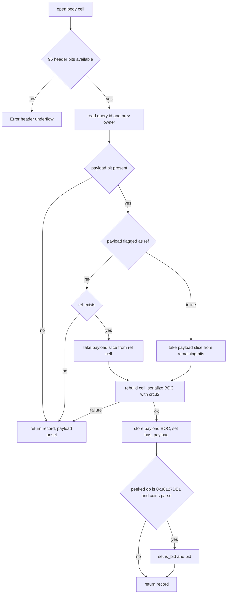
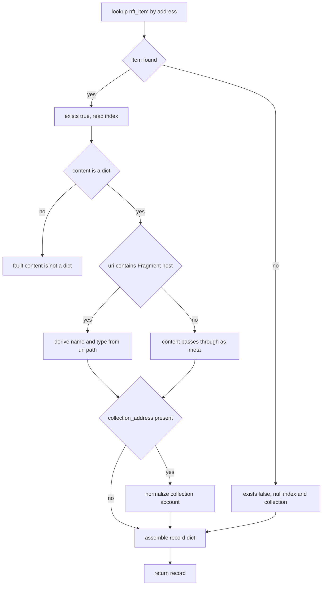
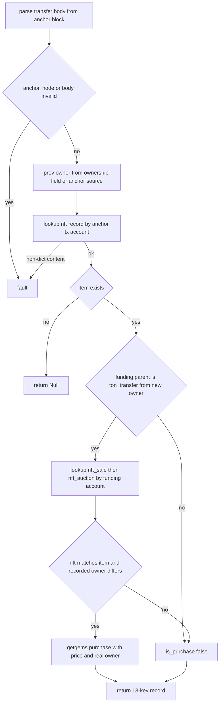
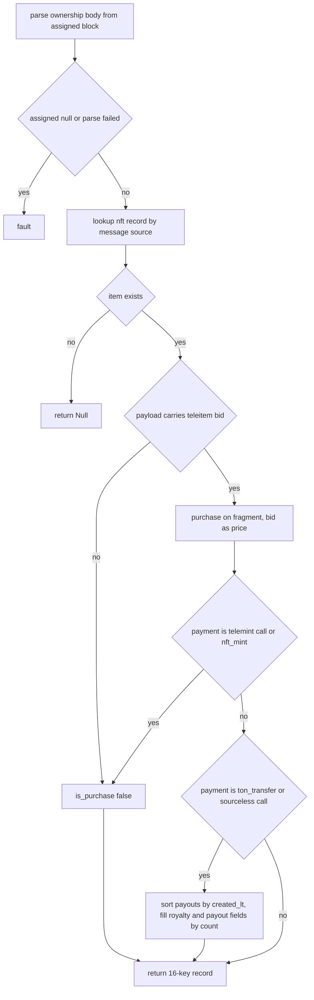

# HostNft

Host bindings for the TON NFT item-transfer family: the standard transfer and ownership-assigned notification pair, GetGems sale and auction purchases detected through the funding parent, and Fragment username purchases carried inside the ownership payload. The module feeds the engine registries with the nft_transfer_data, telegram_nft_purchase_data, and is_teleitem host fns, the single_contract_deploy predicate, and the nft_transfer_parent_absorb shaper, all reached from the pattern language by name through the host dispatch. Invariants: message bodies are parsed strictly so any cell-layout deviation faults the pattern, while repository misses reject with Null instead of faulting, and the nft record faults only when a found item carries a non-dict content value. The host fns are pure readers over the consumed block set and the lookup tables; only the shaper mutates the produced tree.

## class mch::OwnershipFull

- decl: `ton-index-worker/ton-mch-engine/src/host/HostNft.cpp:115`

Parsed NftOwnershipAssigned result: query id, prev owner, optional payload BOC, and teleitem bid fields.

Built only by parse_ownership_full. has_payload stays false whenever the payload is absent or fails to rebuild or serialize, and is_bid with bid are set only when the payload starts with opcode 0x38127DE1 followed by a parseable coins value, so a bid flag never surfaces without a payload.

## class mch::NftTransferMsg

- decl: `ton-index-worker/ton-mch-engine/src/host/HostNft.cpp:54`

Decoded NFT transfer body: query id, new owner, response destination, custom and forward payloads, forward amount.

## parse_ownership_prev_owner

`td::Result<Value> parse_ownership_prev_owner(const td::Ref<vm::Cell> & body)`

- decl: `ton-index-worker/ton-mch-engine/src/host/HostNft.cpp:109`
- callers: mch::nft_transfer_data (ton-index-worker/ton-mch-engine/src/host/HostNft.cpp:281)
- calls: `mch::Value::field`, `mch::parse_message_body`

Extracts only the prev_owner account from an NftOwnershipAssigned body via the shared generated parser.

Delegates to the generated rule NftOwnershipAssignedPrevOwner and returns its prev_owner field; any decode failure propagates as an error and faults the calling pattern. Only prev_owner is read because the transfer core needs nothing else from the notification.

## OwnershipFull

`void OwnershipFull()`

- decl: `ton-index-worker/ton-mch-engine/src/host/HostNft.cpp:115`
- callers: mch::parse_ownership_full (ton-index-worker/ton-mch-engine/src/host/HostNft.cpp:127)

Default-constructs the record with null owner and payload values and no bid.

## parse_ownership_full

`td::Result<OwnershipFull> parse_ownership_full(const td::Ref<vm::Cell> & body)`

- decl: `ton-index-worker/ton-mch-engine/src/host/HostNft.cpp:124`
- callers: mch::telegram_nft_purchase_data (ton-index-worker/ton-mch-engine/src/host/HostNft.cpp:417)
- calls: `mch::OwnershipFull::OwnershipFull`, `mch::PSlice::PSlice`, `mch::load_address_py`, `mch::load_coins_py`, `mch::open_body`, `mch::pslice_from_cell`, `mch::pslice_to_cell`, `mch::refint_u64`, `mch::td_boc_serialize_crc`

Strict-header, soft-payload decode of an NftOwnershipAssigned body for the telegram purchase core.

The 96 header bits, query id, and prev owner are read strictly; an underflow errors out. The payload is soft: a missing payload bit, a missing ref, or a failed cell rebuild or BOC serialization leaves has_payload unset instead of erroring. When present, the payload cell is serialized to a BOC byte string with crc32, its first 32 bits are peeked, and opcode 0x38127DE1 marks a teleitem bid whose following coins value becomes bid.

## get_nft_data

`EvalResult get_nft_data(BuildEnv & env, const Value & nft_address)`

- decl: `ton-index-worker/ton-mch-engine/src/host/HostNft.cpp:178`
- callers: mch::nft_transfer_data (ton-index-worker/ton-mch-engine/src/host/HostNft.cpp:307); mch::telegram_nft_purchase_data (ton-index-worker/ton-mch-engine/src/host/HostNft.cpp:427)
- calls: `mch::LookupTable::get`, `mch::Value::Value`, `mch::Value::field`, `mch::Value::is_null`, `mch::Value::make_bool`, `mch::Value::make_dict`, `mch::Value::make_str`, `mch::Value::null`, `mch::account_from_value`, `mch::fragment_uri`, `mch::rt_fault`, `mch::rt_ok`

Builds the nft record for an address from the nft_item lookup, faulting only on malformed content.

A lookup miss produces exists false with null index and collection rather than an error. A found item whose content is not a dict faults, since the uri membership test would be undefined. When the content uri contains the Fragment host, name is the last uri path segment minus five characters and type the previous segment; otherwise content passes through as meta. A non-null collection_address is normalized into a one-field collection dict.

## nft_transfer_data

`EvalResult nft_transfer_data(BuildEnv & env, const std::vector<Value> & args)`

- decl: `ton-index-worker/ton-mch-engine/src/host/HostNft.cpp:251`
- callers: none found in parsed TU set
- calls: `mch::EvalResult::EvalResult`, `mch::LookupTable::get`, `mch::Value::Value`, `mch::Value::field`, `mch::Value::is_null`, `mch::Value::make_account_none`, `mch::Value::make_bool`, `mch::Value::make_int`, `mch::Value::make_obj`, `mch::Value::make_str`, `mch::Value::null`, `mch::account_from_opt`, `mch::account_from_value`, `mch::amount_or_none`, `mch::as_block`, `mch::block_body`, `mch::first_node`, `mch::get_nft_data`, `mch::parse_nft_transfer`, `mch::parse_ownership_prev_owner`, `mch::rt_fault`, `mch::rt_ok`, `mch::same_account`, `mch::to_amount`

Builds the fixed 13-key transfer record from the transfer, assigned, and funding-parent blocks, rejecting unknown items with Null.

A null anchor, a missing event node, or any body-open or transfer-parse failure faults. prev_owner comes from the ownership notification when present, else from the anchor message source, and the nft record is keyed by the anchor transaction account; exists false rejects with Null. Purchase detection runs only when the funding parent is a ton_transfer whose source matches the new owner: its account is looked up in nft_sale then nft_auction, and the sale qualifies only when its nft address matches the item and its recorded owner differs from the new owner, filling the marketplace name and address, price, and real_prev_owner on success.

## account_from_value

`Value account_from_value(const Value & v)`

- decl: `ton-index-worker/ton-mch-engine/src/host/HostNft.cpp:31`
- callers: mch::get_nft_data (ton-index-worker/ton-mch-engine/src/host/HostNft.cpp:230); mch::nft_transfer_data (ton-index-worker/ton-mch-engine/src/host/HostNft.cpp:285); mch::nft_transfer_data (ton-index-worker/ton-mch-engine/src/host/HostNft.cpp:372); mch::nft_transfer_data (ton-index-worker/ton-mch-engine/src/host/HostNft.cpp:373); mch::nft_transfer_data (ton-index-worker/ton-mch-engine/src/host/HostNft.cpp:377); mch::nft_transfer_data (ton-index-worker/ton-mch-engine/src/host/HostNft.cpp:379)
- calls: `mch::Value::Value`, `mch::Value::make_account_none`, `mch::account_from_opt`

Normalizes a raw-address string or Account value to an Account, mapping anything else to addr_none.

A Str goes through the canonical normalizer, an Account passes through unchanged, and null or any other type becomes addr_none.

## telegram_nft_purchase_data

`EvalResult telegram_nft_purchase_data(BuildEnv & env, const std::vector<Value> & args)`

- decl: `ton-index-worker/ton-mch-engine/src/host/HostNft.cpp:403`
- callers: none found in parsed TU set
- calls: `mch::(lambda at /home/verdigos/dev/ton-indexer-private/ton-index-worker/ton-mch-engine/src/host/HostNft.cpp:467:9)::operator()`, `mch::(lambda at /home/verdigos/dev/ton-indexer-private/ton-index-worker/ton-mch-engine/src/host/HostNft.cpp:480:18)::operator()`, `mch::(lambda at /home/verdigos/dev/ton-indexer-private/ton-index-worker/ton-mch-engine/src/host/HostNft.cpp:484:19)::operator()`, `mch::EvalResult::EvalResult`, `mch::Value::Value`, `mch::Value::field`, `mch::Value::is_null`, `mch::Value::make_account_none`, `mch::Value::make_amount_none`, `mch::Value::make_bool`, `mch::Value::make_int`, `mch::Value::make_obj`, `mch::Value::make_str`, `mch::Value::null`, `mch::account_from_opt`, `mch::as_block`, `mch::block_body`, `mch::first_node`, `mch::get_nft_data`, `mch::parse_ownership_full`, `mch::rt_fault`, `mch::rt_ok`, `mch::to_amount`

Builds the fixed 16-key record for Fragment purchases from an ownership assignment, payment parent, and up to two payouts.

A null assigned block, body-open failure, or ownership-parse failure faults; an unknown item rejects with Null. A purchase requires the ownership payload to carry teleitem bid info, setting price to the bid and marketplace to fragment, unless the payment parent is a telemint call, opcode 0x299a3e15, or an nft_mint, which marks a mint. Payout fields fill only when the payment is a ton_transfer or a sourceless call_contract: payout blocks are sorted by message created_lt, two payouts set the royalty pair from the first and the payout pair from the second, and a single payout sets only the payout pair. real_prev_owner and the response, custom, and forward-amount fields remain null.

## amount_or_none

`Value amount_or_none(const Value & v)`

- decl: `ton-index-worker/ton-mch-engine/src/host/HostNft.cpp:42`
- callers: mch::nft_transfer_data (ton-index-worker/ton-mch-engine/src/host/HostNft.cpp:378)
- calls: `mch::Value::is_null`, `mch::Value::make_amount_none`, `mch::to_amount`

Maps null to an amount-none value and anything else through the amount converter.

## operator()

`bool operator()() const`

- decl: `ton-index-worker/ton-mch-engine/src/host/HostNft.cpp:467`
- callers: mch::telegram_nft_purchase_data (ton-index-worker/ton-mch-engine/src/host/HostNft.cpp:467)

Checks that the payment call_contract block has a null or missing source field.

## operator()

`Value operator()(const Block * b) const`

- decl: `ton-index-worker/ton-mch-engine/src/host/HostNft.cpp:480`
- callers: mch::telegram_nft_purchase_data (ton-index-worker/ton-mch-engine/src/host/HostNft.cpp:489); mch::telegram_nft_purchase_data (ton-index-worker/ton-mch-engine/src/host/HostNft.cpp:490); mch::telegram_nft_purchase_data (ton-index-worker/ton-mch-engine/src/host/HostNft.cpp:495)

Reads a payout block's value field, defaulting to amount-none when absent.

## operator()

`Value operator()(const Block * b) const`

- decl: `ton-index-worker/ton-mch-engine/src/host/HostNft.cpp:484`
- callers: mch::telegram_nft_purchase_data (ton-index-worker/ton-mch-engine/src/host/HostNft.cpp:491); mch::telegram_nft_purchase_data (ton-index-worker/ton-mch-engine/src/host/HostNft.cpp:492); mch::telegram_nft_purchase_data (ton-index-worker/ton-mch-engine/src/host/HostNft.cpp:494)

Reads a payout block's destination field, defaulting to account-none when absent.

## first_node

`const EventNode * first_node(const Block * b)`

- decl: `ton-index-worker/ton-mch-engine/src/host/HostNft.cpp:49`
- callers: mch::nft_transfer_data (ton-index-worker/ton-mch-engine/src/host/HostNft.cpp:258); mch::nft_transfer_data (ton-index-worker/ton-mch-engine/src/host/HostNft.cpp:327); mch::telegram_nft_purchase_data (ton-index-worker/ton-mch-engine/src/host/HostNft.cpp:411); mch::telegram_nft_purchase_data (ton-index-worker/ton-mch-engine/src/host/HostNft.cpp:478)

Returns the block's first event node, or null for a null block or empty node list.

## is_teleitem

`EvalResult is_teleitem(BuildEnv &, const std::vector<Value> & args)`

- decl: `ton-index-worker/ton-mch-engine/src/host/HostNft.cpp:524`
- callers: none found in parsed TU set
- calls: `mch::Value::field`, `mch::Value::is_null`, `mch::Value::make_bool`, `mch::fragment_uri`, `mch::rt_ok`

Decides whether a looked-up nft_item is a Fragment item from its content uri.

A null argument, missing content, or non-dict content yields false without faulting; otherwise the content uri must contain the Fragment NFT host.

## nft_transfer_parent_absorb

`void nft_transfer_parent_absorb(Block * produced, const ShaperMatch &)`

- decl: `ton-index-worker/ton-mch-engine/src/host/HostNft.cpp:536`
- callers: none found in parsed TU set
- calls: `mch::Block::compact_connections`, `mch::Block::merge_blocks`, `mch::Value::field`, `mch::Value::is_null`

Shaper merging the funding parent into a produced purchase block unless it is a finish or stop sale-contract ton transfer.

Runs only on the purchase branch: a null record or a false is_purchase returns immediately. The previous block is absorbed when it is a ton_transfer whose comment is neither finish nor stop, or a call_contract with a null source; absorption merges the parent into the produced block and compacts connections.

## NftTransferMsg

`void NftTransferMsg()`

- decl: `ton-index-worker/ton-mch-engine/src/host/HostNft.cpp:54`
- callers: mch::parse_nft_transfer (ton-index-worker/ton-mch-engine/src/host/HostNft.cpp:66)

Default-initializes the transfer record with null address and payload values.

## single_contract_deploy

`bool single_contract_deploy(const Block * b)`

- decl: `ton-index-worker/ton-mch-engine/src/host/HostNft.cpp:572`
- callers: none found in parsed TU set

Predicate accepting blocks whose event nodes deploy exactly one distinct account.

Nodes without a transaction, already active at start, or not active at end are skipped, and the surviving accounts form a set so repeated deploys of one account count once. Frozen-to-active transactions qualify even though they create no separate contract_deploy side-effect block.

## parse_nft_transfer

`td::Result<NftTransferMsg> parse_nft_transfer(const td::Ref<vm::Cell> & body)`

- decl: `ton-index-worker/ton-mch-engine/src/host/HostNft.cpp:63`
- callers: mch::nft_transfer_data (ton-index-worker/ton-mch-engine/src/host/HostNft.cpp:267)
- calls: `mch::NftTransferMsg::NftTransferMsg`, `mch::PSlice::PSlice`, `mch::Value::make_bytes`, `mch::load_address_py`, `mch::load_coins_py`, `mch::open_body`, `mch::pslice_to_cell`, `mch::refint_u64`, `mch::td_boc_serialize_crc`

Strict decode of the NFT transfer body into query id, addresses, and both payloads as BOC byte strings.

The 32-bit opcode is skipped without validation and 96 header bits must be present. custom_payload is a maybe-ref cell serialized to BOC with crc32 when present; forward_amount is a coins value, and forward_payload, when bits remain, is either the ref cell or the remaining slice rebuilt into a cell, then serialized the same way. Error strings cover header underflow, a bad custom payload, and a missing forward-payload ref.
