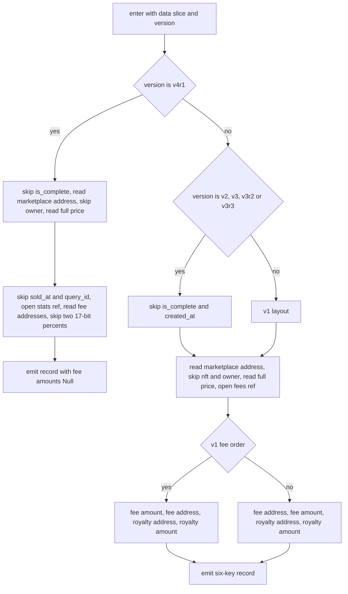
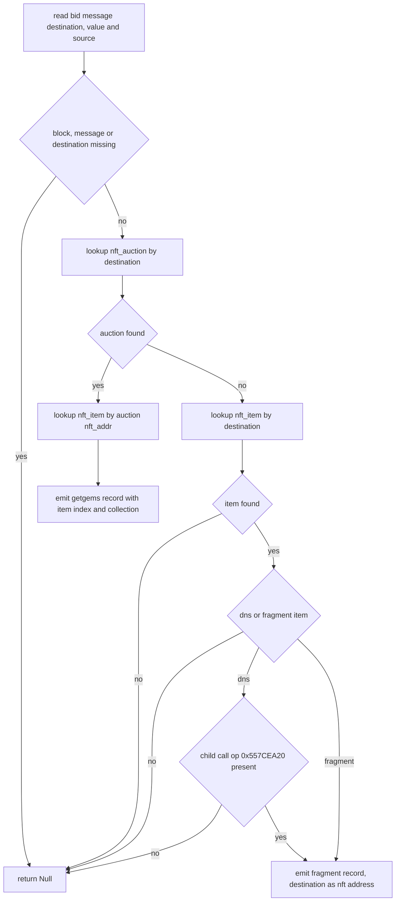

# HostNftSale

Host bindings for GetGems NFT fixed-price sales and auctions plus the Fragment and TON DNS auction-bid path. The StateInit readers getgems_sale_init and getgems_auction_init take listing parameters from a deploying message and select the data-cell layout by code hash with a latest-version fallback, auction_bid_data chains the auction interface lookup into an item lookup, and ton_transfer predicates guard the trade, cancel, and bid patterns, with getgems_proxy_insert rewiring finish and stop purchases. Invariants: every StateInit or layout miss returns Null rather than faulting, an unlisted code hash falls back to the newest layout, and sale_contract_deploy accepts any positive deployment count where the mint path demands exactly one.

## class mch::AuctionInit

- decl: `ton-index-worker/ton-mch-engine/src/host/HostNftSale.cpp:171`

Auction StateInit result: marketplace and royalty fee addresses, fee factor and base, and min and max bid.

Filled by exactly one version reader chosen from the code-hash table. royalty_fee_factor is the only fee field deliberately skipped and never stored; a null integer ref surfaces as Null in the emitted record through the opt_amount conversion.

## opt_amount

`Value opt_amount(const td::RefInt256 & v)`

- decl: `ton-index-worker/ton-mch-engine/src/host/HostNftSale.cpp:105`
- callers: mch::parse_sale_data (ton-index-worker/ton-mch-engine/src/host/HostNftSale.cpp:161); mch::parse_sale_data (ton-index-worker/ton-mch-engine/src/host/HostNftSale.cpp:164); mch::parse_sale_data (ton-index-worker/ton-mch-engine/src/host/HostNftSale.cpp:166); mch::getgems_auction_init (ton-index-worker/ton-mch-engine/src/host/HostNftSale.cpp:418); mch::getgems_auction_init (ton-index-worker/ton-mch-engine/src/host/HostNftSale.cpp:419); mch::getgems_auction_init (ton-index-worker/ton-mch-engine/src/host/HostNftSale.cpp:421); mch::getgems_auction_init (ton-index-worker/ton-mch-engine/src/host/HostNftSale.cpp:422); mch::getgems_auction_init (ton-index-worker/ton-mch-engine/src/host/HostNftSale.cpp:423)
- calls: `mch::Value::make_int`, `mch::Value::null`

Converts an optional integer ref to an int value, or Null when the ref is null.

## load_ref_slice

`td::Result<vm::CellSlice> load_ref_slice(vm::CellSlice & cs)`

- decl: `ton-index-worker/ton-mch-engine/src/host/HostNftSale.cpp:109`
- callers: mch::parse_sale_data (ton-index-worker/ton-mch-engine/src/host/HostNftSale.cpp:130); mch::parse_sale_data (ton-index-worker/ton-mch-engine/src/host/HostNftSale.cpp:146); mch::parse_auction_v1 (ton-index-worker/ton-mch-engine/src/host/HostNftSale.cpp:178); mch::parse_auction_v1 (ton-index-worker/ton-mch-engine/src/host/HostNftSale.cpp:179); mch::parse_auction_v3r2 (ton-index-worker/ton-mch-engine/src/host/HostNftSale.cpp:197); mch::parse_auction_v3r2 (ton-index-worker/ton-mch-engine/src/host/HostNftSale.cpp:198); mch::parse_auction_v3r3 (ton-index-worker/ton-mch-engine/src/host/HostNftSale.cpp:224); mch::parse_auction_v3r3 (ton-index-worker/ton-mch-engine/src/host/HostNftSale.cpp:225); mch::parse_auction_v4r1 (ton-index-worker/ton-mch-engine/src/host/HostNftSale.cpp:242); mch::parse_auction_v4r1 (ton-index-worker/ton-mch-engine/src/host/HostNftSale.cpp:243)
- calls: `mch::open_ref_cell`

Opens a slice's next reference as a fresh CellSlice, erroring when no ref remains.

## parse_sale_data

`td::Result<Value> parse_sale_data(vm::CellSlice cs, const std::string & version)`

- decl: `ton-index-worker/ton-mch-engine/src/host/HostNftSale.cpp:115`
- callers: mch::getgems_sale_init (ton-index-worker/ton-mch-engine/src/host/HostNftSale.cpp:385)
- calls: `mch::Value::make_obj`, `mch::Value::null`, `mch::load_address_py`, `mch::load_coins_py`, `mch::load_ref_slice`, `mch::opt_amount`, `mch::skip_address`, `mch::skip_bits`

Decodes a GetGems sale StateInit data slice into the fee record according to the layout version.

v4r1 skips the completion flag, reads the marketplace address and full price, skips the owner, sold_at, and query_id, and takes the fee addresses from a stats ref followed by two skipped 17-bit percents; the early return leaves marketplace_fee and royalty_amount Null on this version. v2 through v3r3 share the created_at-prefixed layout with addresses and amounts read from a fees ref, where v1 uses fee-amount-then-address order and the others the opposite. Any underflow or missing ref errors out, which the caller converts to Null.

## AuctionInit

`void AuctionInit()`

- decl: `ton-index-worker/ton-mch-engine/src/host/HostNftSale.cpp:171`
- callers: mch::getgems_auction_init (ton-index-worker/ton-mch-engine/src/host/HostNftSale.cpp:402)

Default-constructs the auction record with null addresses and empty integer refs.

## parse_auction_v1

`td::Status parse_auction_v1(vm::CellSlice & cs, AuctionInit & d)`

- decl: `ton-index-worker/ton-mch-engine/src/host/HostNftSale.cpp:177`
- callers: mch::getgems_auction_init (ton-index-worker/ton-mch-engine/src/host/HostNftSale.cpp:405)
- calls: `mch::load_address_py`, `mch::load_coins_py`, `mch::load_ref_slice`, `mch::load_uint_py`, `mch::skip_bits`

Reads the v1 auction layout: fee fields from a fees ref, bid bounds from a bids ref.

royalty_fee_factor is read past but discarded. Any missing ref or field underflow returns a status error, which getgems_auction_init turns into Null.

## parse_auction_v3r2

`td::Status parse_auction_v3r2(vm::CellSlice & cs, AuctionInit & d)`

- decl: `ton-index-worker/ton-mch-engine/src/host/HostNftSale.cpp:191`
- callers: mch::getgems_auction_init (ton-index-worker/ton-mch-engine/src/host/HostNftSale.cpp:407)
- calls: `mch::load_address_py`, `mch::load_coins_py`, `mch::load_ref_slice`, `mch::load_uint_py`, `mch::skip_address`, `mch::skip_bits`, `mch::skip_coins`

Reads the v3r2 auction layout after skipping the auction state, with fees and constant refs supplying fee fields and bid bounds.

Three status bits, the last member, last bid, and both timestamps are skipped first. The constant ref yields min and max bid around a skipped gas price and marketplace address, and the fees ref yields the fee addresses and bases with royalty_fee_factor skipped.

## parse_auction_v3r3

`td::Status parse_auction_v3r3(vm::CellSlice & cs, AuctionInit & d)`

- decl: `ton-index-worker/ton-mch-engine/src/host/HostNftSale.cpp:212`
- callers: mch::getgems_auction_init (ton-index-worker/ton-mch-engine/src/host/HostNftSale.cpp:409)
- calls: `mch::load_address_py`, `mch::load_coins_py`, `mch::load_ref_slice`, `mch::load_uint_py`, `mch::skip_address`, `mch::skip_bits`, `mch::skip_coins`

Reads the v3r3 auction layout: skipped state plus inline fee factor and base, then fees and constant refs.

Compared to v3r2 it also skips an nft_owner address and a 64-bit last query id, and reads the fee factor and base inline before the refs. The fees ref then carries only the two fee addresses, and the constant ref the marketplace address with the bid bounds.

## parse_auction_v4r1

`td::Status parse_auction_v4r1(vm::CellSlice & cs, AuctionInit & d)`

- decl: `ton-index-worker/ton-mch-engine/src/host/HostNftSale.cpp:234`
- callers: mch::getgems_auction_init (ton-index-worker/ton-mch-engine/src/host/HostNftSale.cpp:411)
- calls: `mch::load_address_py`, `mch::load_coins_py`, `mch::load_ref_slice`, `mch::load_uint_py`, `mch::skip_address`, `mch::skip_bits`, `mch::skip_coins`

Reads the v4r1 auction layout: the same skipped state as v3r3, with both refs opened up front.

The fees ref carries the two addresses followed by the factor and base with royalty_fee_factor skipped, and the constant ref carries the marketplace address and the bid bounds. Field underflow or a missing ref is a status error.

## block_comment

`std::string block_comment(const Block * b)`

- decl: `ton-index-worker/ton-mch-engine/src/host/HostNftSale.cpp:257`
- callers: mch::is_cancel_comment (ton-index-worker/ton-mch-engine/src/host/HostNftSale.cpp:263); mch::nft_trade_finish_comment (ton-index-worker/ton-mch-engine/src/host/HostNftSale.cpp:333); mch::auction_outbid_leg (ton-index-worker/ton-mch-engine/src/host/HostNftSale.cpp:362)
- calls: `mch::Value::field`

Returns a block's comment string, empty for a null block, missing field, or non-string value.

## is_cancel_comment

`bool is_cancel_comment(const Block * b)`

- decl: `ton-index-worker/ton-mch-engine/src/host/HostNftSale.cpp:262`
- callers: mch::nft_trade_cancel_comment (ton-index-worker/ton-mch-engine/src/host/HostNftSale.cpp:326); mch::auction_bid_candidate (ton-index-worker/ton-mch-engine/src/host/HostNftSale.cpp:340)
- calls: `mch::block_comment`

True when the comment is exactly cancel, finish, or stop.

## has_deployment

`bool has_deployment(const Block * b)`

- decl: `ton-index-worker/ton-mch-engine/src/host/HostNftSale.cpp:267`
- callers: mch::sale_contract_deploy (ton-index-worker/ton-mch-engine/src/host/HostNftSale.cpp:322); mch::auction_bid_candidate (ton-index-worker/ton-mch-engine/src/host/HostNftSale.cpp:339)

True when any event node's transaction ends active from a non-active origin status.

## is_dns_item

`bool is_dns_item(const Value & nft)`

- decl: `ton-index-worker/ton-mch-engine/src/host/HostNftSale.cpp:281`
- callers: mch::auction_bid_data (ton-index-worker/ton-mch-engine/src/host/HostNftSale.cpp:473)
- calls: `mch::Value::field`

Identifies a TON DNS domain item by item code hash or DNS collection address.

Both comparisons are exact string matches against compile-time constants; either one suffices.

## is_fragment_item

`bool is_fragment_item(const Value & nft)`

- decl: `ton-index-worker/ton-mch-engine/src/host/HostNftSale.cpp:290`
- callers: mch::auction_bid_data (ton-index-worker/ton-mch-engine/src/host/HostNftSale.cpp:474)
- calls: `mch::Value::field`, `mch::fragment_uri`

True when the item's content uri contains the Fragment NFT host.

Content must be a dict or obj value; any other shape returns false without faulting.

## msg_dest

`const std::string * msg_dest(const Block * b)`

- decl: `ton-index-worker/ton-mch-engine/src/host/HostNftSale.cpp:298`
- callers: mch::auction_bid_data (ton-index-worker/ton-mch-engine/src/host/HostNftSale.cpp:433)
- calls: `mch::block_msg`

Pointer to the block message's destination string, null when the message or destination is absent.

## account_of

`Value account_of(const Value & v)`

- decl: `ton-index-worker/ton-mch-engine/src/host/HostNftSale.cpp:304`
- callers: mch::auction_bid_data (ton-index-worker/ton-mch-engine/src/host/HostNftSale.cpp:454); mch::auction_bid_data (ton-index-worker/ton-mch-engine/src/host/HostNftSale.cpp:461); mch::auction_bid_data (ton-index-worker/ton-mch-engine/src/host/HostNftSale.cpp:491)
- calls: `mch::Value::null`, `mch::account_from_opt`

Converts an interface string address to an Account, Null for any non-string value.

## sale_contract_deploy

`bool sale_contract_deploy(const Block * b)`

- decl: `ton-index-worker/ton-mch-engine/src/host/HostNftSale.cpp:317`
- callers: none found in parsed TU set
- calls: `mch::has_deployment`

Predicate accepting ton_transfer or call_contract leaves that deployed at least one contract.

Any positive deployment count qualifies, deliberately weaker than the exactly-one check the mint path uses.

## nft_trade_cancel_comment

`bool nft_trade_cancel_comment(const Block * b)`

- decl: `ton-index-worker/ton-mch-engine/src/host/HostNftSale.cpp:325`
- callers: none found in parsed TU set
- calls: `mch::is_cancel_comment`

ton_transfer whose comment is cancel, finish, or stop.

## nft_trade_finish_comment

`bool nft_trade_finish_comment(const Block * b)`

- decl: `ton-index-worker/ton-mch-engine/src/host/HostNftSale.cpp:329`
- callers: none found in parsed TU set
- calls: `mch::block_comment`

ton_transfer whose comment is exactly finish or stop.

## auction_bid_candidate

`bool auction_bid_candidate(const Block * b)`

- decl: `ton-index-worker/ton-mch-engine/src/host/HostNftSale.cpp:338`
- callers: none found in parsed TU set
- calls: `mch::has_deployment`, `mch::is_cancel_comment`

Cheap pre-filter for bid legs: a ton_transfer with no deployment and a non-cancel comment.

Registered as a predicate and evaluated before the bid path touches the interface repository.

## sale_versions

`const std::map<std::string, std::string> & sale_versions()`

- decl: `ton-index-worker/ton-mch-engine/src/host/HostNftSale.cpp:34`
- callers: mch::getgems_sale_init (ton-index-worker/ton-mch-engine/src/host/HostNftSale.cpp:385)

Code-hash to layout-name table for the sale reader, covering v1 through v4r1.

## auction_outbid_leg

`bool auction_outbid_leg(const Block * bid)`

- decl: `ton-index-worker/ton-mch-engine/src/host/HostNftSale.cpp:344`
- callers: none found in parsed TU set
- calls: `mch::Value::field`, `mch::block_comment`, `mch::data_field`, `mch::is_call_op`, `mch::same_account`

True when an auction_bid block has exactly one qualifying outbid return leg.

Only children whose previous_block is the bid and whose source matches the auction field are considered. A getgems leg must be a ton_transfer containing the outbid comment text, a fragment leg a call with opcode 0x557CEA20, and a second qualifying leg rejects the match.

## getgems_sale_init

`EvalResult getgems_sale_init(BuildEnv & env, const std::vector<Value> & args)`

- decl: `ton-index-worker/ton-mch-engine/src/host/HostNftSale.cpp:375`
- callers: none found in parsed TU set
- calls: `mch::Value::null`, `mch::as_block`, `mch::parse_sale_data`, `mch::pick_version`, `mch::rt_ok`, `mch::sale_versions`, `mch::state_init_data`

Decodes a deploying sale contract's StateInit data into the fee record.

A null block, a message without init_state, or any decode or layout failure returns Null rather than faulting. The layout is chosen from the code-hash argument with v4r1 as the latest fallback.

## getgems_auction_init

`EvalResult getgems_auction_init(BuildEnv & env, const std::vector<Value> & args)`

- decl: `ton-index-worker/ton-mch-engine/src/host/HostNftSale.cpp:389`
- callers: none found in parsed TU set
- calls: `mch::AuctionInit::AuctionInit`, `mch::Value::make_obj`, `mch::Value::null`, `mch::as_block`, `mch::auction_versions`, `mch::opt_amount`, `mch::parse_auction_v1`, `mch::parse_auction_v3r2`, `mch::parse_auction_v3r3`, `mch::parse_auction_v4r1`, `mch::pick_version`, `mch::rt_ok`, `mch::state_init_data`

Decodes a deploying auction contract's StateInit data into the seven-key fee and bid-bounds record.

The version comes from the code-hash table with v3r3 as the latest fallback; v2 appears in the table but has no reader branch, so it keeps the unsupported-version error and returns Null. Any reader status error returns Null, and success emits the fee addresses, fee factor and base, royalty base, and min and max bid.

## auction_bid_data

`EvalResult auction_bid_data(BuildEnv & env, const std::vector<Value> & args)`

- decl: `ton-index-worker/ton-mch-engine/src/host/HostNftSale.cpp:430`
- callers: none found in parsed TU set
- calls: `mch::LookupTable::get`, `mch::Value::Value`, `mch::Value::field`, `mch::Value::is_null`, `mch::Value::make_obj`, `mch::Value::make_str`, `mch::Value::null`, `mch::account_from_opt`, `mch::account_of`, `mch::as_block`, `mch::block_msg`, `mch::first_call`, `mch::is_dns_item`, `mch::is_fragment_item`, `mch::msg_dest`, `mch::msg_value_amount`, `mch::rt_ok`

Builds the bid record by chaining the auction interface lookup into an item lookup, for getgems and fragment or DNS auctions.

The bid destination is looked up in nft_auction first: a hit produces the getgems record and resolves item index and collection from the nft_addr the interface carries. Otherwise the destination itself must be a DNS or Fragment item; DNS additionally requires a child call with opcode 0x557CEA20, and the fragment record reuses the destination as the nft address. Every rejected branch returns Null.

## auction_versions

`const std::map<std::string, std::string> & auction_versions()`

- decl: `ton-index-worker/ton-mch-engine/src/host/HostNftSale.cpp:46`
- callers: mch::getgems_auction_init (ton-index-worker/ton-mch-engine/src/host/HostNftSale.cpp:401)

Code-hash to layout-name table for the auction reader, covering v1 through v4r1.

The v2 entry has no reader branch in getgems_auction_init and always rejects.

## getgems_proxy_insert

`void getgems_proxy_insert(Block * produced, const ShaperMatch & m)`

- decl: `ton-index-worker/ton-mch-engine/src/host/HostNftSale.cpp:498`
- callers: none found in parsed TU set
- calls: `mch::Block::compact_connections`, `mch::Block::insert_between`, `mch::Block::merge_blocks`, `mch::BlockArena::make`, `mch::ShaperMatch::capture`, `mch::Value::field`

Shaper inserting an empty proxy block under a finish or stop sale parent and absorbing the sibling payout.

It requires the captured sib_payout, an arena, and a ton_transfer parent whose comment is finish or stop. An empty block is made in the match arena, inserted between the produced block and the payout under the parent, both are merged into the produced block, and connections are compacted.

## pick_version

`std::string pick_version(const std::map<std::string, std::string> & table, const Value & code_hash, const char * latest)`

- decl: `ton-index-worker/ton-mch-engine/src/host/HostNftSale.cpp:57`
- callers: mch::getgems_sale_init (ton-index-worker/ton-mch-engine/src/host/HostNftSale.cpp:385); mch::getgems_auction_init (ton-index-worker/ton-mch-engine/src/host/HostNftSale.cpp:401)

Maps a code-hash string to a layout name, falling back to the latest version.

## state_init_data

`td::Result<vm::CellSlice> state_init_data(const Block * b)`

- decl: `ton-index-worker/ton-mch-engine/src/host/HostNftSale.cpp:69`
- callers: mch::getgems_sale_init (ton-index-worker/ton-mch-engine/src/host/HostNftSale.cpp:381); mch::getgems_auction_init (ton-index-worker/ton-mch-engine/src/host/HostNftSale.cpp:395)
- calls: `mch::block_msg`, `mch::open_ref_cell`, `mch::state_init_data_cell`

Decodes a deploying message's StateInit and opens its data cell as a slice.

The message must carry an init_state; it is base64-decoded, BOC-deserialized, and walked down the ref chain to the data cell. Every failure is an error the callers convert to Null.

## load_uint_py

`td::Result<td::RefInt256> load_uint_py(vm::CellSlice & cs, int bits)`

- decl: `ton-index-worker/ton-mch-engine/src/host/HostNftSale.cpp:82`
- callers: mch::parse_auction_v1 (ton-index-worker/ton-mch-engine/src/host/HostNftSale.cpp:181); mch::parse_auction_v1 (ton-index-worker/ton-mch-engine/src/host/HostNftSale.cpp:182); mch::parse_auction_v1 (ton-index-worker/ton-mch-engine/src/host/HostNftSale.cpp:185); mch::parse_auction_v3r2 (ton-index-worker/ton-mch-engine/src/host/HostNftSale.cpp:204); mch::parse_auction_v3r2 (ton-index-worker/ton-mch-engine/src/host/HostNftSale.cpp:205); mch::parse_auction_v3r2 (ton-index-worker/ton-mch-engine/src/host/HostNftSale.cpp:208); mch::parse_auction_v3r3 (ton-index-worker/ton-mch-engine/src/host/HostNftSale.cpp:220); mch::parse_auction_v3r3 (ton-index-worker/ton-mch-engine/src/host/HostNftSale.cpp:221); mch::parse_auction_v3r3 (ton-index-worker/ton-mch-engine/src/host/HostNftSale.cpp:223); mch::parse_auction_v4r1 (ton-index-worker/ton-mch-engine/src/host/HostNftSale.cpp:246); mch::parse_auction_v4r1 (ton-index-worker/ton-mch-engine/src/host/HostNftSale.cpp:247); mch::parse_auction_v4r1 (ton-index-worker/ton-mch-engine/src/host/HostNftSale.cpp:249)

Fixed-width unsigned integer read that errors on bit underflow.

## skip_bits

`td::Status skip_bits(vm::CellSlice & cs, int bits)`

- decl: `ton-index-worker/ton-mch-engine/src/host/HostNftSale.cpp:87`
- callers: mch::parse_sale_data (ton-index-worker/ton-mch-engine/src/host/HostNftSale.cpp:124); mch::parse_sale_data (ton-index-worker/ton-mch-engine/src/host/HostNftSale.cpp:128); mch::parse_sale_data (ton-index-worker/ton-mch-engine/src/host/HostNftSale.cpp:129); mch::parse_sale_data (ton-index-worker/ton-mch-engine/src/host/HostNftSale.cpp:135); mch::parse_sale_data (ton-index-worker/ton-mch-engine/src/host/HostNftSale.cpp:136); mch::parse_sale_data (ton-index-worker/ton-mch-engine/src/host/HostNftSale.cpp:139); mch::parse_sale_data (ton-index-worker/ton-mch-engine/src/host/HostNftSale.cpp:140); mch::parse_auction_v1 (ton-index-worker/ton-mch-engine/src/host/HostNftSale.cpp:184); mch::parse_auction_v3r2 (ton-index-worker/ton-mch-engine/src/host/HostNftSale.cpp:192); mch::parse_auction_v3r2 (ton-index-worker/ton-mch-engine/src/host/HostNftSale.cpp:195); mch::parse_auction_v3r2 (ton-index-worker/ton-mch-engine/src/host/HostNftSale.cpp:196); mch::parse_auction_v3r2 (ton-index-worker/ton-mch-engine/src/host/HostNftSale.cpp:199); mch::parse_auction_v3r2 (ton-index-worker/ton-mch-engine/src/host/HostNftSale.cpp:207); mch::parse_auction_v3r3 (ton-index-worker/ton-mch-engine/src/host/HostNftSale.cpp:213); mch::parse_auction_v3r3 (ton-index-worker/ton-mch-engine/src/host/HostNftSale.cpp:216); mch::parse_auction_v3r3 (ton-index-worker/ton-mch-engine/src/host/HostNftSale.cpp:217); mch::parse_auction_v3r3 (ton-index-worker/ton-mch-engine/src/host/HostNftSale.cpp:219); mch::parse_auction_v3r3 (ton-index-worker/ton-mch-engine/src/host/HostNftSale.cpp:222); mch::parse_auction_v4r1 (ton-index-worker/ton-mch-engine/src/host/HostNftSale.cpp:235); mch::parse_auction_v4r1 (ton-index-worker/ton-mch-engine/src/host/HostNftSale.cpp:238); mch::parse_auction_v4r1 (ton-index-worker/ton-mch-engine/src/host/HostNftSale.cpp:239); mch::parse_auction_v4r1 (ton-index-worker/ton-mch-engine/src/host/HostNftSale.cpp:241); mch::parse_auction_v4r1 (ton-index-worker/ton-mch-engine/src/host/HostNftSale.cpp:248)

Advances the slice by a fixed bit count, erroring when too few bits remain.

## skip_address

`td::Status skip_address(vm::CellSlice & cs)`

- decl: `ton-index-worker/ton-mch-engine/src/host/HostNftSale.cpp:93`
- callers: mch::parse_sale_data (ton-index-worker/ton-mch-engine/src/host/HostNftSale.cpp:126); mch::parse_sale_data (ton-index-worker/ton-mch-engine/src/host/HostNftSale.cpp:143); mch::parse_sale_data (ton-index-worker/ton-mch-engine/src/host/HostNftSale.cpp:144); mch::parse_auction_v3r2 (ton-index-worker/ton-mch-engine/src/host/HostNftSale.cpp:193); mch::parse_auction_v3r2 (ton-index-worker/ton-mch-engine/src/host/HostNftSale.cpp:200); mch::parse_auction_v3r3 (ton-index-worker/ton-mch-engine/src/host/HostNftSale.cpp:214); mch::parse_auction_v3r3 (ton-index-worker/ton-mch-engine/src/host/HostNftSale.cpp:218); mch::parse_auction_v3r3 (ton-index-worker/ton-mch-engine/src/host/HostNftSale.cpp:228); mch::parse_auction_v4r1 (ton-index-worker/ton-mch-engine/src/host/HostNftSale.cpp:236); mch::parse_auction_v4r1 (ton-index-worker/ton-mch-engine/src/host/HostNftSale.cpp:240); mch::parse_auction_v4r1 (ton-index-worker/ton-mch-engine/src/host/HostNftSale.cpp:250)
- calls: `mch::load_address_py`

Parses and discards one address from the slice.

## skip_coins

`td::Status skip_coins(vm::CellSlice & cs)`

- decl: `ton-index-worker/ton-mch-engine/src/host/HostNftSale.cpp:99`
- callers: mch::parse_auction_v3r2 (ton-index-worker/ton-mch-engine/src/host/HostNftSale.cpp:194); mch::parse_auction_v3r3 (ton-index-worker/ton-mch-engine/src/host/HostNftSale.cpp:215); mch::parse_auction_v4r1 (ton-index-worker/ton-mch-engine/src/host/HostNftSale.cpp:237)
- calls: `mch::load_coins_py`

Parses and discards one coins value from the slice.
