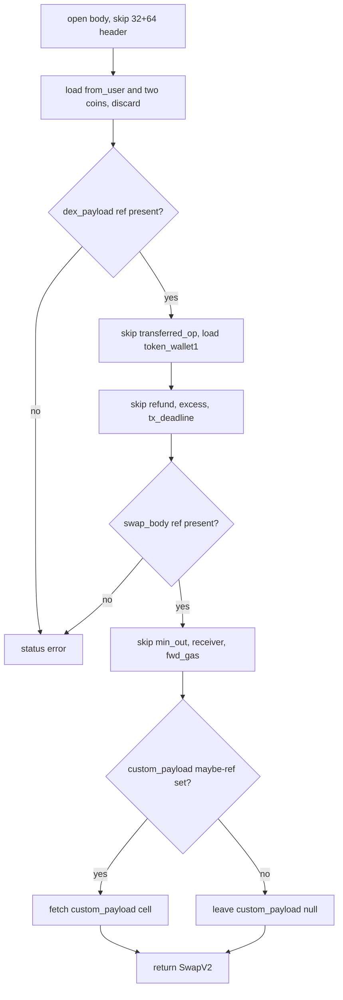
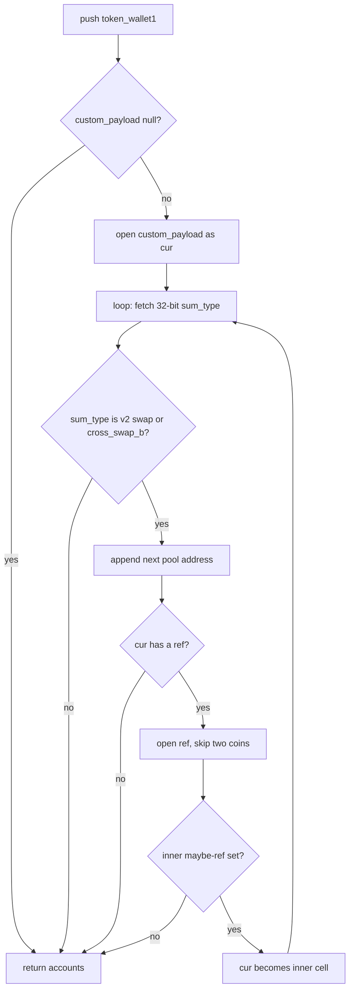
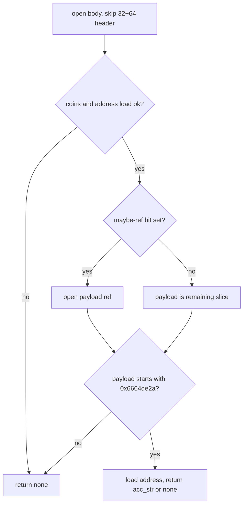
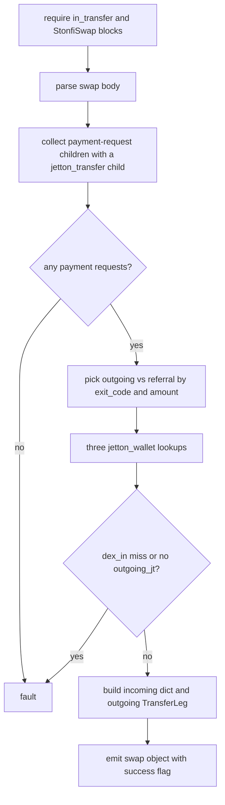
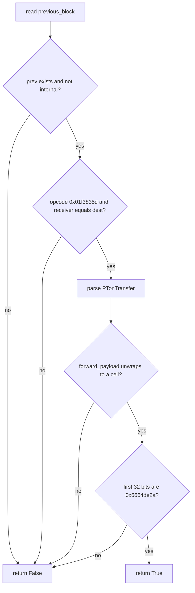
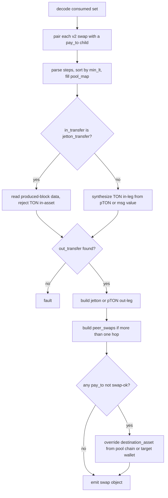

# HostStonfi

Host bindings for STON.fi v1 and v2 swaps in the mch classifier engine. Two host fns, stonfi_v1_swap_data (arity 2, in_transfer plus StonfiSwap call) and stonfi_v2_swap_data (arity 1, consumed set), plus two predicates, stonfi_v1_sender_payment and pton_self_transfer, are dispatched by name from HostRegistry after an arity check. Swap-data bindings fault on any parse, nav, or jetton_wallet lookup miss so the match is rejected; the predicates return False instead. v1 payment-request bodies must parse in full before exit_code is trusted. v2 identifies in and out legs by btype rather than event-node order, and 0x6664de2a is simultaneously the swap-request call opcode, the forward-payload swap tag, and a cross-swap sum-type, while the swap body's own opcode field is unused.

## class mch::PayTo

- decl: `ton-index-worker/ton-mch-engine/src/host/HostStonfi.cpp:109`

Parsed STON.fi v2 pay_to body: exit_code plus the two amount and token out-legs.

Filled only by parse_pay_to from a StonfiV2PayTo object after info.ref is present. stonfi_v2_swap_data stores one per hop inside Step and feeds it to bigger_leg when building peer_swaps. An exit_code other than 0xc64370e5 marks the whole swap failed.

## class mch::SwapV2

- decl: `ton-index-worker/ton-mch-engine/src/host/HostStonfi.cpp:132`

Parsed STON.fi v2 swap body: token_wallet1 and an optional custom_payload cell two refs deep.

parse_swap_v2 fills it by walking the cell layout; other fields are read and discarded. token_wallet1 keys the per-hop jetton_wallet lookup, and custom_payload feeds pool_accounts for the failed-swap destination fallback.

## class mch::PR

- decl: `ton-index-worker/ton-mch-engine/src/host/HostStonfi.cpp:315`

Local pairing of a parsed PaymentReq with the payment-request block that produced it.

Lives only inside stonfi_v1_swap_data. Built for swap children that are payment-request calls with opcode 0xf93bb43f and a jetton_transfer child, then scanned to pick the sender-related out-leg and the optional ok_ref referral.

## class mch::PaymentReq

- decl: `ton-index-worker/ton-mch-engine/src/host/HostStonfi.cpp:53`

Parsed STON.fi v1 payment-request body: exit_code plus the two amount and token out-legs.

parse_payment_request requires a full StonfiPaymentRequest parse including info.ref before reporting exit_code, so a missing later field still rejects. stonfi_v1_swap_data uses the positive amount0_out leg or else amount1_out. stonfi_payment_exit_code returns only the exit_code.

## class mch::Step

- decl: `ton-index-worker/ton-mch-engine/src/host/HostStonfi.cpp:610`

One v2 hop: token_wallet1, the swap min_lt, and the parsed PayTo and SwapV2 bodies.

Built per swap and payout pair in stonfi_v2_swap_data, then stably sorted by min_lt. token_wallet1 fills pool_map. A pay_to exit_code other than 0xc64370e5 sets the failed flag.

## class mch::SwapV1

- decl: `ton-index-worker/ton-mch-engine/src/host/HostStonfi.cpp:82`

Parsed STON.fi v1 swap body: from_user_address, token_wallet, amount, and from_real_user from the info ref.

parse_swap_v1 requires info.ref. stonfi_v1_swap_data uses from_real_user as sender, token_wallet as the incoming pool wallet, amount as the in-leg amount, and from_user_address as receiver and as the outgoing destination fallback.

## sender_related

`bool sender_related(std::uint32_t ec)`

- decl: `ton-index-worker/ton-mch-engine/src/host/HostStonfi.cpp:103`
- callers: mch::stonfi_v1_sender_payment (ton-index-worker/ton-mch-engine/src/host/HostStonfi.cpp:291); mch::stonfi_v1_swap_data (ton-index-worker/ton-mch-engine/src/host/HostStonfi.cpp:355)

True for the three sender-facing v1 payment exit codes: ok, no_liq, and reserve_err.

Matches 0xc64370e5, 0x5ffe1295, and 0x38976e9b. The referral code 0x45078540 is excluded, so stonfi_v1_sender_payment rejects referral payments. stonfi_v1_swap_data uses the same test to separate the outgoing leg from the referral.

## PayTo

`void PayTo()`

- decl: `ton-index-worker/ton-mch-engine/src/host/HostStonfi.cpp:109`
- callers: mch::parse_pay_to (ton-index-worker/ton-mch-engine/src/host/HostStonfi.cpp:121)

Default-constructs a PayTo with exit_code 0 and empty out-legs.

## parse_pay_to

`td::Result<PayTo> parse_pay_to(const td::Ref<vm::Cell> & body)`

- decl: `ton-index-worker/ton-mch-engine/src/host/HostStonfi.cpp:114`
- callers: mch::stonfi_v2_swap_data (ton-index-worker/ton-mch-engine/src/host/HostStonfi.cpp:622)
- calls: `mch::PayTo::PayTo`, `mch::Value::field`, `mch::parse_message_body`

Unpacks a StonfiV2PayTo body into PayTo, requiring info.ref before any field is trusted.

parse_message_body must succeed, then info.ref must exist or the status is stonfi pay_to: info.ref missing. exit_code comes from the root. amount0_out, token0, amount1_out, and token1 come from the ref. Callers convert any status into an rt_fault.

## SwapV2

`void SwapV2()`

- decl: `ton-index-worker/ton-mch-engine/src/host/HostStonfi.cpp:132`
- callers: mch::parse_swap_v2 (ton-index-worker/ton-mch-engine/src/host/HostStonfi.cpp:155)

Default-constructs a SwapV2 with a null custom_payload.

## parse_swap_v2

`td::Result<SwapV2> parse_swap_v2(const td::Ref<vm::Cell> & body)`

- decl: `ton-index-worker/ton-mch-engine/src/host/HostStonfi.cpp:136`
- callers: mch::stonfi_v2_swap_data (ton-index-worker/ton-mch-engine/src/host/HostStonfi.cpp:634)
- calls: `mch::SwapV2::SwapV2`, `mch::load_address_py`, `mch::load_coins_py`, `mch::open_body`, `mch::open_ref_cell`

Manually slices a v2 swap body for token_wallet1 and the maybe-ref custom_payload two refs down.

After a 32+64-bit header, from_user and two coins fields are parsed and discarded. The first ref is dex_payload. transferred_op is skipped, then token_wallet1, refund, excess, and a 64-bit tx_deadline. The next ref is swap_body: min_out, receiver, and fwd_gas are discarded, then a maybe-ref bit yields custom_payload. The body's own opcode is never used as a discriminator. Any bit or ref underflow is a status error.

## pool_accounts

`td::Result<std::vector<std::string>> pool_accounts(const SwapV2 & sv)`

- decl: `ton-index-worker/ton-mch-engine/src/host/HostStonfi.cpp:189`
- callers: mch::stonfi_v2_swap_data (ton-index-worker/ton-mch-engine/src/host/HostStonfi.cpp:645)
- calls: `mch::acc_str`, `mch::load_address_py`, `mch::load_coins_py`, `mch::open_ref_cell`

Collects pool wallet addresses from token_wallet1 and an uncapped custom_payload cross-swap chain.

Starts with token_wallet1, using an empty string for addr_none, and returns immediately when custom_payload is null. The while-true walk continues only while the 32-bit sum-type is 0x6664de2a or 0x69cf1a5b, then appends an address and follows the inner maybe-ref. Any other sum-type, a missing ref, or a clear maybe bit stops the walk. There is no hop cap, so a cyclic or very long chain never terminates by count. A malformed head, such as sum-type underflow or a missing inner ref, is a status error that stonfi_v2_swap_data turns into a fault.

## extract_target_wallet

`std::optional<std::string> extract_target_wallet(const td::Ref<vm::Cell> & body)`

- decl: `ton-index-worker/ton-mch-engine/src/host/HostStonfi.cpp:233`
- callers: mch::stonfi_v2_swap_data (ton-index-worker/ton-mch-engine/src/host/HostStonfi.cpp:849)
- calls: `mch::acc_str`, `mch::load_address_py`, `mch::load_coins_py`, `mch::open_body`, `mch::open_ref_cell`

Pulls a single target pool wallet from a notification-style body, or none on any miss.

Skips a 32+64-bit header, then a coins field and an address, then a maybe-ref payload that falls back to the remaining slice when the bit is clear. The payload must start with opcode 0x6664de2a. Anything else, underflow, or a bad address returns none rather than a status. Used only on the failed-swap arm of stonfi_v2_swap_data against the notification previous-block body.

## stonfi_v1_sender_payment

`bool stonfi_v1_sender_payment(const Block * block)`

- decl: `ton-index-worker/ton-mch-engine/src/host/HostStonfi.cpp:281`
- callers: none found in parsed TU set
- calls: `mch::block_body`, `mch::sender_related`, `mch::stonfi_payment_exit_code`

True when a payment-request body fully parses and its exit_code is sender-related.

Any missing body or parse failure is False. The ok_ref referral code 0x45078540 fails the gate even when parse succeeds. Registered as the host predicate stonfi_v1_sender_payment.

## stonfi_v1_swap_data

`EvalResult stonfi_v1_swap_data(BuildEnv & env, const std::vector<Value> & args)`

- decl: `ton-index-worker/ton-mch-engine/src/host/HostStonfi.cpp:296`
- callers: none found in parsed TU set
- calls: `mch::(lambda at /home/verdigos/dev/ton-indexer-private/ton-index-worker/ton-mch-engine/src/host/HostStonfi.cpp:303:19)::operator()`, `mch::(lambda at /home/verdigos/dev/ton-indexer-private/ton-index-worker/ton-mch-engine/src/host/HostStonfi.cpp:332:25)::operator()`, `mch::LookupTable::get`, `mch::TransferLeg::encode`, `mch::Value::Value`, `mch::Value::field`, `mch::Value::is_null`, `mch::Value::make_account_none`, `mch::Value::make_amount`, `mch::Value::make_amount_none`, `mch::Value::make_asset_jetton`, `mch::Value::make_bool`, `mch::Value::make_dict`, `mch::Value::make_list`, `mch::Value::make_obj`, `mch::Value::make_str`, `mch::Value::null`, `mch::acc_str`, `mch::account_from_opt`, `mch::amount_or_zero`, `mch::as_block`, `mch::block_body`, `mch::data_field`, `mch::data_truthy`, `mch::is_call_op`, `mch::parse_payment_request`, `mch::parse_swap_v1`, `mch::rt_fault`, `mch::rt_ok`, `mch::sender_related`, `mch::wallet_jetton_asset`, `mch::wallet_jetton_master_str`

Builds the STON.fi v1 swap record from the in_transfer jetton_transfer and the StonfiSwap call.

Arguments are the two captured blocks. Payment-request children that themselves have a jetton_transfer child are parsed, and an empty set faults. Sender-related payments pick the larger out amount as the outgoing leg and may demote the previous to referral, while ok_ref fills referral only. Three jetton_wallet lookups run before any deref so a later miss still records all keys, and a null address or a miss on dex_in_wallet faults. Incoming asset has no pTON conversion. success is True only when a sender-related payment carried exit_code 0xc64370e5.

## operator()

`Value operator()(const Value & v) const`

- decl: `ton-index-worker/ton-mch-engine/src/host/HostStonfi.cpp:303`
- callers: mch::stonfi_v1_swap_data (ton-index-worker/ton-mch-engine/src/host/HostStonfi.cpp:423); mch::stonfi_v1_swap_data (ton-index-worker/ton-mch-engine/src/host/HostStonfi.cpp:426); mch::stonfi_v1_swap_data (ton-index-worker/ton-mch-engine/src/host/HostStonfi.cpp:440); mch::stonfi_v1_swap_data (ton-index-worker/ton-mch-engine/src/host/HostStonfi.cpp:442); mch::stonfi_v1_swap_data (ton-index-worker/ton-mch-engine/src/host/HostStonfi.cpp:455); mch::stonfi_v1_swap_data (ton-index-worker/ton-mch-engine/src/host/HostStonfi.cpp:456); mch::stonfi_v1_swap_data (ton-index-worker/ton-mch-engine/src/host/HostStonfi.cpp:460); mch::stonfi_v1_swap_data (ton-index-worker/ton-mch-engine/src/host/HostStonfi.cpp:463)

Maps a Null value to account_none and leaves any other value unchanged.

Used at several v1 record fields so a missing address becomes account_none rather than Null. No error path.

## operator()

`const Block * operator()(const Block * pb) const`

- decl: `ton-index-worker/ton-mch-engine/src/host/HostStonfi.cpp:332`
- callers: mch::stonfi_v1_swap_data (ton-index-worker/ton-mch-engine/src/host/HostStonfi.cpp:358); mch::stonfi_v1_swap_data (ton-index-worker/ton-mch-engine/src/host/HostStonfi.cpp:362)

Returns the first jetton_transfer child of a payment-request block, or null.

Linear scan of next_blocks. A null later becomes the no outgoing jetton transfer fault.

## pton_self_transfer

`bool pton_self_transfer(const Block * block)`

- decl: `ton-index-worker/ton-mch-engine/src/host/HostStonfi.cpp:475`
- callers: none found in parsed TU set
- calls: `mch::Message::opcode32`, `mch::Value::field`, `mch::acc_str`, `mch::account_from_opt`, `mch::block_body`, `mch::block_msg`, `mch::data_field`, `mch::data_truthy`, `mch::open_ref_cell`, `mch::parse_message_body`, `mch::rt_builtin_tail_unwrap`, `mch::same_account`

True when this pTON call is a same-receiver, non-internal hop whose forward payload starts with the v2 swap opcode.

The previous block must exist, must not have has_internal_transfer, and its receiver must canonically equal this message destination. The call opcode must be 0x01f3835d, PTonTransfer must parse, and tail_unwrap of forward_payload must yield a cell whose first 32 bits are 0x6664de2a. Any check failure is False. Gates the stonfi_v2_swap matcher.

## bigger_leg

`std::pair<td::RefInt256, Value> bigger_leg(const PayTo & pt)`

- decl: `ton-index-worker/ton-mch-engine/src/host/HostStonfi.cpp:525`
- callers: mch::stonfi_v2_swap_data (ton-index-worker/ton-mch-engine/src/host/HostStonfi.cpp:740); mch::stonfi_v2_swap_data (ton-index-worker/ton-mch-engine/src/host/HostStonfi.cpp:757)

Returns the larger of a pay_to's two out-legs, preferring token0 on a tie.

Compares amount0_out and amount1_out with cmp greater-or-equal keeping token0. Used when building v2 peer_swaps.

## PaymentReq

`void PaymentReq()`

- decl: `ton-index-worker/ton-mch-engine/src/host/HostStonfi.cpp:53`
- callers: mch::parse_payment_request (ton-index-worker/ton-mch-engine/src/host/HostStonfi.cpp:66)

Default-constructs a PaymentReq with exit_code 0 and empty out-legs.

## leg_dict

`Value leg_dict(Value amount, Value asset)`

- decl: `ton-index-worker/ton-mch-engine/src/host/HostStonfi.cpp:534`
- callers: mch::stonfi_v2_swap_data (ton-index-worker/ton-mch-engine/src/host/HostStonfi.cpp:749); mch::stonfi_v2_swap_data (ton-index-worker/ton-mch-engine/src/host/HostStonfi.cpp:751); mch::stonfi_v2_swap_data (ton-index-worker/ton-mch-engine/src/host/HostStonfi.cpp:768)
- calls: `mch::Value::make_dict`

Builds a two-field dict of amount and asset for a peer-swap in or out leg.

## asset_from_wallet_jetton

`Value asset_from_wallet_jetton(const Value & wallet)`

- decl: `ton-index-worker/ton-mch-engine/src/host/HostStonfi.cpp:543`
- callers: mch::stonfi_v2_swap_data (ton-index-worker/ton-mch-engine/src/host/HostStonfi.cpp:655); mch::stonfi_v2_swap_data (ton-index-worker/ton-mch-engine/src/host/HostStonfi.cpp:668)
- calls: `mch::wallet_jetton_asset`

Turns wallet.jetton into an Asset with pTON conversion, or Null when the jetton is missing.

Calls wallet_jetton_asset with pTON conversion on. Callers treat Null as no asset. Used for destination_asset and pool_map in v2.

## stonfi_v2_swap_data

`EvalResult stonfi_v2_swap_data(BuildEnv & env, const std::vector<Value> & args)`

- decl: `ton-index-worker/ton-mch-engine/src/host/HostStonfi.cpp:552`
- callers: none found in parsed TU set
- calls: `mch::(lambda at /home/verdigos/dev/ton-indexer-private/ton-index-worker/ton-mch-engine/src/host/HostStonfi.cpp:567:21)::operator()`, `mch::(lambda at /home/verdigos/dev/ton-indexer-private/ton-index-worker/ton-mch-engine/src/host/HostStonfi.cpp:731:20)::operator()`, `mch::(lambda at /home/verdigos/dev/ton-indexer-private/ton-index-worker/ton-mch-engine/src/host/HostStonfi.cpp:836:21)::operator()`, `mch::ConsumedBlocks::ConsumedBlocks`, `mch::EvalResult::EvalResult`, `mch::LookupTable::get`, `mch::Message::opcode32`, `mch::TransferLeg::TransferLeg`, `mch::TransferLeg::encode`, `mch::TransferLeg::from_jetton_transfer`, `mch::Value::Value`, `mch::Value::describe`, `mch::Value::field`, `mch::Value::is_null`, `mch::Value::make_amount_none`, `mch::Value::make_asset_jetton`, `mch::Value::make_asset_ton`, `mch::Value::make_bool`, `mch::Value::make_dict`, `mch::Value::make_list`, `mch::Value::make_obj`, `mch::Value::make_str`, `mch::Value::null`, `mch::acc_str`, `mch::account_from_opt`, `mch::amount_or_zero`, `mch::asset_from_wallet_jetton`, `mch::bigger_leg`, `mch::block_body`, `mch::block_msg`, `mch::data_field`, `mch::data_truthy`, `mch::decode_consumed`, `mch::extract_target_wallet`, `mch::is_call_op`, `mch::is_pton_master`, `mch::leg_dict`, `mch::msg_value_amount`, `mch::parse_message_body`, `mch::parse_pay_to`, `mch::parse_swap_v2`, `mch::pool_accounts`, `mch::rt_fault`, `mch::rt_ok`, `mch::to_amount`, `mch::wallet_jetton_master_str`

Builds the STON.fi v2 swap record from a consumed match set, identifying legs by btype.

decode_consumed faults on a bad list. Every swap call 0x6664de2a must have a pay_to child 0x657b54f5. An incoming jetton_transfer reads produced-block data and rejects a TON or absent in-asset, while a PTonTransfer call synthesizes a TON in-leg. The out-leg is the latest jetton_transfer whose previous_block is a pay_to, and a missing out_transfer faults even if raw 0x0f8a7ea5 calls remain. peer_swaps is published only when the built list has more than one hop. Any parse, nav, or truncated pool_map miss is a fault, and a pay_to exit_code other than 0xc64370e5 sets failed and may override destination_asset from pool_accounts or extract_target_wallet.

## operator()

`bool operator()(const Block * p) const`

- decl: `ton-index-worker/ton-mch-engine/src/host/HostStonfi.cpp:567`
- callers: mch::stonfi_v2_swap_data (ton-index-worker/ton-mch-engine/src/host/HostStonfi.cpp:582); mch::stonfi_v2_swap_data (ton-index-worker/ton-mch-engine/src/host/HostStonfi.cpp:601)

True when the block is one of the collected pay_to calls in the consumed set.

Used to pair each swap with a payout child and to find the out_transfer whose previous_block is a pay_to.

## parse_payment_request

`td::Result<PaymentReq> parse_payment_request(const td::Ref<vm::Cell> & body)`

- decl: `ton-index-worker/ton-mch-engine/src/host/HostStonfi.cpp:59`
- callers: mch::stonfi_v1_swap_data (ton-index-worker/ton-mch-engine/src/host/HostStonfi.cpp:326); mch::stonfi_payment_exit_code (ton-index-worker/ton-mch-engine/src/host/HostStonfi.cpp:76)
- calls: `mch::PaymentReq::PaymentReq`, `mch::Value::field`, `mch::parse_message_body`

Unpacks a StonfiPaymentRequest body into PaymentReq, requiring info.ref before exit_code is reported.

The full field set must parse first, so a failure past exit_code still rejects. Missing info.ref is a status. Callers turn errors into False from stonfi_v1_sender_payment or into a fault from stonfi_v1_swap_data.

## operator()

`const Value * operator()(const Value & tok) const`

- decl: `ton-index-worker/ton-mch-engine/src/host/HostStonfi.cpp:731`
- callers: mch::stonfi_v2_swap_data (ton-index-worker/ton-mch-engine/src/host/HostStonfi.cpp:741); mch::stonfi_v2_swap_data (ton-index-worker/ton-mch-engine/src/host/HostStonfi.cpp:761)

Looks up a pool wallet in pool_map and returns the asset pointer, or null on addr_none or miss.

acc_str failure also returns null. A miss after pool_map was truncated by a jetton_wallet lookup failure becomes the peer out asset missing fault.

## stonfi_payment_exit_code

`td::Result<std::uint32_t> stonfi_payment_exit_code(const td::Ref<vm::Cell> & body)`

- decl: `ton-index-worker/ton-mch-engine/src/host/HostStonfi.cpp:75`
- callers: mch::stonfi_v1_sender_payment (ton-index-worker/ton-mch-engine/src/host/HostStonfi.cpp:286)
- calls: `mch::parse_payment_request`

Returns the payment-request exit_code after a full parse, or a status on any failure.

Delegates to parse_payment_request so a missing later field still rejects. Only used by stonfi_v1_sender_payment.

## SwapV1

`void SwapV1()`

- decl: `ton-index-worker/ton-mch-engine/src/host/HostStonfi.cpp:82`
- callers: mch::parse_swap_v1 (ton-index-worker/ton-mch-engine/src/host/HostStonfi.cpp:95)

Default-constructs an empty SwapV1.

## operator()

`Value operator()() const`

- decl: `ton-index-worker/ton-mch-engine/src/host/HostStonfi.cpp:836`
- callers: mch::stonfi_v2_swap_data (ton-index-worker/ton-mch-engine/src/host/HostStonfi.cpp:836)

Reads the asset field off the already-built outgoing transfer dict, or Null if absent.

## parse_swap_v1

`td::Result<SwapV1> parse_swap_v1(const td::Ref<vm::Cell> & body)`

- decl: `ton-index-worker/ton-mch-engine/src/host/HostStonfi.cpp:88`
- callers: mch::stonfi_v1_swap_data (ton-index-worker/ton-mch-engine/src/host/HostStonfi.cpp:309)
- calls: `mch::SwapV1::SwapV1`, `mch::Value::field`, `mch::parse_message_body`

Unpacks a StonfiSwapMessage body into SwapV1, requiring info.ref.

from_user_address, token_wallet, and amount come from the root, from_real_user from the ref. Missing info.ref is a status that stonfi_v1_swap_data turns into a fault.
