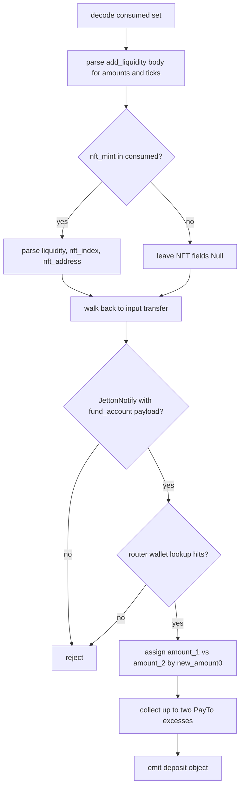
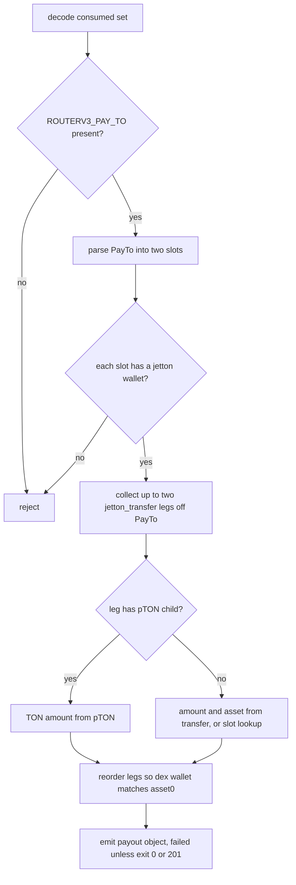
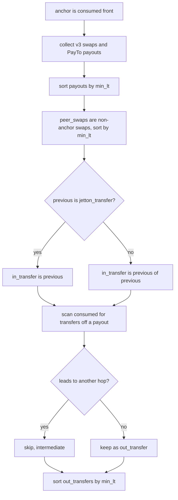
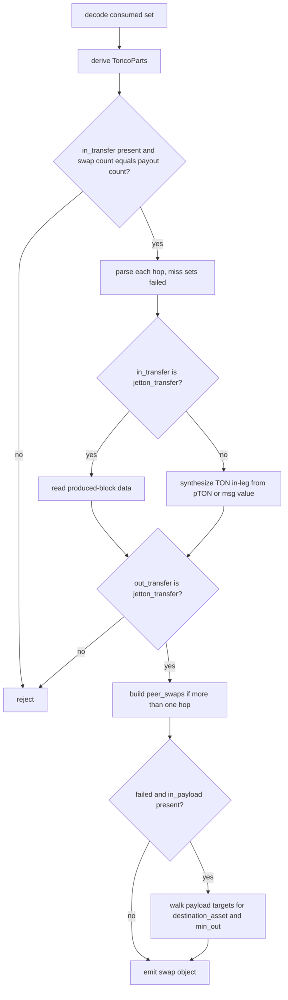
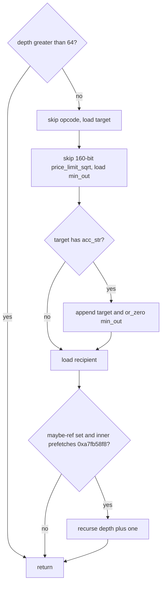

# HostTonco

Host bindings for the TONCO v3 router and pool in the mch classifier engine. Three arity-1 host fns, tonco_deposit_liquidity_data, tonco_withdraw_payouts, and tonco_swap_data, are dispatched by name from HostRegistry after an arity check. All three decode the consumed match set with decode_consumed_or_none and reject with Null on bad arguments, empty consumed, parse, or nav failure rather than faulting. Deposit and swap read the in-leg by btype and children_blocks, not event_nodes. A PayTo slot whose jetton wallet is the router's wTON wallet is treated as native TON. Multi-hop peer_swaps and the failed-swap recursive-payload fallback are supported; the corpus covers only single-hop swaps.

## class mch::Slot

- decl: `ton-index-worker/ton-mch-engine/src/host/HostTonco.cpp:425`

One PayTo-declared withdraw slot: amount, jetton wallet, and receiver.

Built in tonco_withdraw_payouts from amount0/1, jetton0/1, and receiver0/1. A wallet equal to the router's wTON jetton wallet is nulled as native TON. A slot with no jetton address rejects.

## class mch::Leg

- decl: `ton-index-worker/ton-mch-engine/src/host/HostTonco.cpp:452`

One withdraw out-leg: amount, asset, dex wallet, dex jetton wallet, and user wallet.

Filled from a jetton_transfer hanging off PayTo, or from the slot plus a jetton_wallet lookup when no transfer exists. Reordered so leg 0 matches the pool's asset0 wallet. A failed reorder is not observable.

## class mch::ToncoParts

- decl: `ton-index-worker/ton-mch-engine/src/host/HostTonco.cpp:519`

Label roles reconstructed from the consumed set: anchor, in_transfer, peer_swaps, payouts, and out_transfers.

derive_tonco_parts fills it because cyclic bodies bind no captures. peer_swaps are non-anchor 0xa7fb58f8 calls and payouts are 0xa1daa96d, both lt-sorted. in_transfer is the previous jetton_transfer or the block before that. out_transfers are jetton_transfers whose previous_block is a payout and that do not lead to another hop.

## class mch::RouterPayTo

- decl: `ton-index-worker/ton-mch-engine/src/host/HostTonco.cpp:58`

Parsed ROUTERV3_PAY_TO body: exit_code, optional coinsinfo amounts and jettons, and the two receivers.

Filled only by parse_v3_pay_to. Conditional swap and burn info cells after coinsinfo are unused. Receivers are used on the withdraw fallback legs only. Swap treats exit_code 0 or 200 as success; withdraw treats 0 or 201 as success.

## class mch::Step

- decl: `ton-index-worker/ton-mch-engine/src/host/HostTonco.cpp:610`

One swap hop: source_wallet, parsed PayTo, and the swap min_lt.

Built in tonco_swap_data for each paired swap and payout, then stably sorted by min_lt. source_wallet keys jw_asset_map. A parse miss sets the failed flag and skips the hop rather than rejecting.

## tonco_deposit_liquidity_data

`EvalResult tonco_deposit_liquidity_data(BuildEnv & env, const std::vector<Value> & args)`

- decl: `ton-index-worker/ton-mch-engine/src/host/HostTonco.cpp:150`
- callers: none found in parsed TU set
- calls: `mch::Value::Value`, `mch::Value::field`, `mch::Value::is_null`, `mch::Value::make_account_none`, `mch::Value::make_amount`, `mch::Value::make_amount_none`, `mch::Value::make_asset_ton`, `mch::Value::make_int`, `mch::Value::make_int64`, `mch::Value::make_list`, `mch::Value::make_obj`, `mch::Value::null`, `mch::account_from_opt`, `mch::amount_or_zero`, `mch::block_body`, `mch::block_msg`, `mch::data_field`, `mch::decode_consumed_or_none`, `mch::excess_pair`, `mch::first_call`, `mch::host_reject`, `mch::is_call_op`, `mch::load_address_py`, `mch::load_coins_py`, `mch::open_body`, `mch::open_ref_cell`, `mch::parse_message_body`, `mch::pton_ton_amount`, `mch::refint_u64`, `mch::rt_builtin_tail_unwrap`, `mch::rt_ok`, `mch::to_amount`, `mch::wallet_asset`

Builds a TONCO add-liquidity record from the consumed set, reading the input transfer via btype not event nodes.

decode_consumed_or_none rejects empty consumed or bad arguments with Null. The add_liquidity body supplies new_amount0/1, new_enough0/1, and ticks; new_amount0 greater than zero means this is the first asset. JettonNotify must carry a fund_account forward payload 0x4468de77 whose other wallet is a present Account. The router-wallet jetton_wallet lookup must hit, or the action is dropped rather than published as a TON deposit. Excesses are up to two jetton_transfer children of ROUTERV3_PAY_TO, with a pTON child becoming a TON excess. NFT mint is optional.

## tonco_withdraw_payouts

`EvalResult tonco_withdraw_payouts(BuildEnv & env, const std::vector<Value> & args)`

- decl: `ton-index-worker/ton-mch-engine/src/host/HostTonco.cpp:396`
- callers: none found in parsed TU set
- calls: `mch::Leg::Leg`, `mch::Slot::Slot`, `mch::Value::Value`, `mch::Value::make_asset_ton`, `mch::Value::make_bool`, `mch::Value::make_obj`, `mch::Value::null`, `mch::acc_str`, `mch::account_from_opt`, `mch::amount_or_zero`, `mch::block_body`, `mch::block_msg`, `mch::data_field`, `mch::decode_consumed_or_none`, `mch::first_call`, `mch::host_reject`, `mch::is_call_op`, `mch::parse_v3_pay_to`, `mch::pton_ton_amount`, `mch::rt_ok`, `mch::same_account`, `mch::wallet_asset`

Builds the payout half of a TONCO withdraw: two slots, up to two transfer legs, reordered into pool asset order.

Requires a ROUTERV3_PAY_TO in the consumed set. A slot whose jetton wallet is the router wTON wallet is nulled. Missing jetton address rejects. Legs come from jetton_transfers hanging off PayTo, padded to two; a pTON child makes that leg TON. No-transfer slots look up the wallet and leave asset Null on miss. failed is True when exit_code is neither 0 nor 201.

## Slot

`void Slot()`

- decl: `ton-index-worker/ton-mch-engine/src/host/HostTonco.cpp:425`
- callers: mch::tonco_withdraw_payouts (ton-index-worker/ton-mch-engine/src/host/HostTonco.cpp:426)

Default-constructs an empty Slot.

## wallet_asset

`Value wallet_asset(BuildEnv & env, const std::string & addr)`

- decl: `ton-index-worker/ton-mch-engine/src/host/HostTonco.cpp:45`
- callers: mch::tonco_deposit_liquidity_data (ton-index-worker/ton-mch-engine/src/host/HostTonco.cpp:316); mch::tonco_deposit_liquidity_data (ton-index-worker/ton-mch-engine/src/host/HostTonco.cpp:321); mch::tonco_withdraw_payouts (ton-index-worker/ton-mch-engine/src/host/HostTonco.cpp:477); mch::tonco_swap_data (ton-index-worker/ton-mch-engine/src/host/HostTonco.cpp:632); mch::tonco_swap_data (ton-index-worker/ton-mch-engine/src/host/HostTonco.cpp:759)
- calls: `mch::LookupTable::get`, `mch::Value::make_str`, `mch::wallet_jetton_asset`

jetton_wallet lookup to Asset with pTON conversion, or Null on a miss.

The caller decides the fallback. Deposit rejects a Null first_asset so a missing counterparty is not published as TON. Withdraw and swap keep Null.

## Leg

`void Leg()`

- decl: `ton-index-worker/ton-mch-engine/src/host/HostTonco.cpp:452`
- callers: mch::tonco_withdraw_payouts (ton-index-worker/ton-mch-engine/src/host/HostTonco.cpp:453)

Default-constructs an empty Leg.

## parse_v3_swap_source_wallet

`td::Result<Value> parse_v3_swap_source_wallet(const td::Ref<vm::Cell> & body)`

- decl: `ton-index-worker/ton-mch-engine/src/host/HostTonco.cpp:51`
- callers: mch::tonco_swap_data (ton-index-worker/ton-mch-engine/src/host/HostTonco.cpp:620)
- calls: `mch::Value::field`, `mch::parse_message_body`

Reads only source_wallet from a ToncoRouterV3SwapSourceWallet body.

Other swap-body fields are unread. A parse error is a status that tonco_swap_data treats as a failed hop rather than a reject.

## tonco_leg_asset

`Value tonco_leg_asset(const Value & asset_v)`

- decl: `ton-index-worker/ton-mch-engine/src/host/HostTonco.cpp:511`
- callers: mch::tonco_swap_data (ton-index-worker/ton-mch-engine/src/host/HostTonco.cpp:642); mch::tonco_swap_data (ton-index-worker/ton-mch-engine/src/host/HostTonco.cpp:692)
- calls: `mch::Value::Value`, `mch::Value::make_asset_ton`, `mch::is_pton_master`

Converts a pTON-master jetton asset to TON and otherwise keeps the block's asset field.

Requires an Asset value with a jetton master. Used on both in and out jetton legs of tonco_swap_data.

## ToncoParts

`void ToncoParts()`

- decl: `ton-index-worker/ton-mch-engine/src/host/HostTonco.cpp:519`
- callers: mch::derive_tonco_parts (ton-index-worker/ton-mch-engine/src/host/HostTonco.cpp:527)

Default-constructs ToncoParts with null anchor and in_transfer and empty role lists.

## ToncoParts

`void ToncoParts(ToncoParts &&)`

- decl: `ton-index-worker/ton-mch-engine/src/host/HostTonco.cpp:519`
- callers: mch::derive_tonco_parts (ton-index-worker/ton-mch-engine/src/host/HostTonco.cpp:574)

Move-constructs ToncoParts, used when returning from derive_tonco_parts.

## derive_tonco_parts

`ToncoParts derive_tonco_parts(const std::vector<const Block *> & consumed)`

- decl: `ton-index-worker/ton-mch-engine/src/host/HostTonco.cpp:526`
- callers: mch::tonco_swap_data (ton-index-worker/ton-mch-engine/src/host/HostTonco.cpp:591)
- calls: `mch::(lambda at /home/verdigos/dev/ton-indexer-private/ton-index-worker/ton-mch-engine/src/host/HostTonco.cpp:529:16)::(lambda at /home/verdigos/dev/ton-indexer-private/ton-index-worker/ton-mch-engine/src/host/HostTonco.cpp:529:16)`, `mch::(lambda at /home/verdigos/dev/ton-indexer-private/ton-index-worker/ton-mch-engine/src/host/HostTonco.cpp:552:23)::operator()`, `mch::ToncoParts::ToncoParts`, `mch::is_call_op`

Reconstructs TONCO swap roles from the consumed set because cyclic bodies bind no captures.

Collects 0xa7fb58f8 swaps and 0xa1daa96d payouts, sorts both by min_lt. Non-anchor swaps become peer_swaps. in_transfer is previous if it is a jetton_transfer, else previous of previous. out_transfers are jetton_transfers or raw 0x0f8a7ea5 calls whose previous_block is a payout and that do not lead to another hop via pTON then jetton_notify.

## (lambda at /home/verdigos/dev/ton-indexer-private/ton-index-worker/ton-mch-engine/src/host/HostTonco.cpp:529:16)

`void (lambda at /home/verdigos/dev/ton-indexer-private/ton-index-worker/ton-mch-engine/src/host/HostTonco.cpp:529:16)(const (lambda at /home/verdigos/dev/ton-indexer-private/ton-index-worker/ton-mch-engine/src/host/HostTonco.cpp:529:16) &)`

- decl: `ton-index-worker/ton-mch-engine/src/host/HostTonco.cpp:529`
- callers: mch::derive_tonco_parts (ton-index-worker/ton-mch-engine/src/host/HostTonco.cpp:541); mch::derive_tonco_parts (ton-index-worker/ton-mch-engine/src/host/HostTonco.cpp:546); mch::derive_tonco_parts (ton-index-worker/ton-mch-engine/src/host/HostTonco.cpp:573)

min_lt less-than comparator used to stably sort payouts, peer_swaps, and out_transfers.

## operator()

`bool operator()(const Block * b) const`

- decl: `ton-index-worker/ton-mch-engine/src/host/HostTonco.cpp:552`
- callers: mch::derive_tonco_parts (ton-index-worker/ton-mch-engine/src/host/HostTonco.cpp:570)

True when a transfer's descendants include another swap, including via pTON then jetton_notify.

Walks next_blocks one level, or two extra levels through 0x01f3835d then 0x7362d09c. Used to drop intermediate hop transfers from out_transfers.

## RouterPayTo

`void RouterPayTo()`

- decl: `ton-index-worker/ton-mch-engine/src/host/HostTonco.cpp:58`
- callers: mch::parse_v3_pay_to (ton-index-worker/ton-mch-engine/src/host/HostTonco.cpp:75)

Default-constructs a RouterPayTo with exit_code 0 and absent amounts.

## tonco_swap_data

`EvalResult tonco_swap_data(BuildEnv & env, const std::vector<Value> & args)`

- decl: `ton-index-worker/ton-mch-engine/src/host/HostTonco.cpp:582`
- callers: none found in parsed TU set
- calls: `mch::(lambda at /home/verdigos/dev/ton-indexer-private/ton-index-worker/ton-mch-engine/src/host/HostTonco.cpp:593:16)::(lambda at /home/verdigos/dev/ton-indexer-private/ton-index-worker/ton-mch-engine/src/host/HostTonco.cpp:593:16)`, `mch::(lambda at /home/verdigos/dev/ton-indexer-private/ton-index-worker/ton-mch-engine/src/host/HostTonco.cpp:702:24)::operator()`, `mch::(lambda at /home/verdigos/dev/ton-indexer-private/ton-index-worker/ton-mch-engine/src/host/HostTonco.cpp:713:14)::operator()`, `mch::Message::opcode32`, `mch::Value::Value`, `mch::Value::field`, `mch::Value::is_null`, `mch::Value::make_asset_ton`, `mch::Value::make_bool`, `mch::Value::make_dict`, `mch::Value::make_list`, `mch::Value::make_obj`, `mch::Value::make_str`, `mch::Value::null`, `mch::acc_str`, `mch::account_from_opt`, `mch::amount_or_zero`, `mch::block_body`, `mch::block_msg`, `mch::collect_payload_targets`, `mch::data_field`, `mch::decode_consumed_or_none`, `mch::derive_tonco_parts`, `mch::host_reject`, `mch::parse_message_body`, `mch::parse_v3_pay_to`, `mch::parse_v3_swap_source_wallet`, `mch::rt_builtin_tail_unwrap`, `mch::rt_ok`, `mch::tonco_leg_asset`, `mch::wallet_asset`

Builds a TONCO swap record from the consumed set, with multi-hop peer_swaps and a failed-swap payload fallback.

decode_consumed_or_none rejects empty consumed or bad arguments. Swap and payout counts must match. Jetton in-legs read btype and data; a pTON in-leg is synthesized from a single-leaf call. Out-leg must be a jetton_transfer, else a raw call_contract here means the jetton_transfer matcher rejected that leg. Parse misses on a hop set failed rather than reject. Destination asset and min_out_amount come from the out-leg unless failed, in which case collect_payload_targets walks the in-payload for the last target wallet.

## (lambda at /home/verdigos/dev/ton-indexer-private/ton-index-worker/ton-mch-engine/src/host/HostTonco.cpp:593:16)

`void (lambda at /home/verdigos/dev/ton-indexer-private/ton-index-worker/ton-mch-engine/src/host/HostTonco.cpp:593:16)(const (lambda at /home/verdigos/dev/ton-indexer-private/ton-index-worker/ton-mch-engine/src/host/HostTonco.cpp:593:16) &)`

- decl: `ton-index-worker/ton-mch-engine/src/host/HostTonco.cpp:593`
- callers: mch::tonco_swap_data (ton-index-worker/ton-mch-engine/src/host/HostTonco.cpp:596)

min_lt less-than comparator used to sort the combined anchor and peer swap list.

## parse_v3_pay_to

`td::Result<RouterPayTo> parse_v3_pay_to(const td::Ref<vm::Cell> & body)`

- decl: `ton-index-worker/ton-mch-engine/src/host/HostTonco.cpp:64`
- callers: mch::tonco_withdraw_payouts (ton-index-worker/ton-mch-engine/src/host/HostTonco.cpp:416); mch::tonco_swap_data (ton-index-worker/ton-mch-engine/src/host/HostTonco.cpp:624)
- calls: `mch::RouterPayTo::RouterPayTo`, `mch::load_address_py`, `mch::load_coins_py`, `mch::open_body`, `mch::open_ref_cell`

Manually slices a ROUTERV3_PAY_TO body into receivers, exit_code, and optional coinsinfo.

After a 32+64-bit header come two addresses, a 32-bit exit_code, and a discarded 64-bit seqno. A maybe-ref bit opens coinsinfo with amount0, jetton0, amount1, jetton1. Conditional tails after coinsinfo are not parsed. Header, exit/seqno, maybe-bit, or missing ref underflow is a status. Withdraw converts errors to host_reject; swap treats them as a failed hop.

## operator()

`std::vector<std::pair<td::RefInt256, Value>> operator()(const RouterPayTo & pt) const`

- decl: `ton-index-worker/ton-mch-engine/src/host/HostTonco.cpp:702`
- callers: mch::tonco_swap_data (ton-index-worker/ton-mch-engine/src/host/HostTonco.cpp:718); mch::tonco_swap_data (ton-index-worker/ton-mch-engine/src/host/HostTonco.cpp:729)

Collects present PayTo amount/jetton pairs and sorts them by amount descending.

Skips a null amount or a non-Account jetton. Reverse sort uses or_zero so a null amount compares as zero. The first pair is the out-leg for peer_swaps.

## operator()

`Value operator()(const Value & amount, const Value & asset) const`

- decl: `ton-index-worker/ton-mch-engine/src/host/HostTonco.cpp:713`
- callers: mch::tonco_swap_data (ton-index-worker/ton-mch-engine/src/host/HostTonco.cpp:723); mch::tonco_swap_data (ton-index-worker/ton-mch-engine/src/host/HostTonco.cpp:725); mch::tonco_swap_data (ton-index-worker/ton-mch-engine/src/host/HostTonco.cpp:734)

Builds a two-field dict of amount and asset for a peer-swap in or out leg.

## collect_payload_targets

`void collect_payload_targets(vm::CellSlice cs, std::vector<std::pair<std::string, td::RefInt256>> & out, int depth)`

- decl: `ton-index-worker/ton-mch-engine/src/host/HostTonco.cpp:99`
- callers: mch::collect_payload_targets (ton-index-worker/ton-mch-engine/src/host/HostTonco.cpp:137); mch::tonco_swap_data (ton-index-worker/ton-mch-engine/src/host/HostTonco.cpp:750)
- calls: `mch::acc_str`, `mch::collect_payload_targets`, `mch::load_address_py`, `mch::load_coins_py`, `mch::open_ref_cell`, `mch::or_zero`

Walks nested in-transfer payload cells collecting target_wallet and min_out pairs, depth-capped at 64.

Skips a 32-bit opcode, loads target, skips 160-bit price_limit_sqrt, loads min_out, then recipient. Recurses into a maybe-ref only when the inner cell prefetches opcode 0xa7fb58f8. Depth above 64 returns. A bad inner tail is swallowed. addr_none targets are dropped. Used on the failed-swap arm of tonco_swap_data.

