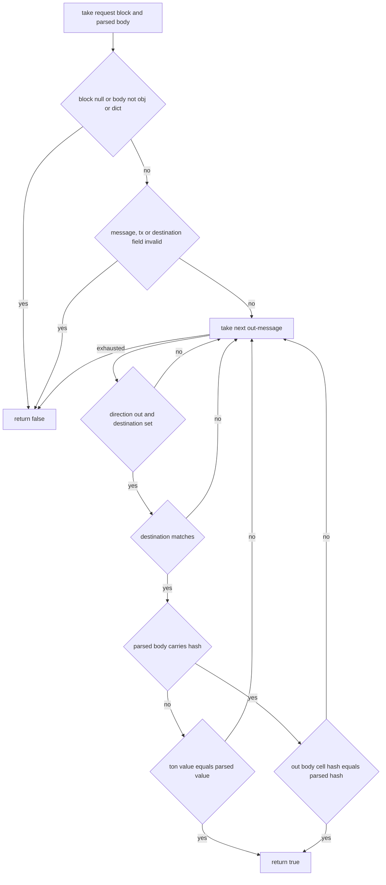

# HostVesting

Host binding for vesting-contract message requests. The single host fn verifies that a message parsed from a request body was actually emitted by the request transaction, by scanning out-messages for one addressed to the parsed destination and comparing body cell hashes, with a TON-value fallback when the parsed body carries no hash. It never faults: a malformed argument, a missing message or transaction, or an undecodable body all yield false.

## out_body_hash

`std::string out_body_hash(const Message & m)`

- decl: `ton-index-worker/ton-mch-engine/src/host/HostVesting.cpp:20`
- callers: mch::vesting_message_was_sent (ton-index-worker/ton-mch-engine/src/host/HostVesting.cpp:77)

Cell hash bytes of an out-message body, empty when the body is absent or undecodable.

An absent or empty body, a failed base64 decode, and a failed or null BOC deserialize all return the empty string rather than erroring.

## vesting_message_was_sent

`EvalResult vesting_message_was_sent(BuildEnv &, const std::vector<Value> & args)`

- decl: `ton-index-worker/ton-mch-engine/src/host/HostVesting.cpp:43`
- callers: none found in parsed TU set
- calls: `mch::Value::field`, `mch::Value::make_bool`, `mch::account_from_opt`, `mch::as_block`, `mch::block_msg`, `mch::out_body_hash`, `mch::rt_ok`, `mch::same_account`

Decides whether the request transaction emitted an out-message matching the parsed vesting send body.

A null block, a body that is neither obj nor dict, a missing message or transaction, or a message_destination that is not an Account all return false. Out-messages are filtered on direction and destination first; when the parsed body carries a Bytes hash, the out body's cell hash must equal it, otherwise matching falls back to comparing TON value. An out message whose body cannot be hashed never matches on hash.

