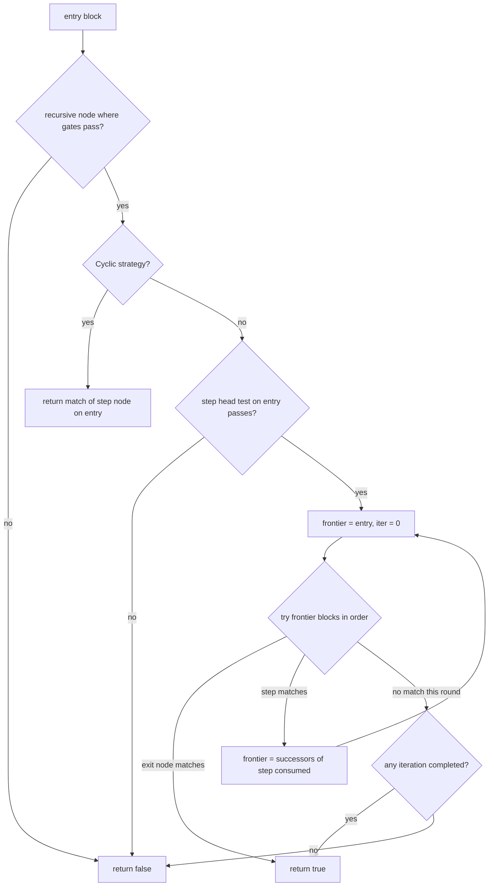
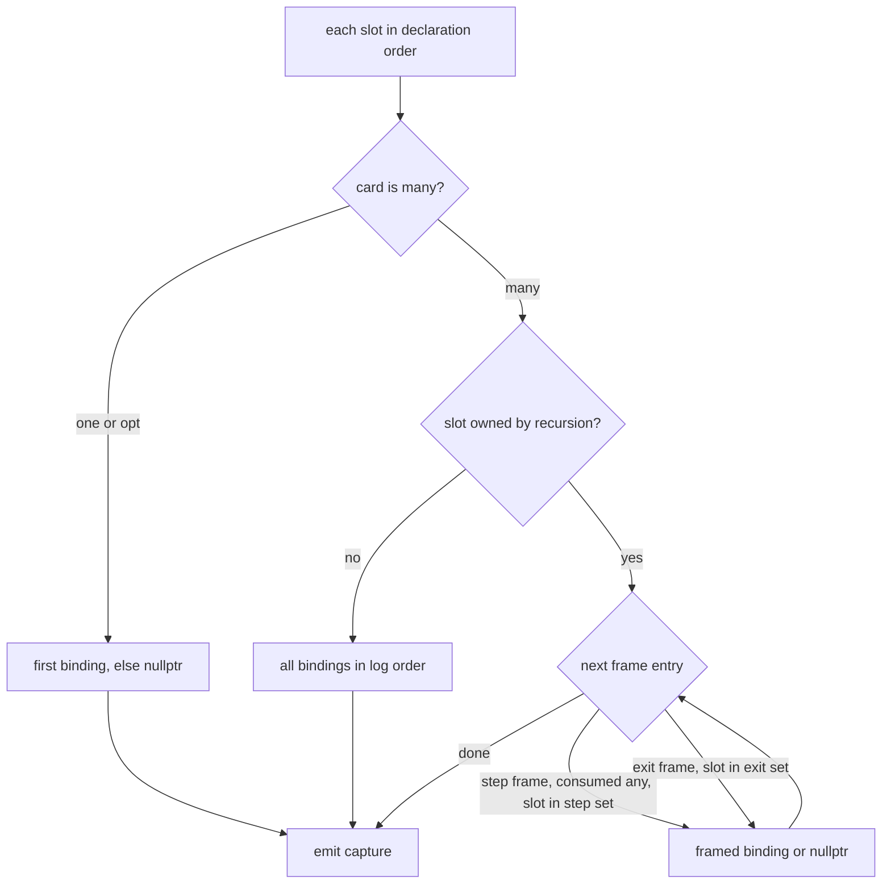

# Walker

Walker executes compiled MCH matchers against the block tree without mutating it: matcher_match runs the anchor prefilter and, on pass, a MatchState walk that binds capture slots and records consumed blocks, returning nullopt on any structural mismatch. Candidate blocks are always tried in canonical min_lt order, and every speculative branch marks and rolls back bindings, consumed set, and frame log, so a failed subtree leaves no trace. Inline where expressions dispatch through the generated where table after the structural head test, and a faulting or non-bool where result simply evaluates false rather than aborting the walk. Matching recurses mutually through child, children-set, parent, or, and recursive edges under a 500-deep guard that throws MatchDepthExceeded, which the classify boundary catches and turns into a failed trace. Matcher tables are immutable and shared; all mutable state lives in the per-attempt MatchState, so a walk is single-threaded and self-contained.

## class mch::Frame

- decl: `ton-index-worker/ton-mch-engine/src/Walker.cpp:24`

Current recursion-frame tag: which node id and which iteration index new bindings are made under.

idx is a non-negative frontier iteration index while stepping or kExitIdx (-1) while the exit node is being tried; match_recursive snapshots and restores the whole frame around each attempt.

## class mch::FrameEntry

- decl: `ton-index-worker/ton-mch-engine/src/Walker.cpp:29`

One logged frame event (step or exit) that assemble_captures replays to build list captures in traversal order.

Records whether the frame was a step, the node id, the iteration index, and whether that step consumed any blocks; the consumed_any flag is what keeps gap-aligned entries in owned many-captures.

## class mch::Mark

- decl: `ton-index-worker/ton-mch-engine/src/Walker.cpp:36`

Rollback checkpoint capturing the sizes of the bindings, consumed, and frames vectors.

## class mch::MatchState

- decl: `ton-index-worker/ton-mch-engine/src/Walker.cpp:49`

Per-attempt mutable state for one matcher_match run; owns the whole match recursion.

Holds the where-slot environment seeded with the anchor block, the binding log, the identity-deduped consumed list with its visited set, the frame log, and the current depth counter. The matcher and where table are borrowed immutably for the attempt's lifetime.

## class mch::MatchState::DepthGuard

- decl: `ton-index-worker/ton-mch-engine/src/Walker.cpp:62`

RAII guard that increments the match recursion depth on construction and decrements it on destruction.

## class mch::MatchDepthExceeded

- decl: `ton-index-worker/ton-mch-engine/src/Walker.h:31`

Exception thrown when match recursion passes 500 frames deep; the classify boundary catches it and fails the trace.

## class mch::Capture

- decl: `ton-index-worker/ton-mch-engine/src/Walker.h:38`

One assembled capture: a slot name with a single value or an in-order block list.

Scalars carry exactly one entry, nullptr meaning unbound or None; a many capture carries one entry per assembly position with nullptr marking a gap-aligned None.

## class mch::MatchResult

- decl: `ton-index-worker/ton-mch-engine/src/Walker.h:44`

Match outcome: consumed blocks in traversal order and captures in slot declaration order.

## finish

`MatchResult finish()`

- decl: `ton-index-worker/ton-mch-engine/src/Walker.cpp:101`
- callers: mch::matcher_match (ton-index-worker/ton-mch-engine/src/Walker.cpp:443)
- calls: `mch::MatchResult::MatchResult`, `mch::MatchState::assemble_captures`

Packages the walk's consumed list and assembled captures into a MatchResult.

Called once the root match returned true; simply moves out the state MatchState will not use again.

## eval_where

`bool eval_where(const CompiledNode & node, Block * block) const`

- decl: `ton-index-worker/ton-mch-engine/src/Walker.cpp:110`
- callers: mch::MatchState::test_head (ton-index-worker/ton-mch-engine/src/Walker.cpp:171); mch::MatchState::match_recursive (ton-index-worker/ton-mch-engine/src/Walker.cpp:251)

Runs a node's inline where expression through the generated table; faults and non-bool results count as false.

The function is looked up by artifact-global node id, and a missing entry also evaluates false, which cannot happen in a prepared run because prepare_classify validates coverage up front. The block plus the current where-slot values travel through a WhereEnv; only a clean boolean true accepts.

## test_head

`bool test_head(int nid, Block * block) const`

- decl: `ton-index-worker/ton-mch-engine/src/Walker.cpp:120`
- callers: mch::MatchState::test_head (ton-index-worker/ton-mch-engine/src/Walker.cpp:138); mch::MatchState::test_head (ton-index-worker/ton-mch-engine/src/Walker.cpp:143); mch::MatchState::test_head (ton-index-worker/ton-mch-engine/src/Walker.cpp:151); mch::MatchState::match_recursive (ton-index-worker/ton-mch-engine/src/Walker.cpp:257); mch::MatchState::match_node (ton-index-worker/ton-mch-engine/src/Walker.cpp:77)
- calls: `mch::MatchState::eval_where`, `mch::MatchState::test_head`, `mch::host_predicates`

Structural head test of one node against one block, then the named-where and inline-where gates.

Contract nodes require a call_contract block with the exact opcode, BlockType compares btype, Any accepts everything, Pred consults the host predicate registry, Recursive delegates to its step node, and Or needs one matching branch (exactly one when exclusive). A passing head then runs the node's named where predicate, where a missing registry entry rejects because the loader gates runnability on the registry, and finally the inline where expression; both gates must accept.

## match_child_edge

`bool match_child_edge(const CompiledNode & node, Block * block)`

- decl: `ton-index-worker/ton-mch-engine/src/Walker.cpp:177`
- callers: mch::MatchState::match_node (ton-index-worker/ton-mch-engine/src/Walker.cpp:86)
- calls: `mch::MatchState::mark`, `mch::MatchState::match_node`, `mch::MatchState::rollback`, `mch::canonical`

Tries the node's single child edge against every canonical successor until one matches.

Each candidate runs under a mark and a failed candidate rolls the attempt back, so only the winning branch's bindings and consumed blocks survive. An unmatched edge passes only when the child node itself is optional.

## match_children_set

`bool match_children_set(const CompiledNode & node, Block * block)`

- decl: `ton-index-worker/ton-mch-engine/src/Walker.cpp:193`
- callers: mch::MatchState::match_node (ton-index-worker/ton-mch-engine/src/Walker.cpp:89)
- calls: `mch::MatchState::mark`, `mch::MatchState::match_node`, `mch::MatchState::rollback`, `mch::canonical`

Matches an unordered set of child patterns against the successor list, each pattern consuming one distinct block.

Items are matched in table order and candidates in canonical order; a matched item removes its block from the working list so later items cannot reuse it, and every failed try rolls back. An item with no match fails the whole set unless that item is optional.

## match_parent_edge

`bool match_parent_edge(const CompiledNode & node, Block * block)`

- decl: `ton-index-worker/ton-mch-engine/src/Walker.cpp:216`
- callers: mch::MatchState::match_node (ton-index-worker/ton-mch-engine/src/Walker.cpp:92)
- calls: `mch::MatchState::mark`, `mch::MatchState::match_node`, `mch::MatchState::rollback`

Matches the node's parent pattern against the block's single predecessor.

The one predecessor is tried under a mark and rolled back on failure; an optional parent accepts a missing predecessor or a failed match. Unlike child edges there is no candidate choice, only present or absent.

## match_or

`bool match_or(const CompiledNode & node, Block * block)`

- decl: `ton-index-worker/ton-mch-engine/src/Walker.cpp:231`
- callers: mch::MatchState::match_node (ton-index-worker/ton-mch-engine/src/Walker.cpp:72)
- calls: `mch::MatchState::mark`, `mch::MatchState::match_node`, `mch::MatchState::rollback`

Tries each or-branch on the same block until one matches, rolling back failed branches.

Branches run in table order under marks and the first success stands with its bindings kept. Exhausting the branches fails the or.

## Frame

`void Frame(const Frame &)`

- decl: `ton-index-worker/ton-mch-engine/src/Walker.cpp:24`
- callers: mch::MatchState::match_recursive (ton-index-worker/ton-mch-engine/src/Walker.cpp:260)

Copies the current frame tag to snapshot it before a recursive strategy rewrites the active frame.

## operator=

`Frame & operator=(Frame &&)`

- decl: `ton-index-worker/ton-mch-engine/src/Walker.cpp:24`
- callers: mch::MatchState::match_recursive (ton-index-worker/ton-mch-engine/src/Walker.cpp:268); mch::MatchState::match_recursive (ton-index-worker/ton-mch-engine/src/Walker.cpp:277)

Implicit move assignment; installs a freshly built frame or restores the saved outer frame during recursive stepping.

## operator=

`Frame & operator=(const Frame &)`

- decl: `ton-index-worker/ton-mch-engine/src/Walker.cpp:24`
- callers: mch::MatchState::match_recursive (ton-index-worker/ton-mch-engine/src/Walker.cpp:271); mch::MatchState::match_recursive (ton-index-worker/ton-mch-engine/src/Walker.cpp:294)

Implicit copy assignment; restores the snapshotted outer frame when a recursive attempt ends.

## match_recursive

`bool match_recursive(int nid, const CompiledNode & node, Block * entry)`

- decl: `ton-index-worker/ton-mch-engine/src/Walker.cpp:242`
- callers: mch::MatchState::match_node (ton-index-worker/ton-mch-engine/src/Walker.cpp:75)
- calls: `mch::Frame::Frame`, `mch::MatchState::eval_where`, `mch::MatchState::mark`, `mch::MatchState::match_node`, `mch::MatchState::rollback`, `mch::MatchState::test_head`, `mch::canonical`, `mch::host_predicates`

Frontier strategy for recursive nodes: gate on where, then alternate exit checks and step matches over an advancing frontier.

The recursive node's own where gates run against the entry block first, and a Cyclic strategy short-circuits into a plain match of the step node. Otherwise the step's head is tested once, then a loop tries the exit node (under a kExitIdx frame) and the step node on every frontier block under marks, rebuilding the frontier from the successors of each step's consumed blocks in canonical order. A round where some block stepped continues the loop; a round where nothing stepped ends the walk, succeeding only if at least one iteration completed. The frame entries logged per step and per accepted exit later drive owned many-capture assembly.

## absorb_aux

`void absorb_aux(Block * block)`

- decl: `ton-index-worker/ton-mch-engine/src/Walker.cpp:301`
- callers: mch::MatchState::match_node (ton-index-worker/ton-mch-engine/src/Walker.cpp:96)
- calls: `mch::MatchState::consume`, `mch::canonical`

Consumes excess and bounce aux blocks among the block's canonical successors.

Only call_contract successors whose opcode is the excess or bounce service opcode are consumed; everything else stays for other matchers. Runs after a node's own match unless the node peeks, and never at the root, where excess and bounce blocks are a build-result concern appended after the build.

## mark

`Mark mark() const`

- decl: `ton-index-worker/ton-mch-engine/src/Walker.cpp:311`
- callers: mch::MatchState::match_child_edge (ton-index-worker/ton-mch-engine/src/Walker.cpp:183); mch::MatchState::match_children_set (ton-index-worker/ton-mch-engine/src/Walker.cpp:201); mch::MatchState::match_parent_edge (ton-index-worker/ton-mch-engine/src/Walker.cpp:222); mch::MatchState::match_or (ton-index-worker/ton-mch-engine/src/Walker.cpp:233); mch::MatchState::match_recursive (ton-index-worker/ton-mch-engine/src/Walker.cpp:267); mch::MatchState::match_recursive (ton-index-worker/ton-mch-engine/src/Walker.cpp:276)

Captures the current bindings, consumed, and frames sizes as a rollback point.

## rollback

`void rollback(const Mark & mk)`

- decl: `ton-index-worker/ton-mch-engine/src/Walker.cpp:313`
- callers: mch::MatchState::match_child_edge (ton-index-worker/ton-mch-engine/src/Walker.cpp:187); mch::MatchState::match_children_set (ton-index-worker/ton-mch-engine/src/Walker.cpp:207); mch::MatchState::match_parent_edge (ton-index-worker/ton-mch-engine/src/Walker.cpp:226); mch::MatchState::match_or (ton-index-worker/ton-mch-engine/src/Walker.cpp:237); mch::MatchState::match_recursive (ton-index-worker/ton-mch-engine/src/Walker.cpp:274); mch::MatchState::match_recursive (ton-index-worker/ton-mch-engine/src/Walker.cpp:291)

Truncates bindings, consumed, and frames back to a mark and un-visits the consumed tail.

## consume

`void consume(Block * b)`

- decl: `ton-index-worker/ton-mch-engine/src/Walker.cpp:322`
- callers: mch::MatchState::absorb_aux (ton-index-worker/ton-mch-engine/src/Walker.cpp:305); mch::MatchState::match_node (ton-index-worker/ton-mch-engine/src/Walker.cpp:81)

Adds a block to the consumed list once; duplicates by identity are ignored.

## bind

`void bind(int slot, Block * b)`

- decl: `ton-index-worker/ton-mch-engine/src/Walker.cpp:328`
- callers: mch::MatchState::match_node (ton-index-worker/ton-mch-engine/src/Walker.cpp:84)

Logs one slot, current frame, block binding for later capture assembly.

## assemble_captures

`std::vector<Capture> assemble_captures() const`

- decl: `ton-index-worker/ton-mch-engine/src/Walker.cpp:330`
- callers: mch::MatchState::finish (ton-index-worker/ton-mch-engine/src/Walker.cpp:104)
- calls: `mch::Capture::Capture`

Replays bindings and the frame log into one capture per slot in declaration order.

Scalar slots take their first binding or nullptr when unbound; unowned many slots take every binding in log order; owned many slots are rebuilt from the frame log with one entry per step frame that consumed anything, or per exit frame, nullptr where an iteration bound nothing. That framing is what keeps list captures aligned with recursion iterations instead of collapsing gaps.

## matcher_test_self

`bool matcher_test_self(const CompiledMatcher & m, const Block * b)`

- decl: `ton-index-worker/ton-mch-engine/src/Walker.cpp:395`
- callers: mch::matcher_match (ton-index-worker/ton-mch-engine/src/Walker.cpp:434)
- calls: `mch::host_predicates`

Cheap anchor prefilter: opcode set, btype set, host predicate, or mixed-branch test on one block.

Opcode anchors require call_contract plus membership in the opcode set, btype anchors test set membership, and Pred anchors call the host predicate directly with no prefilter, which classify uses for full scans. Mixed anchors walk their branches in source order and accept on the first head hit whose optional where predicate passes, so a branch whose predicate fails falls through to a later branch with the same head.

## canonical

`std::vector<Block *> canonical(const std::vector<Block *> & v)`

- decl: `ton-index-worker/ton-mch-engine/src/Walker.cpp:40`
- callers: mch::MatchState::match_child_edge (ton-index-worker/ton-mch-engine/src/Walker.cpp:182); mch::MatchState::match_children_set (ton-index-worker/ton-mch-engine/src/Walker.cpp:197); mch::MatchState::match_recursive (ton-index-worker/ton-mch-engine/src/Walker.cpp:288); mch::MatchState::absorb_aux (ton-index-worker/ton-mch-engine/src/Walker.cpp:302)

Returns the block list stably sorted by min_lt ascending.

The one ordering rule behind every candidate choice in the walker; ties keep the caller's original order so walks are deterministic.

## matcher_match

`std::optional<MatchResult> matcher_match(const CompiledMatcher & m, Block * anchor, const WhereTable & gen)`

- decl: `ton-index-worker/ton-mch-engine/src/Walker.cpp:432`
- callers: mch::run_build_smoke (ton-index-worker/ton-mch-engine/harness/BuildSmoke.cpp:71); mch::dump_fixture (ton-index-worker/ton-mch-engine/harness/MatchRunner.cpp:46); mch::test_walker_peek_bind_and_aux (ton-index-worker/ton-mch-engine/harness/ShapeTest.cpp:199); mch::test_walker_peek_then_consume (ton-index-worker/ton-mch-engine/harness/ShapeTest.cpp:216); [mch::try_build (ton-index-worker/ton-mch-engine/src/ClassifyCore.cpp:130)](ClassifyCore.md#try_build)
- calls: `mch::MatchState::MatchState`, `mch::MatchState::finish`, `mch::MatchState::match_node`, `mch::matcher_test_self`

Full match attempt: anchor test, then the walk from the root node with aux absorption suppressed at the root.

Returns nullopt when the anchor test or the root match fails, discarding the MatchState so no partial state leaks. The where table must cover every where_expr node id of the matcher, which prepare_classify guarantees; an uncovered id would just fail its head test. Never runs build programs and never mutates the block tree; only the attempt's own state changes.

## MatchState

`void MatchState(const CompiledMatcher & m, const WhereTable & gen, Block * anchor)`

- decl: `ton-index-worker/ton-mch-engine/src/Walker.cpp:51`
- callers: mch::matcher_match (ton-index-worker/ton-mch-engine/src/Walker.cpp:437)
- calls: `mch::Value::make_block`, `mch::Value::null`

Seeds the where-slot environment from the matcher and pre-binds the anchor block into the entry node's slot.

where_slots_ starts as nulls sized to the matcher's slot names, and when the root node declares a slot it is pre-seeded with the anchor as a Block value so root where expressions can reference it.

## match_node

`bool match_node(int nid, Block * block, bool absorb)`

- decl: `ton-index-worker/ton-mch-engine/src/Walker.cpp:61`
- callers: mch::MatchState::match_child_edge (ton-index-worker/ton-mch-engine/src/Walker.cpp:184); mch::MatchState::match_children_set (ton-index-worker/ton-mch-engine/src/Walker.cpp:202); mch::MatchState::match_parent_edge (ton-index-worker/ton-mch-engine/src/Walker.cpp:223); mch::MatchState::match_or (ton-index-worker/ton-mch-engine/src/Walker.cpp:234); mch::MatchState::match_recursive (ton-index-worker/ton-mch-engine/src/Walker.cpp:255); mch::MatchState::match_recursive (ton-index-worker/ton-mch-engine/src/Walker.cpp:269); mch::MatchState::match_recursive (ton-index-worker/ton-mch-engine/src/Walker.cpp:278); mch::matcher_match (ton-index-worker/ton-mch-engine/src/Walker.cpp:440)
- calls: `mch::MatchDepthExceeded::MatchDepthExceeded`, `mch::MatchState::DepthGuard::DepthGuard`, `mch::MatchState::absorb_aux`, `mch::MatchState::bind`, `mch::MatchState::consume`, `mch::MatchState::match_child_edge`, `mch::MatchState::match_children_set`, `mch::MatchState::match_or`, `mch::MatchState::match_parent_edge`, `mch::MatchState::match_recursive`, `mch::MatchState::test_head`

Matches one node against one block: depth guard, head test, consume, bind, then child, children-set, and parent edges, absorbing aux.

Recursion depth is checked first and throws MatchDepthExceeded past 500; Or and Recursive nodes dispatch to their own strategies before the head test. A passing head consumes the block unless the node peeks, binds its capture slot, and then all three edge kinds must match; aux absorption runs last, only when absorb is set and the node does not peek. The matcher_match root call passes absorb false because root-level excess and bounce blocks belong to the build result, not the consumed set.

## DepthGuard

`void DepthGuard(int & x)`

- decl: `ton-index-worker/ton-mch-engine/src/Walker.cpp:64`
- callers: mch::MatchState::match_node (ton-index-worker/ton-mch-engine/src/Walker.cpp:66)

Increments the referenced depth counter.

## ~DepthGuard

`void ~DepthGuard()`

- decl: `ton-index-worker/ton-mch-engine/src/Walker.cpp:65`
- callers: none found in parsed TU set

Decrements the depth counter on scope exit.

## MatchDepthExceeded

`void MatchDepthExceeded()`

- decl: `ton-index-worker/ton-mch-engine/src/Walker.h:32`
- callers: mch::MatchState::match_node (ton-index-worker/ton-mch-engine/src/Walker.cpp:68)

Constructs the exception with the fixed recursion-depth-exceeded message.

## Capture

`void Capture()`

- decl: `ton-index-worker/ton-mch-engine/src/Walker.h:38`
- callers: mch::MatchState::assemble_captures (ton-index-worker/ton-mch-engine/src/Walker.cpp:343)

Implicit default constructor; empty name, scalar shape, no values.

## MatchResult

`void MatchResult()`

- decl: `ton-index-worker/ton-mch-engine/src/Walker.h:44`
- callers: mch::MatchState::finish (ton-index-worker/ton-mch-engine/src/Walker.cpp:102)

Implicit default constructor producing empty consumed and capture lists.

## MatchResult

`void MatchResult(MatchResult &&)`

- decl: `ton-index-worker/ton-mch-engine/src/Walker.h:44`
- callers: mch::MatchState::finish (ton-index-worker/ton-mch-engine/src/Walker.cpp:105)

Implicit move constructor; transfers consumed and captures out of the source result.

